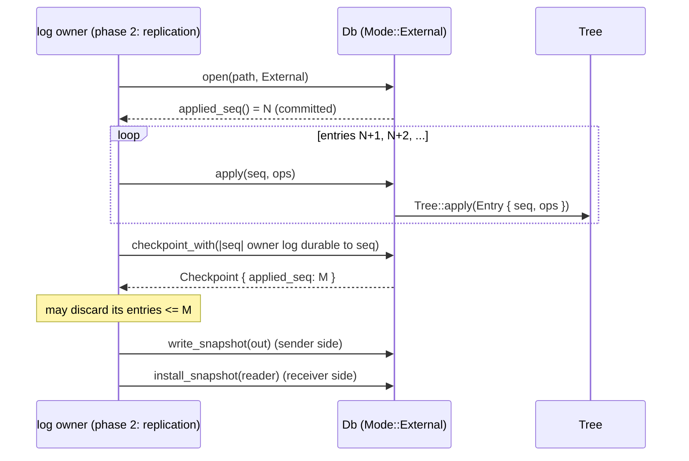
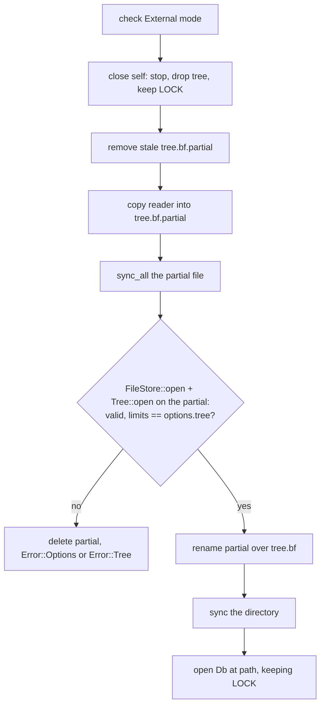

# 0022: External-log mode

**Status:** Agreed

**Design references:** [Project direction](../design/architecture.md),
[engine](../design/engine.md), [persistence](../design/bf-tree-persistence.md).

**Parent roadmap:** [BF-Tree implementation](0002-bf-tree-roadmap.md), milestone 9.

**Builds on:** [Engine `Db`](0021-engine-db.md),
[apply, log hook, and snapshots](0019-bf-tree-apply.md).

## Goal and scope

In phase 2 a replicated log (Raft or similar) orders and stores every write,
and each replica's engine applies the committed entries. That engine must not
keep a second log of its own. This stack adds `Mode::External`: a `Db` with
no WAL and no policy thread, driven by an owner that supplies sequenced
entries, decides when to checkpoint, and moves whole states between replicas
with snapshots. It fixes the contract that replication will drive.

- **In scope:**
  - `Mode::External`, `Error::WrongMode`;
  - `Db::apply(seq, ops)`, ordering and redelivery rules;
  - `Db::checkpoint_with(hook)` for the owner's own WAL-before-data;
  - `Db::install_snapshot(self, reader)`: write, sync, validate, rename,
    sync the directory, reopen;
  - leader-to-follower tests with snapshot install, catch-up, and crashes;
  - `docs/design/engine.md` (external mode, the replication contract).
- **Out of scope:** replication itself; incremental or streamed snapshots;
  switching modes on an open `Db`; a follower read protocol.
- **Done when:** a follower in external mode that installs a leader's
  snapshot and applies every later entry equals the leader; a follower that
  crashes resumes from its committed `applied_seq` and converges; a corrupt
  or mismatched snapshot is rejected and the old state stays usable; wrong-mode
  calls fail; workspace checks pass.

## Approach

### The contract



The owner's obligations, stated in the API documentation and the design
document:

1. **Order.** Call `apply` with strictly increasing sequences. Gaps are
   allowed (for example, log entries that carry no data operation).
2. **Redelivery.** After a reopen, start at `applied_seq() + 1`. Entries at or
   below the current applied sequence are acknowledged without effect.
3. **Retention.** Keep every entry above the `applied_seq` of the last
   *committed* checkpoint. Only `checkpoint` and `checkpoint_with` report it.
4. **Durability before data.** Apply only entries the owner can redeliver
   after a crash, or pass a `checkpoint_with` hook that makes them
   redeliverable before the commit. A checkpoint can capture effects of an
   entry above the committed sequence; if the owner then loses that entry,
   the replica holds part of it with nothing to complete it.

The engine's obligations:

1. `apply` is all or nothing after any crash once the owner redelivers.
2. After `open`, `applied_seq()` is the committed sequence, and the state
   equals the result of applying every entry up to it.
3. Two replicas that apply the same entries from the same snapshot hold the
   same contents (the tree's determinism, 0019).

### Mode and errors

```rust
#[derive(Clone, Copy, Debug, Default, PartialEq, Eq)]
pub enum Mode {
    #[default]
    Standalone,
    /// Another log sequences and stores writes and hands them over with
    /// `apply`. The engine keeps no WAL and runs no background thread.
    External,
}

pub enum Error {
    // ... variants from 0021 ...
    #[error("operation is not available in this mode")]
    WrongMode,
}
```

- `put`, `delete`, `write` return `WrongMode` in external mode.
- `apply`, `checkpoint_with`, `install_snapshot` return `WrongMode` in
  standalone mode. In standalone mode the engine's own WAL is the history;
  an `apply` would take sequences the WAL does not know.
- `get`, `get_with`, `range`, `scan_with`, `checkpoint`, `write_snapshot`,
  `applied_seq`, `close` work in both modes.
- `Shared::wal` becomes `Option<Wal>`; the policy thread is not started.
  `flush_interval`, `segment_bytes`, `checkpoint_wal_bytes`, and
  `checkpoint_interval` are ignored in external mode (documented).
- External `open` does not read `wal/`. If `wal/` holds segments, `open`
  returns `Error::Options("a standalone WAL exists")`: replaying it would be
  wrong for an external owner, and ignoring it silently would lose
  standalone writes. A database moves to external mode only through `close`
  (which checkpoints and leaves a WAL that replays nothing) followed by
  deleting `wal/`, or through `install_snapshot`.

### Apply

```rust
/// Apply one entry of the external log. Strictly increasing `seq`; an
/// entry at or below `applied_seq()` is ignored. Returns once applied, not
/// durable: the owner's log provides durability.
pub fn apply(&self, seq: u64, ops: &[Op<'_>]) -> Result<Applied, Error> {
    let tree = self.shared.external()?;               // WrongMode otherwise
    let _serial = self.shared.gate.write();           // one applier at a time
    if seq <= tree.applied_seq() {
        return Ok(Applied::AlreadyApplied);
    }
    
    tree.apply(Entry { seq, ops })?;
    Ok(Applied::Applied)
}

#[derive(Clone, Copy, Debug, PartialEq, Eq)]
pub enum Applied { Applied, AlreadyApplied }
```

- **Serialized.** `apply` holds the writer gate exclusive, so the check of
  `applied_seq` and the application are one step and concurrent callers
  cannot reorder entries. Readers do not take the gate. Phase-2 appliers are
  sequential anyway; the gate makes misuse safe rather than fast.
- **Skip, do not re-apply.** Re-applying an old entry over newer state is not
  harmless: an old `Put` would overwrite a newer value. Skipping makes
  redelivery idempotent from the owner's point of view.
- **Batch normalization** (0021) also applies to `ops`, so the result does not
  depend on operation order within an entry, and limits are checked before
  anything is written.
- **Watermark.** Because `apply` is serialized and the tree advances the
  applied sequence once per entry, the applied sequence is always the last
  completed entry. Gaps in the owner's sequence do not stall it.

### Checkpoints

There is no policy thread. The owner calls:

```rust
/// Commit a checkpoint. Standalone mode syncs its own WAL in the hook.
pub fn checkpoint(&self) -> Result<Checkpoint, Error>;

/// External mode only: `hook(seq)` runs before the commit with the
/// highest sequence the checkpoint may include. The owner makes its log
/// durable up to `seq`; an error aborts the commit.
pub fn checkpoint_with(
    &self,
    hook: impl FnOnce(u64) -> Result<(), Box<dyn std::error::Error + Send + Sync>>,
) -> Result<Checkpoint, Error>;
```

The engine passes the hook to `Tree::checkpoint_with` and gives the owner
`CommitPoint::captured_seq` from plan 0019: at least the sequence of every
effect in the image being committed, including an entry still in progress.
A hook error becomes `LogError::Other("external hook")` and aborts the
commit; the owner keeps its own error. The tree calls the hook holding only
its checkpointing mutex, so the hook may wait on the owner's log, but it
must not call back into this `Db`'s `apply` or `checkpoint`.

**Decision: on demand only.** The owner must coordinate log retention with
the committed sequence, so it should decide when the sequence advances. An
engine-chosen checkpoint would be safe (it only advances the committed
sequence) but would make the owner poll for it. Consequence: the store file
grows between checkpoints (0018), so the owner must checkpoint periodically.
The design document states this.

### Snapshots

The sender calls `write_snapshot(&mut dyn Write)` (0021, from 0019's
`Tree::write_snapshot`). The result is a complete store file at the last
committed checkpoint, with its `applied_seq` in the superblock.

```rust
/// Replace this database's state with a snapshot and reopen.
/// External mode only. On error the database is closed; reopen it with
/// `Db::open`. The old state stays intact unless the rename completed.
pub fn install_snapshot(self, snapshot: &mut dyn Read) -> Result<Db, Error>;
```



- **Validate before replacing.** A truncated or foreign snapshot must not
  destroy a good state. Opening the partial file as a tree checks the
  superblocks, page validation, tiling, and the limits.
- **Atomic replacement.** `rename` replaces `tree.bf` in one step. Syncing
  the partial file before the rename and the directory after it makes the
  replacement durable and never exposes a half-written store.
- **Crash during install.** Before the rename, `tree.bf` is the old state and
  a stale partial remains; `open` deletes `tree.bf.partial`. After the
  rename, the new state is in place.
- **The lock is kept** across the install so no other process opens the
  database in between.
- A fresh follower opens an empty external database at a new path and
  installs into it.

## Decisions and trade-offs

- **Same `Db` type, runtime mode** (as in 0021).
- **`install_snapshot` consumes `self`.** The tree must be closed before its
  file is replaced; ownership makes that impossible to get wrong. Cost: on
  error the caller reopens.
- **Reject `apply` at or below the applied sequence by skipping, and return
  which case happened.** The owner can count redeliveries; nothing re-applies.
- **Refuse external open over a standalone WAL.** Explicit conversion avoids
  silently discarding acknowledged standalone writes.
- **No background checkpoints in external mode.** The owner controls the
  committed sequence that bounds its log retention.
- **Expose the pre-commit hook to the owner.** Phase 2 may apply entries
  before its own log is locally durable (for example, a leader applying
  after quorum acknowledgement but before its own fsync). The hook lets it
  keep the WAL-before-data rule without the engine knowing its log.

## Extension points

This is the interface phase 2 drives. Replication adds callers, not changes:

- **Raft apply loop:** `apply(index, ops)`; `Applied::AlreadyApplied` on
  replays after restarts.
- **Log compaction:** `checkpoint_with(|seq| raft_log.sync_to(seq))`, then
  discard entries `<= checkpoint.applied_seq`.
- **Follower catch-up:** leader `write_snapshot`, follower `install_snapshot`,
  then `apply` from `applied_seq() + 1`.
- **Restart:** `open`, then resume at `applied_seq() + 1`.

Expected later additions, all additive: a streaming snapshot reader that
does not buffer the whole file, snapshot metadata (term, configuration)
carried beside the store file, a read barrier ("wait until applied ≥ n") for
follower reads, and metrics. Later plans must not need to change `apply`'s
ordering rules, the snapshot file format (it is the store format), or the
standalone path.

## Proposed commit stack

Five diffs.

### `[1/5][engine-external][plan] plan the external-log mode`

- **Purpose:** Agree on the replication contract.
- **Core changes:** This plan; link it from the roadmap's milestone 9 row.
- **Verification:** Review. Check local links.

### `[2/5][engine-external][mode] apply entries from an external log`

- **Purpose:** The external mode and its write path.
- **Core changes:** `Mode::External`, `Error::WrongMode`, `Applied`,
  `Option<Wal>`, no policy thread, `Db::apply`, `Db::checkpoint_with`, the
  standalone-WAL check in `open`.
- **Verification:** Wrong-mode errors in both directions; `apply` with
  increasing and gapped sequences; redelivered entries return
  `AlreadyApplied` and change nothing; an entry with an oversized key is
  rejected before any write; `checkpoint_with` hook error aborts the commit
  (applied sequence after reopen unchanged); external open over a WAL with
  segments is `Options`; reopen resumes at the committed sequence.

### `[3/5][engine-external][snapshot] install snapshots atomically`

- **Purpose:** Move a whole state into a replica.
- **Core changes:** `Db::install_snapshot`; stale partial removal in `open`.
- **Verification:** Install a leader's snapshot and compare contents and
  `applied_seq`; a truncated snapshot, a snapshot with flipped superblock
  bytes, and a snapshot with different limits are rejected and the old state
  reopens intact; a leftover `tree.bf.partial` is removed by `open`;
  standalone `install_snapshot` is `WrongMode`.

### `[4/5][engine-external][replica] test a leader and follower end to end`

- **Purpose:** Exercise the contract the way replication will.
- **Core changes:** Tests only. The leader is a standalone `Db`; a
  crate-private helper reads its WAL with `engine_wal::Wal::replay` to form
  the entry stream, as a log shipper would.
- **Verification:**
  - Follower installs the leader's snapshot, applies every later entry, and
    equals the leader.
  - Follower checkpoints, receives more entries, crashes by drop, reopens,
    resumes at `applied_seq() + 1`, and converges.
  - A randomized model: leader writes and batches; the follower applies
    entries with random redeliveries, checkpoints, drops, and snapshot
    reinstalls; after each step the follower equals the leader's state at the
    follower's applied sequence (an oracle replayed from the stream).

### `[5/5][engine-external][docs] document the replication contract`

- **Purpose:** Record the contract for phase 2.
- **Core changes:** `docs/design/engine.md` (external mode, obligations of
  owner and engine, snapshot install, checkpoint responsibility); this plan;
  roadmap.
- **Verification:** Workspace checks; local links.

## Open questions

None.

Resolved (review, 2026-11-07):

- **Interval checkpoints in external mode: none.** The owner is fully
  responsible for checkpointing: the checkpoint's `applied_seq` is where
  its log may be truncated and a follower resumes, and an engine-driven
  checkpoint would have no owner hook. The design document states that the
  store file grows between checkpoints, so the owner must checkpoint
  periodically.
- **Snapshot reader shape: `&mut dyn Read`; chunked transfer deferred.**
  A resumable, offset-based transfer can be added later as a second
  method; the snapshot is a store file with fixed offsets, so this is
  additive.

## Verification strategy

| Check | Command or procedure | Expected result |
| --- | --- | --- |
| Convergence | Leader/follower test and randomized model | Follower equals leader state at its applied sequence |
| Redelivery | Apply duplicates after reopen | `AlreadyApplied`; contents unchanged |
| Snapshot safety | Truncated, corrupt, mismatched snapshots; crash before rename | Rejected; old state intact; partial removed |
| Modes | Every method in both modes | Documented subset succeeds; others `WrongMode` |
| Hook | `checkpoint_with` hook error | Commit aborted; committed sequence unchanged |
| Workspace | `tools/fmt.sh`; `tools/clippy.sh`; `tools/buck2 test //crates/... //bin/... //go/...`; `tools/autocargo --check`; `tools/gobuckify-remote --check`; `cargo test --workspace --locked`; `(cd go && go vet ./... && go test ./...)` | All pass |

## Progress

- [x] Agree on the design and commit stack with the user.
- [x] Diff 2: external mode and `apply`.
- [x] Diff 3: snapshot install.
- [x] Diff 4: leader/follower tests.
- [ ] Diff 5: documentation.
- [ ] Stack-wide verification.

## Discoveries and plan changes

- **A hook error returns the owner's own error.** The plan converted it to
  `LogError::Other("external hook")`, which loses the owner's error. The
  engine keeps the boxed error from the hook and returns it as the new
  `Error::Hook`; the tree still sees `LogError::Other("external hook")`
  and commits nothing.
- **`Db::apply` takes `engine::Op`, a re-export of `bf_tree::Op`.** The
  plan's `Op` was unqualified; the engine re-exports the tree's type, so
  an owner needs no other crate.
- **`apply` normalizes by key after the redelivery check.** A redelivered
  entry is skipped before its operations are examined.
- **`Db` implements `Debug`.** `install_snapshot` returns `Result<Db, _>`,
  and the tests (and callers) need `unwrap_err` on it; the output shows
  the path, the mode, and the applied sequence.
- **The stream is read while the leader stays open.** Reopening the
  leader would seal its segment and truncate it below the committed
  sequence, so the tests keep the leader open with one 1 GiB segment and
  read its WAL between phases, when every write is acknowledged and the
  WAL has no torn tail for replay to repair.

## Agent notes

- **Entry points:** `crates/engine/src/lib.rs` and the `Db` module from 0021;
  `Tree::write_snapshot` and `Tree::apply` (0019).
- **Gotchas:**
  - `rename` over an existing file is atomic on POSIX file systems; sync the
    directory with `File::open(dir)?.sync_all()`.
  - Close the old tree (drop its `FileStore`) before the rename so no handle
    writes to the replaced inode.
  - Keep the `LOCK` file handle alive across `install_snapshot`.
  - The leader's WAL helper must replay from 1 with no truncation, or the
    test stream misses entries; set large `segment_bytes` on the leader.

## Sources

- [ZippyDB engineering overview](../references.md#zippydb-engineering-overview):
  the replicated log driving per-replica storage engines.
- [BF-Tree paper](../references.md#bf-tree-paper), §5.7.
- [Microsoft implementation](../references.md#microsoft-bf-tree-implementation)
  at `f442e6172bf7e5483ff320d8e3ac16a70e31bbd6`:
  [`doc/snapshot-recovery.md`](https://github.com/microsoft/bf-tree/blob/f442e6172bf7e5483ff320d8e3ac16a70e31bbd6/doc/snapshot-recovery.md).
