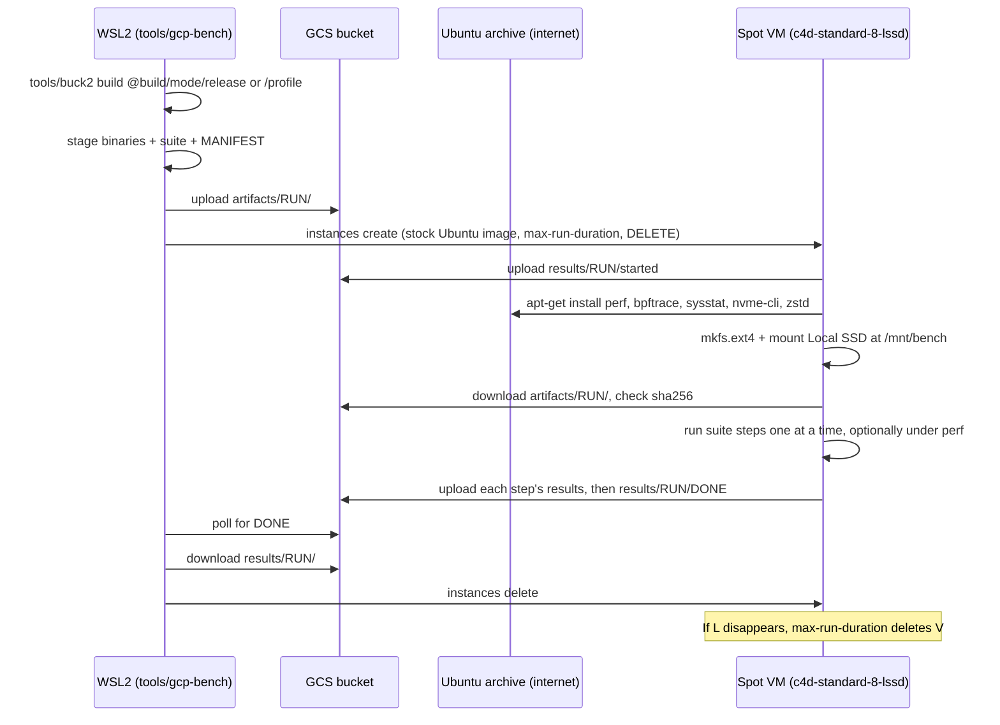

# 0024: Remote benchmarks and profiling on GCP

**Status:** Complete

**Design references:** [build system](../design/build-system.md),
[persistence](../design/bf-tree-persistence.md#measurements),
[concurrency](../design/bf-tree-concurrency.md#linux),
[engine](../design/engine.md#measurements). A new design document,
`docs/design/remote-benchmarks.md`, is part of this stack.

**Builds on:** [Direct I/O and performance](0023-bf-tree-io-perf.md). This
stack builds the tool that runs 0023's benchmarks in its environment 3
("GCP with a Local SSD (NVMe), reference"), and the profiling that 0023's
follow-up asks for. Running the tool and recording reference numbers and
profiles are 0023's follow-up, not part of this stack.

## Goal and scope

Plan 0023 recorded every measurement in Docker on macOS and labelled the
numbers "indicative". The design documents need reference numbers from
real NVMe on x86_64 Linux, and 0023 left open questions (for example, why
put scaling peaks at 4 threads) that need profiles to answer. Later work
adds gateways and servers, which will need the same measurement and deep
profiling. This stack adds one command that builds locally, runs a suite of
workloads on a short-lived GCP VM with optional profiling, collects the
results, and deletes the VM.

The command runs only from the WSL2 development environment: Ubuntu 24.04 on
x86_64 (AMD Ryzen 9 7950X3D). That host has the same architecture and the
same OS release as the VM image, so Buck2 builds the binaries natively and
no cross-compilation or emulation is necessary.

- **In scope:**
  - `tools/gcp-bench`: a local driver. It builds test binaries with
    `tools/buck2`, uploads them to Google Cloud Storage (GCS), creates a VM,
    waits for results, downloads them, and deletes the VM.
  - `tools/gcp/remote-bench.sh`: the VM startup script. It formats and mounts
    the Local SSD, downloads and checks the binaries, runs a suite, records
    the environment, and uploads the results to GCS.
  - Suites: data files that list the workloads to run. The first suite is
    0023's benchmarks.
  - Profiling: software counters (`perf stat`), CPU sampling with call
    stacks (`perf record`), and off-CPU time (time that threads spend
    blocked, for example on locks), selected per run.
  - A `profile` build mode: release optimization plus debug line tables and
    frame pointers, so that profiles have readable stacks.
  - Installation of the profiling and inspection tools from the Ubuntu
    archive at boot.
  - Teardown that does not depend on the local machine staying awake.
  - A `cleanup` subcommand that deletes leftover VMs and disks.
  - A design document for the workflow.
- **Out of scope:**
  - Other local hosts, including macOS. The driver refuses to build on a
    host that is not x86_64 Ubuntu 24.04 (except in `--dry-run`, where it
    warns).
  - Changes to the benchmarks.
  - Multi-VM runs (for example, a server VM and a client VM). The suite
    format and the GCS layout leave room for them (see Extension points).
  - Creating projects, buckets, service accounts, or IAM bindings. The user creates them by hand. The design document lists what
    the tool expects.
  - Flame-graph rendering in the tool. `perf script` output opens directly
    in viewers such as speedscope or `inferno`.
  - CI integration.
- **Done when:**
  - `tools/gcp-bench --dry-run run` prints the complete, correct `gcloud`
    command sequence without contacting GCP.
  - The remote script passes an offline end-to-end run with stub `gcloud`,
    `apt-get`, `perf`, and `bpftrace` commands, with and without profiling.
  - On WSL, `tools/gcp-bench build` stages x86_64 binaries, in `release` and
    `profile` modes, whose only dynamic dependencies are present on the
    stock Ubuntu 24.04 image.
  - The workspace checks pass.
  - The first live run is done by the user, not by an agent.

## Approach

### Flow



### Build

The driver checks the host first: `uname -sm` must be `Linux x86_64`, and
`/etc/os-release` must report Ubuntu 24.04. Then it builds and copies the
outputs:

```sh
tools/buck2 build "@build/mode/$MODE" $TARGETS --show-full-output |
    while read -r target path; do
        cp "$path" ".peppydb-bench/$RUN_ID/bin/${target##*:}"
    done
```

`$MODE` is `release` for runs without profiling and `profile` for runs with
it. `.peppydb-bench/` is added to the repository's ignore file. As 0023
states for WSL2, the checkout must be on the Linux file system, not under
`/mnt/c`.

### Profile build mode

`@build/mode/profile` selects a new platform `//build:profile` with a new
`build_mode` value `mode-profile`. The Rust toolchain adds flags to the
release flags:

```python
PROFILE_FLAGS = [
    "-Cdebuginfo=line-tables-only",   # symbols, inlined frames, source lines
    "-Cforce-frame-pointers=yes",     # cheap, reliable stack walks in perf
]

rustc_flags = ["-Dunsafe_code"] + select({
    "root//build:mode-release": RELEASE_FLAGS,
    "root//build:mode-profile": RELEASE_FLAGS + PROFILE_FLAGS,
    "DEFAULT": [],
}),
```

- Release builds do not change. Reference numbers always come from
  `release` builds; profiles come from `profile` builds. Frame pointers
  cost a few percent, so the two kinds of numbers must not be mixed, and
  results record the mode.
- The precompiled standard library may lack frame pointers, so stacks that
  pass through it can be cut short. The runner records frame-pointer stacks
  by default and offers DWARF unwinding (`--call-graph dwarf`) as a
  fallback. The first profile shows whether the fallback is necessary
  (recorded under Discoveries).

### Suites

A suite is a plain-text file in `tools/gcp/suites/`. Each line is one step:
a name, a binary, and its arguments. The runner runs the steps in order,
one at a time.

```text
# tools/gcp/suites/bf-io-perf.txt: the benchmarks of plan 0023.
preflight-store   bf-tree-store-unittest           --nocapture --test-threads=1 tests::direct::
preflight-tree    bf-tree-unittest                 --nocapture --test-threads=1 tests::open::a_tree_over_a_direct_store
preflight-engine  engine-unittest                  --nocapture --test-threads=1 tests::io::
bf-tree-bench     bf-tree-unittest                 --ignored --nocapture --test-threads=1 tests::bench::
bf-tree-bench-io  bf-tree-unittest                 --ignored --nocapture --test-threads=1 tests::bench_io::
cb-bench          bf-tree-circular-buffer-unittest --ignored --nocapture --test-threads=1 tests::bench::
engine-bench      engine-unittest                  --ignored --nocapture --test-threads=1 tests::bench::
wal-bench         engine-wal-unittest              --ignored --nocapture --test-threads=1 tests::bench::
```

- The driver derives the Buck2 targets from the binaries that the suite
  names, so a new suite needs no driver change.
- `--test-threads=1` makes sure that two benchmarks never run at the same
  time.
- Steps whose names start with `preflight-` stop the run if they fail.
  Other failed steps are recorded, and the run continues.
- Every filter is a module path (`tests::direct::`), never a bare
  substring, so that a filter cannot match unrelated tests (see Agent
  notes).
- A direct-I/O test that finds a file system without `O_DIRECT` support
  prints `skipped: ... rejects O_DIRECT` and passes (0023). On the VM a skip
  means that the Local SSD setup is wrong, so the runner fails a
  `preflight-` step whose output contains `skipped:`. This is why the
  preflight steps use `--nocapture`: libtest hides the output of passing
  tests otherwise.
- `--step NAME` (repeatable) runs a subset of the suite.

Thread counts need no change: `thread_counts()` in the `bf-tree` and
`engine` benchmarks is 1, 2, 4, 8, and `available_parallelism()`, which is
8 on this VM, and `bench_wal_append` uses 1 and `available_parallelism()`.
`bench_wal_recovery` uses 32 threads only to write its records; it times
the single-threaded reopen. Results state that 8 threads are 8 SMT threads
on 4 cores.

### Profiling

`--profile` takes a comma-separated list of profilers. Each step runs once
per profiler, so that profilers do not distort each other, and once without
a profiler only when `none` is in the list. Default: `none`.

| Profiler | Command on the VM (sketch) | Output | Answers |
| --- | --- | --- | --- |
| `none` | the step itself | `<step>.log` | Throughput and latency numbers |
| `stat` | `perf stat -x, -e task-clock,context-switches,cpu-migrations,page-faults -- …` | `<step>.stat.csv` | CPU use, context switches, migrations, page faults |
| `record` | `perf record -e cpu-clock -F 999 --call-graph fp -o <step>.perf.data -- …`, then `perf script` and `perf report --stdio` | `<step>.perf.data.zst`, `<step>.perf-script.txt.zst`, `<step>.report.txt` | Where CPU time goes |
| `offcpu` | the step, with `bpftrace offcpu.bt <pid>` attached | `<step>.offcpu.folded` | Where threads block: locks, I/O, `fsync` |
| `sched` | `perf sched record -- …`, then `perf sched latency` | `<step>.sched.txt` | Run-queue delays and wakeups |

- `--call-graph dwarf` replaces `fp` with `--profile record-dwarf`.
- `tools/gcp/offcpu.bt` is a `bpftrace` script in the repository. It
  records the user and kernel stack of each thread that leaves the CPU,
  sums the time until it runs again, and prints folded stacks. The driver
  uploads it with the binaries. `bpftrace` uses the kernel's built-in type
  information (BTF), which Ubuntu kernels include, so no kernel headers
  are needed.
- The VM sets `kernel.perf_event_paranoid=-1` and `kernel.kptr_restrict=0`
  so that kernel frames are symbolized.
- `perf.data` can be large. The runner compresses it with `zstd` and also
  uploads the text forms, which are readable without the binaries.
- **No hardware counters on C4D (user test, 2026-11-08).** Hardware
  counters (cycles, instructions, cache and branch misses) need the CPU's
  performance monitoring unit (PMU) inside the VM. `gcloud compute
  instances create` rejected `c4d-standard-8-lssd` with
  `--performance-monitoring-unit` set to `enhanced`, `standard`, and
  `architectural`, with the error "performance monitoring unit is not
  supported for c4d-standard-8-lssd on API version v1". `gcloud beta`
  rejected it too. So every profiler uses software events and
  tracepoints:
  - `record` samples with the `cpu-clock` timer. User-space profiles are
    accurate. Kernel code that runs with interrupts disabled cannot be
    sampled, so kernel time is undercounted.
  - `offcpu` and `sched` use BPF and scheduler tracepoints, which do not
    need the PMU.
  - Instructions per cycle (IPC), cache misses, and branch misses are not
    available on the reference machine. Counter-level analysis needs other
    hardware (see Extension points).
- The driver does not pass `--performance-monitoring-unit`. The runner
  still checks `perf stat -e cycles true` and records `pmu: available` or
  `pmu: unavailable` in `env.txt`, so that a change in GCP support is
  visible.

### Tools on the VM

The VM has an external IP and reaches the internet (see Network). The
remote script installs the tools it needs from the Ubuntu archive at boot:

```sh
systemctl stop unattended-upgrades apt-daily.timer apt-daily-upgrade.timer
snap refresh --hold
apt-get -o DPkg::Lock::Timeout=600 update
apt-get -o DPkg::Lock::Timeout=600 install -y --no-install-recommends \
    "linux-tools-$(uname -r)" linux-tools-common bpftrace sysstat nvme-cli zstd
```

- **Only tools come from the internet.** Every binary that is measured or
  profiled comes from the local Buck2 build, through GCS, and its sha256
  is checked against the manifest (review, 2026-11-08).
- **`perf` matches the kernel by construction,** because the package name
  uses the running kernel's version (`uname -r`).
- **Background jobs are stopped first.** `unattended-upgrades` and the apt
  timers would otherwise hold the package lock at boot and could run
  during a benchmark. Snap refreshes are held for the same reason. They
  stay stopped until the VM is deleted.
- **Versions are recorded.** `env.txt` lists the image name, the kernel,
  and the installed versions of the tools.
- **A failed install** stops the run (`DONE` with a failure status) when
  any profiler is selected. Without profiling, the run continues, and
  `env.txt` omits the fields that need the missing tools.
- The installation takes about a minute. The VM bills for it, at Spot
  prices.

### Manifest

The driver writes `MANIFEST` next to the binaries. The VM refuses to run if
a checksum does not match. Each result set can be traced to its source.

```text
run_id=20261108T153000Z-1a2b3c4d
revision=1a2b3c4d5e6f...        # sl whereami
dirty=false                     # sl status is empty
rustc=rustc 1.xx.0 (...)
build_mode=release              # or profile
build_host=Linux x86_64, Ubuntu 24.04
suite=bf-io-perf
profile=none
machine_type=c4d-standard-8-lssd
image=ubuntu-2404-lts-amd64 (resolved name in env.txt)
sha256 bf-tree-unittest=...
...
```

A dirty working copy is allowed, but the manifest records it, and the
driver prints a warning.

### GCS layout

```text
gs://$BUCKET/peppydb-bench/artifacts/$RUN_ID/
  MANIFEST
  suite.txt
  offcpu.bt
  bin/<binary>...
gs://$BUCKET/peppydb-bench/results/$RUN_ID/
  started                        # written first; the VM booted and has GCS access
  env.txt                        # CPU, kernel, image, tool versions, PMU, mounts, device
  <step>.log                     # stdout and stderr of an unprofiled step
  <step>.<profiler>.*            # profiler outputs (see Profiling)
  startup-script.log             # the whole remote script's output
  status                         # per-step, per-profiler exit codes
  DONE                           # written last; contains the overall status
```

`RUN_ID` is a UTC timestamp and the short source revision. Artifacts and
results are under separate top-level prefixes, because a lifecycle rule
can match an object name prefix but not a pattern in the middle of a name.

### Retention

The bucket deletes uploaded binaries after 7 days and results after
14 days (review, 2026-11-08). A bucket lifecycle configuration does this;
the tool never deletes objects itself. The repository keeps the
configuration in `tools/gcp/lifecycle.json`:

```json
{
  "rule": [
    {
      "action": { "type": "Delete" },
      "condition": { "age": 7, "matchesPrefix": ["peppydb-bench/artifacts/"] }
    },
    {
      "action": { "type": "Delete" },
      "condition": { "age": 14, "matchesPrefix": ["peppydb-bench/results/"] }
    }
  ]
}
```

- The user applies it by hand when creating the bucket:
  `gcloud storage buckets update gs://$BUCKET --lifecycle-file=tools/gcp/lifecycle.json`.
- `age` counts whole days from each object's creation. GCS applies the
  rule asynchronously, so an object can remain for up to about a day
  after it becomes eligible.
- Before it uploads anything, the driver reads the bucket's lifecycle
  configuration (read-only, as JSON) and compares it with
  `tools/gcp/lifecycle.json` semantically, not as text: the API returns
  the rules with its own key order, formatting, and extra fields. The
  check reduces both sides to a set of `(action type, age, prefix)` tuples
  and requires the two tuples of `lifecycle.json` to be present. A rule that
  deletes objects under `peppydb-bench/` earlier than these ages also fails
  the check. Other rules produce a warning. If the check fails, the driver
  stops with the command to apply the file.
- The comparison is a short `python3` program inside the driver. `python3`
  is a dependency of the driver: it is present on Ubuntu 24.04, and the
  Buck2 prelude already requires it. The driver also uses it to read the
  instance JSON in the read-back check. No `jq` dependency.
- The local copy in `.peppydb-bench/$RUN_ID/results/` is not affected.
  Results that matter go into the design documents, as 0023 requires.

### VM

```sh
gcloud compute instances create "peppydb-bench-$RUN_ID" \
    --project="$PROJECT" --zone="$ZONE" \
    --machine-type=c4d-standard-8-lssd \
    --provisioning-model=SPOT \
    --image-family=ubuntu-2404-lts-amd64 --image-project=ubuntu-os-cloud \
    --boot-disk-type=hyperdisk-balanced --boot-disk-size=20GB \
    --boot-disk-auto-delete \
    --service-account="peppydb-bench@$PROJECT.iam.gserviceaccount.com" \
    --scopes=cloud-platform \
    --labels=peppydb-bench=1,run=$RUN_LABEL \
    --max-run-duration="$MAX_RUN" --instance-termination-action=DELETE \
    --metadata=peppydb-bucket="$BUCKET",peppydb-run-id="$RUN_ID" \
    --metadata-from-file=startup-script=tools/gcp/remote-bench.sh
```

- **Machine type.** `c4d-standard-8-lssd`: 8 vCPUs (4 cores with 2 SMT
  threads each), about 31 GB of RAM, and one Titanium Local SSD, which the
  guest sees as NVMe. C4D supports only Hyperdisk for the boot disk.
  `--machine-type` overrides the default.
- **Region: `us-east1` only (review, 2026-11-08).** The bucket is in
  `us-east1`, so the VM must be too. Transfers between the VM and the
  bucket then stay in one region, and every reference run comes from the
  same region. The driver tries `us-east1-b us-east1-c us-east1-d` in
  order and moves to the next zone when creation fails for capacity or
  availability. `--zone` selects a zone, but the driver refuses a zone
  outside `us-east1`. Zones of one region can still differ in hardware
  details, so `env.txt` records the zone and the CPU model, and comparisons
  between runs must check both. If no zone has capacity, the driver fails
  and reports each zone's error; Spot capacity in one region can run out,
  and `--on-demand` is the fallback.
- **Spot by default.** `--on-demand` selects an on-demand VM. If GCP
  reclaims a Spot VM, the VM is deleted (`DELETE`). The partial results stay
  in GCS, and the driver reports that the run was preempted.
- **Image.** The stock Ubuntu 24.04 image, the same release as the build
  host. `--image NAME` selects an exact image, for example to repeat a run
  on the same kernel. `env.txt` records the resolved image name.
- **Network: an ephemeral external IP (review, 2026-11-08).** The VM
  installs tools from the Ubuntu archive at boot, so it needs internet
  access. An ephemeral external IP gives it that, and also reaches GCS,
  so no subnet setting is needed. The IP bills a small hourly fee while
  the VM exists. The tool adds no firewall rules. On the `default` network
  the standard rules allow inbound SSH from anywhere; the VM has no SSH
  keys from the tool, and it lives only for the run.
- **No SSH.** The driver never connects to the VM.
- **Least privilege.** A dedicated service account has
  `roles/storage.objectUser` on the bench bucket only. It has no Compute
  permissions, so the VM cannot create or delete resources.

### Remote script

`tools/gcp/remote-bench.sh` runs as root at boot. Steps, in order:

1. If `/var/lib/peppydb-bench/started` exists, stop. Startup scripts run on
   every boot; a reboot must not start a second run.
2. Read `peppydb-bucket`, `peppydb-run-id`, and `peppydb-profile` from the
   metadata server, and upload `results/$RUN_ID/started`.
3. Install the tools from the internet (see "Tools on the VM").
4. Find the Local SSD (`/dev/disk/by-id/google-local-nvme-ssd-0`), format it
   as ext4, and mount it at `/mnt/bench`. Record the `mkfs` and mount
   options.
5. Download `peppydb-bench/artifacts/$RUN_ID/` from GCS, check every sha256
   from `MANIFEST`, and `chmod +x` the binaries.
6. Write `env.txt`: `lscpu`, `nproc`, `free -g`, `uname -a`,
   `/etc/os-release`, the image name, the tool versions,
   `findmnt /mnt/bench`, `lsblk -o NAME,MODEL,SIZE,ROTA`, `nvme id-ctrl`,
   the PMU check, the machine type and zone from the metadata server, the
   build mode, and "virtual machine: yes". 0023 requires these fields.
7. Run the suite. For each step and each selected profiler, run the
   profiler's command with `PEPPYDB_BENCH_DIR=/mnt/bench` and the
   `PEPPYDB_BENCH_*` variables from metadata. Append the exit code to
   `status`, and upload the step's outputs as soon as it ends, so a VM that
   is deleted early still leaves partial results.
8. Upload `startup-script.log` and `status`, then `DONE` last.

A failure in step 2, 4, or 5, in step 3 when profiling is selected, or in
a `preflight-` step writes `DONE` with a failure status, so the driver
stops waiting immediately.

### Teardown

The goal is that no VM runs after its results exist, and that no VM outlives
a fixed limit, even if the local machine sleeps, loses the network, or
crashes.

| Layer | Mechanism | Covers |
| --- | --- | --- |
| 1 | The driver deletes the instance after `DONE` appears, and in an `EXIT`/`INT`/`TERM` trap | Normal completion, Ctrl-C, driver errors |
| 2 | `--max-run-duration` with `--instance-termination-action=DELETE` (default `3h`, set by `--max-run`) | Local machine asleep or offline, driver killed, WSL shut down |
| 3 | `tools/gcp-bench cleanup` deletes every instance with the label `peppydb-bench=1`, in any state, and disks whose names start with `peppydb-bench-` | Anything else; the driver also lists leftovers at the end of every command |

- The boot disk has `auto-delete`, and the Local SSD belongs to the instance,
  so deleting the instance removes all billed compute and disk resources.
  Only GCS objects stay.
- The driver polls every 30 seconds, so a VM is idle for at most about
  30 seconds plus the delete time after its results exist.

**The wait loop always ends.** On each poll the driver checks both GCS and
the instance, and it stops at the first of these conditions:

| Condition | Meaning | Driver action |
| --- | --- | --- |
| `results/$RUN_ID/DONE` exists | The run finished (success or failure) | Download results, delete the VM, report the status in `DONE` |
| The instance does not exist, and there is no `DONE` | Preempted, deleted by the time limit, or deleted by someone else | Download partial results, report "VM gone without DONE" and the preemption flag from the zone's operations list (read-only), exit nonzero |
| The instance is `TERMINATED` or `STOPPED`, and there is no `DONE` | The guest powered off or crashed | Download partial results, delete the VM, exit nonzero |
| No `results/$RUN_ID/started` object 15 minutes after creation | The VM did not boot, or the startup script did not run (bad image, boot failure, no GCS access) | Save the serial port output to the results directory (read-only), delete the VM, exit nonzero |
| `--max-run` plus 10 minutes have passed | A last resort, whatever the other checks say | Download partial results, delete the VM, exit nonzero |

The remote script uploads `started` as soon as it has read its metadata
(step 2), before the tool installation and the disk setup.

- The guest does not stop itself.
- `--keep` skips Layer 1, for debugging. Layer 2 still applies.

**Guards for the remaining failure modes:**

- *The time limit is missing from a created VM* (for example, because of a
  bug in the driver). After creation, the driver reads the instance back
  and checks `scheduling.maxRunDuration` and
  `scheduling.instanceTerminationAction=DELETE`. If either is missing, the
  driver deletes the instance at once and fails.
- *A create call fails on the client but succeeds on the server* (for
  example, a timeout during zone fallback). Every create request carries
  the time limit, so such a VM still deletes itself. After any create
  failure, the driver also lists `peppydb-bench` instances in all zones
  and deletes any that it did not expect.
- *The instance stops instead of being deleted* (for example, the guest
  powers off). A stopped instance bills no vCPUs or RAM, but its boot disk
  still bills, and it is not certain that the time limit deletes a stopped
  instance. The driver and `cleanup` delete instances in any state.
- *The account outlives the tool.* The design document recommends a billing
  budget with an alert on the project. A budget does not stop resources; it
  makes a leak visible.

### Driver interface

```text
tools/gcp-bench build [--suite S] [--profile P]   Build and stage; no GCP access.
tools/gcp-bench run   [options]                   build, upload, create, wait, download, delete.
tools/gcp-bench cleanup                           Delete leftover instances and disks.

Options:
  --project P        default: $PEPPYDB_GCP_PROJECT, then gcloud config
  --bucket B         default: $PEPPYDB_GCS_BUCKET (required)
  --suite S          default: bf-io-perf (tools/gcp/suites/S.txt)
  --step NAME        run only this step (repeatable)
  --profile P,...    none, stat, record, record-dwarf, offcpu, sched; default: none
  --zone Z           try only this zone (repeatable)
  --machine-type M   default: c4d-standard-8-lssd
  --image NAME       default: newest image in family ubuntu-2404-lts-amd64
  --max-run D        default: 3h
  --on-demand        use an on-demand VM instead of Spot
  --keep             do not delete the VM at the end (Layer 2 still applies)
  --dry-run          print every gcloud command; build locally; contact nothing
```

Results are downloaded to `.peppydb-bench/$RUN_ID/results/`. The driver
prints the path and the summary from `status`. It exits with a nonzero
status if any step failed.

The driver is a POSIX `sh` script, as `tools/linux-run` is. `gcloud` comes
from the user's `PATH` and is not pinned; the driver records its version in
the run log.

## Extension points

- **New workloads** (gateways, servers, load generators) are new suites and
  new Buck2 targets. A step's binary can be any staged executable, not only
  a test binary. The driver and the runner do not change.
- **Multi-VM runs.** A later plan can add roles to the suite format (for
  example, `server` and `client` steps), create one VM per role in the same
  zone, and connect them through internal IPs.
  The GCS layout extends to `results/$RUN_ID/<role>/`. Each role uses the
  same profilers and the same teardown guards.
- **Hardware counters.** C4D does not expose the PMU. Counter-level work
  (IPC, cache misses, AMD instruction-based sampling) needs a machine that
  does: a GCP machine series that supports `--performance-monitoring-unit`
  (a different CPU from the reference), or bare-metal Linux on the
  development machine (Zen 4). WSL2 runs under Hyper-V and usually does not
  expose the PMU; `perf stat -e cycles true` inside WSL2 shows whether it
  does. Either
  is a `--machine-type` or a separate host, chosen in a later plan.
- **More profilers** are new rows in the profiler table: a command template,
  an output name, and any new package in the install list.

## Decisions and trade-offs

- **Build natively on WSL2 (review, 2026-11-08).** All runs start from the
  WSL2 environment (Ubuntu 24.04, x86_64), which matches the VM's
  architecture and OS release. Alternatives: an emulated `linux/amd64`
  container on macOS, native Buck2 cross-compilation, or building on the
  VM. The first two are unnecessary because no run starts from macOS; the
  third is rejected by the requirement and bills the VM for build time.
- **Tools from the internet, binaries from the local build (review,
  2026-11-08).** The VM boots, installs tools from the Ubuntu archive, and
  then downloads the locally built artifacts from GCS. Every measured or
  profiled binary comes from the local build.
  - *Alternative: no external IP, with Private Google Access.* The VM
    could then reach only Google services, so the tools would have to
    come from a custom image or from `.deb` packages shipped as artifacts.
    A custom image needs a builder VM, image storage, and pruning;
    shipped packages must match the VM's kernel and installed libraries.
    Both cost much more than an external IP.
  - *Alternative: Cloud NAT.* Internet access without an external IP, but
    a paid service with more setup.
  - Cost of the choice: tool versions follow the Ubuntu archive and can
    change between runs (recorded in `env.txt`), a run depends on the
    archive being reachable, and the VM is reachable from the internet
    while it exists.
- **Profiling in this stack (review, 2026-11-08).** Gateways and servers
  will need deep profiling, and 0023's open questions need it now.
- **Separate `release` and `profile` builds.** Frame pointers change the
  code slightly, so reference numbers come only from `release` builds.
- **One profiler per execution of a step.** Running `perf record` and
  off-CPU tracing together would distort both. The cost is a longer run.
- **Suites as data.** Adding a workload must not need a driver change.
- **GCS as the only channel.** No SSH, no keys, no firewall rules, and no
  dependency on the local connection during the run. The cost is a polling
  delay of up to 30 seconds.
- **Delete, not stop.** Deletion removes the boot disk and Local SSD
  charges. A stopped VM keeps billing for its disk.
- **Shell, not Go.** The work is a sequence of `gcloud`, `tools/buck2`, and
  `perf` commands. The repository's other tools are shell scripts. The
  offline stub tests cover the logic.
- **A fresh ext4 file system on the Local SSD.** It matches the 0023 Docker
  setup (ext4), so the environments are comparable.
- **Spot by default (review, 2026-11-08).** Spot hardware is the same as
  on-demand, so measurements are unaffected. A reclaimed VM loses only the
  step that was running.
- **Wait-loop exit conditions (review, 2026-11-08).** Polling only for
  `DONE` could wait forever if the VM never booted. The driver watches the
  instance and a boot marker too, and has an absolute deadline.
- **Semantic lifecycle check with `python3` (review, 2026-11-08).** A
  textual comparison would never match the API's JSON.
- **Never the default Compute Engine service account.** Every VM runs as
  the bucket-scoped `peppydb-bench@` account. The default account has the
  Editor role in a new project.
- **GCP resources are created by hand (review, 2026-11-08).** The project,
  bucket, lifecycle rule, service account, and IAM bindings. The tool
  creates only VMs and their disks.

## Proposed commit stack

Six diffs.

### `[1/6][gcp-bench][plan] plan remote benchmarks and profiling on GCP`

- **Purpose:** Agree on the tool, profiling, the teardown guarantees, and
  the stack.
- **Core changes:** This plan. A link from 0023's follow-up checkbox.
- **Verification:** Review. Check local links.

### `[2/6][gcp-bench][tools] add the remote suite runner`

- **Purpose:** Run a suite on the VM and report through GCS.
- **Core changes:** `tools/gcp/remote-bench.sh` (steps 1 to 8 of "Remote
  script", with the `none` profiler only); `tools/gcp/suites/bf-io-perf.txt`.
  Test overrides: `PEPPYDB_REMOTE_NO_MKFS=1` and `PEPPYDB_BENCH_DIR`.
  Stubs in `tools/gcp/testing/`: `gcloud` (`storage cp` and `storage ls`
  on a local directory, and fake metadata answers), and `apt-get`,
  `systemctl`, and `snap`, which record their arguments.
- **Verification:** An offline end-to-end run in `tools/linux-run` with the
  stubs, staged binaries, and `PEPPYDB_BENCH_MILLIS` set low: `started`
  first, the install commands in order, every result file, and `DONE`. A
  corrupted binary stops the run at the checksum step with a failed
  `DONE`. A failing `preflight-` step stops the run; another failing step
  does not. A preflight step that prints `skipped:` fails. A failed install
  without profiling continues. A second start of the script does nothing.

### `[3/6][gcp-bench][tools] add the gcp-bench driver`

- **Purpose:** The single local command, for unprofiled runs.
- **Core changes:** `tools/gcp-bench` with `build`, `run`, `cleanup`, and
  `--dry-run`: the host check, suite-to-target mapping, the manifest, the
  zone fallback within `us-east1`, the trap-based deletion,
  `--max-run-duration` with `DELETE` and its read-back check, the wait
  loop with all its exit conditions, download, the leftover check, and the
  lifecycle check. `tools/gcp/lifecycle.json`. `.peppydb-bench/` in the
  ignore file.
- **Verification:** `--dry-run build` in the Linux container stages binaries
  and a correct `MANIFEST` (the host check warns there). `--dry-run run
  --bucket example` prints the expected sequence, including the delete in
  the trap path (checked by sending `INT` during the simulated wait). The
  wait-loop, lifecycle, and region checks in the verification table.
  `--dry-run cleanup` prints the label-filtered list and the deletes.
  `build` without `--dry-run` on macOS refuses. `sh -n` on every script.

### `[4/6][gcp-bench][build] add the profile build mode`

- **Purpose:** Readable stacks in profiles, without changing release builds.
- **Core changes:** `mode-profile` and `//build:profile` in `build/BUCK`;
  `build/mode/profile`; `PROFILE_FLAGS` in `build/toolchains/BUCK`;
  `tools/autocargo` output if it changes; the build-system design document.
- **Verification:** `tools/buck2 build @build/mode/profile
  //crates/bf-tree:bf-tree-unittest` succeeds; the output has
  `.debug_line`; release outputs are unchanged (same action digests). On
  WSL: `objdump -d` shows frame-pointer prologues. Workspace checks.

### `[5/6][gcp-bench][tools] profile suite steps`

- **Purpose:** CPU profiles, off-CPU profiles, scheduler latency, and
  software counters on the VM.
- **Core changes:** `--profile` in the driver (selects the `profile` build
  mode, passes the profiler list in metadata, and uploads `offcpu.bt`);
  `tools/gcp/offcpu.bt`; in the runner, the profiler commands, the PMU
  check, the `sysctl` settings, compression, and uploads.
- **Verification:** An offline run with stub `perf` and `bpftrace` commands
  that record their arguments: each profiler wraps each step once, with the
  expected arguments and outputs. A failed install with profiling stops
  the run. `--profile none` behaves as in diff 2. `--dry-run run --profile
  stat,record` builds in `profile` mode and does not pass
  `--performance-monitoring-unit`. `bpftrace -d` cannot run in the
  container, so `offcpu.bt` is reviewed and checked on the first live run.
  Real `perf` cannot run in the Docker container (0023: the default
  seccomp profile blocks `perf_event_open`), so the first live run checks
  the real profilers.

### `[6/6][gcp-bench][docs] document remote benchmarks and profiling`

- **Purpose:** Record the workflow and its guarantees for later users.
- **Core changes:** `docs/design/remote-benchmarks.md`: the flow, the
  teardown guarantees, the GCS layout and retention, how results are
  labelled ("GCP c4d-standard-8-lssd, reference" for `release`; "profile"
  for `profile`), the WSL2 build host requirement, the tool installation,
  the profilers and how to read their outputs, the extension points, and
  the GCP resources and permissions that the user creates by hand. Links
  from `build-system.md` and 0023's follow-up.
- **Verification:** Review. Check local links. Workspace checks.

## Open questions

None.

Which zones offer C4D is not checked in advance; the zone fallback handles a
zone without it.

## Verification strategy

No agent runs any GCP command for this stack. Every check below is offline.
The first live run is the user's.

| Check | Command or procedure | Expected result |
| --- | --- | --- |
| Remote runner, offline | Stub-`gcloud` run in `tools/linux-run` | All result files, `status`, and `DONE` |
| Checksum failure | Stub run with a modified binary | Run stops; `DONE` reports failure |
| Preflight failure | Stub run with a failing `preflight-` step | Run stops; `DONE` reports failure |
| Preflight skip | Stub run where a `preflight-` step prints `skipped:` and passes | Run stops; `DONE` reports failure |
| Wait loop exits | Dry runs with a stub that reports: `DONE`; instance gone; instance `TERMINATED`; no `started`; deadline passed | Each case stops polling, deletes where needed, and exits with the expected status |
| Lifecycle check | Driver's check against API-shaped JSON: reordered keys and extra fields (pass); a missing rule, a wrong age, an earlier delete under `peppydb-bench/` (fail); an unrelated rule (warn) | As listed |
| Region guard | `--dry-run run --zone us-east4-a` | Refuses |
| Rerun guard | Start the script twice | The second start exits without work |
| Tool install, offline | Stub `apt-get`, `systemctl`, `snap` | Background jobs stopped before `apt-get`; `linux-tools-$(uname -r)` requested; failure handled per profiling |
| Profilers, offline | Stub `perf` and `bpftrace` | Expected arguments and outputs per step and profiler |
| Driver command sequence | `tools/gcp-bench --dry-run run --bucket example` | Create with an external IP, `max-run-duration`, and `DELETE`, read-back, poll, download, delete |
| Trap deletion | `INT` during a dry run | Delete command printed |
| Cleanup | `tools/gcp-bench --dry-run cleanup` | Instances in any state and disks, filtered, then deletes |
| Host check | `tools/gcp-bench build` on macOS | Refuses |
| Profile mode | `tools/buck2 build @build/mode/profile …`; `readelf -S` | `.debug_line` present; release digests unchanged |
| x86_64 build (on WSL2) | `tools/gcp-bench build`; `file`, `readelf -d`, `objdump -d` | x86-64 ELF; only libraries in the stock image; frame pointers in `profile` |
| Scripts parse | `sh -n` on every new script | No errors |
| Workspace | The standard checks in `AGENTS.md` | All pass |

The WSL2 checks need the WSL2 host. If the implementation is done on
another machine, these checks are recorded as pending, and the user runs
them on WSL2.

The first live runs (by the user) should check:

1. `tools/gcp-bench run` completes, and
   `gcloud compute instances list --filter=labels.peppydb-bench=1` is empty
   afterwards.
2. `tools/gcp-bench run --profile stat,record,offcpu,sched --step
   engine-bench` produces non-empty profiles, and `env.txt` reports the
   tool versions and `pmu: unavailable`.

## Progress

- [x] Agree on the design and commit stack with the user.
- [x] Diff 2: remote suite runner and offline stub test.
- [x] Diff 3: driver.
- [x] Diff 4: profile build mode.
- [x] Diff 5: profilers.
- [x] Diff 6: design document ([remote benchmarks](../design/remote-benchmarks.md)).
- [x] Stack-wide verification (offline).
- [x] On WSL2: the x86_64 build checks (by the user, 2026-11-08).
- [x] First live runs (by the user; see "Verification strategy").
  - [x] Unprofiled `release` run (by the user, 2026-11-08).
  - [x] Profiled run of the whole suite (2026-11-09; see "First profiled
    live run"). It found three profiler defects.
  - [x] Fix the profiler defects (2026-11-09, in diff 6).
  - [x] Repeat the profiled run and check the fixes (by the user,
    2026-11-10; see "Second profiled live run").

## Verification outcomes (2026-11-08)

No command contacted GCP. Local checks ran on macOS (arm64) and in the
Linux container (`tools/linux-run`, aarch64 Ubuntu 24.04).

| Check | Outcome |
| --- | --- |
| Remote runner | `tools/linux-run sh tools/gcp/testing/test-remote.sh`: all cases pass (passing run, rerun guard, reboot during a run, failing step, failing and skipping preflight, no tests matched, checksum, failed install with and without profiling, bad `bench.env`, bad suite line, missing metadata, every profiler, a failing test under `bpftrace`, missing off-CPU script, unknown profiler). |
| Driver | `tools/linux-run sh tools/gcp/testing/test-driver.sh`: all cases pass (end to end with the stand-in VM, `--step`, failing step, zone fallback, no capacity, other create errors, leaked create, missing time limit, VM gone with preemption, VM stopped, no boot, deadline, signal during the wait, `--keep`, bucket region, zone guard, `cleanup`, dry run, profiled run, bad profilers, profiled dry run, host check, and `check-bucket.py` rule comparisons). |
| Real binaries | In the container, `tools/gcp-bench run --step wal-bench` against the stand-in `gcloud` built the release targets with Buck2, and the stand-in VM ran the three preflight steps and `wal-bench` on the ext4 `/bench` volume: all passed, `o_direct_is_in_effect` included, and the results were downloaded. |
| `offcpu.bt` | In a privileged local Docker container with `--pid=host` (Ubuntu 24.04, bpftrace 0.20.2): four 0.4 s sleeps produced about 1.6 s of off-CPU time, and `fold-stacks.py` produced folded stacks. |
| Profile mode | In the container, the `profile` build of `engine-wal-unittest` has line tables for `crates/engine-wal` (60 compile units); the release build has none. The release output path on macOS did not change (no rebuild). |
| Workspace | `tools/fmt.sh`, `tools/clippy.sh`, `tools/buck2 test //crates/... //bin/... //go/...` (21 pass), `tools/autocargo --check`, `tools/gobuckify-remote --check`, `cargo test --workspace --locked` (466 pass), `go vet` and `go test`: all pass. No crate on the `unsafe` allowlist changed, so Miri was not rerun. |
| WSL2 | The user built the suite on WSL2 (x86_64 Ubuntu 24.04), and the binaries ran on the VM in both modes. |
| Live, unprofiled | The user's `release` run of the suite completed (2026-11-08). |
| Live, profiled | See "First profiled live run" and "Second profiled live run". The second run confirms the profiler fixes. |
| Profiler fixes (2026-11-09) | `tools/gcp/testing/test-remote.sh` and `test-driver.sh` pass on macOS with a stand-in `zstd` (Docker was not available for `tools/linux-run`), including the new `perf-addr2line` and `fold-stacks` cases. `fold-stacks.py` on this run's `engine-bench` output demangles the Rust names. |

## First profiled live run (2026-11-09)

The user ran the whole `bf-io-perf` suite with
`--profile stat,record,offcpu,sched`. The results archive was analyzed
offline; no agent contacted GCP.

**Run identity.** Run `20261109-010042-c8dd7947`, revision `c8dd7947`
(dirty working copy), `profile` build mode, rustc 1.98.1, Spot
`c4d-standard-8-lssd` in `us-east1-b`, image
`ubuntu-2404-noble-amd64-v20261105`, kernel `7.0.0-1017-gcp`, AMD EPYC 9B45
(4 cores, 8 SMT threads), 30 GB RAM, Local SSD `/dev/nvme0n1` (375 GB, 4 KiB
format) as ext4 on `/mnt/bench`. Tools: perf 7.0.14, bpftrace 0.20.2.
`pmu=unavailable`, as expected for C4D.

**What worked.**

- The VM booted, installed the tools in seconds (most packages were already
  in the image), passed the three preflight steps (`o_direct_is_in_effect`
  included, no `skipped:`), and ran 5 steps × 4 profilers. All 23 entries in
  `status` are `ok`, and `DONE` reports `status=ok`. The run took about
  10 minutes from `started` (01:01:45Z) to `DONE` (01:12:02Z).
- `stat`, `sched`, and `offcpu` produced complete outputs for every step.
- `record` produced complete, symbolized reports with inlined frames for
  the two small binaries (`cb-bench`, `wal-bench`). Frame-pointer stacks
  walk through the Rust code; they stop at libc frames (`[unknown]` in
  `libc.so.6`), as "Profile build mode" predicted.

**Defects found.** All three are fixed in diff 6 (2026-11-09). The second
profiled run confirmed the fixes.

1. **`perf report` and `perf script` fail on the large test binaries.** For
   `bf-tree-unittest` (steps `bf-tree-bench` and `bf-tree-bench-io`) and
   `engine-unittest`, `report.txt` contains only
   `cmd_addr2line_configure …: addr2line configuration failed` and a few
   bytes of garbage. `perf-script.txt` stops in the middle of a line: 614
   samples for `bf-tree-bench`, where about 150,000 were expected
   (154.6 s of task clock at 999 Hz). The runner sends `perf script`'s
   stderr to `/dev/null`, so the cause is not recorded. Probable cause: perf
   resolves inlined frames and source lines with an external `addr2line`,
   and `binutils` is not installed (`--no-install-recommends`). The CPU
   profiles of these three steps are not usable from this run.
   *Fix:* the runner installs `binutils`, writes the errors of
   `perf report` and `perf script` to `<step>.record.perf.log`, and
   repeats either command with `--no-inline` if it fails or prints the
   `addr2line` error.
2. **`perf.data` files are missing from the results.** Neither
   `<step>.record.perf.data.zst` nor `<step>.sched.perf.data.zst` is in the
   archive, although the runner compresses and lists them. The run log
   reports no failed copies, so the archive probably excluded them; check
   the bucket. Without them, defect 1 cannot be repaired offline.
   *Fix:* the runner uploads `files.txt`, a listing of its result files
   with sizes, logs a missing output, and uploads the uncompressed file if
   `zstd` fails. The next run shows where such files are lost.
3. **Off-CPU stacks are only partly symbolized.**
   - Rust frames use v0 mangling (`_RNv…`), which bpftrace 0.20 does not
     demangle. `fold-stacks.py` should demangle them (for example with
     `rustfilt`, or by symbolizing addresses offline).
   - About 30 % of off-CPU time in `bf-tree-bench` and `wal-bench` has user
     frames that are only hexadecimal addresses. bpftrace symbolizes user
     stacks when it prints the map (once per second); a thread that exits
     before then is not symbolized. These stacks include the longest
     waits, which end when the test ends.
   - *Fix:* while the step runs, the runner copies the process's
     `/proc/PID/maps` to `<step>.offcpu.maps`. `fold-stacks.py --maps`
     resolves raw addresses with `addr2line` (inlined frames included) and
     demangles names with `c++filt`, dropping crate hashes.

Also: one archive held `bf-tree-bench-io.offcpu.bpftrace.txt` both
uncompressed (2.1 MB) and compressed, although `compress` uses `--rm`. This
is minor; check it with defect 2.

**Measurements (profile build; not reference numbers).** These numbers come
from a `profile` build under `perf stat`, so they are labelled "profile" and
must not replace 0023's numbers. They show that the steps run correctly on
the VM and give a first idea of scale.

| Step | Result (8 threads unless stated) |
| --- | --- |
| `bf-tree-bench` | `baseline_threads`, page caching: get 8.11, put 10.21, 50/50 8.93 M ops/s; record caching: about 7.1 to 7.9 M ops/s. Scaling from 1 to 8 threads is close to linear (about 10×) for random keys. `baseline_hot_set`, one leaf, 90/10: 3.89 (1t), 6.15 (2t), 4.82 (4t), 4.00 (8t) M ops/s. |
| `bf-tree-bench-io` | `bench_eviction_io` 8t: cached 1.82, direct 0.66 M puts/s. `bench_persistence`: direct random get 1t 0.02, 8t 0.12 M ops/s, against cached 0.80 and 4.62. Checkpoint of 8,258 leaves: cached 466 ms, direct 784 ms. |
| `cb-bench` | `circular_buffer_cost`: 43.0 ns (10,000 live) to 220.5 ns (300,000 live) per alloc and free. |
| `engine-bench` | Group commit, `flush_interval` 0: cached 1t 15,239, 8t 63,958 puts/s (p50 64 to 129 µs); direct 14,411 and 59,240. With a 1 ms interval, every configuration is about 880 puts/s per thread (p50 about 1.13 ms). fsync interference: cached p99 2.5 ms, max 33.5 ms; direct p99 7.1 ms, max 10.1 ms. Recovery: 632k (cached) and 406k (direct) records/s. |
| `wal-bench` | 16-byte values: 1t 8.33, 8t 3.91 M appends/s in total. 1024-byte values: 1t 2.59, 8t 1.59. |

**What the profiles show.**

- **WAL appends with 8 threads are dominated by lock contention.** In
  `wal-bench.record.report.txt`, about 40 % of samples are in the lock and
  wake-up path: `Mutex::lock_contended` (11.6 %),
  `native_queued_spin_lock_slowpath` (10.4 %), `_raw_spin_unlock_irqrestore`
  (11.7 %), `futex_wake` (3.5 %), and `Condvar::notify_one` (2.6 %).
  `Wal::append` itself is 13.1 %, and CRC32C is about 6 %. The stack under
  `Wal::append` shows the unlock of the `flusher::Pending` mutex. This
  explains why 8 threads append fewer records than one. A follow-up should
  measure a design that does not take the mutex and notify the flusher on
  every append.
- **Group-commit waiting dominates off-CPU time in `engine-bench`.**
  `Wal::wait_durable` accounts for 40 % of off-CPU time and the flusher's
  `flush_loop` for about 10 %. File reads and writes are below 1 % each.
  This is the expected behavior of a synchronous commit.
- **Leaf lock waits are small in `bf-tree-bench`.** `LeafMap::read` and
  `LeafMap::write` futex waits are 2.7 % and 0.6 % of off-CPU time. The
  remaining off-CPU time is the test harness (main thread waiting for the
  test, timer threads in `thread::sleep`) and unsymbolized stacks (defect
  3). The hot-set drop at 4 and 8 threads (90/10, one leaf) needs a CPU
  profile, which defect 1 prevented.
- **Off-CPU time in `bf-tree-bench-io`** includes file reads (7.1 %) and
  writes (5.8 %) through `FileExt`, and `FileStore` page I/O (1.5 %).
- **Circular buffer.** `CircularBuffer::free` and `alloc` take about 50 %
  of `cb-bench` samples; page faults at start-up are about 3 %.
- **Scheduling delay is not a factor.** In every step, the benchmark
  threads have an average run-queue delay of 1 to 2 µs and a maximum of
  about 3 ms. The 3 ms maxima appear in kernel workers too, at the same
  timestamps, so they are probably host-side (hypervisor) pauses, not
  contention between benchmark threads.
- **Context switches.** `engine-bench` makes 1.5 million context switches
  and 160,802 CPU migrations in 8.5 s of task clock, from the hand-off
  between committing threads and the flusher. `bf-tree-bench` makes
  1.37 million in 154.6 s.

## Second profiled live run (2026-11-10)

The user repeated the profiled run after the fixes. The results archive was
analyzed offline.

**Run identity.** Run `20261110-030118-76daad03`, revision `76daad03` (clean
working copy), `profile` build mode. Zone, image, kernel, and CPU model are
the same as in the first run (`us-east1-b`,
`ubuntu-2404-noble-amd64-v20261105`, `7.0.0-1017-gcp`, AMD EPYC 9B45). All
23 entries in `status` are `ok`. The run took about 10 minutes from
`started` (03:03:14Z) to `DONE` (03:13:29Z).

### Profiler fixes confirmed

| Defect | Outcome |
| --- | --- |
| 1. `perf report` and `perf script` | Complete reports for all five steps: 151K samples for `bf-tree-bench` (614 in the first run), 81K for `bf-tree-bench-io`, 7K for `engine-bench`. Every `.record.perf.log` lists only the two perf commands: `binutils` alone fixed it, and the `--no-inline` retry was not needed, so inlined frames are present. |
| 2. Missing `perf.data` | `files.txt` lists every `.record.perf.data.zst` and `.sched.perf.data.zst` on the VM (the `sched` files are 14 to 50 MB), and the log reports no failed copies. They are missing only from the user's archive, so the runner is not at fault. They stay in the bucket for 14 days. |
| 3. Off-CPU symbols | No unresolved hexadecimal frames remain in any `.offcpu.folded` file, and Rust names are demangled. |

One gap remains: libc has no symbols on the VM, so libc frames show as
offsets (for example `libc.so.6 0x1986a5`). They are probably `memcmp` or
`memmove`. Installing `libc6-dbg` on the VM would name them; this is a
possible follow-up, not a defect.

### Reproducibility between the two runs

Results that repeated closely (profile build, both runs):

| Result | Run 1 | Run 2 |
| --- | --- | --- |
| Hot leaf, 90/10, 1/2/4/8 threads (M ops/s) | 3.89 / 6.15 / 4.82 / 4.00 | 3.82 / 6.23 / 4.96 / 3.89 |
| WAL append, 16-byte values, 1t / 8t total (M/s) | 8.33 / 3.91 | 8.67 / 3.98 |
| Engine write, `flush_interval` 1 ms, 1t (puts/s) | 885 | 882 |
| fsync interference, cached, p50 alone / with load (µs) | 68 / 561 | 74 / 541 |
| Descent, leaf lock, `get_with` hot leaf (ns) | 82.2, 17.3, 234.7 | 82.2, 17.3, 235.5 |
| Direct random get, 1t / 8t (M ops/s) | 0.02 / 0.12 | 0.01 / 0.12 |

Results that moved:

| Result | Run 1 | Run 2 |
| --- | --- | --- |
| Put, random leaves (ns) | 1,444.9 | 702.0 |
| Record caching get, 1t / 8t (M ops/s) | 0.70 / 7.10 | 1.42 / 10.78 |
| Circular-buffer lock, 32 MiB, put 1t (M ops/s) | 0.63 | 1.36 |
| Eviction I/O, cached, put p50 (µs) | 1.0 | 0.4 |
| Circular-buffer cost, 100,000 live (ns) | 83.2 | 154.9 |
| Engine write, cached, `flush_interval` 0, 8t (puts/s) | 63,958 | 55,141 |

**Interpretation.** The code did not cause the change:
`sl diff -r c8dd7947 -r 76daad03` changes no benchmarked code. The pattern
points to the memory system of the host, not to CPU speed:

- Benchmarks whose data stays in the private caches are identical to
  within 1 %: descent, leaf locks, `get_with` on a hot leaf, and the hot
  set.
- Benchmarks that touch random leaves across the whole tree moved by up to
  2×. Their working set (8,192 leaves of 4 KiB, about 32 MiB, plus a 32 MiB
  circular buffer) is about the size of the 32 MiB L3 cache. On C4D the
  VM's L3 is probably shared with other tenants on the same core complex,
  so a neighbor that uses the L3 changes the miss rate of exactly these
  benchmarks.
- One memory-bound result became slower in run 2 (circular-buffer cost at
  100,000 live entries), so the change is noise between hosts, not a
  one-way improvement.

This is a hypothesis: C4D has no hardware counters, so L3 misses cannot be
measured. Consequences for reference numbers:

- Numbers for random-leaf workloads, single-threaded or not, need several
  runs on different VMs before they are cited. Report the spread.
- Numbers that stay in the private caches, ratios between configurations,
  and I/O-bound numbers (fsync, direct reads) repeat well from one run.

### What the profiles show about the system

**1. The tree's CPU time goes to searching, not to locking.** In
`bf-tree-bench` (151K samples), `Page::search` takes 16.2 % and
`InnerNode::route` 10.2 %. Unsymbolized libc functions take 24.5 % of
samples; 9.5 % come from `Page::get_routed` and 3.3 % from
`Page::upsert_indexed`, which suggests key comparison or record copying
in libc. Latch work is small: `LeafMap::read` 4.9 %, `RwLock::read_contended`
1.2 %, and `arc_swap` 3.1 %.

**2. "`swap_bytes`" is cache-miss time in binary search.** About 12 % of
samples land in `u64::swap_bytes`, inlined in `from_be_bytes`. The stacks
show where: `compare_preview` in the leaf's binary search (7.3 %), the
inner node's `route` (3.2 %), and `cmp_short` (1.8 %). A byte swap costs
one cycle. The samples land there because the swap is the first
instruction that uses a slot value just loaded from memory, and
timer-based samples are charged to the instruction that waits. The real
cost is the cache misses of the binary search over slots. Ways to reduce
it are fewer probes (for example, an Eytzinger or B-tree-shaped slot
layout, or a small per-page search index) or prefetching, not a cheaper
comparison.

**3. The hot-leaf drop is contention on cache lines, not blocking.** The
90/10 workload on one leaf peaks at 2 threads and falls to 3.89 M ops/s
at 8 threads, in both runs. Off-CPU time in `LeafMap::read` and `write`
is only 4.1 % and 1.1 % of `bf-tree-bench`'s off-CPU time, so threads
rarely sleep on the leaf lock. The probable cause is that the lock word
and the page move between cores on every write, at 10 % writes. A leaf
with 32 hot pages scales to 31.8 M ops/s at 8 threads, so the limit is
per leaf, not global.

**4. The durable write path is bounded by fdatasync latency and by how
commits form groups.**

- With `flush_interval` 0 and one thread, each put waits for one
  fdatasync. 13,529 puts/s means about 74 µs per sync, the Local SSD's
  flush latency.
- Group size is about half the thread count: 1.0 at 2 threads, 2.0 at 4,
  4.4 at 8. A commit that arrives during a sync waits for the next sync,
  so about half the threads are in each group. This is why 2 threads are
  no faster than one.
- With `flush_interval` 1 ms, throughput per thread is about
  1 / (1 ms + sync) ≈ 880 puts/s, and the group size equals the thread
  count. The interval is longer than the sync itself, so it only adds
  latency on this device. A useful interval here is on the order of the
  sync time (tens of µs), or a rule that flushes when the group stops
  growing.
- Off-CPU time in `engine-bench` confirms this: `Wal::wait_durable` is
  53 % of it, and the flusher's fsync is 5.5 %.

**5. WAL appends from many threads are limited by one mutex.** In
`wal-bench`, `Mutex::lock_contended` (13.5 %), the kernel's futex
spin locks (`_raw_spin_unlock_irqrestore` 12.6 %,
`native_queued_spin_lock_slowpath` 10.6 %), and `futex_wake` are together
about 40 % of samples. `Wal::append` itself is 12.7 % and CRC32C about
6 %. Off-CPU, 23 % of the time is threads that sleep on that lock. 8
threads append about half as much in total as one. A design where
appenders reserve space with an atomic operation and wake the flusher
only when needed, not on every append, should remove most of this cost.

**6. Checkpoints and fsync interfere with foreground commits.** Under load
with checkpoints, a single committing thread's p50 rises from about 74 µs
to 541 µs (cached) or 654 µs (direct), and p99 to 4 to 10 ms, in both runs.
Commits share the device and the file system journal with checkpoint
writes. Limiting the rate of checkpoint I/O, or giving the WAL its own
device, are the obvious options.

**7. Direct I/O reads have no cache in front of them.** Direct random gets
reach 0.01 M ops/s with one thread (about 100 µs each, one device read)
and 0.12 M ops/s with 8 threads, against 0.91 and 5.35 M ops/s with the
page cache. In `bf-tree-bench-io`, 29 % of off-CPU time is reads in
I/O wait. Throughput rises with the number of outstanding reads, so the
device is not the limit; the latency of one read is. Direct mode needs
its own read cache, or asynchronous reads, to be competitive for reads.

**8. Scheduling is not a factor.** Benchmark threads wait 1 to 3 µs on
average for a CPU, with maxima of 0.8 to 3.1 ms, as in the first run.
`engine-bench` makes 1.36 million context switches and 162,695 CPU
migrations in 7.6 s of CPU time, from the hand-off between committing
threads and the flusher. Each hand-off is a sleep and a wake-up, which
adds latency to every commit.

### Follow-ups

These are proposals for later plans, not part of this stack:

- Record the 2026-11-08 `release` run as the reference numbers, and run
  the release suite on two or three VMs to measure the spread between
  hosts.
- Install `libc6-dbg` on the VM so that libc frames have names.
- Run `bf-tree-bench` with `--profile record-dwarf` to see which callers
  of libc account for the 24.5 %.
- Measure a leaf search with fewer cache misses, a WAL append path without
  the mutex, and a shorter or adaptive flush interval.

## Discoveries and plan changes

- **Build host is WSL2 (review, 2026-11-08).** Runs start only from the
  WSL2 environment (Ubuntu 24.04, Ryzen 9 7950X3D). The `linux/amd64`
  container diff was removed.
- **No external IP and profiling in scope (review, 2026-11-08).** The bench
  VM has no internet access, so profiling tools come from a custom image.
  The stack grew from four diffs to seven: suites, the profile build mode,
  the image, and the profilers.
- **C4D has no PMU (user test, 2026-11-08).** GCP rejected all three
  `--performance-monitoring-unit` levels for `c4d-standard-8-lssd`, on
  both the v1 and beta APIs. The
  profilers use software events only, and the PMU flag was removed.
- **External IP; tools from the internet (review, 2026-11-08).** The VM
  boots, installs tools from the Ubuntu archive, and then downloads the
  locally built artifacts from GCS. This replaced the custom image and the
  Private Google Access setting. The stack went from seven diffs to six.
- **Implementation details (2026-11-08).**
  - The runner reads metadata with `curl` from the metadata server; tests
    point `PEPPYDB_REMOTE_METADATA` at a directory of fake answers instead
    of faking them in the `gcloud` stand-in.
  - `tools/gcp/targets.txt` maps suite binary names to Buck2 targets.
  - The driver gained `--prebuilt DIR` (stage existing binaries), `--suite`
    accepts a path, and `PEPPYDB_GCP_BENCH_OUT` and
    `PEPPYDB_GCP_BENCH_TEST` serve the tests.
  - After a reboot in the middle of a run, the startup script writes a
    failed `DONE` instead of leaving the driver waiting until the deadline.
  - Every step fails on `test result: FAILED` in its output, because
    `bpftrace -c` exits 0 whatever the command returns.
  - The stand-in `gcloud` simulates Compute Engine, and its "VM" runs the
    real startup script, so the driver tests are end to end.
  - The signal test sends `TERM`: a non-interactive shell starts
    background jobs with `INT` ignored, and an ignored signal cannot be
    trapped. `INT` and `TERM` share the exit path.
  - `bpftrace`'s `pid == cpid` filter matched nothing in a container with
    its own PID namespace; with `--pid=host` it works. The VM has no PID
    namespace.
  - Diff 3 is about 1,300 changed lines, above the 300-line guideline: the
    driver and its end-to-end tests belong together.
- **First live run (2026-11-09): invalid JSON from `echo`.** The time-limit
  read-back failed with "Invalid control character", and the driver deleted
  the VM, as designed. The cause: `gcloud --format=json` escapes the
  startup script's newlines as `\n`, and dash's `echo` (WSL's `/bin/sh`)
  turns `\n` back into real newlines. The driver now passes JSON on with
  `printf '%s\n'`. The stand-in `gcloud` now prints the startup script in
  its `describe` output, as the real one does, so the driver tests fail with
  the old `echo`. `.buckconfig` also ignores `.peppydb-bench/`, whose staged
  binaries had reset Buck2's file watcher on every run.
- **Review fixes (2026-11-08).** The bucket is in `us-east1`, so VMs are
  restricted to `us-east1` zones. The wait loop gained exit conditions for
  a VM that disappears, stops, or never boots, and an absolute deadline.
  The lifecycle check compares rules semantically with `python3`. The
  preflight filters are module paths, and a preflight step that prints
  `skipped:` fails, because a direct-I/O test that skips still passes.
  VMs never run as the default Compute Engine service account.

## Agent notes

- **Do not run `gcloud` or contact GCP** while implementing or verifying this
  stack. Use `--dry-run` and the stubs.
- **Entry points:** `tools/linux-run` (for offline script tests),
  `build/BUCK` and `build/toolchains/BUCK` (build modes), the bench modules
  `crates/*/src/tests/bench*.rs`, and `PEPPYDB_BENCH_DIR` users in
  `crates/bf-tree-store/src/tests/direct.rs` and `crates/engine/src/tests/io.rs`.
- **Gotchas:**
  - The filter `baseline_` also matches `tests::model::baseline_*` and
    `disk_baseline`. Use the module filters in the suite.
  - libtest runs ignored tests in parallel by default. Always pass
    `--test-threads=1`.
  - `O_DIRECT` fails on `tmpfs`. Keep all benchmark data under `/mnt/bench`.
  - `perf` and `bpftrace` do not run in the Docker container (seccomp).
    Use stubs offline.
  - `unattended-upgrades` can hold the dpkg lock for minutes after boot.
    Stop it first, and use `DPkg::Lock::Timeout`.
  - The preflight filters match `crates/bf-tree-store/src/tests/direct.rs`
    (`tests::direct::`, Linux tests in its `linux` module),
    `crates/bf-tree/src/tests/open.rs`
    (`a_tree_over_a_direct_store_reopens_at_its_commit`), and
    `crates/engine/src/tests/io.rs` (`tests::io::`). Recheck them if those
    tests move.
  - Direct-I/O tests pass with a `skipped:` message when `O_DIRECT` is
    rejected. Check the output, not only the exit code.
