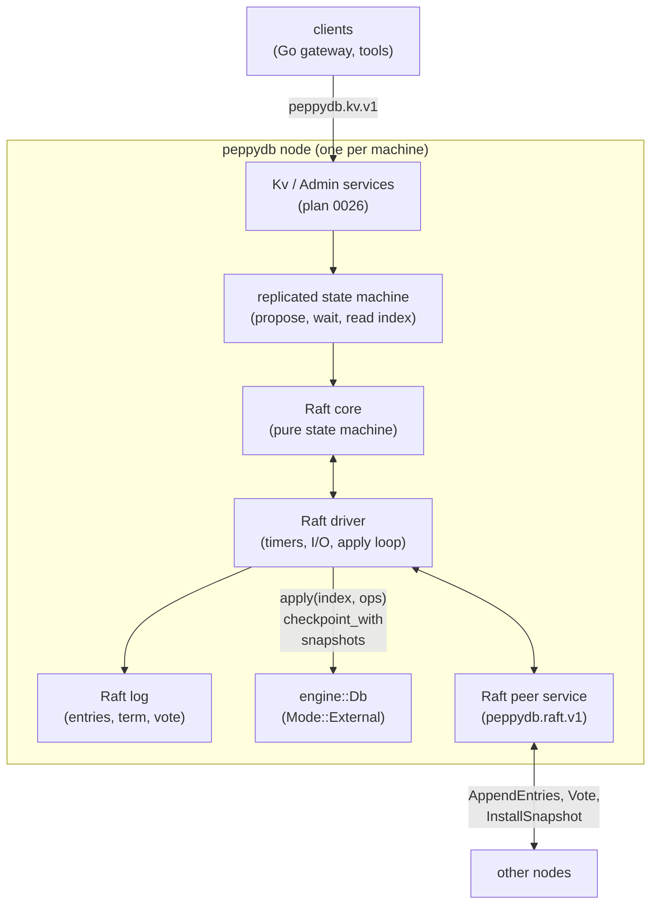
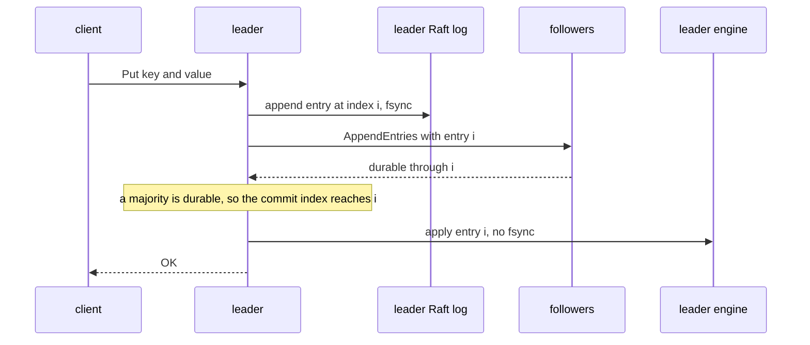
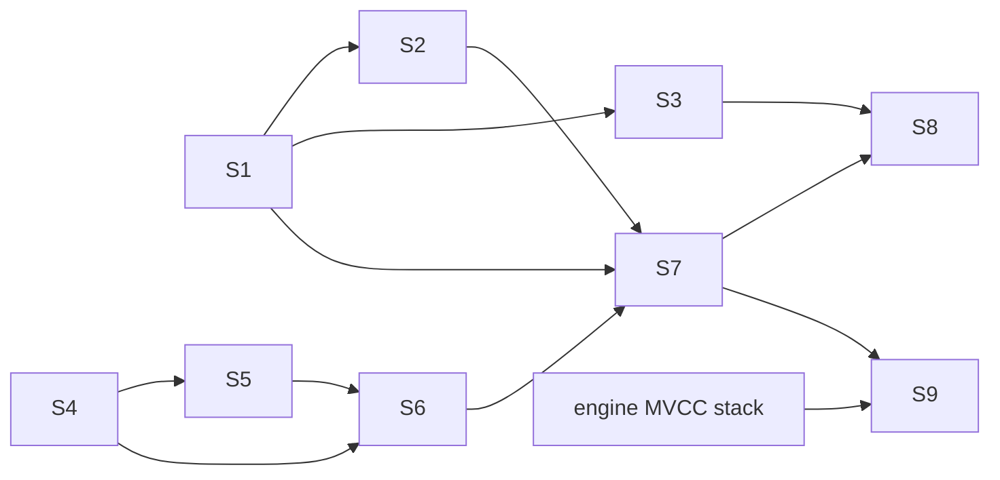
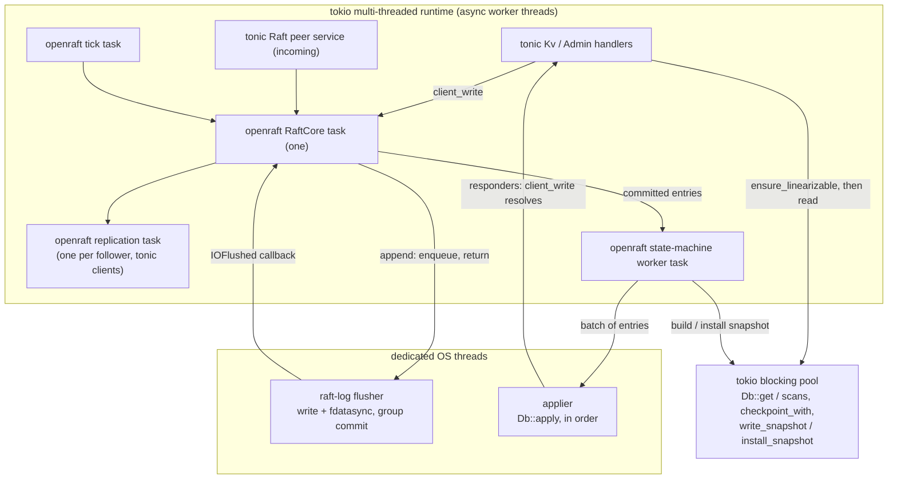

# 0025: Server implementation roadmap

**Status:** In progress

**Design references:** [Project direction](../design/architecture.md),
[engine](../design/engine.md) (especially
[external-log mode](../design/engine.md#external-log-mode) and
[read consistency](../design/engine.md#read-consistency)),
[build system](../design/build-system.md).

**Background:** [Raft paper and dissertation](../references.md#raft),
[ZippyDB engineering overview](../references.md#zippydb-engineering-overview).

## Goal

Take the embedded engine from phase 1 to phase 2 of the
[architecture](../design/architecture.md): first a single-node network
server, then a multi-node server that replicates one shard, which holds
the whole database, with Raft. `engine::Db` is a durable embedded database,
and its external-log mode fixes the contract that a replicated log drives
([plan 0022](0022-engine-external.md)). This roadmap builds the server
and the replication layer on that contract without reshaping the engine.

This roadmap describes the components, how they compose, the decisions
that hold across stacks, and the build order. Each implementation stack
gets its own numbered plan with concrete interfaces, commits, and
verification. A milestone may require several stacks. Use the normal
draft/discuss/implement workflow for each stack and keep links and
milestone progress here current.

Phase 3 (sharding) is out of scope. It gets its own roadmap once phase 2
is complete. Its expected shape constrains phase 2, so this roadmap
records it: applications partition their keys into μshards (micro-shards),
and μshards are mapped to p-shards (physical shards), as in
[ZippyDB](../references.md#zippydb-engineering-overview). Each p-shard is
one Raft group, and **each server belongs to exactly one Raft group**. A
placement manager, backed by its own etcd cluster, holds the authoritative
μshard-to-p-shard map and orchestrates μshard moves; a gateway routes
requests by that map. This differs from ZippyDB, where a server hosts many
p-shards. One group per server gives one log and one fsync stream per
server, and no multi-raft batching.

## Fundamental components

| Component | Responsibility | Source |
| --- | --- | --- |
| Client API (`peppydb.kv.v1`) | The stable client contract over gRPC: point reads and writes, scans, and admin calls; leader discovery and retry rules. | Plan 0026 |
| Raft core | Elections, log replication, commit, snapshot messages, and read index; no I/O and no clock. | Paper §5, §7, §8; dissertation ch. 3, 6 |
| Raft log | Durable entries with terms, hard state (term, vote), suffix truncation on conflict, and prefix compaction. | Paper §5.3, §7 |
| Raft driver | Ticks the core, persists before it sends, delivers messages, and runs the apply loop. | Paper Figure 2 |
| Replicated state machine | Turns RPCs into proposals, waits for their apply, and serves linearizable reads. | Dissertation §6.4 |
| Peer transport | The gRPC service between nodes, including snapshot streaming. | — |
| Membership | Static membership first; later learners and single-server changes. | Dissertation ch. 4 |
| Engine (`Mode::External`) | Applies committed entries, checkpoints on demand, and writes and installs snapshots. | Plan 0022 |

## How the components compose

The diagram shows one node of the target cluster and its peers.



- **Write:** The leader appends the entry to its Raft log and sends it to
  the followers. Once a majority holds it durably, the entry commits. Each
  node applies it with `Db::apply(index, ops)`, and the leader answers the
  client after its own apply.
- **Read:** The leader confirms that it is still the leader (read index),
  waits until it has applied through the confirmed commit index, and reads
  its local engine. A non-leader answers with a leader hint.
- **Compaction:** A node checkpoints its engine with `checkpoint_with` and
  then discards Raft log entries at or below the committed `applied_seq`.
- **Catch-up:** A follower whose next entry was discarded receives the
  leader's engine snapshot, installs it, and continues from the snapshot's
  index.
- **Restart:** A node opens its engine at the last committed checkpoint
  and replays its own Raft log from `applied_seq() + 1`.

A write in phase 2:



The engine never syncs a log of its own: the Raft log is the history
([external-log mode](../design/engine.md#external-log-mode)). The engine
makes its state durable only at checkpoints, which let the Raft log
discard entries. One fsync per write is part of correctness and of the
latency budget; no stack may add a second one on the write path.

## Build order

Start with the client-facing server on the existing engine, then build the
replication layer below it. The milestones below are not individual
commits or reserved plan numbers.

| Milestone | Builds on | Reviewable outcome |
| --- | --- | --- |
| S1. Single-node server | Engine | `peppydb serve`: one standalone `Db` behind the `Kv` and `Admin` gRPC services, health, graceful shutdown, fail-stop, `SIGKILL` durability; the buf-based proto toolchain for Rust and Go; `peppy-load`, an external Go load generator. [Plan 0026](0026-server-grpc-kv.md). |
| S2. Operability | S1 | A streaming `Admin.Snapshot` RPC over `write_snapshot` (backups now, the Raft snapshot transport later); metrics; `peppy-load` runs on separate client and server machines through `tools/gcp-bench`, with reference measurements ([remote benchmarks](../design/remote-benchmarks.md)). |
| S3. Gateway skeleton | S1 | A Go gateway that routes to the server over the generated Go client; a Buck2 test in which Go code talks to the Rust server; a linearizability checker harness for later milestones. |
| S4. Raft core | — | openraft wrapped behind our types, with elections, pre-vote (openraft substitutes a lease check; see plan 0028), replication, commit, read index, and snapshots; a seeded simulator with the safety checks of decision 15. No network or disk yet. |
| S5. Raft log | S4 | Durable entries with terms, hard state, suffix truncation, prefix compaction, torn-tail repair; a crash model like the engine's. |
| S6. Replicated state machine in one process | S4, S5, engine external mode | The driver: core, log, and `Db` in external mode; the apply loop; compaction; snapshot install. Several nodes in one process over an in-memory transport that injects faults. |
| S7. Multi-node server | S1, S6, S2's snapshot stream | `peppydb.raft.v1` between processes; static membership from flags; leader-only writes and read-index reads; leader hints; `Status` reports role, term, and leader. Process-level tests: kill the leader, partition, restart. |
| S8. Membership and fault testing | S7, S3 | Add and remove nodes (learner first, then single-server changes); chunked, resumable snapshot transfer; randomized fault runs checked for linearizability. |
| S9. Follower reads (optional) | S7, engine MVCC | Snapshot reads in the engine (its own engine stack; recommended MVCC), a read barrier, and bounded-staleness or read-index follower reads. |



S2, S3, and S4 are independent and can proceed in any order after S1. The
default order is S1, S4, S5, S6, S2, S7, S3, S8: Raft correctness is the
long pole, and S2 and S3 are needed only by S7 and S8. Dependencies
determine the actual stack boundaries.

Each plan chooses the final shape of the interfaces it introduces, so that
later milestones add mechanisms rather than reshape earlier code:

- Interim behavior must be a special case of the final behavior. The
  single-node server of S1 exposes the final client API; replication adds
  fields and status details, not new semantics.
- The services reach the engine through one bridge, so S7 replaces what
  stands behind the bridge (a standalone `Db`, then the replicated state
  machine) without changing the services.
- Components that do not need the network (the Raft core, the Raft log)
  are built and tested on their own first.
- Each plan states its extension points: what later plans add to its
  types, and what they must not need to change. Each test oracle is
  written once and extended.
- Planned replacements are named in the plan that makes them.

## Fidelity and staged implementation

- Preserve Raft's safety rules as the paper states them (Figure 2 and
  §5.4). Record every deliberate departure, and every extension taken from
  the dissertation or from production implementations, with its rationale.
- Use production implementations (etcd raft, raft-rs, openraft) to
  investigate behavior and edge cases. Prefer clear ownership and explicit
  invariants over reproducing their organization.
- Keep the engine's contract fixed. Replication adds callers of
  `apply`, `checkpoint_with`, `write_snapshot`, and `install_snapshot`
  ([engine extension points](../design/engine.md#external-mode-extension-points));
  a stack that needs to change that contract must say so in its plan.
- Tune timeouts, batching, and pipelining after a correct baseline, and
  measure on Linux.

### Cross-cutting decisions

These hold across the stacks. A stack that needs to change one must say so
in its plan.

1. **The Raft index is the engine sequence.** Each committed data entry at
   index `i` becomes `Db::apply(i, ops)`. Entries that carry no data (the
   leader's no-op, configuration changes) leave gaps, which `apply`
   allows. After a restart the driver redelivers from `applied_seq() + 1`.
2. **The engine runs in `Mode::External`.** One fsync per write, in the
   Raft log. Compaction calls
   `checkpoint_with(|seq| raft_log.sync_to(seq))` and then discards
   entries at or below the returned `applied_seq`.
3. **Snapshots are engine snapshots.** A follower that is too far behind
   receives `write_snapshot` output and calls `install_snapshot`. The
   store file carries only `applied_seq`. The Raft term and membership at
   that index are system keys inside the tree
   ([below](#the-system-keyspace)), so they travel with the file and roll
   back with the data.
4. **The client API stays `peppydb.kv.v1`.** Writes whose outcome is
   unknown follow the rule that plan 0026 documents.
5. **Reads go to the leader and are linearizable**, using read index
   (dissertation §6.4) first. Leader leases are an optimization for later.
   Follower reads wait for MVCC snapshots in the engine and a read
   barrier (milestone S9).
6. **Raft runs deterministically under test.** Tests drive openraft on
   its deterministic runtime (`rt-sim`) with a seeded simulator that crashes nodes, drops, delays, duplicates, and reorders
   messages, and partitions the network. Every failing seed must
   reproduce exactly.
7. **Persist before send.** A node persists its term, vote, and new
   entries before it sends any message that depends on them (paper,
   Figure 2). The driver enforces this order; the core states it in its
   output.
8. **Stored keys carry a namespace byte.** Plan 0026 stores user keys as
   `0x01 ‖ key` and reserves `0x00` for the system keyspace
   ([below](#the-system-keyspace)). Later stacks put their replicated
   server state there and never in user keys.
9. **Raft is [openraft](../references.md#raft-implementations)**, pinned
   to an exact version and upgraded deliberately, because its API and
   on-disk types still change before 1.0. Each upgrade is its own diff.
   Chosen over raft-rs (stale release, `protoc` at build time, prost 0.11,
   an unseeded election RNG) and over our own core (Raft is a commodity
   component). See [Raft implementation choice](#raft-implementation-choice).
10. **Every server runs Raft.** From S7 on, `peppydb serve` always runs
   Raft; a single node is a group of one. Multi-node is the expected
   deployment, so the single-node case gets no separate write path and no
   optimization. Standalone mode remains for embedded use, tests, and the
   S1 server until S7. A standalone data directory migrates by `close`
   followed by a snapshot install into a new node.
11. **Leadership: Raft elects, the placement manager prefers, the server
   corrects.** See [Leader discovery and preference](#leader-discovery-and-preference).
12. **Process-level network faults use `iptables`** inside
   `tools/linux-run`.
13. **The Raft log is a new crate with its own format.** It is
   `server-raft-log`, an internal crate of the server component
   ([plan 0028](0028-server-raft-core.md#component-layout)), and
   `server-raft` adapts it to openraft's `RaftLogStorage`. It borrows
   `engine-wal`'s proven mechanics but not its format. See
   [The Raft log](#the-raft-log). The S5 plan fixes the record layout.
14. **Blocking work stays off the async threads.** One multi-threaded
   tokio runtime runs gRPC and openraft's tasks; a dedicated flusher
   thread syncs the Raft log; a dedicated applier thread calls
   `Db::apply`; tokio's blocking pool runs reads, checkpoints, and
   snapshot streaming. See [Threading model](#threading-model). The S6
   plan measures it before fixing sizes.
15. **Safety properties are tested, not assumed.** Every Raft stack checks
   the paper's properties (election safety, log matching, leader
   completeness, state machine safety; §5.4 and Figure 3) in simulation,
   and the end-to-end milestones check client histories for
   linearizability.

### The system keyspace

Every key in the tree is replicated: `write_snapshot` ships the whole
tree, and every replica applies the same entries. In External mode the
engine is durable only at checkpoints, so after a crash it rolls back to
its last checkpoint, and everything in the tree rolls back with it.

**Rule:** the system keyspace (`0x00 ‖ name`) holds state that is
replicated and must change atomically with the user data. State that must
agree with the data at every point must roll back with the data, and only
the tree itself does that exactly. Node-local state must stay out.

| State | Where | Why |
| --- | --- | --- |
| Format marker | System keyspace | Plan 0026; detects data not written by the server |
| Migration fences (phase 3) | System keyspace | Must be ordered with writes (below) |
| Raft applied `LogId` (term, index) and membership | System keyspace | Written by each `Db::apply`; atomic with the data and carried by snapshots. openraft's `applied_state()` reads them back |
| Client deduplication table (if added) | System keyspace | Must roll back exactly with the writes it records (dissertation §6.3) |
| Raft log entries, current term, vote, commit index | Raft log storage | Node-local, and exist before apply. A vote inside the tree would reach followers through a snapshot and break election safety |
| μshard map, migration plans | Placement manager (etcd) | Global and authoritative |
| Node identity, addresses | Local configuration | Node-local |

TiKV keeps its apply state and region epoch in its key-value engine, and
user data under an internal `z` prefix. CockroachDB keeps range-local
state, including applied state and the range descriptor, under a reserved
`\x01` prefix. etcd keeps its consistent index and membership in bbolt
buckets beside the data. All three write that state in the same atomic
batch or transaction as the data it describes.

**Migration fences (phase 3).** The placement manager decides μshard
moves, and the gateway routes requests, but neither can stop a write that
is already on its way to the source group: a write that timed out at the
gateway can still be applied later. The source group therefore applies a
fence entry for the μshard's key range. From that log index on, every
replica rejects writes to the range, and the range is frozen, so a plain
scan exports exactly its state at the fence. Every write either precedes
the fence and is in the export, or follows it and is rejected; none is
lost. The storage layer knows only "this key range is frozen", not the
placement map. TiKV's region epoch check plays the same role.

### Raft implementation choice

Inspected on 2026-11-09:

- *raft-rs* (TiKV): the most production-proven core, about 7k lines, with
  no I/O; the application drives it through a `Ready` loop. Its last
  crates.io release is 0.7.0 (March 2023); TiKV patches it to git master.
  `raft-proto` generates code with `protoc` at build time, `prost-codec`
  uses prost 0.11, it requires `slog`, and its election timeout draws from
  the thread-local RNG, so seeded simulation needs a workaround.
- *openraft*: active (0.10.0 released on 2026-11-10 after a long alpha
  series; 0.9 receives fixes only); pure Rust
  dependencies; a deterministic runtime (`rt-sim`), a Turmoil fuzzer in
  every CI build, and a Jepsen suite. It supports a state machine that is
  durable only at snapshots, which matches External mode. Its API still
  changes before 1.0; it owns the control flow; its storage traits are
  async.
- Phase 3's one-group-per-server model removes raft-rs's multi-raft
  advantage.

### Leader discovery and preference

Three separate concerns:

- **Who is leader** is decided by Raft elections, inside the group. This
  is a choice, not a limit of Raft. ZippyDB's ShardManager assigns a
  leader per epoch, an external-reconfiguration design that the ZippyDB
  article calls a simplification and plans to move away from. openraft
  could be driven the same way (`Config::enable_elect = false`, and the
  placement manager calls `trigger().elect()` on an up-to-date node), but
  then every failover would wait for the placement manager to detect the
  failure and act. In-band elections fail over within an election timeout
  and do not depend on the placement manager being available.
- **Who should be leader** is placement policy, for example a server near
  the clients, or not a server about to be drained. The placement manager
  (phase 3, on etcd) records a preferred leader and asks the group to move
  leadership with openraft's `trigger().transfer_leader(node)`. Raft still
  runs the handover safely.
- **How requests find the leader.** Leaders report themselves to the
  placement manager, which publishes the current leader in etcd; gateways
  watch it and cache it. That view is always slightly stale, so a
  non-leader answers `UNAVAILABLE` with the leader's address in the status
  details, and the gateway updates its cache and retries there. Servers do
  not forward requests: forwarding adds a hop and makes "outcome unknown"
  harder to reason about. Before the placement manager exists (phase 2),
  gateways learn the leader from these hints and from `Admin.Status`.

TiKV and PD work the same way: PD learns leaders from heartbeats and
clients cache them, while a stale request gets `NotLeader` with a hint.

### The Raft log

openraft's `RaftLogStorage` needs:

| Requirement | Meaning |
| --- | --- |
| Entries with `LogId { term, index }` | The leader assigns the index, not the log |
| Data, membership, and blank entries | Not only key-value operations |
| `append(entries, IOFlushed)` | Return once the entries are readable; report durability later, which allows group commit |
| `truncate_after(log_id)` | Remove an old leader's conflicting entries, from the end backward, possibly inside a segment |
| `purge(log_id)` | Drop entries up to a checkpoint |
| Reads by index range | The leader replicates from its log |
| `save_vote` | Durable before it returns, after every earlier write |
| `get_log_state`, `save_committed` | The last purged and last `LogId`, and the committed `LogId` |

`engine-wal` already has checksummed records, segment files, torn-tail
repair, prefix truncation by whole segments, and a flusher thread with
group commit. It assigns sequences itself and has no terms, no entry
kinds beyond key-value operations, no suffix truncation, no reads by
index, and no vote. Those differences are in its core assumptions, so
generalizing it would rewrite a verified component. The Raft log is
therefore a new crate:

```text
raft-log/
  00000000000000000001.log   segments named by first index
  vote                       {term, voted_for}: tmp, fsync, rename, dir fsync
  meta                       last purged LogId, committed LogId

record: len | crc | index u64 | term u64 | kind u8 | payload
```

- An in-memory index maps each index to its segment, offset, and term,
  and a cache keeps recent entries, so the leader usually replicates from
  memory.
- `truncate_after(k)` deletes later segments, then truncates the segment
  that holds `k + 1` at its offset and syncs: working from the end never
  leaves a hole.
- `purge(k)` records the purge point in `meta`, then deletes whole
  segments whose last index is at most `k`.
- Only code that is identical in both logs (CRC framing, segment naming,
  directory sync) moves into a shared crate.

### Threading model

openraft runs as async tasks: one `RaftCore` task, one replication task
per follower, a state-machine worker, a tick task, and a snapshot
transmitter. Blocking work (fsync and engine calls) must not run on the
async worker threads.



- **A write:** the handler calls `client_write`. `RaftCore` calls
  `append`, which queues the entry for the flusher and returns, and the
  replication tasks send it to the followers in parallel with the local
  sync. The flusher writes and syncs everything pending at once, then
  fires the `IOFlushed` callbacks. Once a majority holds the entry, it
  commits; the state-machine worker passes a batch to the applier, which
  calls `Db::apply` in order and answers each responder.
- **A read:** `ensure_linearizable(ReadIndex)` confirms leadership and
  waits until the state machine has applied through the read point; the
  read then runs on the blocking pool.
- **Why a flusher thread:** an fsync blocks for milliseconds, and one
  thread batches naturally, as `engine-wal` does.
- **Why an applier thread:** `Db::apply` blocks and must run in order. One
  long-lived thread keeps the order without a `spawn_blocking` per batch.
- **One runtime first.** If gRPC load delays heartbeats enough to cause
  spurious elections, openraft moves to its own runtime. S6 measures this.
- **Under test,** the same tasks run on `rt-sim`, and the two dedicated
  threads are replaced by in-process models: a log store that can delay
  or lose unflushed writes, and a synchronous apply.

### Paper and implementation notes

The paper, the dissertation, and production implementations are distinct
references:

- The paper's Figure 2 covers elections and replication only. Pre-vote
  (dissertation §9.6), read index (§6.4), and learners are extensions that
  etcd raft and raft-rs implement; plans that adopt them cite their source.
- The paper's membership change (§6) uses joint consensus. The
  dissertation (ch. 4) recommends single-server changes as simpler; S8
  chooses between them.
- The paper's snapshot (§7) is the state machine's own state. Here it is
  the engine's committed store file, which is already a complete, openable
  image (decision 3).

## Open questions

None at the roadmap level. Each child plan settles the details of its
stack, for example the exact record layout of the Raft log (S5) and
measured thread counts and channel sizes (S6).

## Verification as the system grows

Each child plan defines focused checks alongside the required workspace
checks. Use a seeded simulator for the Raft core, crash models for
storage, fault-injecting transports for in-process clusters, and
multi-process runs for the server. Verify intermediate states, failure
paths, and recovery as well as results.

- **Core:** seeded simulation with many seeds per CI run, and long runs on
  demand; every failing seed must reproduce exactly.
- **Storage:** crash models in the style of
  `crates/engine/src/tests/crash.rs` for the Raft log.
- **Integration:** in-process clusters with a fault-injecting transport;
  the follower tests in `crates/engine/src/tests/replica.rs` are the
  pattern.
- **End to end:** multi-process clusters under `tools/linux-run`, with
  `SIGKILL`, restarts, and partitions; client histories checked for
  linearizability. Candidates for the checker, decided in the S3 plan:
  [Porcupine](https://github.com/anishathalye/porcupine), a Go library that
  searches recorded histories for a valid order against a sequential
  model, partitions key-value histories by key, and treats operations with
  unknown outcomes correctly; Jepsen's checkers (Clojure, heavier to
  adopt); or a custom oracle like openraft's fuzzer (cheaper, but checks
  only specific properties).

Track correctness and performance separately. Measure RPC and
replicated-write latency and throughput on GCP under stated conditions,
next to the engine's numbers.

## Progress and next decision

- [x] Agree on the component map, the cross-cutting decisions, and the
  build order.
- [x] Draft and agree on [the single-node server](0026-server-grpc-kv.md)
  (S1).
- [x] Implement and verify the single-node server stack, completing S1
  ([plan 0026](0026-server-grpc-kv.md), recorded in the
  [server design](../design/server.md)).
- [x] Agree on the namespace byte in stored keys (decision 8) and the
  phase 3 shape: one Raft group per server, placement manager on etcd.
- [x] Agree on the Raft log crate (decision 13) and the threading model
  (decision 14).
- [x] Choose openraft (decision 9), Raft on every server (decision 10),
  leader discovery and preference (decision 11), `iptables` for network
  faults (decision 12), and system keys for the Raft applied state.

- [x] Draft and agree on [the Raft core](0028-server-raft-core.md) (S4).
- [ ] Implement and verify the Raft core stack, completing S4.

The next step is implementing plan 0028; the S5 plan (Raft log) follows.

## Sources

- [Raft paper](../references.md#raft): §5 (the algorithm, Figures 2 and 3),
  §7 (log compaction), §8 (client interaction).
- [Raft dissertation](../references.md#raft): ch. 4 (membership changes),
  ch. 6 (client interaction, read index, leases), §9.6 (pre-vote).
- [Raft implementations](../references.md#raft-implementations): etcd raft,
  raft-rs, and openraft, for extensions and edge cases.
- [ZippyDB engineering overview](../references.md#zippydb-engineering-overview):
  a replicated log that drives a storage engine on each replica, the shape
  phase 2 follows.
- [Plan 0022](0022-engine-external.md) and the
  [engine design](../design/engine.md#external-log-mode): the replication
  contract that this roadmap drives.
