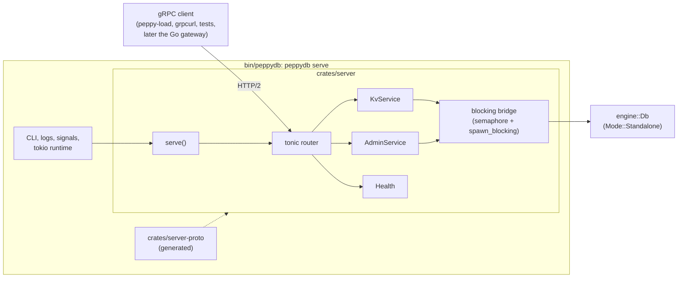
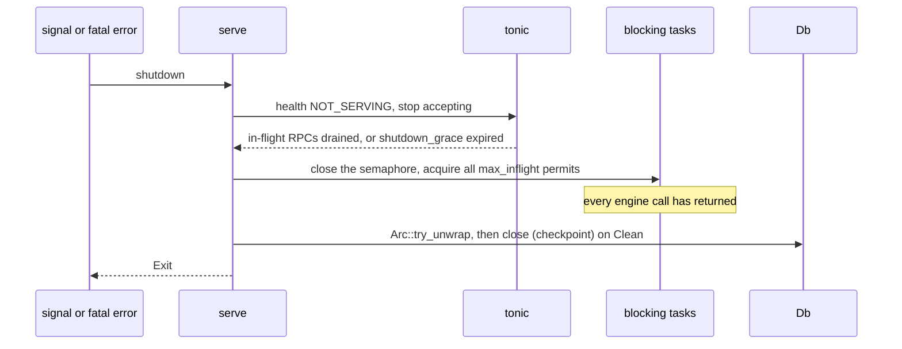

# 0026: Single-node gRPC server

**Status:** Agreed

**Design references:** [Project direction](../design/architecture.md),
[engine](../design/engine.md), [build system](../design/build-system.md).

**Parent roadmap:** [Server roadmap](0025-server-roadmap.md), milestone S1.

**Builds on:** [Engine `Db`](0021-engine-db.md),
[external-log mode](0022-engine-external.md) (not used yet; see
[Forward compatibility](#forward-compatibility-with-replication)).

## Goal and scope

Phase 1 delivered `engine::Db`, an embedded database. Nothing outside the
process can use it yet. This stack puts one `Db` behind a gRPC API, so
that clients in any language can read and write over the network, and
adds a Go load generator to measure it from outside the process. It also
fixes the client-facing API that phase 2 replication keeps.

- **In scope:**
  - `proto/peppydb/kv/v1/kv.proto`: the `Kv` service (`Get`, `Put`,
    `Delete`, `Scan`) and the `Admin` service (`Status`, `Checkpoint`);
  - a hermetic proto toolchain built on buf: lint, breaking-change checks,
    Rust code generated by `tonic-prost-build`, and Go code generated by
    the standard Go plugins, all checked into the tree, with a `--check`
    mode;
  - the stored key layout: a namespace byte that separates server-owned
    system keys from user keys, and a format marker;
  - an internal crate `server-proto` (generated code) and an entry crate
    `server` (the services, error mapping, the blocking bridge, limits,
    and graceful shutdown);
  - the standard gRPC health service (`grpc.health.v1.Health`);
  - fail-stop on a WAL failure, tested through a `fault-injection` feature
    on `engine-wal` and `engine`;
  - `peppydb serve`: the executable, with signal handling and logs;
  - a generated Go package and `peppy-load`, an external load generator;
  - tests: RPC behaviour against an oracle, error codes, scan paging,
    shutdown, fail-stop, and a `SIGKILL` durability test;
  - `docs/design/server.md`.
- **Out of scope:** replication; TLS and authentication; the gateway and
  cross-language tests (roadmap S3); snapshot download or backup RPCs;
  metrics export; remote load runs on GCP (roadmap S2); multi-key writes
  and transactions; snapshot-consistent scans (needs MVCC, see
  [read consistency](../design/engine.md#read-consistency)); a
  configuration file.
- **Done when:** `peppydb serve` serves every RPC on a local port; a write
  acknowledged with `OK` survives `SIGKILL` of the server; `SIGTERM`
  drains requests and closes the `Db` with a checkpoint; a WAL failure
  makes the server exit non-zero; each engine error maps to a documented
  gRPC status; generated Rust and Go code matches the `.proto` and the
  `.proto` passes `buf lint` and `buf breaking` (`tools/gen-proto
  --check`); every stored key carries the namespace byte, and no user scan
  returns a system key; `peppy-load` reports throughput and latency
  against a running server; workspace checks pass.

## Approach

### Components



The component follows the repository's naming rule: one entry crate named
after the component, and internal crates named `<component>-<part>`, as
`engine` and `engine-wal` do.

```text
proto/peppydb/kv/v1/kv.proto        the API (language-neutral)
buf.yaml, buf.gen.yaml              buf module, lint rules, Go plugin config

crates/server-proto/                crate `server_proto` (internal, generated code only)
  src/lib.rs                        pub mod kv { pub mod v1 { include!(...); } }
  src/generated/peppydb.kv.v1.rs    written by tools/protogen, checked in
crates/server/                      crate `server` (entry crate)
  src/lib.rs                        serve(), Config, Exit, ServeError
  src/bridge.rs                     semaphore + spawn_blocking
  src/kv.rs, src/admin.rs           the two services
  src/keys.rs                       key layout and format marker
  src/status.rs                     engine::Error to gRPC status
  src/tests/                        in-process harness, SIGKILL re-exec test
bin/peppydb/                        binary `peppydb`, subcommand `serve`

tools/protogen/                     Rust binary: descriptor set to tonic-prost-build
tools/gen-proto                     script: lint, breaking, Rust and Go generation, --check

go/kvpb/                            generated Go package `peppydb/go/kvpb`
go/cmd/peppy-load/                  the Go load generator
```

- **`proto/`** is language-neutral, at the repository root. Rust and Go
  generate from the same files.
- **`server-proto`** is visible to `//crates/server:` alone.
- **`server`** depends on `engine`, `server-proto`, `tonic`, and `tokio`.
  It is visible to `//bin/peppydb:`.
- **`bin/peppydb`** stays thin: it parses arguments, sets up logging,
  builds the runtime, opens the `Db`, binds the socket, and calls
  `server::serve`.
- In phase 2 this process also hosts the Raft peer service, so the
  component is named `server`, not `kv-server`. The plan label,
  `server-grpc-kv`, follows the `<component>-<topic>` pattern of plan
  names.

### The API

```proto
syntax = "proto3";
package peppydb.kv.v1;

service Kv {
  rpc Get(GetRequest) returns (GetResponse);
  rpc Put(PutRequest) returns (PutResponse);
  rpc Delete(DeleteRequest) returns (DeleteResponse);
  // One page of records in [start, end), in key order.
  rpc Scan(ScanRequest) returns (ScanResponse);
}

service Admin {
  rpc Status(StatusRequest) returns (StatusResponse);
  rpc Checkpoint(CheckpointRequest) returns (CheckpointResponse);
}

message GetRequest { bytes key = 1; }
message GetResponse { optional bytes value = 1; }   // unset: no such key

message PutRequest { bytes key = 1; bytes value = 2; }
message PutResponse {}

message DeleteRequest { bytes key = 1; }
message DeleteResponse {}

message ScanRequest {
  optional bytes start = 1;   // unset: from the first key
  optional bytes end = 2;     // unset: to the last key; exclusive
  uint32 page_size = 3;       // 0 or above the server maximum: the maximum
}
message KeyValue { bytes key = 1; bytes value = 2; }
message ScanResponse {
  repeated KeyValue records = 1;
  optional bytes next_start = 2;  // unset: the range is exhausted
}

message StatusRequest {}
message StatusResponse { uint64 applied_seq = 1; string version = 2; }

message CheckpointRequest {}
message CheckpointResponse { uint64 applied_seq = 1; uint64 checkpoint_id = 2; }
```

- **Semantics are the engine's.** Each RPC calls one `Db` method. A `Put`
  or `Delete` returns `OK` only after its WAL record is durable. Single
  keys are linearizable; scans are consistent per leaf, not across leaves
  ([read consistency](../design/engine.md#read-consistency)). The proto
  comments must state this, because gRPC clients do not read Rust docs.
- **Errors are gRPC statuses,** not fields of the response messages. A
  successful call returns `OK` and its response message; a failed call
  returns a status code, a message, and optional details, and no response
  message ([Error mapping](#error-mapping)). A missing key is not an
  error: `Get` returns `OK` with `value` unset.
- **`optional` fields** distinguish "unset" from an empty byte string for
  `GetResponse.value` (an empty value is valid) and for scan bounds.
- **Empty response messages stay,** so fields can be added later without
  changing an RPC's signature.
- **No multi-key write.** The engine's `WriteBatch` (atomic durability
  across keys, without isolation) is not exposed: no client needs it yet,
  and multi-key atomicity is expected to arrive as transactions with read
  sets, as in ZippyDB, rather than as blind batches. Adding an RPC later
  is a compatible change to `kv.v1`.
- **Scans return pages.** Each `Scan` returns at most one page. If more
  records remain, `next_start` is set, and the client sends the same
  request again with `start = next_start`. The server keeps no cursor
  state, and each page is an independent request.

### Key layout

Every key that the server stores in the engine starts with one namespace
byte. Clients never see it.

```text
0x00 ‖ name           system keyspace: server-owned state
0x01 ‖ user key       user keyspace: everything clients write
0x02 .. 0xFF          reserved
```

- **The server adds and strips the byte.** `Get`, `Put`, and `Delete`
  use `0x01 ‖ key`. `Scan` results drop the first byte. Clients can use
  any non-empty key, including keys that start with `0x00` or `0xFF`;
  there is no visible restriction.
- **Scan bounds.** A user range `[start, end)` becomes
  `[0x01 ‖ start, 0x01 ‖ end)`. An unset `start` becomes `[0x01]`, and an
  unset `end` becomes `[0x02]`. A user scan therefore never reads a system
  key.
- **Limits.** The engine checks the stored key, so the largest user key is
  one byte shorter than `TreeConfig::max_key_len`. An empty user key stays
  `INVALID_ARGUMENT`, as in the engine, although `[0x01]` would be a valid
  stored key: the API keeps the engine's rule.
- **A format marker.** On first open of an empty database the server
  writes `0x00 ‖ "format" = 1`. On every open it requires the marker; a
  non-empty database without it was not written by the server and is
  refused at startup. This catches a data directory written directly
  through `engine::Db`.
- **Why now.** Adding a prefix later would rewrite every key. Reserving it
  now costs one byte per key.

**What belongs in the system keyspace.** Every key in the tree is
replicated: `write_snapshot` ships the whole tree, and in phase 2 every
replica applies the same entries. The system keyspace therefore holds
state that is replicated and must change atomically with the user data,
so that it rolls back with the data to the same checkpoint after a crash.
Node-local state (the Raft term and vote, the commit index, the node's
identity) must stay out. The [roadmap](0025-server-roadmap.md#the-system-keyspace)
lists the expected contents: the Raft applied term and membership
(phase 2), the migration fences of phase 3, and possibly a client
deduplication table. In this stack the system keyspace holds only the
format marker.

Phase 3 is expected to put a μshard identifier after the `0x01` byte, so
that each μshard is one contiguous key range. That encoding is decided in
phase 3, not here.

### The blocking bridge

`Db` methods block: a durable write waits for an fsync, and a read can wait
for page I/O. Tonic runs handlers on tokio's async worker threads, about
one per core, and a handler that blocks freezes every request scheduled on
its worker. Each handler therefore moves its engine call onto tokio's
blocking thread pool and awaits the result:

```rust
impl Inner {
    /// Run `f` on the blocking pool, holding one in-flight permit.
    async fn blocking<T: Send + 'static>(
        &self,
        f: impl FnOnce(&Db) -> Result<T, engine::Error> + Send + 'static,
    ) -> Result<T, Status> {
        let permit = Arc::clone(&self.inflight)
            .acquire_owned()
            .await
            .map_err(|_| Status::unavailable("the server is shutting down"))?;
        let db = Arc::clone(&self.db);
        let result = tokio::task::spawn_blocking(move || {
            let _permit = permit; // held until the engine call ends
            f(&db)
        })
        .await
        .map_err(|error| Status::internal(format!("engine task failed: {error}")))?;
        result.map_err(|error| self.status(error))
    }
}

#[tonic::async_trait] // tonic's generated traits use async-trait; impls must match
impl Kv for KvService {
    async fn put(&self, request: Request<PutRequest>) -> Result<Response<PutResponse>, Status> {
        let PutRequest { key, value } = request.into_inner();
        let key = user_key(&key)?; // 0x01 ‖ key; INVALID_ARGUMENT if empty
        self.inner.blocking(move |db| db.put(&key, &value)).await?;
        Ok(Response::new(PutResponse {}))
    }
    // get and delete: the same shape.
}
```

The semaphore has three jobs:

1. **Backpressure.** Without it, every request becomes a blocking task at
   once, and tokio queues tasks beyond its thread limit without bound.
   With it, a request over `Config::max_inflight` (default 1024) waits for
   a permit, which stops tonic reading from that connection and pushes back
   on the client through HTTP/2 flow control.
2. **A bound on blocking threads.** At most `max_inflight` engine calls run
   at once; the binary sets tokio's `max_blocking_threads` slightly above
   it, so every permitted call gets a thread.
3. **Shutdown.** Closing the semaphore and acquiring every permit proves
   that no engine call is running ([Serving and shutdown](#serving-and-shutdown)).

- **The permit moves into the closure.** If the client cancels, tonic drops
  the handler's future, but the blocking task runs to the end and keeps
  its permit. The semaphore counts engine calls, not live RPCs.
- **Group commit needs concurrency.** The WAL syncs every pending record
  at once ([durable writes](../design/engine.md#durable-writes)), so many
  concurrent writers share each fsync. By Little's law, 1024 concurrent
  calls at about 1 ms each allow far more than the engine's measured
  durable-write rate, so the limit is not expected to bind. The load
  generator measures throughput and latency against concurrency, and the
  default is revisited from those numbers. It is configurable with
  `--max-inflight`.
- **Cancellation does not undo writes.** A write whose RPC was cancelled
  or timed out may still become durable. Clients must treat `CANCELLED`,
  `DEADLINE_EXCEEDED`, and `UNAVAILABLE` on a write as "outcome unknown".
  `Put` and `Delete` are idempotent, so retrying them is safe.
- **The `#[tonic::async_trait]` attribute is required.** `tonic-build`
  0.14 still generates its service traits with `async-trait`, which boxes
  each handler's future so that it is `Send`. The attribute comes from
  tonic's re-export; there is no direct `async-trait` dependency.

### Error mapping

| `engine::Error` | gRPC status | Notes |
| --- | --- | --- |
| `Tree(EmptyKey \| KeyTooLarge \| ValueTooLarge \| InvalidRange)` | `INVALID_ARGUMENT` | Checked before logging: nothing was written |
| `Wal(_)` | `UNAVAILABLE` | Sticky: the WAL fails every later write until a reopen. The server starts a fatal shutdown (below) |
| `Tree(Store \| Corrupt* \| InconsistentLeaves \| ...)`, `Io` | `INTERNAL` | Logged with the full error |
| `WrongMode`, `Options`, `Locked`, `Hook` | `INTERNAL` | Cannot happen after a standalone open: a server bug |

A request is also rejected with `INVALID_ARGUMENT` before it reaches the
engine when a key is empty. The engine checks every other limit on the
stored key, so `KeyTooLarge` applies one byte earlier than `max_key_len`.
Tonic rejects a request over `Config::max_request_bytes` (default 4 MiB,
tonic's default) with `RESOURCE_EXHAUSTED`.

**Fail-stop on a WAL failure.** After `Error::Wal`, the `Db` accepts no
write until it is reopened ([Db limits](../design/engine.md#db-not-guaranteed-and-limits)).
A server that keeps running would serve reads but fail every write, and
the engine documents that applied but unsynced writes stay visible until
a reopen. The server instead marks itself `NOT_SERVING` in the health
service and begins the shutdown sequence. `serve` returns `Exit::Fatal`,
and the binary exits with a non-zero status, so a supervisor restarts it,
and the restart reopens the `Db`. This is the crash-only response that the
engine's recovery is built for.

### Testing fail-stop: a fault-injection feature

The `server` tests must make the WAL fail. `engine-wal` already has a
test-only `fail_next_sync`, but it is `cfg(test)`, and `cfg(test)` applies
only to the crate under test: `server`'s tests cannot reach it. The
[build-system design](../design/build-system.md#build-modes-are-platforms)
states the rule: such a switch must be a real feature.

```rust
// crates/engine/src/lib.rs
impl Db {
    /// Make the WAL's next sync fail, as a device error would.
    #[cfg(feature = "fault-injection")]
    #[doc(hidden)]
    pub fn fail_next_wal_sync(&self) { ... } // calls engine_wal's hook
}
```

- `engine-wal` and `engine` gain a `fault-injection` Cargo feature, off by
  default. `engine-wal`'s existing hook moves from `cfg(test)` to
  `cfg(any(test, feature = "fault-injection"))`.
- In Buck2, `peppy_rust_library` gains an optional feature variant:
  `:engine-fault-injection` and `:engine-wal-fault-injection` are built
  with the feature and are visible only to `//crates/server:server-unittest`.
  The normal targets never enable it, so production builds cannot call the
  hook.
- In Cargo, `server` lists `engine` with the feature only in
  `dev-dependencies`.

### Scans

```rust
async fn scan(&self, request: Request<ScanRequest>) -> Result<Response<ScanResponse>, Status> {
    let ScanRequest { start, end, page_size } = request.into_inner();
    let max = self.inner.config.scan_max_records;
    let limit = match page_size as usize { 0 => max, n => n.min(max) };
    let max_bytes = self.inner.config.scan_max_bytes;
    let page = self.inner.blocking(move |db| {
        // Map the user range into the 0x01 keyspace (see Key layout).
        let (start, end) = user_range(start.as_deref(), end.as_deref());
        let mut records = Vec::new();
        let mut bytes = 0;
        let mut next_start = None;
        for record in db.range(Some(&start), Some(&end))? {
            let (key, value) = record?;
            if records.len() == limit || bytes >= max_bytes {
                next_start = Some(key[1..].to_vec()); // first key not returned
                break;
            }
            bytes += key.len() + value.len();
            records.push(KeyValue { key: key[1..].to_vec(), value }); // strip 0x01
        }
        Ok(ScanResponse { records, next_start })
    })
    .await?;
    Ok(Response::new(page))
}
```

- **Bounded pages.** A page holds at most `Config::scan_max_records`
  (default 1000) records and stops once it reaches
  `Config::scan_max_bytes` (default 1 MiB). One record is at most one leaf
  page (4 KiB), so a page never exceeds the byte limit by more than one
  record, and stays far below tonic's 4 MiB message limit. `page_size` is
  the most records the client wants in this page; a page can hold fewer.
- **`next_start` is the first key not returned,** so resuming with it
  covers the range exactly once, without the client computing a successor
  key.
- **Each page is one ordinary engine call** through the blocking bridge:
  it holds one permit for the length of one page, and shutdown handles it
  like any other request.
- **No consistency across pages.** Writes between two pages are visible to
  later pages, as writes between two leaves already are within a page
  ([read consistency](../design/engine.md#read-consistency)).

### Serving and shutdown

```rust
pub struct Config {
    pub max_inflight: usize,       // 1024
    pub max_request_bytes: usize,  // 4 MiB
    pub scan_max_records: usize,   // 1000
    pub scan_max_bytes: usize,     // 1 MiB
    pub shutdown_grace: Duration,  // 10 s
}

pub enum Exit {
    /// The shutdown future completed; the Db closed with a checkpoint.
    Clean,
    /// A WAL failure stopped the server. The Db was dropped without a
    /// checkpoint; a restart reopens it.
    Fatal(engine::Error),
}

/// Serve `db` on `listener` until `shutdown` completes or a fatal engine
/// error occurs, then drain and close the database.
pub async fn serve(
    db: Db,
    listener: tokio::net::TcpListener,
    config: Config,
    shutdown: impl Future<Output = ()> + Send,
) -> Result<Exit, ServeError>;
```

`serve` is the server crate's one entry point and owns the whole
lifecycle: it writes or checks the format marker, builds the services and
the router, runs until shutdown or a fatal error, drains, and closes. It
takes an opened `Db` and a bound listener, so tests can open a temporary
database, bind `127.0.0.1:0`, read the port, and call it in-process. The
binary binds the `--listen` address and logs the bound address.



- **Every engine call ends before `close`.** Acquiring all permits waits
  for each blocking task, including the tasks of cancelled RPCs. Then the
  service holds the only other `Arc<Db>` references, and dropping the
  router releases them.
- **The grace period bounds only the network drain.** Engine calls are
  short (one fsync or one page), so the permit wait does not need a
  timeout.
- **`Clean` closes, `Fatal` drops.** `close` checkpoints, so a clean
  restart replays nothing. After a WAL failure a checkpoint cannot commit
  (its hook syncs the WAL), so `Fatal` drops the `Db`, and the restart
  replays the durable WAL.

### The binary

```text
peppydb serve --data-dir <DIR> [--listen 127.0.0.1:7420]
              [--flush-interval-us 0] [--io cached|direct]
              [--max-inflight 1024]
```

- **Arguments** are parsed with `clap` (derive). Logs use `tracing` and
  `tracing-subscriber`, to stderr, filtered by `RUST_LOG` (default
  `info`); tonic already logs through `tracing`. The first line after
  startup is `listening on <addr>`; the `SIGKILL` test reads it.
- **The default address is loopback.** There is no TLS or authentication
  in this stack, so exposing the server must be an explicit choice. Port
  7420 is an arbitrary unprivileged default.
- **Signals.** `SIGINT` and `SIGTERM` start the clean shutdown. A second
  signal exits at once, which is safe: acknowledged writes are durable.
- **Exit status.** 0 for `Clean`; 1 for `Fatal` or a startup error such as
  `Locked`.

### The proto toolchain

buf is the proto toolchain for every language. It parses, lints, and
checks for breaking changes; the Go plugins write Go; `tonic-prost-build`,
from the tonic project, writes Rust from buf's descriptor set.

```text
tools/gen-proto
  buf lint                                  style and API rules
  buf breaking --against <previous image>   wire and source compatibility
  buf build -o <tmp>/descriptors.binpb      one parse for every language
  tools/protogen <tmp>/descriptors.binpb    Rust: tonic_prost_build::compile_fds
  buf generate                              Go: protoc-gen-go, protoc-gen-go-grpc
tools/gen-proto --check                     generate into a temporary tree; fail on any difference
```

```rust
// tools/protogen/src/main.rs (sketch)
let fds = FileDescriptorSet::decode(std::fs::read(descriptors)?.as_slice())?;
tonic_prost_build::configure()
    .build_client(true) // tests and later Rust peers use the client
    .build_server(true)
    .out_dir("crates/server-proto/src/generated")
    .compile_fds(fds)?;
```

- **Rust code comes from tonic's own build crate,** not from the
  third-party buf plugins `protoc-gen-prost` and `protoc-gen-tonic`. Those
  wrap prost and tonic and lag their releases (0.5.0 from November 2025,
  against tonic-build 0.14.1, while tonic is at 0.14.9). `tonic-prost-build`
  is pinned in `Cargo.lock` beside the tonic runtime, so generated code and
  runtime cannot drift apart.
- **Generated code is checked in,** as the
  [build-system design](../design/build-system.md#generated-cargo-manifests-hand-written-go-module)
  requires: Cargo and the `go` command cannot see code that Buck2
  generates into `buck-out`. Normal builds never run code generation.
- **`AGENTS.md`** adds `tools/gen-proto --check` to the pre-completion
  checks.

**Hermeticity.** Every piece is pinned the way the rest of the repository
pins its tools:

| Piece | Pinned by |
| --- | --- |
| buf (`github.com/bufbuild/buf/cmd/buf`) | `go/go.mod` `tool` directive and `go.sum`; built by Buck2 from `tools/gobuckify-remote` archives |
| `protoc-gen-go`, `protoc-gen-go-grpc` | `go/go.mod` `tool` directives; built by Buck2 |
| Well-known types (`google/protobuf/*.proto`) | Bundled in buf |
| `tonic-prost-build`, prost | `Cargo.lock`; `compile_fds` never calls `protoc` |

These rules keep it hermetic:

1. **No Buf Schema Registry dependencies.** Any third-party `.proto` file
   (for example `google/rpc/status.proto` for phase 2's leader hint) is
   vendored into `proto/third_party/` with its source and revision
   recorded.
2. **No remote plugins.** `buf.gen.yaml` uses only `local:` plugins, which
   `tools/gen-proto` resolves to the Buck2-built binaries.
3. **A local baseline for `buf breaking`.** The repository uses Sapling,
   not a git checkout, so `tools/gen-proto` writes the parent revision's
   `proto/` tree (`sl cat -r .^`) to a temporary directory and builds the
   baseline image from it.
4. **Go version.** buf's minimum Go version must not exceed `GO_VERSION`;
   `tools/check-tools` already compares the pins.

The Homebrew `buf`, and any `protoc` on `PATH`, are never used.

### The load generator

`go/cmd/peppy-load` drives a running server from outside its process, over
the generated Go client.

```text
peppy-load --addr 127.0.0.1:7420 --workload put|get|mixed[:read-percent]
           --concurrency 64 --duration 30s --warmup 5s
           --keys 1000000 --key-size 16 --value-size 100
           --distribution uniform|zipf[:s] [--preload] [--seed 1]
           [--json]
```

- **Workers.** `--concurrency` goroutines share one gRPC connection pool
  and issue requests back to back (closed loop). `--preload` writes every
  key once before the measurement, so `get` finds values.
- **Keys.** Keys are fixed-size encodings of an integer drawn from the
  chosen distribution; a seed makes runs repeatable.
- **Output.** Per operation type: throughput, error counts by status code,
  and latency p50, p99, p99.9, and max, from a latency histogram. `--json`
  prints machine-readable results for later use by `tools/gcp-bench`
  (roadmap S2).
- **Errors count, not abort.** A run records `UNAVAILABLE` and other codes
  and continues, so it can also observe a server restart.
- **Remote runs** on separate client and server machines, through
  `tools/gcp-bench`, belong to roadmap S2. This stack records indicative
  local numbers.

### Forward compatibility with replication

The roadmap keeps this API for clients when the server replicates
([roadmap](0025-server-roadmap.md)). This stack therefore:

- uses a versioned package (`peppydb.kv.v1`), so incompatible changes get
  `v2`, and `buf breaking` enforces it;
- keeps every response message, even empty ones, so fields such as an
  applied index can be added;
- documents the "outcome unknown" rule for writes now, because
  replication adds leader changes, which make it common;
- reserves `UNAVAILABLE` with a leader hint for "not the leader".

The server uses `Mode::Standalone`. The roadmap moves it to Raft with
`Mode::External`; `serve` keeps its signature and hides the mode from the
services behind the bridge.

## Decisions and trade-offs

- **tonic and tokio.** tonic is the standard Rust gRPC stack and runs on
  tokio. *Alternative:* `grpcio` (bindings to gRPC C core) needs a C++
  build, which conflicts with hermetic Buck2 builds.
- **`spawn_blocking` per call.** *Alternative:* an async durability wait
  inside the engine (a `put` that returns a future completed by the
  flusher) avoids one thread per waiting writer. It changes the engine
  API, so it waits until measurements show that threads are the
  bottleneck. *Alternative:* running fast reads inline on the async
  thread. A cold read does page I/O, so every engine call goes through the
  bridge for now.
- **buf, with Rust generated by `tonic-prost-build`.** buf is the common
  polyglot proto toolchain: one parser for Rust and Go, `buf lint`, and
  `buf breaking`. *Alternatives:* `protox` (a Rust-only parser; Go would
  need a second parser later); `protoc` (a C++ binary that needs a
  per-platform DotSlash pin, and no lint or breaking checks); buf's Rust
  plugins (third-party, lag tonic's releases).
- **Unary, paginated `Scan`.** *Alternatives:* a server stream (faster for
  very large scans, but it adds a channel, cancellation handling, a permit
  held for the whole scan, and a stream that the gateway must proxy and
  that a leader change in phase 2 breaks anyway); server-side cursors
  (state, expiry, and cleanup, for scans that are not snapshots anyway).
  A streaming RPC can be added later without breaking `kv.v1`.
- **No multi-key write.** *Alternative:* expose `WriteBatch`. It promises
  less than clients usually expect (no isolation, no read set) and no
  client needs it yet.
- **Fail-stop on WAL failure.** *Alternative:* keep serving reads. The
  engine documents that applied but unsynced writes stay visible after a
  WAL failure; serving them invites clients to read values that a restart
  takes back.
- **A `fault-injection` feature, not `cfg(test)`.** `cfg(test)` does not
  reach dependencies. *Alternative:* test only the error mapping, which
  leaves the shutdown path untested.
- **A namespace byte in every stored key.** *Alternatives:* a reserved
  user-visible prefix that clients may not use (simpler, but a visible
  restriction); keeping server state outside the tree in a sidecar file
  (cannot change atomically with the data); no reservation (a later
  layout change rewrites every key). TiKV stores user data under an
  internal `z` prefix and CockroachDB keeps range-local state under a
  reserved `\x01` prefix for the same reasons.
- **`clap` and `tracing`.** The usual choices; tonic already depends on
  `tracing`.
- **An external Go load generator.** It measures the server as clients see
  it, including gRPC and network costs, from another process or machine.
  *Alternative:* an in-process Rust benchmark over loopback, which shares
  the server's CPU and runtime.
- **Health service.** `tonic-health` is small, and load balancers,
  Kubernetes, and the future gateway expect it. Server reflection is left
  out: `grpcurl -proto proto/peppydb/kv/v1/kv.proto` works without it.

## Proposed commit stack

### `[1/11][server-grpc-kv][plan] plan the single-node gRPC server`

- **Purpose:** This plan.
- **Verification:** Review.

### `[2/11][server-grpc-kv][deps] add tonic, prost, tokio, clap, and tracing`

- **Purpose:** Rust dependencies, separately from code, because the
  generated `third-party/rust/BUCK` diff is large and mechanical.
- **Core changes:** `third-party/rust/Cargo.toml` gains `tokio`
  (`rt-multi-thread`, `macros`, `net`, `signal`, `sync`, `time`), `tonic`,
  `tonic-prost`, `tonic-health`, `prost`, `prost-types`,
  `tonic-prost-build`, `clap` (`derive`), `tracing`, and
  `tracing-subscriber` (`env-filter`). `tools/buckify`; reindeer fixups for
  any crate whose build script must run.
- **Verification:** `tools/buck2 build //third-party/rust/...`;
  `cargo test --workspace --locked`.

### `[3/11][server-grpc-kv][deps] add buf, the Go protobuf plugins, and grpc-go`

- **Purpose:** Go tools and runtime libraries, separately from code.
- **Core changes:** `go/go.mod` `tool` directives for buf, `protoc-gen-go`,
  and `protoc-gen-go-grpc`; requirements for `google.golang.org/grpc` and
  `google.golang.org/protobuf`; `go mod tidy`; `tools/gobuckify-remote`;
  Buck2 `go_binary` targets for the three tools.
- **Verification:** the three tools build with Buck2 and print their
  versions; `tools/gobuckify-remote --check`; `(cd go && go vet ./...)`.

### `[4/11][server-grpc-kv][proto] add the kv API and buf-based code generation`

- **Purpose:** The API contract and its generated Rust and Go code.
- **Core changes:** `proto/peppydb/kv/v1/kv.proto` with full comments
  (semantics, errors, paging); `buf.yaml` and `buf.gen.yaml`;
  `tools/protogen` and `tools/gen-proto` (with `--check` and the Sapling
  baseline for `buf breaking`); `crates/server-proto` with the generated
  Rust; `go/kvpb` with the generated Go and its `BUCK`; `tools/autocargo`;
  `AGENTS.md` verification list.
- **Verification:** `tools/gen-proto --check`; both generated packages
  build under Buck2 and under Cargo and `go build`.

### `[5/11][server-grpc-kv][server] serve point reads and writes`

- **Purpose:** The `server` crate with `Get`, `Put`, and `Delete`.
- **Core changes:** `KvService`, the blocking bridge, the error mapping,
  the key layout (`user_key`, `user_range`, the format marker), an
  in-process test harness (a temporary `Db`, `serve` on `127.0.0.1:0`, a
  generated client).
- **Verification:** tests: round trips, absent and empty values, each
  `INVALID_ARGUMENT` case writes nothing, concurrent clients against a
  `BTreeMap` oracle, values survive a server restart; user keys starting
  with `0x00` and `0xFF` round-trip; the engine holds `0x01 ‖ key` for
  each user key and the format marker; a non-empty database without the
  marker is refused at startup.

### `[6/11][server-grpc-kv][server] serve paginated range scans`

- **Purpose:** `Scan`.
- **Core changes:** the page loop, `page_size`, bounds, `next_start`.
- **Verification:** tests: paging through random bounds and page sizes
  returns exactly the oracle's records, each once; pages respect
  `scan_max_records` and `scan_max_bytes`; `page_size` 0 and a page size
  above the maximum both use the maximum; `next_start` is unset exactly
  when the range is exhausted; `InvalidRange` is `INVALID_ARGUMENT`; an
  unbounded scan returns no system key and every user key, including keys
  that start with `0xFF`.

### `[7/11][server-grpc-kv][engine] add a fault-injection feature for WAL failures`

- **Purpose:** Let `server`'s tests make the WAL fail.
- **Core changes:** the `fault-injection` feature on `engine-wal` and
  `engine`; `Db::fail_next_wal_sync`; feature variants in
  `peppy_rust_library` and the two `BUCK` files, visible only to
  `//crates/server:server-unittest`; `tools/autocargo`.
- **Verification:** an `engine` test with the feature: after
  `fail_next_wal_sync`, the next `put` returns `Error::Wal` and later
  writes keep failing; the normal targets do not expose the method
  (`cargo build` without the feature); existing engine and Miri checks
  pass.

### `[8/11][server-grpc-kv][server] add admin, health, graceful shutdown, and fail-stop`

- **Purpose:** `Status`, `Checkpoint`, the health service, the shutdown
  sequence, and fail-stop.
- **Core changes:** `AdminService`, `Exit`, the permit drain, `close` on
  `Clean`, the fatal trigger on `Error::Wal`.
- **Verification:** tests: `Status.applied_seq` advances with writes;
  `Checkpoint` returns increasing ids; shutdown with requests in flight
  lets them finish and returns `Clean`; after `Clean` the lock is released
  and a reopen sees every write; health reports `SERVING` and then
  `NOT_SERVING`; after `fail_next_wal_sync`, a `Put` returns `UNAVAILABLE`,
  health becomes `NOT_SERVING`, `serve` returns `Exit::Fatal`, and a
  reopen recovers every acknowledged write.

### `[9/11][server-grpc-kv][bin] add peppydb serve`

- **Purpose:** The executable.
- **Core changes:** `clap` arguments, `tracing` setup, the runtime, signal
  handling, exit codes. `bin/peppydb` depends on `server` and `engine`.
- **Verification:** a test in `crates/server` re-executes its own test
  binary as a child server (an ignored test that runs only when an
  environment variable names the data directory). The parent writes
  acknowledged keys, sends `SIGKILL`, restarts the child, and reads every
  key back. The same harness checks `SIGTERM` (exit 0, nothing to replay)
  and `Locked` (exit 1). Re-executing the test binary works under both
  Buck2 and Cargo without locating `bin/peppydb`.

### `[10/11][server-grpc-kv][load] add the Go load generator`

- **Purpose:** Measure the server from outside its process.
- **Core changes:** `go/cmd/peppy-load` with its `BUCK`: flags, workers,
  key distributions, the latency histogram, text and JSON output.
- **Verification:** Go unit tests for key generation (deterministic for a
  seed, within range, zipf skew), the histogram (percentiles against a
  sorted reference), and result formatting; `go vet` and `go test`; a run
  against `peppydb serve` on loopback for put, get, and mixed workloads at
  several concurrency levels, with indicative numbers recorded in the
  design document.

### `[11/11][server-grpc-kv][docs] document the server`

- **Purpose:** Enduring design.
- **Core changes:** `docs/design/server.md` (API semantics, error
  mapping, key layout, the bridge, shutdown, fail-stop, the proto
  toolchain, the load generator, guarantees with tests, limits,
  measurements); `architecture.md` code layout; `build-system.md` (buf and
  feature variants); roadmap milestone S1; this plan's progress.
- **Verification:** links resolve; guarantees match the tests.

## Open questions

None.

## Verification strategy

| Check | Command or procedure | Expected result |
| --- | --- | --- |
| RPC behaviour against an oracle | `tools/buck2 test //crates/server/...` | Pass |
| Acknowledged writes survive `SIGKILL` | the re-exec test in diff 9 | Every acknowledged key is present after restart |
| Clean shutdown closes the `Db` | diff 8 tests | `Clean`; reopen succeeds and sees all writes |
| WAL failure stops the server | diff 8 fail-stop test | `UNAVAILABLE`, `NOT_SERVING`, `Exit::Fatal`; reopen recovers acknowledged writes |
| Generated code is current; API rules hold | `tools/gen-proto --check` | No difference; `buf lint` and `buf breaking` pass |
| Fault injection is test-only | diff 7 checks | The method exists only with the feature |
| Manual smoke test | `peppydb serve --data-dir /tmp/p` and `grpcurl -plaintext -proto proto/peppydb/kv/v1/kv.proto ...` | Put, get, scan work |
| Load from outside the process | `peppy-load` against `peppydb serve` | Throughput and latency recorded, not gated |
| Workspace checks | the `AGENTS.md` list, plus `tools/gen-proto --check` | Pass |
| Miri for unsafe crates | the `AGENTS.md` Miri command for each allowlisted crate | Pass; `server` has no `unsafe` code |

## Progress

- [x] Agree on the design and commit stack with the user.
- [ ] 2/11 Rust dependencies.
- [ ] 3/11 Go tools and libraries.
- [ ] 4/11 proto and code generation.
- [ ] 5/11 point RPCs.
- [ ] 6/11 scans.
- [ ] 7/11 fault-injection feature.
- [ ] 8/11 admin, health, shutdown, fail-stop.
- [ ] 9/11 binary and `SIGKILL` test.
- [ ] 10/11 load generator.
- [ ] 11/11 design document; stack-wide verification.

## Discoveries and plan changes

- During planning, the API dropped a multi-key `Write` RPC, `Scan` became
  unary and paginated, and the proto toolchain moved from `protox` to buf.
  The reasons are under [Decisions and trade-offs](#decisions-and-trade-offs).

## Agent notes

- **Entry points:** `crates/engine/src/lib.rs` (`Db`, `Error`, `range`);
  `crates/engine-wal/src/flusher.rs` (`fail_next_sync`);
  `bin/peppydb/src/main.rs` (hello world today); `build/defs.bzl`
  (`peppy_rust_library`); `go/go.mod` and `go/internal/greet/BUCK` (the
  Go package pattern).
- **Sapling** is at `/opt/homebrew/bin/sl` and may be missing from `PATH`.
- `tonic-prost-build` 0.14 has `Builder::compile_fds`; confirm the
  version pinned at implementation time. Go `tool` directives need the Go
  version in `go/go.mod` to support them; confirm `gobuckify-remote`
  generates targets for tool packages, or add a blank-import stub.
