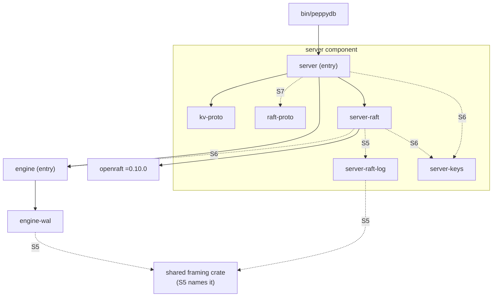
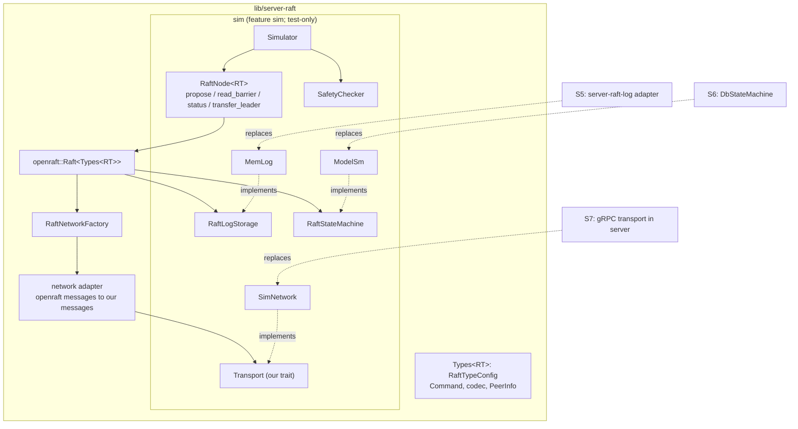
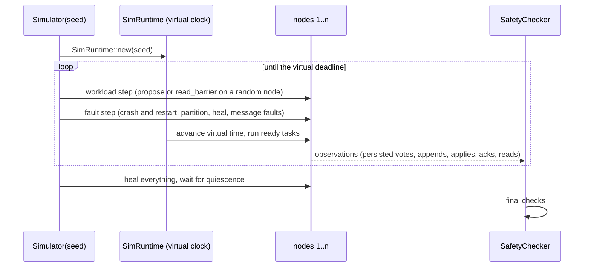

# 0028: Raft core and deterministic simulator

**Status:** Complete

**Parent roadmap:** [Server roadmap](0025-server-roadmap.md), milestone S4.

**Design references:** [Engine external-log mode](../design/engine.md#external-log-mode),
[build system](../design/build-system.md), [server](../design/server.md),
[architecture](../design/architecture.md#code-layout).

**Background:** [Raft paper](../references.md#raft) §5, §7, §8;
dissertation ch. 3, §4.2.3, §6.4, §9.6;
[openraft](../references.md#raft-implementations).

## Goal and scope

This stack wraps openraft behind peppydb's own types. It proves the result
safe in a seeded, deterministic simulator before any disk or network code
exists. Later milestones then add mechanisms behind the same types: S5
adds the on-disk log, S6 the `Db` state machine, and S7 the gRPC peer
transport. Those milestones add implementations; they do not reshape this
API.

- **In scope:**
  - `lib/server-raft`, an internal crate of the server component;
  - the type config, the `Command` payload, and its stable binary codec;
  - the `server_raft::RaftNode` facade: propose, read barrier, status, and
    leader transfer, with error mapping, so that no openraft type reaches
    `server`;
  - test-only storage models:
    - `MemLog`, an implementation of `RaftLogStorage` with a crash model;
    - `ModelSm`, an implementation of `RaftStateMachine` that is durable
      only at snapshots, like `Mode::External`;
  - `SimNetwork`, which drops, delays, duplicates, and reorders messages,
    and partitions nodes;
  - the simulator: seeded runs on `openraft-rt-sim` with a fault schedule
    and a workload;
  - safety checkers for the paper's §5.4 properties, and checks of what
    clients observe;
  - updates to the roadmap's naming and openraft version wording, and to
    the future-work line in `architecture.md`;
    `docs/design/server-raft.md`.
- **Out of scope:**
  - the on-disk Raft log (`server-raft-log`, S5);
  - `Db` as the state machine, the applier and flusher threads,
    compaction, and the `server-keys` move (S6);
  - `peppydb.raft.v1` (`proto/raft/v1`) and gRPC between processes (S7);
  - membership changes (S8);
  - a linearizability checker over full histories (S3).
- **Done when:**
  - the safety checkers pass for N seeds per CI run (N ≈ 500, set from
    measured runtime) on 3-node and 5-node clusters with every fault
    enabled;
  - a long run on demand passes;
  - a failing seed reproduces exactly from `PEPPY_SIM_SEED`;
  - two runs with the same seed produce identical trace hashes;
  - the workspace checks pass.

## Approach

### Component layout

Raft is part of the server component. It exists for one purpose:
replicating one server's `Db` within its group. One Raft group per server
(phase 3) and Raft on every server (roadmap decision 10) tie it to the
server. It also shares server-owned state: the system keyspace
(`0x00 ‖ name`) holds the Raft applied state. Its crates therefore follow
the internal naming rule `server-<part>`
([build system](../design/build-system.md)), and live under `lib/` as
[plan 0027](0027-workspace-language-agnostic-layout.md) places every
library.

| Crate | Directory | Visible to | Arrives | Contents |
| --- | --- | --- | --- | --- |
| `server` (entry) | `lib/server` | `//bin/peppydb:` | 0026 | services, lifecycle; peer transport in S7 |
| `kv-proto` | `proto/kv/v1/rust` | `server` | 0026, 0027 | generated `peppydb.kv.v1` code |
| `raft-proto` | `proto/raft/v1/rust` | `server` | S7 | generated `peppydb.raft.v1` code |
| `server-raft` | `lib/server-raft` | `server` | **this stack** | type config, `Command` codec, `RaftNode` facade, sim models behind a `sim` feature; `DbStateMachine` and applier in S6 |
| `server-raft-log` | `lib/server-raft-log` | `server-raft` | S5 | the on-disk Raft log; no openraft dependency |
| `server-keys` | `lib/server-keys` | `server`, `server-raft` | S6 | key layout and format marker, moved out of `lib/server/src/keys.rs` (`server-raft` cannot depend on `server`: that would be a cycle) |



Rules that later stacks keep:

- **openraft stays inside `server-raft`.** `server` sees only the facade
  and `server-raft`'s own types, so an openraft upgrade (decision 9)
  changes one crate.
- **`server-raft-log` does not depend on openraft.** It has its own API
  (`append`, `sync_to`, `truncate_after`, `purge`, `save_vote`);
  `server-raft` adapts it to `RaftLogStorage`. The on-disk format and its
  crash tests do not change on an openraft upgrade.
- **`server-raft` does not depend on tonic or any proto crate.** The S7
  transport lives in `server` and implements the `Transport` trait that
  `server-raft` defines over its own message types
  ([The transport trait](#the-transport-trait)). Visibility cannot enforce
  this rule, so it is recorded here and in the design document.
- **The shared framing crate** (CRC records, segment naming, directory
  sync) is used by both `engine-wal` and `server-raft-log`, so it belongs
  to neither component. S5 names it.

### Inside `server-raft`



The extension points are the two openraft storage traits and our
`Transport` trait. S5, S6, and S7 each add one implementation behind one
of them, and none of them changes `RaftNode`. The network adapter is the
only code that converts between openraft's message types and ours; it is
written once in this stack and exercised by every simulator run.

### Type config, generic over the runtime

Production runs on `TokioRuntime`, and tests run on `SimRuntime`.
`declare_raft_types!` fixes one runtime per type config, so `Types<RT>`
implements `RaftTypeConfig` by hand:

```rust
pub struct Types<RT>(PhantomData<RT>);

impl<RT: AsyncRuntime> RaftTypeConfig for Types<RT> {
    type D = Command;
    type R = Applied;                 // apply outcome returned to the proposer
    type NodeId = u64;
    type Node = PeerInfo;             // { addr: String }; S7 fills it in
    type Term = u64;
    type LeaderId = leader_id_std::LeaderId<u64, u64>; // one leader per term
    // Vote, Membership, Payload, Entry: the openraft::impls defaults
    type Responder<T> = OneshotResponder<Self, T>;
    type AsyncRuntime = RT;
    // ...
}

// The facade. Production uses the default runtime (`RaftNode`); tests
// name the simulator (`RaftNode<SimRuntime>`).
pub struct RaftNode<RT: AsyncRuntime = TokioRuntime> { /* openraft::Raft<Types<RT>>, ... */ }
```

**Standard leader IDs.** `LeaderId` must be `leader_id_std::LeaderId`,
which allows at most one leader per term, as the paper's election safety
property states (§5.2, Figure 3). openraft's macro default,
`leader_id_adv::LeaderId`, identifies a leader by (term, node ID) and
allows several leaders in one term, ordered by node ID, to reduce split
votes. That is a departure from the paper, and it would break the
"at most one leader per term" check below. The type config sets the
standard mode explicitly, and a unit test asserts it, so that a later
change to openraft's defaults cannot switch it silently.

### The payload and its codec

```rust
/// One replicated write. The entry at Raft index i becomes Db::apply(i, ops)
/// (roadmap decision 1). Blank and membership entries carry no Command and
/// leave gaps in the applied sequence.
pub struct Command { pub ops: Vec<OwnedOp> }

// The encoding is ours, not serde: server-raft-log (S5) stores these bytes.
// version u8 = 1 | count u32 | { kind u8 (put=1, del=2) | klen u32 | key | vlen u32 | value }*
impl Command {
    pub fn encode(&self, out: &mut Vec<u8>);
    pub fn decode(bytes: &[u8]) -> Result<Self, CodecError>;
}
```

- Keys already carry the namespace byte (decision 8). `server` adds the
  byte before it proposes.
- The version byte lets the format change later. Property tests check
  that `decode(encode(c)) == c` and that every truncation of a valid
  encoding is rejected.

### The facade

As built (the draft's shape is recorded under
[Discoveries](#discoveries-and-plan-changes)):

```rust
// `SM` is the state machine: `ModelSm` in tests, `DbStateMachine` in S6.
pub struct RaftNode<SM, RT = TokioRuntime> { /* openraft::Raft<Types<RT>, SM> */ }

impl<SM, RT> RaftNode<SM, RT> {
    /// Returns once the entry is committed and applied on this node.
    pub async fn propose(&self, cmd: Command) -> Result<Proposed, ProposeError>;
    /// Read index (dissertation §6.4): confirms leadership and waits until
    /// applied >= the read point. The caller then reads its local state.
    pub async fn read_barrier(&self) -> Result<ReadPoint, ReadError>;
    pub fn status(&self) -> Status;   // role, term, vote, leader, commit, applied, ...
    pub async fn transfer_leader(&self, to: u64) -> Result<(), StopError>;
    // start, initialize, snapshot, shutdown, and handle_* for incoming messages
}

pub enum ProposeError {
    NotLeader(LeaderHint),   // nothing was proposed; safe to retry anywhere
    OutcomeUnknown,          // appended, then discarded on a leader change
    Stopped(String),         // the node stopped (fail-stop, as in 0026)
    Internal(String),        // a server bug
}
pub enum ReadError { NotLeader(LeaderHint), NoQuorum, Stopped(String) }
```

- `read_barrier` calls `ensure_linearizable(ReadPolicy::ReadIndex)`.
  Leader leases are a later optimization (decision 5).
- One module, `error.rs`, matches on openraft's error enums. Nothing else
  does.

### The transport trait

`server` must carry Raft messages between processes in S7 without
depending on openraft. `server-raft` therefore defines its own plain
message types and a `Transport` trait over them, and a network adapter
implements openraft's `RaftNetworkFactory` on top of that trait.

```rust
// With standard leader IDs (above), a committed leader is identified by
// its term alone, so a LogId is (term, index).
pub struct LogId { pub term: u64, pub index: u64 }
pub struct Vote { pub term: u64, pub node: u64, pub committed: bool }

pub enum EntryPayload {
    Blank,                        // a new leader's no-op
    Command(Vec<u8>),             // the Command codec's bytes, opaque here
    Membership(MembershipConfig), // voter sets and every member's PeerInfo
}
pub struct Entry { pub log_id: LogId, pub payload: EntryPayload }

pub struct AppendEntries {
    pub vote: Vote,
    pub prev: Option<LogId>,
    pub entries: Vec<Entry>,
    pub commit: Option<LogId>,
}
pub enum AppendReply {
    Accepted(Option<LogId>),
    Conflict { log_id: LogId, hint: Option<Vec<LogId>> },
    HigherVote(Vote),
}
pub struct VoteRequest { pub vote: Vote, pub last: Option<LogId>, pub transfer_from: Option<Vote> }
pub struct VoteReply { pub vote: Vote, pub granted: bool, pub last: Option<LogId> }

/// What server-raft needs from the network. `from` lets a test network
/// model partitions. S7 implements it in `server` over gRPC.
pub trait Transport: Send + Sync + 'static {
    type SnapshotData: Send + 'static;  // the state machine's snapshot type
    fn append_entries(&self, from: u64, to: u64, req: AppendEntries)
        -> impl Future<Output = Result<AppendReply, Unreachable>> + Send;
    fn vote(&self, from: u64, to: u64, req: VoteRequest)
        -> impl Future<Output = Result<VoteReply, Unreachable>> + Send;
    fn pre_vote(&self, from: u64, to: u64, req: VoteRequest)
        -> impl Future<Output = Result<VoteReply, Unreachable>> + Send;
    fn snapshot(&self, from: u64, to: u64, vote: Vote, meta: SnapshotMeta, data: Self::SnapshotData)
        -> impl Future<Output = Result<Vote, Unreachable>> + Send;
    fn transfer_leader(&self, from: u64, to: u64, req: TransferLeader)
        -> impl Future<Output = Result<TransferReply, Unreachable>> + Send;
}
```

**The wire format is a hybrid.** In S7, `peppydb.raft.v1` mirrors the
envelope field by field: votes, `LogId`s, the commit index, membership,
and the reply variants. A `Command` payload travels as `bytes`, encoded by
the `Command` codec, which is the same encoding that `server-raft-log`
stores in S5.

```proto
// S7 sketch, not part of this stack.
message LogId { uint64 term = 1; uint64 index = 2; }
message Entry {
  LogId log_id = 1;
  oneof payload { Blank blank = 2; bytes command = 3; Membership membership = 4; }
}
message AppendEntriesRequest {
  Vote vote = 1; optional LogId prev = 2; repeated Entry entries = 3; optional LogId commit = 4;
}
```

- **Mixed versions must interoperate.** During a rolling upgrade, old and
  new binaries share a cluster. A mirrored envelope puts that
  compatibility under `buf breaking`, which every change already runs. An
  opaque envelope would hide it from the check: an openraft upgrade could
  change an encoding inside a `bytes` field without any check failing.
- **`Command` bytes stay opaque** because they already have a versioned
  codec of their own, and the log stores the same bytes; mirroring them
  would add a second schema for one format.
- **Debuggability.** Terms and indexes are readable in `grpcurl` and logs.
- **Cost.** Conversion code in the adapter (here) and in `server` (S7),
  and a proto change when openraft's messages change. Both are reviewed
  like any other change.

### Storage models that match the real components

| Model | Mirrors | Crash behavior |
| --- | --- | --- |
| `MemLog` | `server-raft-log` (S5) | `append` buffers entries and fires `IOFlushed` after a delay chosen by the seed. A crash loses everything not yet flushed. `save_vote` is durable before it returns. `truncate_after` and `purge` follow the roadmap's ordering. |
| `ModelSm` | `Db` in `Mode::External` | A `BTreeMap` that holds the applied `LogId` and the membership as system keys (`0x00 ‖ …`) in the same map as the data. A crash rolls it back to the last snapshot (its "checkpoint"), and openraft redelivers from `applied_state()`. |

`ModelSm` uses openraft's "transient state machine" pattern: snapshots are
persistent, and the log implements `save_committed`. S6 has exactly this
contract with `Db`: the applied state rolls back to the checkpoint, and
the log redelivers. The simulator therefore exercises the redelivery path
now, not first in S6. openraft's `testing` storage suite runs against
`MemLog` as a conformance check.

### The simulator



- One seed drives every random choice: faults, delays, the workload, and
  openraft's election timeouts through `SimRuntime`.
- `PEPPY_SIM_SEED=<n>` reruns one seed. A failing run prints its
  reproduction command.
- Fault knobs:
  - the crash and restart rate;
  - partition shapes: minority, majority, isolated leader, asymmetric;
  - drop, duplicate, and delay distributions for messages.
- The trace hash covers every observation, so the determinism test can
  compare two runs of one seed.

**Two tiers of seeds.** The default workspace test run must stay fast,
because it runs before every handoff, so simulation runs in two tiers:

| Tier | Where | Seeds | Purpose |
| --- | --- | --- | --- |
| Default | `server-raft-unittest` | a fixed list, `1..=N`, plus every seed that ever failed | regression gate; the same seeds on every run |
| Long | an ignored test, `PEPPY_SIM_SEEDS=100000`, under `tools/linux-run` | a random base seed, printed at the start | exploration; run on demand and before significant changes |

- N is set from the measured cost per seed, so that the default tier
  takes under 60 s. The value and the measurement are recorded in this
  plan.
- Exploration happens only in the long tier, so a default run never fails
  on a commit that did not cause the failure.
- A seed that fails in either tier is fixed and then added permanently to
  the default list (`sim/regressions.rs`), with a comment naming the bug.

### Safety checkers (decision 15)

| Property | Check |
| --- | --- |
| Election safety | At most one leader per term, using each node's persisted votes and every leader transition seen in metrics. |
| Log matching | At every step, if two durable logs share `(index, term)`, their prefixes are identical. |
| Leader completeness | When a leader is elected, its log holds every entry committed in an earlier term. |
| State machine safety | Each index is applied with the same `Command` on every node; the global apply map never conflicts. |
| Persist before send (decision 7) | A vote or append that a peer observes is durable on the sender when the message is delivered. |
| Acknowledged writes survive | After healing, every `Proposed` write is applied on every live node. |
| Read-index reads | Each write uses a unique value. A read that starts after an acknowledged write never returns an older value for that key. |

The last two checks are a cheap per-key real-time check, not full
linearizability. S3 adds Porcupine over complete histories.

### Pre-vote

**The problem.** A node cut off from the cluster times out repeatedly and
increments its term with each election. When it rejoins, its term is
higher than the leader's, and under the paper's rules the leader steps
down when it sees a higher term. One flaky node can then force an
election, although its stale log cannot win it.

**Pre-vote** (dissertation §9.6; etcd raft, raft-rs) prevents this: a
node asks whether it would win before it increments its term, so an
isolated node never raises its term.

**Outcome: pre-vote is enabled.** The draft assumed openraft had no
pre-vote phase. openraft 0.10.0 implements it behind
`Config::enable_pre_vote` (off by default), with a separate `pre_vote`
RPC. `RaftConfig::pre_vote` defaults to `true`, the transport carries the
RPC, and the deviation the draft recorded does not exist.

openraft also rejects votes while a follower's leader lease is valid
(dissertation §4.2.3). The lease stops a disruptive node from winning;
pre-vote stops it from raising its term. The scenarios in diff 13 show
that the difference matters: with pre-vote, a follower isolated for 5 s
keeps its term and the leader is undisturbed; with pre-vote off, the
isolated node raises its term, and the cluster moves to a higher term
when it rejoins.

## Decisions and trade-offs

- **Raft in the server component (`server-raft`), not its own `raft`
  component.** Its scope is the server: one group per server, Raft on
  every server, and the system keyspace shared with `server`. Internal
  crates can still keep narrow APIs, because visibility lists exact
  dependents. *Alternative:* a `raft` component with an entry crate. It
  would enforce a public API, but it would need a cross-component export
  of the server's key layout, and no other consumer is expected.
- **`Types<RT>` generic over the runtime.** *Alternative:* a feature that
  switches the runtime in `declare_raft_types!`. That makes tests build
  different production code. The cost of the generic form is a
  hand-written `RaftTypeConfig` impl.
- **Simulator models behind a `sim` feature in `server-raft`,** with a
  `:server-raft-sim` variant as plan 0026 did for `fault-injection`, so
  S6 and S7 tests can reuse them. *Alternative:* a separate
  `server-raft-sim` crate. It would need `server-raft` internals, so the
  feature is simpler.
- **Our own `Command` codec, not serde.** The bytes are stored on disk in
  S5 and must stay stable across openraft and serde upgrades.
- **Pin `=0.10.0`.** The first stable 0.10 release; the alphas are not
  pinned.
- **Pre-vote on.** openraft offers it; it prevents rejoin disruption that
  the lease check alone does not (scenario tests).
- **The simulator and checker are test-only; the models are not.**
  `MemLog`, `ModelSm`, `Router`, and `SimNetwork` are generic over the
  runtime and built with the `sim` feature for S5 to S7 tests. The
  simulator and checker are tied to `SimRuntime` and stay `cfg(test)`,
  so the `sim` variant needs no `openraft-rt-sim` dependency.
- **Standard leader IDs (`leader_id_std`).** One leader per term, as in
  the paper. *Alternative:* openraft's default advanced mode, which allows
  several leaders per term and can reduce split votes. It would be a
  recorded deviation from the paper, and the election-safety check would
  have to become "at most one leader per (term, node)". Split votes are
  rare with randomized timeouts, so the benefit does not justify the
  deviation now.
- **Our own transport messages; a hybrid wire format.** The `Transport`
  trait uses `server-raft`'s message types, so `server` never sees
  openraft. In S7 the envelope is mirrored in `raft.v1` and `Command`
  payloads are opaque bytes. *Alternatives:* an opaque envelope (simple,
  but `buf breaking` cannot see wire changes inside the bytes, which
  matters for rolling upgrades); mirroring the `Command` too (a second
  schema for an encoding that already has one).
- **Two seed tiers, fixed default seeds.** *Alternative:* default seeds
  derived from the revision, which explores more over time but can fail a
  commit that did not cause the bug.

## Proposed commit stack

The stack was first nine diffs; it was split into fourteen after
implementation so that each diff is smaller (see
[Discoveries](#discoveries-and-plan-changes)).

### `[1/14][server-raft-core][plan] plan the Raft core and simulator`

- **Purpose:** This plan, and the naming change in the roadmap.
- **Core changes:** this file; in `0025-server-roadmap.md`, decision 13
  and the component table move Raft into the server component
  (`server-raft`, `server-raft-log`), and "0.10 alphas" becomes 0.10.0;
  in `architecture.md`, `lib/raft*` becomes `lib/server-raft*`.
- **Verification:** Review.

### `[2/14][server-raft-core][deps] pin openraft 0.10.0 and openraft-rt-sim`

- **Purpose:** Dependencies, kept apart because the generated BUCK diff is
  large and mechanical.
- **Core changes:** `openraft = "=0.10.0"`, `openraft-rt-sim = "=0.10.0"`
  in `third-party/rust/Cargo.toml`; `tools/buckify`; fixups as needed.
- **Verification:** `tools/buck2 build //third-party/rust/...`;
  `cargo test --workspace --locked`.

### `[3/14][server-raft-core][codec] add the server-raft crate and the command codec`

- **Core changes:** `lib/server-raft` (`peppy_rust_library`, visible to
  `//lib/server:` only, no openraft dependency yet); `Command` and its
  codec; the seeded `Rng` for tests; `tools/autocargo`.
- **Verification:** codec tests (round trip, fixed layout, every
  truncation rejected, bad version, kind, and trailing bytes rejected);
  `Rng` tests.

### `[4/14][server-raft-core][types] define the openraft type config`

- **Core changes:** the openraft dependencies; `Types<RT>`, `PeerInfo`,
  standard leader ids.
- **Verification:** the config holds for both runtimes; a test that
  leader ids are standard (two candidates in one term are unordered).

### `[5/14][server-raft-core][sim] add an in-memory log with a crash model`

- **Core changes:** `MemLog`; the `sim` feature and its
  `:server-raft-sim` variant, visible only to `server`'s unit tests.
- **Verification:** a crash loses exactly the unflushed suffix;
  `save_vote` survives a crash; durability follows the write order.

### `[6/14][server-raft-core][sim] add a model state machine durable at snapshots`

- **Core changes:** `ModelSm` with the applied `LogId` and the membership
  as system keys; snapshot build and install.
- **Verification:** openraft's storage conformance suite over both
  models; a crash rolls back to the snapshot; redelivery converges; an
  install replaces state and metadata together.

### `[7/14][server-raft-core][transport] define peer messages and the Transport trait`

- **Core changes:** `transport.rs`: the message types, the `Transport`
  trait, and `From`/`TryFrom` conversions to and from openraft's types.
- **Verification:** every message converts to openraft's type and back
  unchanged; commands travel as codec bytes; a bad command is rejected.

### `[8/14][server-raft-core][node] wrap openraft behind the RaftNode facade`

- **Core changes:** `RaftNode<SM, RT>`, `RaftConfig`, `Status`;
  `error.rs`; the network adapter over `Transport`; `Router`, a perfect
  in-memory transport.
- **Verification:** on `SimRuntime` with the router: election; propose
  and apply on every node; read barrier; leader transfer; `NotLeader`
  with a correct hint on followers.

### `[9/14][server-raft-core][sim] add a fault-injecting network`

- **Core changes:** `SimNetwork` (drops, lost replies, duplicates,
  delays, partitions, one-way links) over the router; the trace.
- **Verification:** a 3-node cluster converges over a lossy network;
  a partitioned node receives nothing and catches up after healing.

### `[10/14][server-raft-core][sim] add the seeded cluster simulator`

- **Core changes:** the simulator: configuration drawn from a seed,
  crashes and restarts, the fault schedule, the client workload,
  quiescence, the trace hash.
- **Verification:** two runs of a seed record identical traces; every
  fault type occurs; replicas converge.

### `[11/14][server-raft-core][sim] check Raft safety properties`

- **Core changes:** the checker; observer hooks in the models; the
  network probe; `Cluster::finish` runs the final checks.
- **Verification:** each check detects a synthetic violation; simulated
  runs are safe; a log that loses unflushed votes is caught in every
  seed.

### `[12/14][server-raft-core][sim] run the default and long seed tiers`

- **Core changes:** the default tier (`1..=N` and `sim/regressions.rs`)
  in 8 parallel chunks; `PEPPY_SIM_SEED`; the ignored long tier.
- **Verification:** the default tier passes on 3 and 5 nodes in under
  60 s; N and the cost per seed are recorded; the long tier passes.

### `[13/14][server-raft-core][sim] add scripted fault scenarios`

- **Core changes:** `tests/scenarios.rs`.
- **Verification:** an isolated leader is replaced and rejoins as a
  follower; with pre-vote a rejoining node does not disrupt the leader,
  and without it the cluster moves to a higher term; a write discarded
  on a leader change reports `OutcomeUnknown` and applies nowhere.

### `[14/14][server-raft-core][docs] document the Raft core`

- **Core changes:** `docs/design/server-raft.md` (layout and dependency
  rules, facade, models, guarantees with their tests, pre-vote); the
  component section of `server.md`; the code layout table in
  `architecture.md`; roadmap S4 progress; this plan's progress.
- **Verification:** links resolve; guarantees match the tests.

## Open questions

None. The two results measured during the stack:

- **N for the default tier** is 400 (0.34 s of CPU per seed in debug;
  20 s of wall time in 8 parallel chunks on 12 cores).
- **The rejoining-node scenario** led to enabling openraft's real
  pre-vote ([Pre-vote](#pre-vote)).

## Verification strategy

| Check | Command or procedure | Expected result | Outcome (2026-11-11, macOS aarch64) |
| --- | --- | --- | --- |
| Unit, model, and sim tests | `tools/buck2 test //lib/server-raft/...` | Pass | Pass; 49 tests, 1 ignored (the long tier) |
| Default tier | `tools/buck2 run //lib/server-raft:server-raft-unittest -- tests::sweep` | Pass in under 60 s | 400 seeds, 3 and 5 nodes, 20 s wall |
| Reproduce one seed | `PEPPY_SIM_SEED=<n> tools/buck2 run //lib/server-raft:server-raft-unittest -- tests::sweep::one_seed --nocapture` | Same trace hash, same result | Seed 594594012345: hash `e892c9a2ff9bd84e` in two processes |
| Long tier | `tools/buck2 run @build/mode/release //lib/server-raft:server-raft-unittest -- --ignored long_tier --nocapture` | Pass | 100,000 seeds from base 594594002000 in 148 s on 12 threads; no violations. Run on macOS, not under `tools/linux-run` |
| Checker sensitivity | `sim/checker.rs` tests; `a_log_that_loses_votes_is_caught` | Violation detected | Every check detects its synthetic violation; the lazy-vote log fails 100 of 100 seeds (persist before send) |
| Workspace checks | the `AGENTS.md` list | Pass | Pass: fmt; clippy (31 targets); 30 Buck2 test targets; `cargo test --workspace --locked`; autocargo, gobuckify-remote, and gen-proto checks; `go vet` and `go test` |
| Miri | not required | `server-raft` has no `unsafe` code | Not run; `tools/check-unsafe` passes |

## Progress

- [x] Agree on the design and commit stack with the user.
- [x] 2/14 dependencies.
- [x] 3/14 crate and codec.
- [x] 4/14 type config.
- [x] 5/14 `MemLog`.
- [x] 6/14 `ModelSm`.
- [x] 7/14 peer messages and `Transport`.
- [x] 8/14 facade.
- [x] 9/14 `SimNetwork`.
- [x] 10/14 simulator.
- [x] 11/14 safety checker.
- [x] 12/14 seed tiers.
- [x] 13/14 scenarios.
- [x] 14/14 design document; stack-wide verification.

## Discoveries and plan changes

- openraft 0.10.0 and `openraft-rt-sim` 0.10.0 were released on
  2026-11-10. The roadmap still describes 0.10 as alphas, so diff 1
  corrects it, and this stack pins the stable release.
- During planning, Raft moved from a separate `raft` component to the
  server component (`server-raft`, `server-raft-log`). The reasons are its
  server-specific scope and its shared use of the system keyspace. Plan
  0027 lists `lib/raft` and `lib/raft-log` as future directories; that
  plan is a historical record and stays unchanged, and `architecture.md`
  is updated instead.
- openraft's default `LeaderId` (`leader_id_adv`) allows several leaders
  per term. The first draft used it by mistake, which contradicted the
  election-safety check. The plan now requires `leader_id_std`, as the
  paper does.
- During planning, the seed budget became two tiers; the pre-vote
  question became a recorded deviation whose consequence a scenario test
  decides; and the transport became a trait over our own message types,
  with a hybrid wire format for S7 (mirrored envelope, opaque `Command`
  bytes). The first draft recommended an opaque envelope; rolling-upgrade
  compatibility under `buf breaking` changed the recommendation.

During implementation:

- **openraft 0.10.0 has pre-vote** (`Config::enable_pre_vote`, off by
  default). The planned deviation was unnecessary; pre-vote is on, and
  the transport carries its RPC. The scenario without pre-vote confirms
  the disruption it prevents.
- **The persist-before-send probe first reported 9 of 30 seeds.** A
  follower accepted appends through an index whose entry was not in its
  durable log. openraft sends that reply only after the IO for
  `(vote, last)` is flushed, so the probe was suspect. The cause: the
  follower had installed a snapshot covering the index, which is durable
  in the state machine at once while the log's purge is still queued. The
  probe now accepts "in the durable log, or at or below the durable
  snapshot". A second hypothesis, a race with a conflict truncation, was
  tested and found unnecessary (300 seeds pass without allowing it), so
  the probe stays strict.
- **The lazy-vote bug is caught by persist before send, not election
  safety.** The plan expected election safety to catch it; in 100 seeds
  it never did, because two leaders need a crash between a vote and its
  flush. Persist before send catches it in every seed. Each check also
  has a synthetic sensitivity test.
- **Shapes changed from the draft:**
  - The facade is `RaftNode<SM, RT>`, because openraft's `Raft` is
    generic over the state machine.
  - `read_barrier` returns `ReadError` (`NoQuorum` is a distinct
    failure).
  - `ProposeError::Fatal` became `Stopped` and `Internal`.
  - A `Vote` names its node directly, because 0.10's standard leader id
    has a non-optional node.
  - The `Transport` trait gained `pre_vote`, `transfer_leader`, a
    `from` argument, and an associated snapshot type.
  - `Command::encode` returns an error for fields over `u32::MAX` bytes.
- **The simulator and checker are `cfg(test)`;** the models are behind the
  `sim` feature. The draft had all of `sim` behind the feature.
- **The default tier runs in 8 chunks** so the test harness runs them in
  parallel.
- **The stack was split from nine diffs to fourteen** after
  implementation, for review: the codec and the type config; the peer
  messages and the facade; the network and the simulator; the checker,
  the seed tiers, and the scenarios. For the split, the transport
  conversions became `From`/`TryFrom` impls (methods would have been
  dead code in the diff before the facade), and `SimNetwork` gained its
  own tests.
- **openraft's leader restore** (`Config::enable_leader_restore`, on by
  default) makes a restarted former leader campaign at once in a higher
  term. It is left on; the sweep covers it.
- **The long tier ran on macOS,** not under `tools/linux-run`; the
  simulator is single-threaded and deterministic, so the platform does
  not change its results.

## Agent notes

- **Entry points:**
  - `lib/server/src/keys.rs`, for the system-key encoding that `ModelSm`
    mirrors;
  - `lib/engine/src/tests/replica.rs`, for the redelivery pattern;
  - `lib/server/BUCK` and `//lib/engine:engine-fault-injection`, for the
    feature-variant pattern that `:server-raft-sim` follows;
  - openraft's `testing` module, for the storage suite.
- In openraft 0.10, `SnapshotData` is an associated type of
  `RaftStateMachine`, not `RaftTypeConfig`. `try_create_snapshot_builder`
  replaces `get_snapshot_builder`.
- The simulator calls `SimRuntime::with_seed(seed)` directly, so
  `PEPPY_SIM_SEED` controls every RNG; `openraft_rt_sim::SEED_ENV` is not
  used.
- Reindeer needed build-script fixups for `num-traits`, `serde`,
  `chrono-tz`, and `generic-array` (openraft's dependencies).
- openraft's metrics field `committed` is deprecated; `Status` uses
  `local_committed`.
