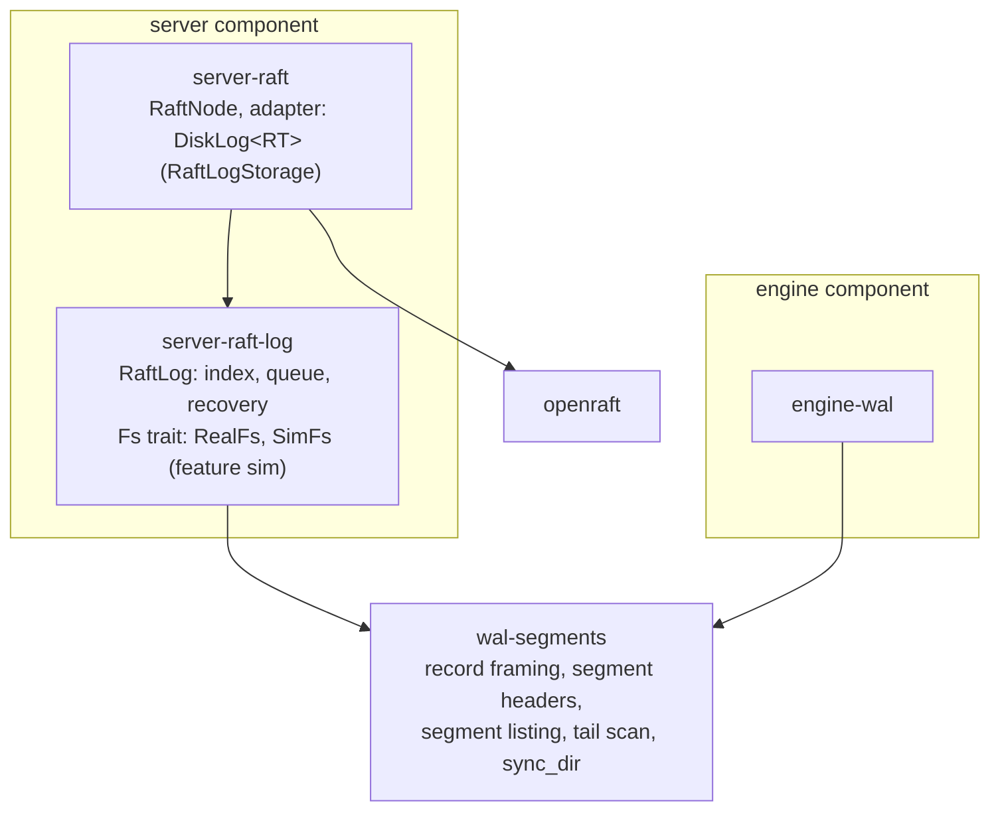
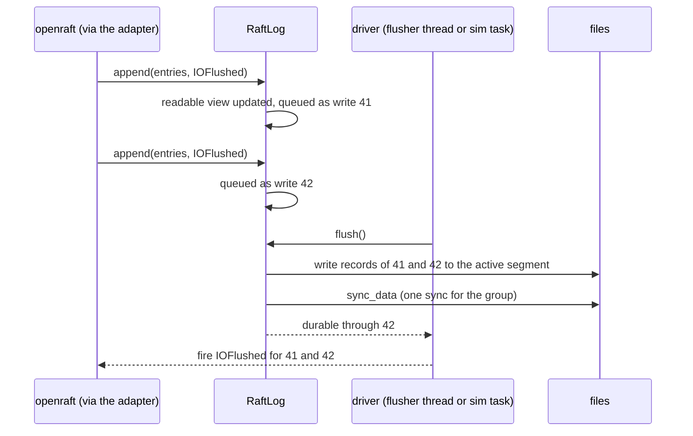

# 0029: The on-disk Raft log

**Status:** In progress

**Parent roadmap:** [Server roadmap](0025-server-roadmap.md), milestone S5
(decision 13, "The Raft log").

**Design references:** [Server Raft](../design/server-raft.md) (the
`MemLog` contract this log must keep), [engine](../design/engine.md)
(the write-ahead log whose mechanics this log borrows),
[build system](../design/build-system.md),
[remote benchmarks](../design/remote-benchmarks.md).

**Builds on:** [plan 0028](0028-server-raft-core.md) (the Raft core, its
models, and the simulator), [plan 0020](0020-engine-wal.md) (the engine's
write-ahead log), [plan 0024](0024-gcp-remote-bench.md) (fsync measurements
on GCP).

## Goal and scope

Plan 0028 runs openraft over `MemLog`, an in-memory model of a Raft log.
This stack builds the real log: `server-raft-log`, which keeps Raft entries,
the vote, and the purge point in files, and survives process crashes and
power loss. It keeps `MemLog`'s contract exactly, so the safety checks of
plan 0028 apply to it unchanged, and it runs inside the deterministic
simulator over a simulated file system.

- **In scope:**
  - `lib/wal-segments`, a shared crate for checksummed records in numbered
    segment files, extracted from `engine-wal`, which keeps its on-disk
    format byte for byte;
  - `lib/server-raft-log`: the segment format for Raft entries, the
    in-memory index, recovery with torn-tail repair, one ordered write
    queue with group commit, `truncate_after`, `purge`, the vote, and the
    committed log id; no openraft dependency;
  - a small file-system trait with a real implementation and a simulated
    one that models power loss (unsynced bytes and unsynced directory
    changes are lost; a tail can be torn);
  - an adapter in `server-raft` that implements openraft's
    `RaftLogStorage` over the log, with a flusher thread in production
    and a flusher task in the simulator;
  - crash tests: every crash point of scripted sequences on the
    simulated file system, and process-crash tests on real files;
  - the simulator running the real log by default;
  - benchmarks: the log alone, and three nodes over real files;
  - `docs/design/server-raft.md` updates.
- **Out of scope:** the `Db` state machine and compaction through
  `checkpoint_with` (S6); the gRPC transport (S7); segment preallocation
  (an extension point, measured on Linux first; see
  [Decisions](#decisions-and-trade-offs)); `O_DIRECT` or `O_DSYNC` writes;
  remote GCP runs (S2).
- **Done when:**
  - openraft's storage conformance suite passes on the adapter over both
    file systems;
  - after a crash at every point of the scripted crash tests, recovery
    returns the result of a prefix of the submitted writes that includes
    every write whose completion was reported;
  - the simulator's default tier and a 100,000-seed long tier pass with
    the real log;
  - a failed sync stops the node (fail-stop) and never reports a write as
    durable;
  - `engine-wal`'s existing tests pass unchanged on `wal-segments`, and
    segments written before the extraction still replay;
  - the benchmarks are recorded; the workspace checks pass.

## Approach

### Components



- **`server-raft-log` knows nothing about openraft.** Entries are an
  index, a term, a kind, and payload bytes. `server-raft` converts
  openraft's entries and votes to these types, as it already does for the
  transport.
- **`wal-segments`** holds only what is identical in both logs
  (roadmap decision 13). It frames opaque bodies and manages the files
  that hold them; it never interprets a body. The Raft entry encoding
  (`kind | index | term | payload`) stays in `server-raft-log`, and the
  engine's operation encoding stays in `engine-wal`. It belongs to neither
  component, so it is its own small component with one crate. The name
  says what both users have in common, write-ahead log segments, and
  deliberately avoids `raft`.

### The API

```rust
/// One stored entry. The log does not interpret the payload.
pub struct LogEntry {
    pub index: u64,
    pub term: u64,
    pub kind: EntryKind,     // Blank, Command (codec bytes), Membership (encoded)
    pub payload: Vec<u8>,
}

/// The persisted vote: term, candidate, and whether a quorum granted it.
pub struct StoredVote { pub term: u64, pub node: u64, pub committed: bool }

/// What `open` recovered.
pub struct Recovered {
    pub vote: Option<StoredVote>,
    pub purged: Option<LogPos>,     // LogPos = (term, index)
    pub last: Option<LogPos>,       // the last entry, or `purged` if none remain
    pub committed: Option<LogPos>,
    pub repaired_bytes: u64,        // torn tail removed
}

impl<F: Fs> RaftLog<F> {
    pub fn open(fs: F, dir: &Path, options: LogOptions) -> Result<(Self, Recovered), LogError>;

    // Writes. Each one is applied to the readable view at once and queued
    // for durability, in submission order. Each returns its write number.
    pub fn append(&self, entries: Vec<LogEntry>) -> Result<WriteId, LogError>;
    pub fn truncate_after(&self, index: Option<u64>) -> Result<WriteId, LogError>;
    pub fn purge(&self, upto: LogPos) -> Result<WriteId, LogError>;
    pub fn save_vote(&self, vote: StoredVote) -> Result<WriteId, LogError>;
    pub fn save_committed(&self, committed: Option<LogPos>) -> Result<WriteId, LogError>;

    // Durability: the driver calls `flush` (below); it makes every queued
    // write durable in order and returns the last write now durable.
    pub fn flush(&self) -> Result<WriteId, LogError>;
    pub fn durable(&self) -> WriteId;

    // Reads, from the readable view.
    pub fn entries(&self, range: impl RangeBounds<u64>) -> Result<Vec<LogEntry>, LogError>;
    pub fn state(&self) -> LogState;   // purged, last, vote, committed
}
```

**Writes are one ordered queue,** as in `MemLog`. openraft requires every
write (appends, truncations, purges, the vote) to be serialized: none may
become durable before an earlier one. `flush` takes the whole queue and
processes it in order:



- **Group commit.** Consecutive appends and committed-log-id writes in
  the queue share one write and one `sync_data`. A truncation, a purge, or
  a vote ends the group: the flusher syncs what came before, performs it,
  and continues.
- **One appender.** openraft appends from its single core task, so the
  engine WAL's append-mutex contention (plan 0024, finding 5) does not
  arise; the queue lock is held only to push.
- **The driver** is a thread in production and a task on the simulator's
  runtime in tests (below). `RaftLog` itself starts no thread, which is
  what lets the simulator run it deterministically.

### On-disk layout

```text
raft-log/
  00000000000000000001.log    segments, named by their first index
  state                       vote and purge point; replaced by tmp + rename

segment header, 32 bytes (the wal-segments layout, magic "PEPPYRLG"):
  magic (8) | version u32 = 1 | reserved u32 | first_index u64 | header_crc u32 | zero (4)

record (the wal-segments framing, padded to 8 bytes for this log):
  len u32 | crc u32 | body | zero padding to a multiple of 8
  body = kind u8 | index u64 | term u64 | payload      (kinds 0..2: entries)
       | kind u8 = 3 | committed term u64 | committed index u64   (commit point)
```

- **Records are padded to a multiple of 8 bytes.** With the 32-byte
  segment header, every record header then starts at an 8-aligned offset,
  and an 8-byte header at such an offset never crosses a sector boundary
  (512 bytes or 4 KiB). If one sector write is atomic, a crash cannot
  persist half of a length field. `len` is the unpadded body length; the
  CRC covers `len` and the body, not the padding, which must be zero.
  etcd's WAL and hashicorp/raft-wal pad to 8 bytes for the same reason.
  The CRC alone already makes a torn length safe (it fails the check and
  is repaired as a torn tail); padding makes recovery's distinction
  between a torn tail and corruption more reliable. The cost is up to 7
  bytes per record.
- **Padding is a `wal-segments` parameter.** The Raft log turns it on;
  `engine-wal` leaves it off, so its format stays byte for byte the same
  and the extraction stays a pure refactor.

- **Entries** are records in index order with no gaps inside a segment. A
  new segment starts when the active one exceeds `segment_bytes` (default
  64 MiB), at a group boundary, as in `engine-wal`.
- **The committed log id is a record in the stream,** not a file. openraft
  calls `save_committed` often; a record joins the next group commit and
  costs no extra sync. Recovery takes the last commit record, or the
  `state` file's purge point if it is higher. Losing the newest commit
  record in a crash is allowed: openraft treats the value as a lower bound.
- **The `state` file** holds the vote and the purge point, each changed
  rarely. It is written as `state.tmp`, synced, renamed over `state`, and
  the directory is synced: either the old or the new file survives, whole.
  It carries a checksum. One file instead of the roadmap's `vote` and
  `meta` files: both change rarely and a single atomic replacement is
  simpler.
- **The in-memory index** maps each index to its segment, offset, and
  term.
- **The entry cache** keeps the newest entries in memory, bounded by bytes
  (`LogOptions::cache_bytes`, default 64 MiB). openraft reads entries back
  to replicate them to followers and to apply them once committed; the
  cache serves the common case, a follower slightly behind or entries
  just committed. A read below the cache reads the segment. The bound
  starts at 64 MiB and is revisited with measurements; in S6, when
  snapshots exist, keeping every entry above the last snapshot becomes an
  option.

### Truncation and purge

- **`truncate_after(k)`** removes every entry after `k`. The flusher
  syncs the preceding group, deletes the segments that start after
  `k + 1`, from the last one backward, then truncates the segment that
  holds `k + 1` at that record's offset (or deletes it, if `k + 1` is its
  first record), syncs the file and the directory. Working from the end
  backward never leaves a hole: a crash in the middle leaves a longer
  log, whose extra entries Raft truncates again.
- **Invariant: no write after a truncation becomes durable before the
  truncation does.** The flusher must finish the truncation's file and
  directory syncs before it writes any record queued after it. Otherwise
  a crash could keep a later append while bringing back the entries it
  replaced, and recovery would return a log that is not a prefix of the
  writes. The scripted crash tests (diff 6) must include a truncation
  followed by appends, crashed at every operation.
- **`purge(p)`** writes the new purge point to `state` first, then
  deletes every segment whose entries are all at or below `p`. A crash
  between the two leaves extra segments, which recovery skips and the next
  purge deletes. Entries at or below `p` in a partly purged segment are
  ignored on recovery.

### Recovery

`open` lists the segments, reads `state`, and scans every segment from the
first one at or after the purge point:

1. Validate each header (magic, version, checksum, first index matching the
   name).
2. Decode records in order. Entry indexes must increase by exactly one;
   commit records may appear anywhere.
3. **Torn tail.** In the last segment only, an undecodable record with no
   intact record after it is a torn tail: truncate the file there and sync.
   Damage followed by intact records, or damage in an earlier segment, is
   corruption and `open` fails. This is `engine-wal`'s rule, from
   `wal-segments`. A segment that has only a torn header is removed.
4. Take the committed log id: the last commit record, or the purge
   point if that is higher. A committed log id below the purge point is
   never returned.
5. Build the index and the cache, and return `Recovered`.

The result must be the effect of a prefix of the writes queued before the
crash, including every write that was reported durable.

### The file-system trait

```rust
/// What the log needs from a file system. `RealFs` calls `std::fs`;
/// `SimFs` (feature `sim`) keeps files in memory with a crash model.
pub trait Fs: Clone + Send + Sync + 'static {
    type File: FsFile;
    fn create_new(&self, path: &Path) -> io::Result<Self::File>;
    fn open(&self, path: &Path) -> io::Result<Self::File>;
    fn read(&self, path: &Path) -> io::Result<Vec<u8>>;
    fn list(&self, dir: &Path) -> io::Result<Vec<PathBuf>>;
    fn rename(&self, from: &Path, to: &Path) -> io::Result<()>;
    fn remove(&self, path: &Path) -> io::Result<()>;
    fn sync_dir(&self, dir: &Path) -> io::Result<()>;
}

pub trait FsFile: Send + 'static {
    fn append(&mut self, bytes: &[u8]) -> io::Result<()>;
    fn read_at(&self, offset: u64, buf: &mut [u8]) -> io::Result<()>;
    fn set_len(&mut self, len: u64) -> io::Result<()>;
    fn sync_data(&mut self) -> io::Result<()>;
    fn len(&self) -> u64;
}
```

**`SimFs`'s crash model is power loss,** which is stricter than the
engine's process-crash tests:

- Bytes written but not synced are lost on a crash. With a seeded choice,
  a random prefix of them survives instead: a torn tail.
- A created, renamed, or removed name is durable only after `sync_dir` of
  its directory; before that, a crash undoes it.
- `set_len` is durable after the file's next sync.
- Each operation can be made to fail with an I/O error, for fail-stop
  tests.
- `SimFs::crash()` returns the surviving image; a new `SimFs` opens it.

### The adapter and the drivers

`server-raft` gains `DiskLog<RT, F>`, which implements `RaftLogStorage`
over `RaftLog<F>`, and converts entries (the `Command` codec for normal
entries; the membership encoding that `ModelSm` uses moves into a shared
module) and votes.

- **`append`** queues the entries, records the `IOFlushed` callback under
  the write's number, and wakes the driver. The driver fires each callback
  once `flush` reports its write durable.
- **`save_vote`** queues the vote and awaits a oneshot that the driver
  completes after the flush, so no async worker blocks on a sync (the
  disk benchmark of plan 0028 blocked one; roadmap decision 14).
- **The production driver** is a thread named `raft-log-flusher`: wait for
  work, `flush`, fire callbacks, repeat. Groups form while a sync runs.
- **The simulator's driver** is a task on `SimRuntime` that flushes after
  a seeded delay, as `MemLog` does today.
- **Reads** come from the cache. A miss reads the segment on the blocking
  pool in production (`RT::spawn_blocking`) and inline over `SimFs`, which
  never blocks.
- **A failed write or sync is sticky.** The log refuses every later
  write, callbacks report the error, openraft stops the node with a
  storage error, and `propose` returns `Stopped`. The process should
  restart, as for a WAL failure (plan 0026).

### Testing

| Level | What runs | Oracle |
| --- | --- | --- |
| `wal-segments` | Framing (with and without padding), headers, tail scan | `engine-wal`'s existing tests, unchanged; a fixture of segments written before the extraction replays |
| `server-raft-log` on `SimFs` | Scripted write sequences, crashed after every file-system operation in turn, and with torn tails | Recovery returns a prefix of the submitted writes, containing every write reported durable |
| `server-raft-log` on `SimFs`, random | Random writes, flushes, and crashes over many seeds | The same prefix oracle, against a model log |
| `server-raft-log` on real files | Process crashes: a write cut at every byte, then reopen | Written bytes survive; the cut record is repaired away |
| Adapter | openraft's storage suite on `SimFs` and on real files | The suite |
| Simulator | The sweep and the long tier with the real log over `SimFs`, including injected sync failures | Plan 0028's safety checker; a failed sync stops only that node |

The prefix oracle is the property openraft needs. It is what `MemLog`
models, so `MemLog` stays as the reference model of the random tests and
for model-only tests of `ModelSm`.

### Benchmarks

- **The log alone:** appends of 100-byte entries from one task, with
  callbacks, at increasing queue depths; throughput, latency percentiles,
  and entries per sync.
- **Three nodes over real files:** the disk benchmark from plan 0028's
  discussion, now over the real log: 3 nodes in one process on Tokio,
  writers from 1 to 256, with throughput, latency percentiles, writes per
  sync, and the number of elections during each run.
- Both run on macOS here. Linux reference numbers on
  `c4d-standard-8-lssd` (one fsync about 64 to 74 µs, plan 0024) wait for
  roadmap S2's remote runs, which can run these benchmarks unchanged.

## Decisions and trade-offs

- **A new log over a shared framing crate, not a generalized
  `engine-wal`** (roadmap decision 13). The logs differ in indexing (the
  leader assigns indexes), truncation from the end, the vote, and reads by
  index.
- **Extract `wal-segments` in this stack, and move `engine-wal` onto
  it.** *Alternative:* copy the framing into the new crate and extract
  later. Copying is faster now but leaves two versions of torn-tail repair,
  the most delicate code in both logs. The extraction is a pure refactor,
  checked by `engine-wal`'s unchanged tests and an old-segment fixture.
- **Per-record checksums, padded to 8 bytes for the Raft log.** Every
  surveyed log frames records with a length and a checksum. LevelDB,
  Postgres, and etcd check each record; hashicorp/raft-wal and TiKV's
  raft-engine check each batch. *Alternative:* one checksum per group
  commit, which saves about 4 bytes per entry but makes recovery keep or
  drop whole groups and differs from `engine-wal`. Padding is a parameter
  so that `engine-wal`'s format does not change. *Alternative:* pad
  `engine-wal` too, which needs a format version and old-segment reading.
- **Keep `MemLog`.** It stays as the in-memory reference model for the
  random crash tests and for fast `ModelSm` tests. *Alternative:* remove
  it once the real log runs in the simulator.
- **The committed log id as a stream record.** *Alternative:* a field in
  the `state` file. A file write per commit advance would add a rename and
  two syncs to the hot path.
- **One `state` file for the vote and the purge point.** *Alternative:*
  the roadmap's separate `vote` and `meta` files. Both change rarely, and
  writes are serialized anyway.
- **A file-system trait.** *Alternative:* test only real files, as the
  engine does. Real files cannot model power loss (the operating system
  keeps written bytes) and do not run in the deterministic simulator.
  The trait has seven methods and costs nothing at run time worth
  measuring.
- **No segment preallocation yet.** Preallocating zero-filled segments
  would keep `fdatasync` from changing file size, which on ext4 probably
  saves a journal commit per sync. The effect exists only on Linux, which
  we cannot measure locally; the format already tolerates it (a zero-filled
  tail never decodes as a record, since `len` has a lower bound). It is an
  extension point, decided with a Linux measurement.
- **The flusher thread lives in the adapter's production driver, not in
  `RaftLog`.** Keeping threads out of `RaftLog` is what lets the simulator
  drive it.

## Proposed commit stack

### `[1/10][server-raft-log][plan] plan the on-disk Raft log`

- **Purpose:** This plan.
- **Verification:** Review.

### `[2/10][server-raft-log][segments] extract segment framing from engine-wal`

- **Purpose:** One implementation of record framing, segment headers,
  segment listing, the tail scan, and directory sync, for both logs.
- **Core changes:** `lib/wal-segments` (its own component); `engine-wal`
  uses it; magic, minimum body length, and 8-byte padding (off for
  `engine-wal`) become parameters; framing tests with padding on.
- **Verification:** `engine-wal`'s and `engine`'s tests unchanged;
  segments written by the previous revision replay byte for byte; Miri is
  not needed (no `unsafe`).

### `[3/10][server-raft-log][fs] add the file-system trait and a simulated file system`

- **Core changes:** `lib/server-raft-log` with `Fs`, `RealFs`, and
  `SimFs` (feature `sim`) with its crash model and fault injection.
- **Verification:** `SimFs` tests: unsynced bytes are lost; a torn tail is
  a prefix; unsynced creates, renames, and removes are undone; synced
  state survives; injected errors surface.

### `[4/10][server-raft-log][format] encode entries and recover segments`

- **Core changes:** the entry and commit records, the segment writer and
  reader, `open` with the index, the cache, and torn-tail repair, and the
  `state` file.
- **Verification:** round trips; recovery of segments written directly;
  every record header is 8-aligned; torn tails at every byte are repaired;
  a commit record below the purge point is not returned; damage before intact records and
  damage in an earlier segment are errors; a torn `state.tmp` leaves the
  old `state`.

### `[5/10][server-raft-log][queue] add the ordered write queue with group commit`

- **Core changes:** `append`, `truncate_after`, `purge`, `save_vote`,
  `save_committed`, `flush`, and reads; group formation; sticky failure.
- **Verification:** writes are readable at once and durable after
  `flush`; consecutive appends share one sync; truncation and purge shape
  the log as `MemLog`'s tests require; a failed sync fails every later
  write and reports nothing durable.

### `[6/10][server-raft-log][crash] crash the log at every file-system operation`

- **Core changes:** the scripted crash tests and the random crash model
  on `SimFs`, with the prefix oracle; the real-file process-crash tests.
- **Verification:** every crash point and seed recovers a valid prefix
  containing every reported write, including a truncation followed by
  appends; a negative control (a log that reports
  durability before its sync) fails the oracle.

### `[7/10][server-raft-log][adapter] implement RaftLogStorage over the log`

- **Core changes:** `DiskLog<RT, F>` in `server-raft`; the production
  flusher thread and the simulator task; entry and vote conversion; the
  shared membership encoding.
- **Verification:** openraft's storage suite over `SimFs` and over real
  files; `save_vote` waits without blocking a worker; a failed sync stops
  the node.

### `[8/10][server-raft-log][sim] run the simulator over the real log`

- **Core changes:** the simulator uses `DiskLog` over `SimFs`; crashes
  use `SimFs::crash`, restarts reopen from the surviving image; optional
  sync-failure injection; `MemLog` stays as the reference model.
- **Verification:** the default tier (400 seeds) under 60 s; a
  100,000-seed long tier; a run with injected sync failures stops only
  the failing node and stays safe.

### `[9/10][server-raft-log][bench] benchmark the log and three nodes on disk`

- **Core changes:** the two benchmarks, as ignored tests.
- **Verification:** numbers recorded in the design document, with the
  environment.

### `[10/10][server-raft-log][docs] document the Raft log`

- **Core changes:** `docs/design/server-raft.md` (the log, its format,
  its crash model, guarantees with tests, measurements); `wal-segments`
  in `architecture.md` and `engine.md`; roadmap S5 progress.
- **Verification:** links resolve; guarantees match the tests.

## Open questions

None. Resolved in discussion:

1. **The shared crate's name:** `wal-segments`. A `raft-` name was
   rejected because `engine-wal` uses the crate too.
2. **`engine-wal` moves onto it in this stack,** as diff 2, a pure
   refactor.
3. **Cache size:** a byte budget, 64 MiB by default, revisited with
   measurements and again in S6 when snapshots exist.
4. **`MemLog` stays** as the in-memory reference model.
5. **Padding:** records are padded to 8 bytes in the Raft log, as a
   `wal-segments` parameter that `engine-wal` leaves off.

Two clarifications were added: the truncation ordering invariant
([Truncation and purge](#truncation-and-purge)) and the rule that the
committed log id is never below the purge point ([Recovery](#recovery)).

## Verification strategy

| Check | Command or procedure | Expected result |
| --- | --- | --- |
| Shared crate and `engine-wal` | `tools/buck2 test //lib/engine-wal/... //lib/engine/...` and the old-segment fixture | Pass, unchanged |
| Log and crash tests | `tools/buck2 test //lib/server-raft-log/...` | Pass; every crash point and seed recovers a valid prefix |
| Negative control | The early-report log in diff 6 | The oracle fails it |
| Adapter | openraft's storage suite on both file systems | Pass |
| Simulator | `tools/buck2 run //lib/server-raft:server-raft-unittest -- tests::sweep`; the long tier in release | Pass; default tier under 60 s |
| Fail-stop | Injected sync failures in the simulator | The failing node stops; safety holds |
| Benchmarks | The ignored benchmarks, release | Recorded, not gated |
| Workspace checks | The `AGENTS.md` list | Pass |

## Progress

- [x] Agree on the design and commit stack with the user.
- [ ] 2/10 `wal-segments`.
- [ ] 3/10 file-system trait and `SimFs`.
- [ ] 4/10 format and recovery.
- [ ] 5/10 ordered write queue.
- [ ] 6/10 crash tests.
- [ ] 7/10 openraft adapter.
- [ ] 8/10 simulator over the real log.
- [ ] 9/10 benchmarks.
- [ ] 10/10 design document; stack-wide verification.

## Discoveries and plan changes

None yet.

## Agent notes

- **Entry points:**
  - `lib/engine-wal/src/record.rs`, `segment.rs`, `replay.rs`,
    `flusher.rs`: the framing, listing, tail scan, and group commit to
    extract or follow;
  - `lib/server-raft/src/sim/mem_log.rs`: the contract and its tests;
  - `lib/server-raft/src/sim/simulator.rs`: where crashes and restarts
    happen;
  - `lib/engine/src/tests/crash.rs`: the engine's process-crash tests.
- The disk benchmark from plan 0028's discussion is saved outside the
  repository; diff 9 rewrites it over the real log.
- `RT::spawn_blocking` returns `Unsupported` on `SimRuntime`; the adapter
  must not call it over `SimFs`.
