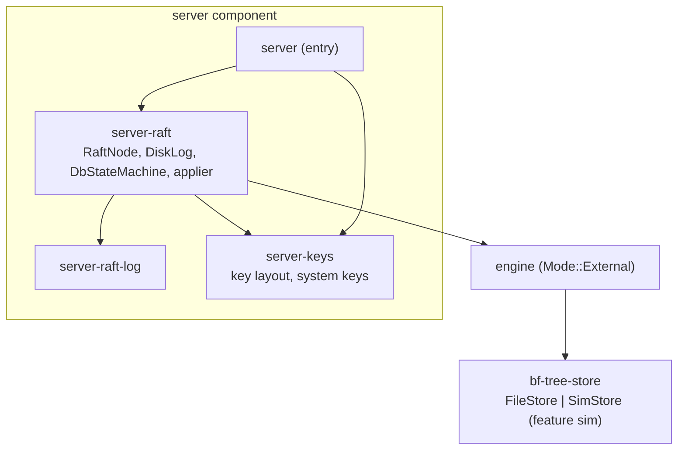
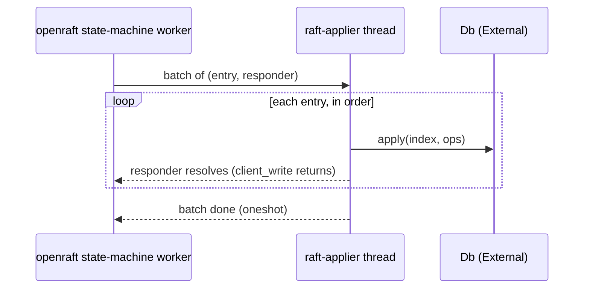
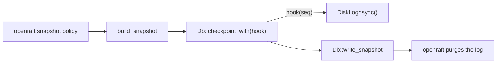

# 0030: The replicated state machine over the engine

**Status:** Complete

**Parent roadmap:** [Server roadmap](0025-server-roadmap.md), milestone S6
(decisions 1, 2, 3, 14, and [the system keyspace](0025-server-roadmap.md#the-system-keyspace)).

**Design references:** [Server Raft](../design/server-raft.md) (the
`ModelSm` contract and the simulator), [server Raft log](../design/server-raft-log.md)
(`DiskLog`, its flusher, and the sync hook), [engine external-log
mode](../design/engine.md#external-log-mode) (the owner's obligations),
[BF-Tree persistence](../design/bf-tree-persistence.md) (checkpoints and
the pre-commit hook), [server](../design/server.md) (the key layout).

**Builds on:** [plan 0022](0022-engine-external.md) (`Mode::External`),
[plan 0028](0028-server-raft-core.md) (the Raft core, `ModelSm`, the
simulator), [plan 0029](0029-server-raft-log.md) (the on-disk log).

## Goal and scope

After plan 0029, openraft runs over the real log, but its state machine
is still `ModelSm`, an in-memory model of `engine::Db`. This stack builds
the real one: `DbStateMachine`, openraft's `RaftStateMachine` over one
`engine::Db` in `Mode::External`, applied by a dedicated thread, with
compaction through engine checkpoints and snapshots as engine snapshots.
The production storage code (`DiskLog` and `DbStateMachine`) is then
tested in two harnesses. Both run several nodes inside one test binary
over an in-memory network, because peers cannot talk between processes
until S7 adds the gRPC transport:

- **The deterministic simulator:** every node on openraft's single-threaded
  simulated runtime, with the log on `SimFs` and the engine on a simulated
  page store, so crashes lose exactly what was not synced and every run
  reproduces from its seed.
- **Real files:** each node on **its own Tokio runtime**, with its own
  flusher and applier threads and its own directories on a real disk.
  One runtime per node keeps one node's load from delaying another
  node's tasks, which would not happen when each node is its own
  process. The nodes still share one machine and one disk.

In production each node is its own `peppydb serve` process; S7 tests
that, with process kills and `iptables` faults.

- **In scope:**
  - `lib/server-keys`: the stored key layout, moved out of `server`, plus
    the Raft system keys (applied log id, membership) and their encodings,
    moved out of `ModelSm`;
  - `DbStateMachine` in `server-raft`: apply, applied state, snapshot
    build and install, and the applier thread (roadmap decision 14);
  - compaction: openraft's snapshot policy calls
    `checkpoint_with` with the log's sync hook (decision 2), then purges the
    log;
  - a way to run the engine over a simulated disk (see
    [Open questions](#open-questions), question 1: `SimStore`), so a simulated crash
    loses unsynced engine state;
  - crash tests of the log and the state machine together;
  - the simulator over `DiskLog` and `DbStateMachine` by default, with
    `ModelSm` kept as the reference model;
  - the threading measurement the roadmap asks of S6: does a node's own
    apply and snapshot load delay its heartbeats enough to cause
    elections, measured with one Tokio runtime per node;
  - first, a fix to `DiskLog`: commit points, truncations, and purges must
    not wake the flusher (plan 0029's benchmark found extra syncs).
- **Out of scope:** gRPC between processes and wiring `peppydb serve` to
  Raft (S7); chunked or streamed snapshot transfer (S8); membership
  changes (S8); follower reads (S9); a separate runtime for openraft
  (only if the measurement asks for it).
- **Done when:**
  - openraft's storage suite passes with `DiskLog` and `DbStateMachine`;
  - after a crash at every point of the scripted crash tests, a node
    recovers to a state equal to applying a prefix of the committed
    entries, and catches up by redelivery;
  - the simulator's default tier and a 100,000-seed long tier pass over
    the real log and the real engine;
  - the threading measurement is recorded, with a decision on runtimes;
  - the workspace checks pass and the design documents describe it.

## Approach

### Components



- **`DbStateMachine` lives in `server-raft`,** next to `DiskLog`, so
  openraft stays inside that crate (plan 0028's dependency rule).
  `server-raft` gains the `engine` dependency that plan 0028's diagram
  reserved for S6.
- **`server-keys`** holds the key layout, so `server` (client reads) and
  `server-raft` (applies) agree byte for byte. It depends on neither tonic
  nor openraft: `server` maps its errors to `Status`, and `server-raft`
  converts openraft's types.

### Entries become engine applies

Each committed entry at index `i` becomes one `Db::apply(i + 1, ops)`
(decision 1, shifted by one; see [Discoveries](#discoveries-and-plan-changes)). Every entry writes the applied log id, so the system keys
always name the last applied entry:

| Entry | Ops passed to `Db::apply(i + 1, ..)` |
| --- | --- |
| Normal (`Command`) | each `Op` as proposed (keys already `0x01 ‖ key`), then `Put(APPLIED_KEY, (term, i))` |
| Membership | `Put(MEMBERSHIP_KEY, (log id, config))`, `Put(APPLIED_KEY, (term, i))` |
| Blank | `Put(APPLIED_KEY, (term, i))` |

- `Db::apply` normalizes by key and is all or nothing after a crash, so
  the data and the applied log id never disagree.
- **`applied_state()`** reads `APPLIED_KEY` and `MEMBERSHIP_KEY` from the
  `Db`. After a crash the engine reopens at its last committed checkpoint,
  the keys roll back with the data, and openraft redelivers from there.
  Redelivered entries return `Applied::AlreadyApplied` (owner obligation
  2).
- This applies blank entries instead of leaving gaps, a small change to
  decision 1's wording: the applied log id must advance past them, or
  openraft would redeliver them after every restart (question 3, agreed).

```rust
/// openraft's state machine over an external-mode `Db`.
pub struct DbStateMachine<RT: AsyncRuntime> {
    shared: Arc<Shared>,       // the Db (replaced on install), the applier, the sync hook
    _rt: PhantomData<fn() -> RT>,
}

impl<RT: AsyncRuntime> DbStateMachine<RT> {
    pub fn open(db: Db, sync: SyncHook, applier: Applier) -> Result<Self, Error>;
    /// For reads after a read barrier (S7's Kv service).
    pub fn db(&self) -> Arc<Db>;
}

/// Who calls `Db::apply`.
pub enum Applier {
    /// A thread named `raft-applier`: production (decision 14).
    Thread,
    /// Inline on the caller: the simulator, whose runtime has one thread.
    #[cfg(any(test, feature = "sim"))]
    Inline,
}
```

### The applier thread

openraft's state-machine worker passes batches of committed entries to
`apply`. `apply` converts them and sends the batch to the applier, then
awaits a oneshot, so no async worker blocks on the engine:



- One long-lived thread keeps apply order without a `spawn_blocking` per
  batch. Responders resolve as each entry applies, so a client does not
  wait for the rest of its batch.
- In the simulator the applier runs inline (`Applier::Inline`), as
  `DiskLog` uses a task instead of its thread. The engine never blocks on
  a simulated disk.

### Compaction and snapshots

openraft's snapshot policy (`snapshot_after`) calls `build_snapshot`; that
is the checkpoint of decision 2:

1. Pause the applier at an entry boundary.
2. `checkpoint_with(|_seq| log.sync())`: the hook makes the log durable
   through every entry the checkpoint captures (owner obligation 4).
   `DiskLog::sync` flushes everything queued, which covers `seq`; a
   `sync_to(seq)` that waits only as far as needed is an optimization for
   later.
3. Read `APPLIED_KEY` and `MEMBERSHIP_KEY` as the snapshot's metadata. With
   the applier paused, they match the committed image.
4. `write_snapshot` streams the committed checkpoint into the snapshot
   data; resume the applier.
5. openraft then purges the log up to the snapshot, keeping
   `keep_below_snapshot` entries (owner obligation 3).

`install_snapshot` (a follower too far behind):

1. **Sync the log first.** openraft queues the truncation of conflicting
   entries before it installs, and the snapshot must not become durable
   before that truncation (plan 0029's discovery; `ModelSm` does the
   same). This is a requirement with its own crash test.
2. `Db::install_snapshot(reader)` consumes the `Db` and returns the new
   one; swap it in. Reads in progress keep the old `Arc<Db>` until they
   finish.
3. Check that the system keys in the installed image match the metadata.



### Running the engine over a simulated disk

The simulator crashes nodes. With the real log, a crash keeps only what
`SimFs` holds durably. The state machine must lose unsynced state the same
way, or a crash leaves the engine ahead of what the real engine would
recover, and the checks test nothing.

Today `Db::open` takes a path and builds a `FileStore`; the tree itself
takes any `Box<dyn PageStore>`, and `bf-tree`'s own crash tests already
use a `FaultStore` with a power-loss model (writes since the last sync
lost, landed, or torn at sector granularity).

**Chosen (question 1):**

- Promote that model to `SimStore` in `bf-tree-store`, behind a `sim`
  feature, with a `crash(seed)` that returns the surviving image and a
  constructor from an image. `bf-tree`'s crash tests move onto it.
- Add to `engine`, behind a `sim` feature, an external-mode open over a
  given store, and a store-based `install_snapshot` (build a `SimStore`
  from the snapshot bytes, which are a store file image).
- The simulator then crashes the log (`SimFs::crash`) and the engine
  (`SimStore::crash`) together, and restarts from both images.

```rust
#[cfg(feature = "sim")]
impl Db {
    /// An external-mode database over `store`, for the simulator.
    pub fn open_external_on(store: Box<dyn PageStore>, options: Options) -> Result<Db, Error>;
}
```

### Testing

| Level | What runs | Oracle |
| --- | --- | --- |
| `server-keys` | Layout and encodings | Round trips; the bytes `server` and `ModelSm` wrote before the move |
| `SimStore` | Its crash model | `bf-tree`'s crash tests, unchanged in what they check |
| `DbStateMachine` | openraft's storage suite with `DiskLog`, on simulated and real files | The suite |
| Crash tests | Apply, checkpoint, install, crashed at every log and store operation in turn | A state equal to applying a prefix of the committed entries; redelivery catches up; the installed-snapshot ordering holds |
| Negative controls | A hook that does not sync; an install that does not sync first | The crash tests fail |
| Simulator | The default tier and the long tier over `DiskLog` and `DbStateMachine` | Plan 0028's safety checks; replicas converge |
| Threading | Three nodes, one Tokio runtime each, real files, writers 1 to 256, with snapshots | Elections during steady load; heartbeat delay percentiles |

The checker reads user contents with a scan of the user keyspace instead
of `ModelSm::user_contents`.

## Decisions and trade-offs

- **The state machine in `server-raft`, not a new crate.** It names
  openraft's traits, which must stay in `server-raft`. *Alternative:* a
  `server-raft-sm` crate that depends on openraft, which breaks that rule.
- **Every entry writes the applied log id,** blank and membership entries
  included. *Alternative:* skip entries with no data (decision 1's
  "gaps"), which leaves the applied log id behind and makes openraft
  redeliver them on every restart.
- **The membership lives only in the system keys.** openraft reads it
  through `applied_state()`, and snapshots carry it. *Alternative:* also
  in the log's `state` file, a second copy that could disagree.
- **Pause the applier to build a snapshot,** so its metadata matches the
  image. *Alternative:* open the snapshot bytes to read the keys back:
  correct, but one more pass over every page.
- **`ModelSm` stays** as the reference model, as `MemLog` did.
- **One Tokio runtime per node on real files.** In production each node
  is its own process with its own runtime. Running every node on one
  shared runtime would let one node's load delay another's heartbeats
  and distort the threading measurement. *Alternative:* real processes,
  which need the S7 transport.
- **The `DiskLog` sync fix goes first,** so this stack's measurements do
  not inherit plan 0029's extra syncs.

## Proposed commit stack

### `[1/12][server-raft-sm][plan] plan the replicated state machine`

- **Purpose:** This plan.
- **Verification:** Review.

### `[2/12][server-raft-sm][log] stop waking the flusher for commits, truncations, and purges`

- **Purpose:** Plan 0029's benchmark showed more syncs than writes with
  one writer: `save_committed`, `truncate_after`, and `purge` woke the
  flusher thread, which synced for them alone.
- **Core changes:** these writes only queue; the next append's flush, a
  vote, or the sync hook makes them durable. Rerun the 3-node benchmark
  and update the measurements in `server-raft-log.md`.
- **Verification:** the storage suite and crash tests; the benchmark
  shows at least one write per sync.

### `[3/12][server-raft-sm][keys] move the key layout into server-keys`

- **Core changes:** `lib/server-keys` with the namespace bytes, user key
  and range helpers, the format marker, `APPLIED_KEY`, `MEMBERSHIP_KEY`,
  and their encodings (from `server/src/keys.rs` and
  `server-raft/src/encoding.rs`); `server` and `ModelSm` use it.
- **Verification:** `server`'s and `server-raft`'s tests unchanged; a
  golden test of the system-key bytes.

### `[4/12][server-raft-sm][store] add SimStore, a page store with a power-loss model`

- **Core changes:** `SimStore` in `bf-tree-store` (feature `sim`) from
  `bf-tree`'s `FaultStore`; `bf-tree`'s crash tests use it.
- **Verification:** `bf-tree`'s crash tests pass unchanged; `SimStore`
  unit tests (unsynced pages lost or torn, commits atomic, images
  reopen).

### `[5/12][server-raft-sm][engine] open an external database over a given store`

- **Core changes:** `engine` feature `sim`: `Db::open_external_on`, a
  store-based `install_snapshot`, and a crash helper.
- **Verification:** `external.rs` and `replica.rs` scenarios also run over
  `SimStore`, crashing it at every operation.

### `[6/12][server-raft-sm][apply] apply committed entries through Db::apply`

- **Core changes:** `DbStateMachine` with entry conversion, the system
  keys, `applied_state`, and the applier (`Thread` and `Inline`).
- **Verification:** applies, redelivery, responders in order; the applier
  thread exits on drop.

### `[7/12][server-raft-sm][snapshot] compact with engine checkpoints and install engine snapshots`

- **Core changes:** `build_snapshot` (pause, `checkpoint_with` with the
  log's sync hook, metadata, `write_snapshot`), `install_snapshot` (sync
  first, install, swap), `get_current_snapshot`.
- **Verification:** openraft's storage suite with `DiskLog` and
  `DbStateMachine` on both file systems.

### `[8/12][server-raft-sm][crash] crash the log and the state machine together`

- **Core changes:** scripted crash tests at every log and store operation;
  the two negative controls.
- **Verification:** every crash point recovers a valid prefix and catches
  up; both negative controls fail.

### `[9/12][server-raft-sm][sim] run the simulator over the real state machine`

- **Core changes:** the simulator's nodes run `DbStateMachine` over
  `SimStore` by default (a `SimSm` enum, as `SimLog`); crashes take both
  images; the checker scans user keys; `ModelSm` stays selectable.
- **Verification:** default tier under 60 s; a 100,000-seed long tier;
  both state machines run safely.

### `[10/12][server-raft-sm][bench] measure apply and heartbeat timing with one runtime per node`

- **Core changes:** extend the 3-node benchmark to `DbStateMachine` on
  real files with snapshots. Each node gets its own Tokio runtime, as it
  would in its own process; the in-memory router hands messages between
  runtimes. Record heartbeat delays and elections. Plan 0029's benchmark
  ran every node on one runtime; rerun it this way too, so the numbers
  compare.
- **Verification:** numbers recorded with the environment, stating that
  the nodes share one machine and one disk; a decision on whether, inside
  one process, openraft needs a runtime separate from gRPC (decision 14).

### `[11/12][server-raft-sm][gcp] run the Raft benchmarks on GCP`

- **Purpose:** The macOS numbers say little about production; the Linux
  reference machine of plan 0024 should run the same benchmarks.
- **Core changes:** `server-raft-log-unittest` and `server-raft-unittest`
  in `tools/gcp/targets.txt`; a `raft-perf` suite (the log benchmark, the
  three-node benchmark, the `Db::apply` benchmark); each node runtime
  sized to a quarter of the cores (2 on `c4d-standard-8-lssd`) unless
  `PEPPYDB_BENCH_THREADS` is set; `remote-benchmarks.md`.
- **Verification:** `PEPPYDB_GCP_BENCH_TEST=1 tools/gcp-bench build
  --suite raft-perf` stages both binaries, and each step's filter selects
  one test. A real run needs a build on the x86_64 Ubuntu 24.04 host; the
  user runs it.

### `[12/12][server-raft-sm][docs] document the replicated state machine`

- **Core changes:** `server-raft.md` (`DbStateMachine`, the applier,
  compaction, the simulator); `server.md` and `architecture.md`
  (`server-keys`); `engine.md` (the `sim` feature); roadmap S6 progress
  and the build-order row.
- **Verification:** links resolve; guarantees match the tests.

## Open questions

None. Resolved in discussion:

1. **The engine under simulation:** (a), `SimStore` in `bf-tree-store`
   and an external open over a given store (diffs 4 and 5).
2. **Snapshot data:** a `Vec<u8>` in memory for now. **To change soon:**
   a whole database in memory does not scale; snapshot data must move to
   a temporary file, at the latest with S8's chunked transfer. Recorded
   under [Not yet done](#not-yet-done).
3. **Blank entries are applied,** writing only the applied log id; the
   roadmap's decision 1 is reworded to match.
4. **The format marker is deferred** to S7, when `server` opens an
   external `Db`. Nothing in S6 checks it.
5. **The label** is `server-raft-sm`.

## Not yet done

- **Snapshot data in a file.** `DbStateMachine`'s `SnapshotData` is a
  `Vec<u8>` holding the whole store image. Move it to a temporary file
  before databases grow past test sizes, and no later than S8.
- **The format marker under Raft** (S7).

## Verification strategy

| Check | Command or procedure | Expected result |
| --- | --- | --- |
| Keys moved without change | `server` and `server-raft` tests; golden bytes | Pass, unchanged |
| Engine over `SimStore` | `tools/buck2 test //lib/bf-tree/... //lib/engine/...` | Pass; crash scenarios recover |
| Storage suite | `DiskLog` with `DbStateMachine`, simulated and real files | Pass |
| Crash tests | `tools/buck2 test //lib/server-raft/...` | Every crash point recovers a prefix; negative controls fail |
| Simulator | `tests::sweep` (debug); the long tier in release | Pass; default tier under 60 s |
| Threading | The benchmark in release | Recorded; elections under steady load stated |
| Workspace checks | The `AGENTS.md` list, Miri for `bf-tree-circular-buffer` | Pass |

## Progress

- [x] Agree on the design and commit stack with the user.
- [x] 2/12 `DiskLog` sync fix.
- [x] 3/12 `server-keys`.
- [x] 4/12 `SimStore`.
- [x] 5/12 external open over a store.
- [x] 6/12 apply and the applier.
- [x] 7/12 snapshots.
- [x] 8/12 crash tests.
- [x] 9/12 simulator.
- [x] 10/12 threading measurement.
- [x] 11/12 the `raft-perf` GCP suite.
- [x] 12/12 design documents; stack-wide verification.

## Verification outcomes (2026-11-21)

On macOS (Apple M4 Pro, 12 cores, APFS).

| Check | Result |
| --- | --- |
| `tools/fmt.sh`, `tools/clippy.sh` (with `check-unsafe`) | Pass; 41 Rust targets clean |
| `tools/buck2 test //bin/... //lib/... //proto/...` | Pass |
| `cargo test --workspace --locked`; `go vet ./... && go test ./...` | Pass |
| `tools/autocargo --check`, `tools/gobuckify-remote --check`, `tools/gen-proto --check` | Up to date |
| Miri: `lib/bf-tree-circular-buffer` | Pass (no new `unsafe`) |
| `bf-tree` crash tests on `SimStore` | Pass, with the same random choices as before |
| Engine over `SimStore` | 308 store calls of 1,500 entries, each crashed with 3 tears: every reopen is a committed prefix |
| openraft's storage suite, `DiskLog` with `DbStateMachine` | Pass on `SimFs`/`SimStore` and on real files |
| Crash tests of the log and the state machine | Compaction: 324 crashes; install: 72; all recover. The install negative control fails as it should |
| Simulator default tier (debug) | 400 seeds and the regression seed in 19 s wall |
| Long tier (release) | Base 87708801000: 100,000 seeds in 160 s; base 264633921000: 100,000 seeds in 165 s; none failing |
| Benchmarks | Recorded in [server Raft](../design/server-raft.md#measurements) |
| `raft-perf` GCP suite | Staged with `PEPPYDB_GCP_BENCH_TEST=1 tools/gcp-bench build --suite raft-perf`; not run on GCP (the user runs it from the Linux build host) |

## Discoveries and plan changes

- **openraft's log starts at index 0.** `Db::apply` treats sequence 0 as
  already applied, so the first entry (the initial membership) was
  skipped, and openraft's storage suite failed with "state machine is
  behind the purged logs". Raft index `i` is now engine sequence `i + 1`,
  and the roadmap's decision 1 says so.
- **Commands carry stored keys.** The plan's table had the state machine
  add the `0x01` prefix; `ModelSm` and the simulator already propose
  stored keys, so `server` maps keys before proposing (S7) and the state
  machine applies operations as they are. An operation the engine refuses
  stops the state machine, so `server` must also check limits first.
- **Compaction does not need the sync hook here; install does.** Because
  the applier is paused while a checkpoint commits, a checkpoint never
  holds part of an entry, and a state machine ahead of its own log is
  allowed: the compaction crash tests pass with a hook that does nothing.
  The install script fails without it (inverted log order). The hook
  stays for both, as the engine's owner contract asks; the plan's second
  negative control was dropped.
- **The engine is the bottleneck at high load on macOS.** With one
  runtime per node, the engine run reached 5,127 writes/s at 256 writers
  against 12,069 for `ModelSm`. `Db::apply` takes 2 µs when the tree
  grows, but 69 µs beside a file that syncs on the same disk (0.2 µs
  either way with a fixed set of keys): writes that grow the store file
  wait behind other files' full flushes. The likely cause is
  `FileStore::alloc` extending the file one page at a time. Follow-up:
  extend in larger steps, and measure on Linux (S2).
- **Heartbeats are not at risk.** Timer lateness on each node's runtime
  stayed within 3.7 ms at the 99th percentile and 16 ms at worst; no run
  had an election. One runtime per process is enough for now (decision
  14).
- **The membership value's encoding stays in `server-raft`.** It encodes
  openraft's membership type; `server-keys` holds the key names and the
  applied log id's layout.
- **`SimStore` reaches the engine through feature variants:**
  `bf-tree-store-sim`, `bf-tree-sim` (re-export), and `engine-sim`, each
  visible only to the next crate and the tests that need it.
- **The simulator's engine uses a 256 KiB circular buffer,** so pages reach
  the store and crashes tear them.
- **A GCP suite was added as diff 11** (the stack grew from 11 to 12
  diffs), so the benchmarks run on plan 0024's Linux reference VM. The
  three-node benchmark's default runtime size changed from 4 threads per
  node to a quarter of the cores (3 on the 12-core laptop, where the
  recorded runs used 4).
- **The `DiskLog` fix** raised one writer from 58 to 90 writes/s (16.1 to
  12.0 ms p50) on three nodes.

## Agent notes

- **Entry points:**
  - `lib/server-raft/src/sim/model_sm.rs`: the contract to keep, the
    system keys, and the install-snapshot sync rule;
  - `lib/server-raft/src/disk_log.rs`: `DiskLog::sync` (the hook), the
    flusher wake-ups (diff 2);
  - `lib/engine/src/lib.rs`: `apply`, `checkpoint_with`,
    `install_snapshot`, `open_or_create_tree`;
  - `lib/bf-tree/src/tests/crash.rs`: `FaultStore`, the model for
    `SimStore`;
  - `lib/server/src/keys.rs`, `lib/server/src/bridge.rs`: the key layout
    and the `ArcSwapOption<Db>` pattern for swapping a `Db`.
- `SimRuntime` has one thread and `spawn_blocking` returns `Unsupported`:
  the inline applier must not block, and nothing in the simulator may
  call `spawn_blocking`.
- **One runtime per node.** `Router` calls the target node's handler
  directly, so the handler's future runs on the sender's runtime. The
  handler only hands the message to the target's openraft core over a
  channel and awaits the reply, which works across Tokio runtimes, but the
  benchmark should check that no task of one node is spawned on
  another's runtime. A router that forwards each message to a task on the
  target's runtime removes the doubt.
- `Db::install_snapshot` consumes the `Db`; the state machine must hold it
  so that it can be taken and replaced.
