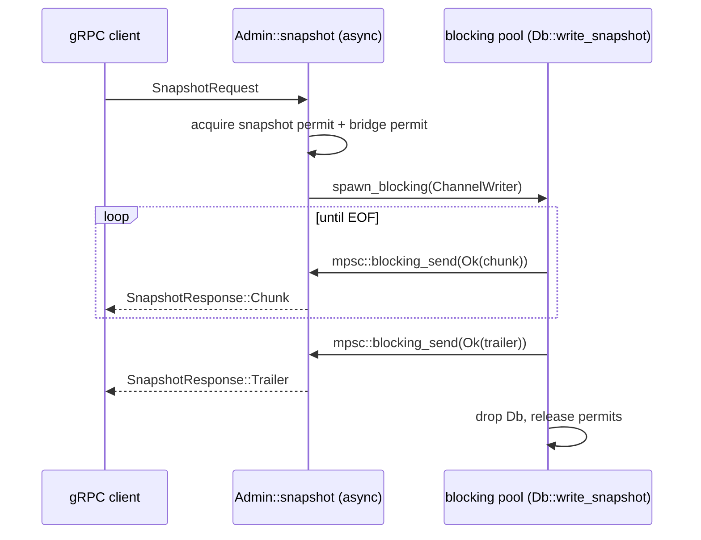
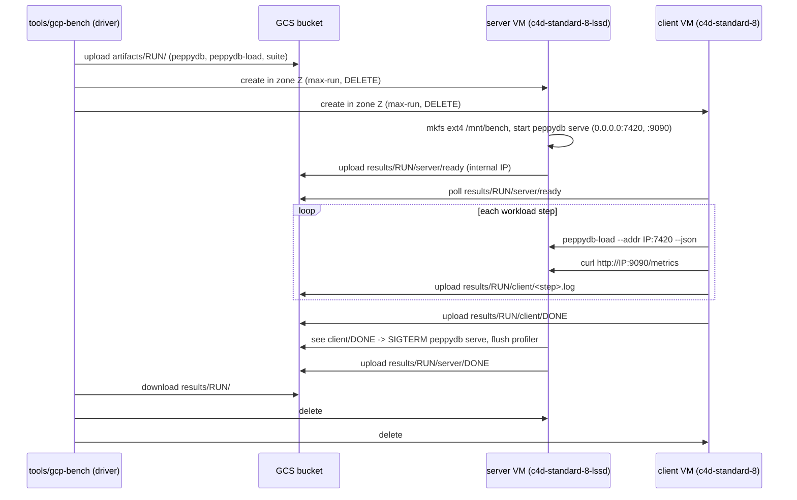

# 0031: Server operability: streaming snapshots, metrics, and remote benchmarks

**Status:** In progress

**Parent roadmap:** [Server roadmap](0025-server-roadmap.md), milestone S2.

**Design references:** [Server](../design/server.md) (`peppydb.kv.v1`, the
blocking bridge, `peppydb-load`), [engine](../design/engine.md)
(`write_snapshot`, `install_snapshot`), [remote benchmarks](../design/remote-benchmarks.md)
(`tools/gcp-bench`, multi-VM extension point).

**Builds on:** [plan 0024](0024-gcp-remote-bench.md) (`tools/gcp-bench`),
[plan 0026](0026-server-grpc-kv.md) (S1 single-node server and `peppydb-load`).

## Goal and scope

Milestone S1 delivered a single-node server and a Go load generator, but left
three operability gaps that S7 (multi-node server) and performance work depend
on:

1. There is no way to stream a consistent backup out of a running server.
   S7 needs a proven chunked snapshot streaming pattern over gRPC before it
   builds `peppydb.raft.v1`.
2. The server exposes no metrics, so diagnosing latency, concurrency, or
   snapshot load requires external tracing or profilers.
3. `tools/gcp-bench` runs on a single VM, so `peppydb-load` cannot measure
   `peppydb serve` across a real network on separate Linux NVMe machines.

- **In scope:**
  - `AdminService.Snapshot`: a server-streaming RPC in `peppydb.kv.v1` over
    `Db::write_snapshot`, with bounded backpressure, cancellation, and a
    checksummed trailer;
  - server metrics: per-RPC counters and latency histograms, in-flight and
    snapshot gauges, and `applied_seq`, served in Prometheus text format on an
    optional `--metrics-listen` HTTP endpoint;
  - multi-VM support in `tools/gcp-bench` and `tools/gcp/remote-bench.sh` for
    `server` and `client` roles in one `us-east1` zone, with the same teardown
    and offline test guarantees as single-VM runs;
  - a `server-perf` suite that runs `peppydb serve` on a `c4d-standard-8-lssd`
    VM and `peppydb-load` on a separate client VM, collecting throughput,
    latency, and server metrics;
  - updated design docs and reference measurements (run by the user on GCP
    from the Linux build host).
- **Out of scope:**
  - Raft peer transport (`peppydb.raft.v1`) and multi-node Raft servers (S7);
  - resumable/offset-based snapshot transfer (S8);
  - moving `DbStateMachine`'s in-memory `SnapshotData` to a temp file (plan
    0030 follow-up, no later than S8);
  - `FileStore::alloc` step-size changes (only if Linux `raft-perf` confirms
    macOS's finding);
  - TLS, authentication, or a `peppydb snapshot` CLI client (see
    [Open questions](#open-questions)).
- **Done when:**
  - `AdminService.Snapshot` streams a live database while concurrent writes
    run, cancels cleanly when the client drops the stream, and produces an
    image whose CRC32C matches the trailer and that `Db::install_snapshot`
    restores to the exact state at `applied_seq`;
  - `GET /metrics` returns valid Prometheus text exposition with accurate RPC
    counts, latency buckets, in-flight gauge, snapshot bytes, and
    `applied_seq`;
  - `tools/linux-run sh tools/gcp/testing/test-driver.sh` and `test-remote.sh`
    pass for both single-VM and multi-VM runs (happy path, failure,
    preemption, cleanup);
  - `PEPPYDB_GCP_BENCH_TEST=1 tools/gcp-bench build --suite server-perf`
    stages `peppydb` and `peppydb-load`, and `--dry-run` validates the
    multi-VM `gcloud` sequence;
  - all `AGENTS.md` workspace checks pass and the design documents are
    updated.

## Approach

### Streaming `AdminService.Snapshot`

Add a server-streaming RPC to `AdminService` in `proto/kv/v1/kv.proto`. This
is a backwards-compatible addition under `buf breaking`.

```proto
service AdminService {
  rpc Status(StatusRequest) returns (StatusResponse);
  rpc Checkpoint(CheckpointRequest) returns (CheckpointResponse);
  // Stream the last committed checkpoint (or a fresh one if requested)
  // as an openable engine store image, followed by a checksummed trailer.
  rpc Snapshot(SnapshotRequest) returns (stream SnapshotResponse);
}

message SnapshotRequest {
  // If true, commit a fresh checkpoint before streaming.
  bool checkpoint = 1;
}

message SnapshotResponse {
  oneof payload {
    // Raw bytes of the engine store file, in order.
    bytes chunk = 1;
    // Sent once after the final chunk.
    SnapshotTrailer trailer = 2;
  }
}

message SnapshotTrailer {
  uint64 applied_seq = 1;
  uint64 checkpoint_id = 2;
  uint64 total_bytes = 3;
  uint32 crc32c = 4;
}
```

Why a trailer message: `Db::write_snapshot(&mut writer)` returns
`Checkpoint { applied_seq, checkpoint_id }` only after writing the entire store
image. Sending the metadata and a streaming `crc32c` in a final `trailer`
message avoids buffering the snapshot on the server and lets the client verify
both completeness and integrity.



- **Backpressure:** `ChannelWriter` implements `std::io::Write`, buffers up to
  `Config::snapshot_chunk_bytes` (default 256 KiB), updates a running
  `crc32c::crc32c_append`, and calls `tx.blocking_send` on a bounded
  `tokio::sync::mpsc::channel` (capacity 4 chunks, ~1 MiB in flight per
  stream). A slow client stalls the writer rather than growing server memory.
- **Cancellation:** If the client cancels or disconnects, `rx` drops,
  `blocking_send` returns `Err`, `ChannelWriter::write` returns
  `ErrorKind::BrokenPipe`, and `Db::write_snapshot` stops and releases its
  snapshot pin in `bf-tree`.
- **Concurrency and shutdown:** Each snapshot acquires one permit from a
  dedicated `max_concurrent_snapshots` semaphore (default 4, so snapshots
  cannot starve KV traffic) and one permit from `Inner::inflight` (so
  `take_db` waits for running snapshots to exit before closing `Db`). The
  blocking task owns both permits and drops `Arc<Db>` before the permits,
  matching `Inner::blocking`.

### Server metrics

Add `lib/server/src/metrics.rs` backed by the official `prometheus-client`
crate, exposing OpenMetrics/Prometheus text exposition format over HTTP/1.1 on
an optional `--metrics-listen <ADDR>` socket (`GET /metrics`).

```rust
pub(crate) struct Metrics {
    registry: Registry,
    started_at: Instant,
    rpc_total: Family<RpcLabels, Counter>,
    rpc_duration: Family<MethodLabels, Histogram>,
    inflight: Gauge,
    snapshot_active: Gauge,
    snapshot_bytes_total: Counter,
    applied_seq: Gauge,
    uptime_seconds: Gauge<f64, AtomicU64>,
}

impl Metrics {
    pub(crate) fn record_rpc(&self, method: Method, code: tonic::Code, elapsed: Duration);
    pub(crate) fn render(&self, applied_seq: Option<u64>) -> String;
}
```

| Metric | Type | Labels | Meaning |
| --- | --- | --- | --- |
| `peppydb_rpc_requests` (`_total`) | counter | `method`, `code` | Completed RPCs by method (`get`, `put`, `delete`, `scan`, `status`, `checkpoint`, `snapshot`) and gRPC status code |
| `peppydb_rpc_duration_seconds` | histogram | `method` | End-to-end handler latency (buckets from 100 µs to 10 s, plus `+Inf`) |
| `peppydb_inflight_requests` | gauge | — | Engine calls currently holding a bridge permit |
| `peppydb_snapshot_active` | gauge | — | `Admin.Snapshot` streams currently active |
| `peppydb_snapshot_bytes` (`_total`) | counter | — | Total snapshot bytes streamed |
| `peppydb_engine_applied_seq` | gauge | — | `Db::applied_seq()` updated at scrape time |
| `peppydb_process_uptime_seconds` | gauge | — | Seconds since `serve` started |

- **Minimal HTTP listener:** When `Config::metrics_listen` is `Some(addr)` (or
  a bound `TcpListener` is passed to `serve_with_metrics` in tests), `serve`
  spawns a small `tokio::net::TcpListener` loop that reads one HTTP/1.1
  request line, encodes the `Registry` with
  `prometheus_client::encoding::text::encode`, serves `200 OK` on
  `GET /metrics` and `404 Not Found` on any other path, and stops with
  `serve`'s shutdown signal.
- **No hot-path locking:** `Counter`, `Gauge`, and `Histogram` use atomics.
  `Family` lookups are read-locked only for the fixed set of `(method, code)`
  pairs. `applied_seq()` is an atomic load inside `Db`.
- **Extension point for S7:** Adding Raft gauges (`term`, `role`,
  `commit_index`, `applied_index`) and `read_barrier` latency requires only
  registering new metrics on `Registry`.

### Multi-VM remote benchmarks (`tools/gcp-bench`)

Extend `tools/gcp-bench` and `tools/gcp/remote-bench.sh` to support two-VM
suites (`server` and `client` roles) while keeping single-VM suites
(`bf-io-perf`, `raft-perf`) unchanged.



- **Suite format:** A suite file that contains a `# mode: client-server` header
  (or `role:` lines) selects the two-VM path; existing suites without it run
  on one VM as before. Each workload step in `server-perf.txt` runs on the
  client VM with `$SERVER_ADDR` and `$METRICS_ADDR` substituted from
  `server/ready`.
- **Same-zone placement:** Both VMs are created in the same `us-east1` zone.
  If the second VM hits a capacity error, the driver deletes the first VM and
  tries the next zone. Internal VPC traffic between VMs in the same subnet is
  allowed by GCP's default VPC (`default-allow-internal`); no external
  firewall rules are added.
- **Machine types:** Server uses `--machine-type` (default
  `c4d-standard-8-lssd` with Local SSD). Client uses `--client-machine-type`
  (default `c4d-standard-8`, no Local SSD needed, so client skips `mkfs`).
- **Profiling:** `--profile` applies to the `peppydb serve` process on the
  server VM (`perf record`, `offcpu`, `stat`, `sched`). Sending `SIGTERM` to
  `peppydb serve` after `client/DONE` flushes profiler outputs cleanly.
- **Teardown guarantees:** Every created VM is tracked in a list; `on_exit`
  deletes all of them, every VM has `--max-run-duration` +
  `--instance-termination-action=DELETE` verified by read-back, and
  `tools/gcp-bench cleanup` deletes all `labels.peppydb-bench=1` instances.
  If either VM disappears or fails before `DONE`, the driver stops waiting,
  downloads partial results, and deletes the remaining VM.
- **`server-perf` workloads:**
  1. `put` concurrency sweep (`1`, `4`, `16`, `64`, `256` workers, 4 conns,
     8 B keys, 16 B values, 100k keys, 2 s warmup, 10 s duration, `--json`);
  2. `get` preloaded uniform (`64` and `256` workers, 8 conns);
  3. `mixed:90` zipf 1.1 (`64` workers, 4 conns);
  4. `put` with `--io direct` (separate server restart or dedicated step, if
     needed; default `--io cached` first).

## Decisions and trade-offs

- **Trailer message with `crc32c` for `AdminService.Snapshot`:** `write_snapshot`
  streams directly to the wire without buffering the full store image on the
  server, and the client gets an end-to-end checksum plus `applied_seq` and
  `checkpoint_id`.
  *Alternative:* buffer the snapshot to a temp file first so metadata can be
  sent in a header. Rejected: adds extra disk I/O and temp space on the server
  for no gain when the client already writes the stream to a temp file before
  installing.
- **Official `prometheus-client` crate on native `GET /metrics`:** Modern
  distributed KV stores (etcd, TiKV, CockroachDB) expose Prometheus metrics
  directly on a dedicated HTTP admin/metrics port so scrapers need no sidecar
  and metrics remain reachable under data-plane saturation. Using
  `prometheus-client` gives spec-compliant exposition, label escaping, and
  `Registry`/`Family` primitives ready for S7's Raft metrics without pulling
  in a heavy HTTP framework.
  *Alternative:* hand-roll a custom text formatter. Rejected: unnecessary
  reimplementation of Prometheus encoding and histogram formatting.
- **GCS handshake for multi-VM coordination:** Reuses the bucket and service
  account that `tools/gcp-bench` already requires; needs no SSH keys, no
  inbound firewall rules, and works identically in the offline fake-`gcloud`
  test harness.
  *Alternative:* SSH from the driver to orchestrate both VMs. Rejected:
  violates `remote-benchmarks.md`'s guarantee that the driver never connects
  to VMs and adds no firewall rules.

## Proposed commit stack

### `[1/8][server-ops][plan] plan server operability, snapshots, and remote benchmarks`

- **Purpose:** Record the agreed design, trade-offs, and commit stack.
- **Core changes:** `docs/plans/0031-server-operability.md`.
- **Verification:** Links resolve; matches `0000-template.md`.

### `[2/8][server-ops][proto] add AdminService.Snapshot streaming RPC`

- **Purpose:** Define the streaming snapshot contract in `peppydb.kv.v1` and
  regenerate Rust and Go bindings.
- **Core changes:** `proto/kv/v1/kv.proto` (`Snapshot`, `SnapshotRequest`,
  `SnapshotResponse`, `SnapshotTrailer`); regenerated files under
  `proto/kv/v1/rust/` and `proto/kv/v1/go/`.
- **Verification:** `tools/gen-proto --check`, `tools/buck2 test //proto/...`,
  `go vet ./...`.

### `[3/8][server-ops][snapshot] stream engine snapshots from AdminService`

- **Purpose:** Implement `AdminService.Snapshot` with bounded backpressure,
  cancellation, concurrency limit, and CRC32C verification.
- **Core changes:** `Config::snapshot_chunk_bytes` and
  `Config::max_concurrent_snapshots` in `lib/server/src/lib.rs`; snapshot
  semaphore and helper in `lib/server/src/bridge.rs`; `ChannelWriter` and
  `Admin::snapshot` in `lib/server/src/admin.rs`; tests in
  `lib/server/src/tests/admin.rs` (round-trip restore via `Db::install_snapshot`,
  concurrent writes during snapshot, `checkpoint: true` vs `false`, client
  cancellation, shutdown waiting for active snapshot).
- **Verification:** `tools/buck2 test //lib/server/...`.

### `[4/8][server-ops][metrics] record server metrics and expose Prometheus endpoint`

- **Purpose:** Instrument RPCs, bridge permits, snapshots, and `applied_seq`,
  and serve them on `--metrics-listen`.
- **Core changes:** Add `prometheus-client` to `third-party/rust/Cargo.toml`
  and run `tools/buckify`; `lib/server/src/metrics.rs` (`Registry`, counters,
  histogram, HTTP/1.1 `/metrics` server); instrumentation in `kv.rs`,
  `admin.rs`, `bridge.rs`, `lib.rs`; `--metrics-listen` flag in `cli.rs`;
  unit tests for rendering and integration tests scraping `/metrics` before
  and after RPCs and snapshots.
- **Verification:** `tools/buck2 test //lib/server/... //bin/peppydb/...`,
  `tools/autocargo --check`.

### `[5/8][server-ops][gcp] add multi-VM role coordination to gcp-bench`

- **Purpose:** Let `tools/gcp-bench` run `server` and `client` VMs in one zone
  with GCS coordination and full teardown guarantees.
- **Core changes:** `tools/gcp-bench` (multi-VM create/zone-fallback,
  `--client-machine-type`, multi-VM `on_exit` cleanup, polling both roles'
  `DONE` and VM states); `tools/gcp/remote-bench.sh` (`peppydb-role` metadata,
  `server` mode launching `peppydb serve` under optional profiler and writing
  `server/ready`, `client` mode polling `server/ready` and substituting
  `$SERVER_ADDR`/`$METRICS_ADDR`).
- **Verification:** `tools/linux-run sh tools/gcp/testing/test-remote.sh`,
  `tools/linux-run sh tools/gcp/testing/test-driver.sh` (existing single-VM
  tests still pass).

### `[6/8][server-ops][gcp] test multi-VM gcp-bench offline`

- **Purpose:** Verify multi-VM orchestration, failure handling, and teardown
  without touching GCP.
- **Core changes:** Update `tools/gcp/testing/bin/gcloud`,
  `tools/gcp/testing/test-remote.sh`, and `tools/gcp/testing/test-driver.sh`
  to cover: two-VM happy path with ready/DONE handshake, server failure
  stopping client wait, client preemption deleting server VM, zone fallback
  deleting the first VM when the second hits capacity, and `cleanup` removing
  both VMs.
- **Verification:** `tools/linux-run sh tools/gcp/testing/test-remote.sh` and
  `tools/linux-run sh tools/gcp/testing/test-driver.sh`.

### `[7/8][server-ops][gcp] add the server-perf benchmark suite`

- **Purpose:** Add `peppydb` and `peppydb-load` to `tools/gcp/targets.txt`
  and define the `server-perf` remote benchmark suite.
- **Core changes:** `tools/gcp/targets.txt`,
  `tools/gcp/suites/server-perf.txt` (put sweep, uniform get, mixed 90/10
  zipf, metrics scrape).
- **Verification:** `PEPPYDB_GCP_BENCH_TEST=1 tools/gcp-bench build --suite server-perf`,
  `PEPPYDB_GCP_BENCH_TEST=1 tools/gcp-bench run --suite server-perf --dry-run`.

### `[8/8][server-ops][docs] document snapshots, metrics, and multi-VM benchmarks`

- **Purpose:** Keep design docs and the roadmap consistent with the
  implementation.
- **Core changes:** `docs/design/server.md` (`AdminService.Snapshot`,
  metrics, `--metrics-listen`, updated guarantees table);
  `docs/design/remote-benchmarks.md` (multi-VM runs, `server-perf` suite);
  `docs/plans/0025-server-roadmap.md` (S2 progress);
  `docs/plans/0031-server-operability.md` (verification outcomes).
- **Verification:** Full `AGENTS.md` workspace verification suite.

## Open questions

None. Resolved in discussion:

1. **`SnapshotRequest.checkpoint`:** Opt-in `bool checkpoint = 1;` defaulting
   to `false` (streams the last committed checkpoint; `true` commits a fresh
   checkpoint first so the snapshot is guaranteed up to date).
2. **Metrics exporter:** Use the official `prometheus-client` crate served on
   a native HTTP `GET /metrics` endpoint (`--metrics-listen`).
3. **`peppydb snapshot` CLI subcommand:** Deferred; keep CLI changes to
   `--metrics-listen`.
4. **Live GCP run:** Offline-only verification here (`test-remote.sh`,
   `test-driver.sh`, `PEPPYDB_GCP_BENCH_TEST=1 tools/gcp-bench build/run
   --dry-run`); the user will run live GCP benchmarks on the Linux build host.

## Verification strategy

| Check | Command or procedure | Expected result |
| --- | --- | --- |
| Proto lint & compatibility | `tools/gen-proto --check` | Clean; `buf breaking` passes |
| Snapshot streaming & restore | `tools/buck2 test //lib/server/...` | Round-trip restore via `Db::install_snapshot` matches live state; cancel & shutdown clean |
| Metrics endpoint | `tools/buck2 test //lib/server/...` | `/metrics` returns valid Prometheus text; counts, histograms, gauges match RPCs |
| Multi-VM `gcp-bench` offline | `tools/linux-run sh tools/gcp/testing/test-remote.sh && tools/linux-run sh tools/gcp/testing/test-driver.sh` | Single-VM and multi-VM suites pass |
| `server-perf` staging & dry-run | `PEPPYDB_GCP_BENCH_TEST=1 tools/gcp-bench build --suite server-perf` and `--dry-run` | Stages `peppydb` and `peppydb-load`; valid `gcloud` sequence |
| Workspace checks | `tools/fmt.sh`, `tools/clippy.sh`, `tools/buck2 test //bin/... //lib/... //proto/...`, `tools/autocargo --check`, `tools/gobuckify-remote --check`, `cargo test --workspace --locked`, `go vet ./... && go test ./...`, Miri on `bf-tree-circular-buffer` | All pass |

## Progress

- [x] Agree on the design and commit stack with the user.
- [x] 1/8 Plan commit.
- [ ] 2/8 `AdminService.Snapshot` proto and generated bindings.
- [ ] 3/8 `AdminService.Snapshot` server implementation and tests.
- [ ] 4/8 Server metrics and `--metrics-listen` HTTP endpoint.
- [ ] 5/8 Multi-VM role coordination in `tools/gcp-bench` and `remote-bench.sh`.
- [ ] 6/8 Offline multi-VM tests for `tools/gcp-bench`.
- [ ] 7/8 `server-perf` benchmark suite and targets.
- [ ] 8/8 Design docs and stack-wide verification.

## Discoveries and plan changes

None yet.

## Agent notes

- **Entry points:**
  - `proto/kv/v1/kv.proto`: `AdminService` definition.
  - `lib/server/src/admin.rs`, `bridge.rs`, `kv.rs`, `lib.rs`, `cli.rs`:
    gRPC services, blocking bridge, config, and CLI.
  - `lib/engine/src/lib.rs`: `Db::write_snapshot` and `Db::install_snapshot`.
  - `tools/gcp-bench`, `tools/gcp/remote-bench.sh`, `tools/gcp/targets.txt`,
    `tools/gcp/testing/test-driver.sh`, `tools/gcp/testing/test-remote.sh`.
- `tools/gen-proto` runs `buf breaking` against the parent Sapling revision,
  so diff 2 must be checked with `tools/gen-proto --check`.
- `lib/server/src/tests/process.rs` spawns `peppydb serve`; ensure
  `--metrics-listen` is optional (disabled by default) so existing process
  tests do not contend on a port.
