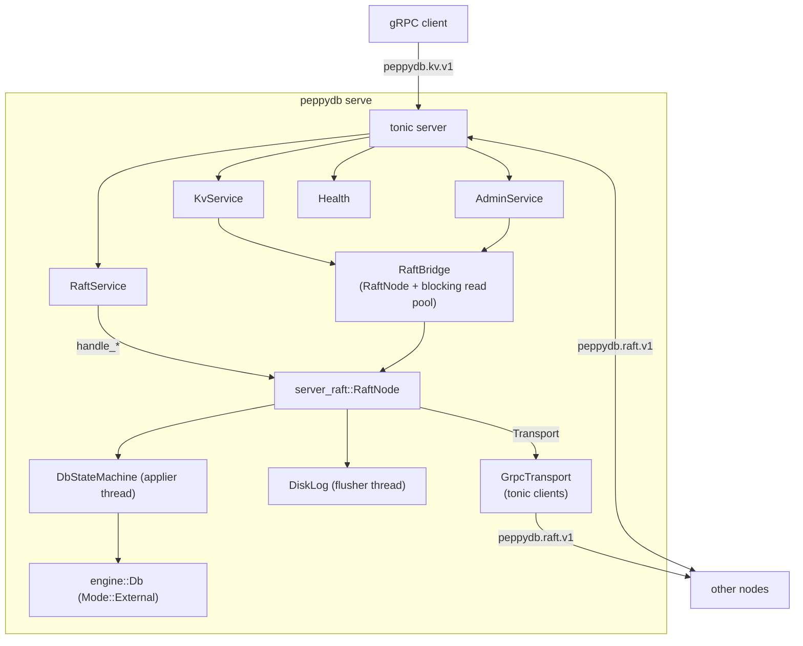

# 0032: Multi-node server over Raft

**Status:** In progress

**Parent roadmap:** [Server roadmap](0025-server-roadmap.md), milestone S7
(decisions 4, 5, 7, 8, 10, 11, 12, 14).

**Design references:** [Server](../design/server.md) (`peppydb.kv.v1`,
`serve`, `cli`, metrics), [server Raft](../design/server-raft.md) (`RaftNode`,
`Transport`, `DbStateMachine`, `DiskLog`, dependency rules),
[engine external-log mode](../design/engine.md#external-log-mode).

**Builds on:** [plan 0026](0026-server-grpc-kv.md) (S1 single-node server),
[plan 0030](0030-server-raft-state-machine.md) (S6 `DbStateMachine` and
`DiskLog`), [plan 0031](0031-server-operability.md) (S2 streaming snapshots
and Prometheus metrics).

## Goal and scope

After plan 0030, `server-raft` runs openraft over the real `DiskLog` and real
`DbStateMachine`, but only inside one process over an in-memory router.
Meanwhile, `peppydb serve` still opens a standalone `engine::Db`.

This stack connects the two: it adds the peer-to-peer gRPC API
(`peppydb.raft.v1`), implements `server_raft::Transport` over tonic in
`lib/server`, wires `peppydb serve` to `RaftNode` (decision 10: every server
runs Raft, with a 1-node group as the single-node case), and verifies
multi-process clusters under `SIGKILL`, restarts, snapshot catch-up, and
`iptables` partitions.

- **In scope:**
  - `proto/raft/v1/raft.proto` (`peppydb.raft.v1`) and crate `raft-proto`
    (`proto/raft/v1/rust`), plus extending `tools/gen-proto` to handle
    multiple APIs under `proto/`;
  - backwards-compatible additions to `proto/kv/v1/kv.proto`: `LeaderHint`
    for `UNAVAILABLE` status details, and Raft fields (`node_id`, `role`,
    `term`, `leader_id`, `leader_addr`) on `AdminService.StatusResponse`;
  - `GrpcTransport` and `RaftService` in `lib/server` implementing
    `server_raft::Transport` (including streamed `InstallSnapshot`);
  - replacing the standalone `Db` write/read path in `lib/server` with
    `RaftNode` (`propose` with pre-proposal limit checks, `read_barrier`
    followed by local `Db` reads, leader hints on `NotLeader`, fail-stop on
    `Stopped`, format marker check under `Mode::External`);
  - CLI flags for static cluster membership (`--node-id`, `--peers`,
    election/heartbeat/snapshot settings) and Raft Prometheus gauges in
    `metrics.rs`;
  - multi-process 3-node cluster tests (leader `SIGKILL`, failover, restart,
    snapshot catch-up), an `iptables` partition test under `tools/linux-run`,
    and a 3-server-VM + 1-client-VM `cluster-perf` GCP benchmark suite in
    `tools/gcp-bench`.
- **Out of scope:**
  - Dynamic membership changes (add/remove voters, learners) and resumable
    offset-based snapshot transfer (S8);
  - Go gateway and Porcupine linearizability harness (S3 / S8);
  - follower reads / MVCC snapshots (S9);
  - moving `DbStateMachine`'s in-memory `SnapshotData` to a temp file (no
    later than S8; S7 still streams chunks over the wire so the protocol is
    final).
- **Done when:**
  - `peppydb serve` runs a 1-node or 3-node static Raft cluster over gRPC;
  - writes replicate through Raft, reads pass `read_barrier`, non-leaders
    return `UNAVAILABLE` with `LeaderHint`, and `Status` + `/metrics` report
    role, term, and leader;
  - killing the leader with `SIGKILL` triggers failover with zero lost
    acknowledged writes; restarting the killed node catches up via log
    replication and via `InstallSnapshot` when behind a purge;
  - an `iptables` partition test under `tools/linux-run` isolates a leader,
    verifies majority failover, and confirms clean rejoin after healing;
  - `server-raft` still has zero tonic/proto dependencies and `server` still
    has zero openraft dependencies;
  - all `AGENTS.md` workspace checks pass and design documents are updated.

## Approach

### Components and dependency rules



Dependency rules from [server Raft](../design/server-raft.md#place-in-the-server-component)
stay intact:
- `raft-proto` (`proto/raft/v1/rust`) is visible only to `//lib/server:`.
- `server-raft` never depends on `tonic`, `kv-proto`, or `raft-proto`.
- `server` never depends on `openraft`.

### Peer API (`proto/raft/v1/raft.proto`)

Mirrors `lib/server-raft/src/transport.rs` field by field, carrying
`Command` bytes opaquely:

```proto
syntax = "proto3";
package peppydb.raft.v1;

service RaftService {
  rpc AppendEntries(AppendEntriesRequest) returns (AppendEntriesResponse);
  rpc Vote(VoteRequest) returns (VoteResponse);
  rpc PreVote(VoteRequest) returns (VoteResponse);
  rpc InstallSnapshot(stream InstallSnapshotRequest) returns (InstallSnapshotResponse);
  rpc TransferLeader(TransferLeaderRequest) returns (TransferLeaderResponse);
}

message InstallSnapshotRequest {
  oneof payload {
    // First message: sender vote and snapshot metadata.
    InstallSnapshotHeader header = 1;
    // Subsequent messages: raw engine store image chunks (256 KiB).
    bytes chunk = 2;
  }
}

message InstallSnapshotResponse {
  Vote vote = 1;
}
```

- `AppendEntries`, `Vote`, `PreVote`, and `TransferLeader` are unary RPCs
  mapping 1:1 to `transport::{AppendEntries, AppendReply, VoteRequest,
  VoteReply, TransferLeader, TransferReply}`.
- `InstallSnapshot` is client-streaming: header first, then 256 KiB chunks,
  returning the receiver's `Vote`. Streaming on the wire now avoids a
  breaking protocol change when S8 moves `SnapshotData` to a file and adds
  resumable offsets.
- `tools/gen-proto` is generalized to scan `proto/*/*/rust` and map each
  generated `<package>.rs` file to its matching crate directory.
  `peppydb.raft.v1` is internal to Rust servers and does not need Go code.

### Client API additions (`proto/kv/v1/kv.proto`)

Backwards-compatible additions verified by `buf breaking`:

```proto
message LeaderHint {
  uint64 leader_id = 1;
  // Client gRPC address of the current leader, if known.
  string leader_addr = 2;
}

message StatusResponse {
  uint64 applied_seq = 1;
  string version = 2;
  uint64 node_id = 3;
  // "leader", "follower", "candidate", "learner", or "shutdown".
  string role = 4;
  uint64 term = 5;
  optional uint64 leader_id = 6;
  optional string leader_addr = 7;
}
```

When a non-leader receives a `KvService` RPC, it returns
`Status::with_details(Code::Unavailable, "not leader", hint.encode_to_vec().into())`
when a leader is known, or plain `Status::unavailable("no leader elected")`
otherwise.

### `GrpcTransport` and peer connections

```rust
pub(crate) struct GrpcTransport {
    peers: RwLock<BTreeMap<NodeId, PeerChannel>>,
    chunk_bytes: usize,
}
```

- `GrpcTransport` maintains one lazy-reconnecting tonic `Channel` per peer
  address (`Endpoint::from_shared(...).connect_lazy()`), updated from
  membership `PeerInfo` when needed.
- Every transport error maps to `server_raft::transport::Unreachable(msg)`.
  openraft's `network.rs` already applies RPC deadlines, so hung peers time
  out cleanly.
- On the receiving side, `RaftService` dispatches incoming RPCs to
  `RaftNode::handle_*`. `HandleError::Stopped` maps to `Status::unavailable`.

### Wiring `serve` to `RaftNode`

- **Writes (`Put`, `Delete`):**
  1. Validate key non-empty, `stored_key.len() <= max_key_len`, and
     `value.len() <= max_value_len` *before* proposing (plan 0030 discovery:
     an entry the engine rejects stops the state machine).
  2. Build `Command::from_ops(&[Op::Put { .. }])` with `0x01 ‖ key` and
     await `node.propose(cmd)`. Notice writes no longer hold a blocking-pool
     thread while waiting for fsync/quorum!
  3. Map `ProposeError`:
     - `NotLeader(hint)` -> `UNAVAILABLE` with `LeaderHint` details;
     - `OutcomeUnknown` -> `UNAVAILABLE` ("write outcome unknown; retry");
     - `Stopped` -> `UNAVAILABLE` and trigger fail-stop shutdown (`Exit::Fatal`);
     - `Internal` -> `INTERNAL`.
- **Reads (`Get`, `Scan`):**
  1. Call `node.read_barrier().await` (maps `ReadError::NotLeader(hint)` to
     `UNAVAILABLE` with `LeaderHint`).
  2. Read from `sm.db()` (latest `Arc<Db>`, swapped atomically on snapshot
     install) on the blocking pool under the `max_inflight` semaphore.
- **Admin:**
  - `Status`: reads `node.status()` and `sm.db().applied_seq()`.
  - `Checkpoint`: calls `node.snapshot().await` (which pauses the applier,
    calls `checkpoint_with` with the log sync hook, and updates the
    committed image) and returns the new checkpoint info (or `Db::checkpoint`
    via the state machine; see [Open questions](#open-questions)).
  - `Snapshot`: streams `sm.db().write_snapshot` as in S2.
- **Data directory layout:**
  ```text
  <data-dir>/
    db/          engine::Db (Mode::External)
    raft-log/    server-raft-log (DiskLog)
  ```
- **Format marker:** Checked on open when `db.applied_seq() > 0` (refusing
  data without `0x00 ‖ "format" = [1]`). On cluster bootstrap, the initial
  leader writes the format marker through Raft so every replica holds it
  atomically with the data.
- **Metrics:** Add `peppydb_raft_term` (gauge), `peppydb_raft_role` (gauge
  labelled by role), `peppydb_raft_commit_index` (gauge), and
  `peppydb_raft_applied_index` (gauge) updated at scrape time from
  `node.status()`.

### CLI and static membership

```text
peppydb serve --data-dir <DIR>
              [--listen 127.0.0.1:7420]
              [--metrics-listen <ADDR>]
              [--node-id 1]
              [--peers 1=127.0.0.1:7420,2=127.0.0.1:7421,3=127.0.0.1:7422]
              [--bootstrap]
              [--io cached|direct]
              [--max-inflight 1024]
```

- Single-node default: if `--peers` is omitted, the node runs as a 1-node
  cluster `{ node_id: listen_addr }` and bootstraps automatically when empty
  (preserving simple `peppydb serve --data-dir <DIR>` ergonomics).
- Multi-node bootstrap: passing `--bootstrap` calls `node.initialize(peers)`
  when the node starts empty (idempotent if already initialized; ignored on
  restart).

## Decisions and trade-offs

- **One port (`--listen`) for client and peer gRPC by default:** Serving
  `KvService`, `AdminService`, `Health`, and `RaftService` on one tonic
  server keeps `PeerInfo { addr }` unchanged (the same address dials peers
  and populates `LeaderHint.leader_addr`) and avoids doubling the address
  map in `--peers`.
  *Alternative:* separate `--peer-listen` port and two addresses per peer.
  Listed as open question 1 below.
- **Pre-proposal limit validation in `server`:** Because an engine error
  during apply halts the state machine on every replica, `KvService` checks
  `max_key_len` and `max_value_len` before calling `RaftNode::propose`.
- **Streamed `InstallSnapshot` on the wire from day one:** Even though
  `DbStateMachine`'s `SnapshotData` is still `Vec<u8>` until S8, chunking it
  over a client-streaming RPC avoids tonic's 4 MiB message limit and keeps
  `peppydb.raft.v1` stable for S8.

## Proposed commit stack

### `[1/11][server-multi-node][plan] plan the multi-node server`

- **Purpose:** Record the agreed design, trade-offs, and commit stack.
- **Core changes:** `docs/plans/0032-server-multi-node.md`.
- **Verification:** Links resolve; matches `0000-template.md`.

### `[2/11][server-multi-node][proto] add peppydb.raft.v1 and extend kv.v1 status and leader hints`

- **Purpose:** Define the peer Raft gRPC API and client leader-hint/status
  fields, and support multiple proto APIs in `tools/gen-proto`.
- **Core changes:** `proto/raft/v1/raft.proto`, `proto/raft/v1/rust/`
  (`raft-proto` crate), `proto/kv/v1/kv.proto` (`LeaderHint`, `StatusResponse`
  fields), `tools/gen-proto`, regenerated files.
- **Verification:** `tools/gen-proto --check`, `tools/autocargo --check`,
  `tools/buck2 test //proto/...`, `go vet ./...`.

### `[3/11][server-multi-node][transport] implement GrpcTransport and RaftService`

- **Purpose:** Carry all 5 `server_raft::Transport` RPCs over tonic gRPC,
  including streamed `InstallSnapshot`.
- **Core changes:** `lib/server/src/raft_transport.rs` (proto conversions,
  `GrpcTransport`, `RaftService`), `lib/server/BUCK` (`server-raft`,
  `raft-proto`), unit tests spinning up two/three `RaftNode`s over loopback
  gRPC (election, replication, snapshot transfer, leader transfer).
- **Verification:** `tools/buck2 test //lib/server/...`.

### `[4/11][server-multi-node][node] wire RaftBridge, KvService, and AdminService to RaftNode`

- **Purpose:** Replace the standalone `Db` path with `RaftNode` (`propose`,
  `read_barrier`, pre-proposal limit checks, `LeaderHint` on `NotLeader`,
  `Status` Raft fields, format marker under Raft).
- **Core changes:** `lib/server/src/bridge.rs`,
  `kv.rs`, `admin.rs`, `status.rs`, `lib.rs`, `keys.rs`, updated unit tests
  in `lib/server/src/tests/`.
- **Verification:** `tools/buck2 test //lib/server/...`.

### `[5/11][server-multi-node][metrics] expose Raft gauges on /metrics`

- **Purpose:** Report Raft role, term, commit index, and applied index in
  Prometheus exposition.
- **Core changes:** `lib/server/src/metrics.rs` and tests in
  `lib/server/src/tests/admin.rs`.
- **Verification:** `tools/buck2 test //lib/server/...`.

### `[6/11][server-multi-node][cli] add cluster flags to peppydb serve`

- **Purpose:** Configure static cluster membership and bootstrap from CLI
  flags while keeping single-node defaults ergonomic.
- **Core changes:** `lib/server/src/cli.rs` (`--node-id`, `--peers`,
  `--bootstrap`, `db/` + `raft-log/` layout), updated `process.rs` tests.
- **Verification:** `tools/buck2 test //lib/server/... //bin/peppydb/...`.

### `[7/11][server-multi-node][test] add 3-node multi-process failover and snapshot catch-up tests`

- **Purpose:** Verify election, leader hints, `SIGKILL` failover, restart
  catch-up, and `InstallSnapshot` catch-up across real OS processes.
- **Core changes:** `lib/server/src/tests/cluster.rs` (spawning 3 `peppydb`
  processes on loopback, killing leader with `SIGKILL`, verifying zero lost
  acknowledged writes, forcing compaction + snapshot install on restart).
- **Verification:** `tools/buck2 test //lib/server/...`.

### `[8/11][server-multi-node][test] add iptables network partition tests under linux-run`

- **Purpose:** Verify real network partitions (isolated leader, majority
  failover, heal and rejoin) using `iptables` (decision 12).
- **Core changes:** `lib/server/src/tests/cluster.rs` (Linux-only /
  `#[ignore]`, run via `tools/linux-run`).
- **Verification:** `tools/linux-run` partition test passes.

### `[9/11][server-multi-node][load] follow LeaderHint in peppydb-load`

- **Purpose:** Allow `peppydb-load` to target a multi-node cluster by
  accepting multiple `--addr` endpoints and redirecting on `UNAVAILABLE`
  with `LeaderHint`.
- **Core changes:** `bin/peppydb-load/main.go`, `bin/peppydb-load/main_test.go`.
- **Verification:** `go vet ./... && go test ./...`, `tools/buck2 build //bin/peppydb-load:peppydb-load`.

### `[10/11][server-multi-node][gcp] add 3-node cluster-perf suite to gcp-bench`

- **Purpose:** Run a 3-node Raft cluster (`3x c4d-standard-8-lssd`) driven by
  `peppydb-load` (`1x n4-standard-8`) on GCP in one `us-east1` zone with a
  2-phase GCS IP/ready handshake and full teardown guarantees.
- **Core changes:** `tools/gcp-bench`, `tools/gcp/remote-bench.sh`,
  `tools/gcp/suites/cluster-perf.txt`, offline tests in
  `tools/gcp/testing/test-driver.sh`.
- **Verification:** `sh tools/gcp/testing/test-driver.sh`,
  `PEPPYDB_GCP_BENCH_TEST=1 tools/gcp-bench run --suite cluster-perf --dry-run`.

### `[11/11][server-multi-node][docs] document the multi-node server`

- **Purpose:** Update design docs, roadmap S7 progress, and verification
  outcomes.
- **Core changes:** `docs/design/server.md`, `docs/design/server-raft.md`,
  `docs/design/remote-benchmarks.md`, `docs/plans/0025-server-roadmap.md`,
  `docs/plans/0032-server-multi-node.md`.
- **Verification:** Full `AGENTS.md` workspace verification suite.

## Open questions

None. Resolved in discussion:

1. **One port (`--listen`):** `RaftService` shares `--listen` with
   `KvService`, `AdminService`, and `Health`.
2. **Cluster bootstrap (`--bootstrap`):** Explicit `--bootstrap` on one node
   initializes a new multi-node cluster via `RaftNode::initialize(peers)`
   (no-op on restart). Omitting `--peers` runs a 1-node group and
   bootstraps automatically when empty.
3. **`AdminService.Checkpoint` under Raft:** Triggers `RaftNode::snapshot()`,
   reusing `DbStateMachine`'s `checkpoint_with` + sync hook compaction path.
4. **`peppydb-load` leader following:** Included as diff 9 so multi-node
   clusters can be load-tested immediately.

## Verification strategy

| Check | Command or procedure | Expected result |
| --- | --- | --- |
| Proto lint & breaking check | `tools/gen-proto --check` | `kv.v1` backwards-compatible; `raft.v1` lints clean |
| Dependency rules | `tools/buck2 query` / `BUCK` inspection | No `openraft` in `server`; no `tonic`/proto in `server-raft` |
| gRPC transport & 3-node in-process | `tools/buck2 test //lib/server/...` | Elections, replication, read barrier, leader hints, snapshot transfer pass |
| Multi-process `SIGKILL` & snapshot catch-up | `tools/buck2 test //lib/server/...` | Zero lost acknowledged writes across leader kills and restarts |
| `iptables` partition | `tools/linux-run ...` | Isolated leader steps down/rejects; majority fails over; heals cleanly |
| Go load generator | `go vet ./... && go test ./...` | Leader-hint redirection and existing tests pass |
| Workspace checks | Full `AGENTS.md` list + Miri on `bf-tree-circular-buffer` | All pass |

## Progress

- [x] Agree on the design and commit stack with the user.
- [x] 1/11 Plan commit.
- [ ] 2/11 `peppydb.raft.v1` proto, `kv.v1` additions, `tools/gen-proto`.
- [ ] 3/11 `GrpcTransport` and `RaftService`.
- [ ] 4/11 Wire `KvService` and `AdminService` to `RaftNode`.
- [ ] 5/11 Raft Prometheus metrics.
- [ ] 6/11 Cluster CLI flags and data layout.
- [ ] 7/11 Multi-process 3-node failover and snapshot catch-up tests.
- [ ] 8/11 `iptables` partition test under `tools/linux-run`.
- [ ] 9/11 Leader-hint following in `peppydb-load`.
- [ ] 10/11 3-server-VM + 1-client-VM `cluster-perf` suite in `tools/gcp-bench`.
- [ ] 11/11 Design docs and stack-wide verification.

## Discoveries and plan changes

None yet.

## Agent notes

- **Entry points:**
  - `lib/server-raft/src/transport.rs`: exact `Transport` trait and message
    structs to mirror in `proto/raft/v1/raft.proto`.
  - `lib/server-raft/src/node.rs`: `RaftNode` facade (`start`, `initialize`,
    `propose`, `read_barrier`, `status`, `snapshot`, `handle_*`).
  - `lib/server-raft/src/db_sm.rs`: `DbStateMachine::open`, `db()`.
  - `tools/gen-proto`: update to route generated `.rs` files into
    `proto/<api>/<version>/rust/src/generated/`.
  - `lib/server/src/tests/process.rs`: pattern for spawning child `peppydb`
    processes in Rust tests.
