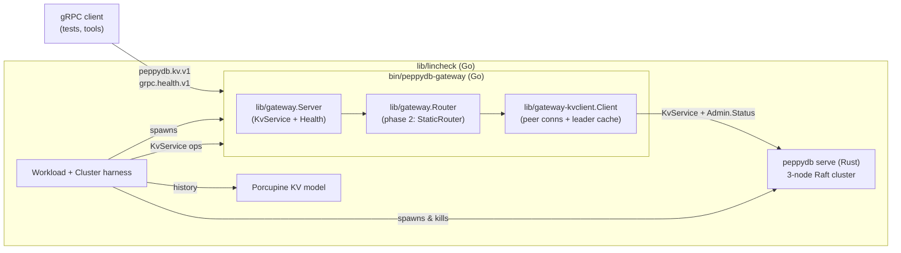
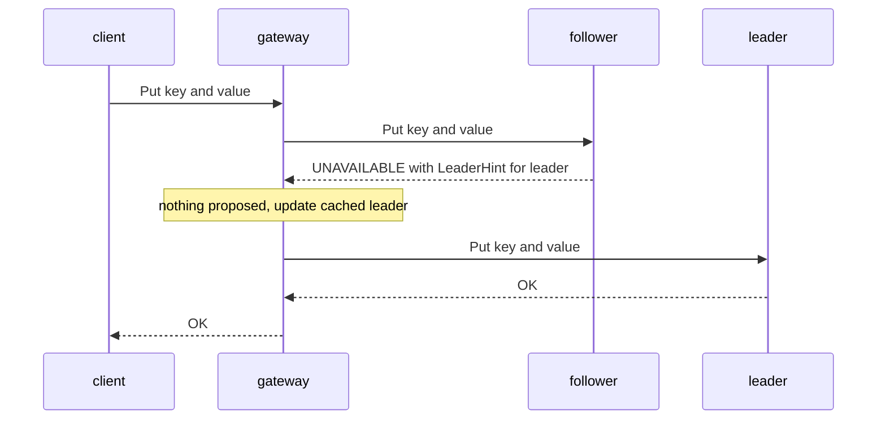

# 0033: Go gateway skeleton and linearizability harness

**Status:** Complete

**Parent roadmap:** [Server roadmap](0025-server-roadmap.md), milestone S3
(decisions 4, 5, 11, 15).

**Design references:** [Architecture](../design/architecture.md),
[server](../design/server.md) (`peppydb.kv.v1`, `LeaderHint`, `AdminService.Status`),
[build system](../design/build-system.md) (Go layout, `gobuckify-remote`, Buck2
visibility).

**Builds on:** [Plan 0026](0026-server-grpc-kv.md) (S1 `peppydb.kv.v1` and Go
codegen), [plan 0027](0027-workspace-language-agnostic-layout.md) (`bin/`,
`lib/`, `proto/` layout), [plan 0032](0032-server-multi-node.md) (S7 multi-node
server, `LeaderHint`, `AdminService.Status` Raft fields).

## Goal and scope

After plan 0032, a 3-node `peppydb` cluster replicates writes over Raft and
returns `UNAVAILABLE` with a `LeaderHint` from non-leaders, but every client
must track leaders itself and no automated checker verifies client-visible
linearizability across real `peppydb` processes.

This stack delivers milestone S3:

1. A stateless Go gateway (`bin/peppydb-gateway` over `lib/gateway`) that
   serves `peppydb.kv.v1.KvService`, caches the current Raft leader from
   `LeaderHint` trailers and `AdminService.Status`, and routes requests behind
   a shard-router interface ready for phase 3.
2. A reusable linearizability checker harness (`lib/lincheck`) built on
   [Porcupine](https://github.com/anishathalye/porcupine) that models single-key
   `Get`, `Put`, and `Delete` operations (including unknown-outcome writes),
   drives concurrent workloads, and spawns real Rust `peppydb` clusters from
   Buck2 `go_test` targets.

- **In scope:**
  - `lib/gateway-kvclient` (`peppydb/lib/gateway-kvclient`, internal package
    `kvclient`, visible only to `//lib/gateway:`): `Client` talking to one
    Raft group (persistent peer connections, `LeaderHint` decoding, injectable
    `LeaderDiscovery` seam with a phase 2 `AdminService.Status` implementation,
    `SetLeader` hook for future placement-driver watch updates, and
    linearizability-safe retry/redirect rules);
  - `lib/gateway` (`peppydb/lib/gateway`, entry package): `Router`,
    `StaticRouter`, `Server` (`KvService` + `grpc.health.v1.Health`), and an
    optional HTTP `GET /metrics` endpoint (`prometheus/client_golang` with Go
    runtime and process collectors);
  - `bin/peppydb-gateway`: thin CLI wrapper (`--listen`, `--backends`,
    `--metrics-listen`, `--request-timeout`, `--max-redirects`,
    `--max-read-retries`, graceful `SIGINT`/`SIGTERM` shutdown);
  - `lib/lincheck` (`peppydb/lib/lincheck`): Porcupine single-key KV model,
    unknown-outcome handling, concurrent workload driver, negative oracle
    tests, and a multi-process Rust `peppydb` + `peppydb-gateway` cluster
    harness;
  - cross-language Buck2 `go_test` targets where Go tests build and execute
    `//bin/peppydb:peppydb` and `//bin/peppydb-gateway:peppydb-gateway` via
    `$(location ...)` environment variables (1-node CRUD + 3-node leader
    `SIGKILL` failover checked by Porcupine);
  - adding `github.com/prometheus/client_golang`,
    `github.com/anishathalye/porcupine`, and `google.golang.org/grpc/health`
    to `go.mod` / `third-party/go/BUCK` via `tools/gobuckify-remote`;
  - a 5-VM `gateway-perf` suite in `tools/gcp-bench` (3 `peppydb` server VMs +
    1 `peppydb-gateway` VM + 1 `peppydb-load` client VM, scraping `/metrics`
    from the gateway and all three servers), with offline driver tests;
  - enduring design documentation in `docs/design/gateway.md` and roadmap/layout
    updates.
- **Out of scope:**
  - Phase 3 μshard routing, placement manager, or etcd integration
    (`StaticRouter` is the phase 2 implementation of `Router`);
  - proxying node-local `AdminService` RPCs (`Status`, `Checkpoint`, `Snapshot`)
    through the gateway (node control stays direct-to-node and moves to the
    phase 3 placement/control plane);
  - refactoring `bin/peppydb-load` to share `lib/gateway-kvclient`'s client
    (left untouched to keep diffs isolated while `cluster-perf` runs);
  - randomized multi-fault suites (`iptables` partitions, dynamic membership,
    snapshot catch-up under chaos) — those belong to S8 and will import
    `lib/lincheck`.
- **Done when:**
  - `peppydb-gateway` accepts `peppydb.kv.v1.KvService` traffic, discovers the
    leader from `--backends`, redirects on `LeaderHint`, retries transient read
    failures, and preserves unknown-outcome semantics on writes;
  - `lib/lincheck` checks concurrent single-key KV histories with Porcupine,
    handles unknown-outcome writes accurately, and catches injected
    non-linearizable histories in negative tests;
  - `tools/buck2 test //lib/gateway-kvclient/... //lib/gateway/... //lib/lincheck/... //bin/peppydb-gateway/...`
    builds and runs Go tests against real Rust `peppydb` 1-node and 3-node
    processes, passing Porcupine linearizability verification across a leader
    `SIGKILL` and restart;
  - `sh tools/gcp/testing/test-driver.sh` and `gateway-perf --dry-run` verify
    the 5-VM `client -> gateway -> 3x server` GCP topology;
  - all `AGENTS.md` workspace checks pass.

## Approach

### Components and dependency boundaries



Buck2 visibility enforces the `<component>-<part>` boundary rules
([build system](../design/build-system.md#small-crates-with-enforced-boundaries)):
- `proto/kv/v1/go:kvv1` adds `//lib/gateway-kvclient:`, `//lib/gateway:`, and
  `//lib/lincheck:` to its `visibility`.
- `lib/gateway-kvclient:gateway-kvclient` is internal to the gateway component:
  `visibility = ["//lib/gateway:"]`.
- `lib/gateway:gateway` is the component entry package, visible to
  `//bin/peppydb-gateway:` and `//lib/lincheck:`.
- `bin/peppydb:peppydb` and `bin/peppydb-gateway:peppydb-gateway` expose
  `visibility = ["//lib/lincheck:"]` so `//lib/lincheck:lincheck-test` can
  pass them via `$(location ...)`.
- No Rust crate changes.

### Gateway routing (`lib/gateway`) and leader tracking (`lib/gateway-kvclient`)

Phase 2 routes every key to one Raft group. Keeping a narrow `Router` interface
in `lib/gateway` lets phase 3 plug in a placement-backed μshard router without
changing `Server`, while `lib/gateway-kvclient` owns the per-group connection
pool and leader-tracking client:

```go
// In lib/gateway:
// Router resolves a key or scan to a backend client.
// Phase 2 uses StaticRouter (one group); phase 3 plugs in a placement router.
type Router interface {
    ClientForKey(key []byte) (Backend, error)
    DefaultClient() (Backend, error)
    Close() error
}

// Backend issues KV RPCs against one Raft group, tracking its leader.
// *kvclient.Client implements Backend.
type Backend interface {
    Get(ctx context.Context, req *kvv1.GetRequest) (*kvv1.GetResponse, error)
    Put(ctx context.Context, req *kvv1.PutRequest) (*kvv1.PutResponse, error)
    Delete(ctx context.Context, req *kvv1.DeleteRequest) (*kvv1.DeleteResponse, error)
    Scan(ctx context.Context, req *kvv1.ScanRequest) (*kvv1.ScanResponse, error)
    Close() error
}
```

`kvclient.Client` (`lib/gateway-kvclient`) talks to one Raft group:

- **Connection reuse:** Maintains a lazy map `addr -> *grpc.ClientConn` (for
  configured seed addresses and any address learned from a `LeaderHint`).
  gRPC multiplexes concurrent streams over each HTTP/2 connection, so leader
  switches do not tear down or churn TCP connections.
- **Pluggable leader discovery (`LeaderDiscovery` + `SetLeader`):**
  ```go
  // LeaderDiscovery locates the current leader address when the cache is empty
  // or invalidated. Phase 2 probes AdminService.Status across seed peers;
  // phase 3 can supply a placement-driver/etcd cache and push updates via
  // Client.SetLeader.
  type LeaderDiscovery interface {
      Discover(ctx context.Context) (string, error)
  }
  ```
  `Client` caches `leaderAddr`, exposes `SetLeader(addr)` for proactive watch
  updates, and coalesces concurrent `Discover` calls so a leader loss triggers
  one probe instead of a stampede.
- **`LeaderHint` decoding:** Reads `grpc-status-details-bin` from `grpc.Trailer`
  and unmarshals `kvv1.LeaderHint` (matching `lib/server/src/bridge.rs`'s
  `Status::with_details` encoding). Even in phase 3, etcd lease caches lag Raft
  elections slightly, so `LeaderHint` provides immediate self-correction.

#### Retry and linearizability contract

`lib/server-raft/src/error.rs` distinguishes two `UNAVAILABLE` causes:

- `ProposeError::NotLeader(hint)` / `ReadError::NotLeader(hint)`: the node was
  not leader and **never proposed** the entry. When the node knows the leader,
  it attaches `LeaderHint` in trailing metadata.
- `ProposeError::OutcomeUnknown`, `ReadError::NoQuorum`, transport reset, or
  `SIGKILL`: no `LeaderHint` is attached; for writes, the entry may already
  have been appended and may still commit under a new leader.

`kvclient.Client` therefore applies asymmetric retry rules:

| RPC kind | `UNAVAILABLE` **with** `LeaderHint` | `UNAVAILABLE` **without** `LeaderHint` | Other status (`INVALID_ARGUMENT`, `DEADLINE_EXCEEDED`, `INTERNAL`, ...) |
| --- | --- | --- | --- |
| Read (`Get`, `Scan`) | Update `leaderAddr` and retry (up to `MaxRedirects`) | Invalidate cache, probe/backoff, and retry (up to `MaxReadRetries`) | Return immediately |
| Write (`Put`, `Delete`) | Update `leaderAddr` and retry (up to `MaxRedirects`) | Invalidate cache, trigger async probe, and **return `UNAVAILABLE`** | Return immediately |

Why writes do not retry without a `LeaderHint`: silently retrying a write whose
first attempt actually committed before leadership loss can apply that write a
second time after an intervening concurrent write to the same key, violating
linearizability (Raft dissertation §6.3; no client deduplication table exists
yet). Returning `UNAVAILABLE` lets the caller—and Porcupine—treat the write as
having an unknown outcome while the invalidated cache ensures the next call
routes straight to the new leader.



### Linearizability harness (`lib/lincheck`)

#### Porcupine KV model

We adopt [Porcupine](https://github.com/anishathalye/porcupine) as the
linearizability checker (resolving the candidate choice from roadmap §Verification):

- **Operations modeled:** single-key `OpGet`, `OpPut`, `OpDelete`. `Scan` is
  not linearizable across leaves or pages (`kv.proto`), so scans are verified
  separately for ordering and pagination rather than inside the single-key
  Porcupine model.
- **Partitioning:** `Model.Partition` groups operations by `Key`, keeping
  Porcupine's search linear in the number of keys and fast under high
  concurrency.
- **State and transitions:**
  ```go
  type OpKind int

  const (
      OpGet OpKind = iota
      OpPut
      OpDelete
  )

  type Input struct {
      Kind  OpKind
      Key   string
      Value string
  }

  type Output struct {
      Found   bool
      Value   string
      Unknown bool
  }

  type kvState struct {
      present bool
      value   string
  }
  ```
  - `OpGet`: valid iff `state.present == out.Found && (!state.present || state.value == out.Value)`; state unchanged.
  - `OpPut`: always valid; next state is `{present: true, value: in.Value}`.
  - `OpDelete`: always valid; next state is `{present: false}`.
- **Unknown-outcome handling:**
  - Failed reads (`Get` returning `UNAVAILABLE`, `DEADLINE_EXCEEDED`, etc.)
    reveal no state and are omitted from the recorded history.
  - Writes rejected with `INVALID_ARGUMENT` guaranteed not to have taken effect
    are omitted.
  - Writes ending in an unknown-outcome status (`UNAVAILABLE`,
    `DEADLINE_EXCEEDED`, `CANCELLED`, `INTERNAL`) keep their invocation
    timestamp `Call` and receive `Return = maxCompletedReturn + 1` when the
    history is finalized.
  - Because `Return` is strictly after every completed operation in the
    history, Porcupine can linearize an applied unknown write at any point
    after `Call` (before any `Get` that observed it), or place an unapplied
    unknown write after all completed operations (affecting no observation).
    For a single-key register with no post-history reads, placing an unapplied
    write at `maxCompletedReturn + 1` is equivalent to Herlihy & Wing's
    incomplete-operation drop rule.
- **Failure diagnostics:** `Check` uses `porcupine.CheckOperationsVerbose` with
  a bounded timeout (default `10s`) and fails on both `porcupine.Illegal` and
  `porcupine.Unknown`. When `LINCHECK_VIS_DIR` is set (or on test failure into
  `t.TempDir()`), it writes Porcupine's HTML timeline for inspection.

#### Cross-language Buck2 cluster harness

`lib/lincheck/cluster.go` manages child `peppydb` and `peppydb-gateway`
processes:

- Reads `PEPPYDB_BIN` and `PEPPYDB_GATEWAY_BIN` from the environment.
- In `lib/lincheck/BUCK`, `go_test` sets:
  ```python
  env = {
      "PEPPYDB_BIN": "$(location //bin/peppydb:peppydb)",
      "PEPPYDB_GATEWAY_BIN": "$(location //bin/peppydb-gateway:peppydb-gateway)",
  }
  ```
  so `tools/buck2 test //lib/lincheck/...` automatically builds the Rust server
  and Go gateway binaries and runs the cross-language tests.
- Under plain `go test ./...` (where `PEPPYDB_BIN` is unset), process-spawning
  tests call `t.Skip("PEPPYDB_BIN not set; run via tools/buck2 test ...")`
  while all unit and negative oracle tests still run.
- Allocates free loopback ports, writes each node's data directory under
  `t.TempDir()`, waits for `listening on <addr>` on stderr (matching
  `lib/server/src/tests/process.rs`), and exposes `WaitLeader`, `Kill`
  (`SIGKILL`), `Stop` (`SIGTERM`), `Restart`, and `StartGateway`.

## Decisions and trade-offs

- **Choice of checker — Porcupine:** Pure Go, zero cgo, zero transitive
  dependencies, runs natively in Buck2 `go_test` without a JVM/Clojure runtime,
  partitions by key, and produces HTML counterexample visualizations.
  *Alternatives:* Jepsen/Knossos (Clojure/JVM operational weight); custom
  oracle (less general than full linearizability search).
- **Package split — `lib/gateway-kvclient` + `lib/gateway`:** Follows peppydb's
  `<component>-<part>` convention (`build-system.md`): `lib/gateway-kvclient`
  (`package kvclient`, visible only to `//lib/gateway:`) isolates peer
  connection management, leader discovery, and retry rules from the gRPC
  `Server` and `Router` in `lib/gateway`. Phase 3 can add
  `lib/gateway-placement` alongside it without restructuring existing packages.
- **Asymmetric write retries in `kvclient.Client`:** Retry writes on `UNAVAILABLE`
  only when `LeaderHint` is present; propagate non-hint `UNAVAILABLE` to the
  caller. *Trade-off:* Callers see occasional `UNAVAILABLE` during an active
  leader crash rather than transparent retry, in exchange for never turning an
  unknown-outcome write into a duplicate write that breaks linearizability.
- **No `AdminService` proxy on the gateway:** `AdminService` RPCs (`Status`,
  `Checkpoint`, `Snapshot`) target a specific node's Raft state and storage
  engine. Keeping `peppydb-gateway` focused on `KvService` + `grpc.health.v1`
  matches phase 3, where a gateway fronts multiple shards.
- **Gateway `/metrics` with `prometheus/client_golang`:** When
  `--metrics-listen <ADDR>` is set, `peppydb-gateway` serves Prometheus
  exposition on `GET /metrics` (404 on other paths) using an isolated
  `prometheus.Registry` with Go runtime and process collectors (`go_*`,
  `process_*`) plus gateway metrics:
  `peppydb_gateway_rpc_requests_total{method,code}`,
  `peppydb_gateway_rpc_duration_seconds{method}` (matching `peppydb serve`'s
  16 latency buckets from 100 µs to 10 s), `peppydb_gateway_inflight_requests`,
  `peppydb_gateway_leader_redirects_total`,
  `peppydb_gateway_read_retries_total`, `peppydb_gateway_leader_probes_total`,
  and `peppydb_gateway_process_uptime_seconds`. Using `client_golang` gives
  goroutine, heap, and GC pause visibility during proxy benchmarks without
  hand-rolling exposition.
- **Leave `bin/peppydb-load` unchanged in this stack:** Avoids touching code
  exercised concurrently by `cluster-perf`; extracting a shared client for
  `peppydb-load` can be a small follow-up if desired.

## Proposed commit stack

### `[1/7][server-gateway][plan] plan the Go gateway skeleton and linearizability harness`

- **Purpose:** Record the agreed S3 design, interfaces, retry semantics,
  Porcupine model, 5-VM `gateway-perf` GCP suite, and commit stack.
- **Core changes:** Add `docs/plans/0033-server-gateway.md`.
- **Verification:** Document review.

### `[2/7][server-gateway][kvclient] add leader-tracking client in lib/gateway-kvclient`

- **Purpose:** Provide the internal Raft-group client (`lib/gateway-kvclient`)
  with persistent peer connections, `LeaderHint` redirection, coalesced
  discovery, and linearizability-safe retry rules.
- **Core changes:**
  - `proto/kv/v1/go/BUCK`: add `//lib/gateway-kvclient:` to `visibility`.
  - `lib/gateway-kvclient/BUCK`, `lib/gateway-kvclient/client.go`,
    `lib/gateway-kvclient/client_test.go`.
  - Unit tests using fake in-process `KvService` + `AdminService` servers:
    initial discovery via `Admin.Status`, `LeaderHint` redirect on reads and
    writes, coalesced probing on failover, transient read retry, non-hint write
    error propagation (asserting write is attempted only once), and
    non-retryable error pass-through.
- **Verification:** `tools/buck2 test //lib/gateway-kvclient/...`,
  `go test ./lib/gateway-kvclient/...`.

### `[3/7][server-gateway][server] add gateway router, server, metrics, and peppydb-gateway binary`

- **Purpose:** Compose `lib/gateway-kvclient` behind `Router`, `Server`
  (`KvService` + `grpc.health.v1`), and optional HTTP `/metrics` in
  `lib/gateway`, and ship the runnable `peppydb-gateway` executable.
- **Core changes:**
  - `proto/kv/v1/go/BUCK`: add `//lib/gateway:` to `visibility`.
  - `lib/gateway/BUCK`, `lib/gateway/router.go`, `lib/gateway/metrics.go`,
    `lib/gateway/server.go`, `lib/gateway/server_test.go` (add
    `github.com/prometheus/client_golang` to `go.mod` / `go.sum`, plus
    `grpc/health` + `grpc_health_v1`; update `third-party/go/BUCK` with
    `tools/gobuckify-remote`).
  - `bin/peppydb-gateway/BUCK`, `bin/peppydb-gateway/main.go`: CLI flags
    (`--listen`, `--backends`, `--metrics-listen`, `--request-timeout`,
    `--max-redirects`, `--max-read-retries`), startup log `listening on <addr>`,
    graceful `SIGINT`/`SIGTERM` shutdown.
  - Unit tests covering `Get`, `Put`, `Delete`, `Scan` pagination, health check
    states, `/metrics` exposition + 404 handling, and graceful stop.
- **Verification:** `tools/buck2 test //lib/gateway-kvclient/... //lib/gateway/...`,
  `tools/buck2 build //bin/peppydb-gateway:peppydb-gateway`,
  `tools/gobuckify-remote --check`,
  `go test ./lib/gateway-kvclient/... ./lib/gateway/... ./bin/peppydb-gateway/...`.

### `[4/7][server-gateway][lincheck] add Porcupine KV linearizability model and workload runner`

- **Purpose:** Build the reusable Porcupine linearizability checker and
  concurrent workload driver for S3 and S8.
- **Core changes:**
  - Add `github.com/anishathalye/porcupine` to `go.mod` / `go.sum` and update
    `third-party/go/BUCK` via `tools/gobuckify-remote`.
  - `proto/kv/v1/go/BUCK`: add `//lib/lincheck:` to `visibility`.
  - `lib/lincheck/BUCK`, `lib/lincheck/model.go`, `lib/lincheck/recorder.go`,
    `lib/lincheck/workload.go`, `lib/lincheck/model_test.go`.
  - Unit tests verifying valid concurrent histories, applied and unapplied
    unknown-outcome writes, and **negative tests** proving Porcupine rejects
    stale reads, lost acknowledged writes, and non-linearizable interleavings.
- **Verification:** `tools/buck2 test //lib/lincheck/...`,
  `tools/gobuckify-remote --check`, `go test ./lib/lincheck/...`.

### `[5/7][server-gateway][e2e] add Go-to-Rust Buck2 integration and failover linearizability tests`

- **Purpose:** Prove cross-language Go-to-Rust communication in Buck2 and run
  a Porcupine-checked linearizability test against a 3-node `peppydb` cluster
  through `peppydb-gateway` during leader `SIGKILL` failover.
- **Core changes:**
  - `bin/peppydb/BUCK`, `bin/peppydb-gateway/BUCK`: add
    `visibility = ["//lib/lincheck:"]`.
  - `lib/lincheck/BUCK`: inject `PEPPYDB_BIN` and `PEPPYDB_GATEWAY_BIN` via
    `env` with `$(location ...)`.
  - `lib/lincheck/cluster.go`, `lib/lincheck/e2e_test.go`:
    - 1-node Go-to-Rust CRUD, empty-value vs absent-key, scan pagination,
      `INVALID_ARGUMENT`, and health test through `peppydb-gateway`;
    - 3-node cluster started with gateway pointed initially at a follower,
      concurrent workload (8 workers, small hot keyspace) across leader
      `SIGKILL` failover and node restart, verified linearizable by Porcupine.
- **Verification:** `tools/buck2 test //lib/lincheck/...`,
  `go test ./lib/lincheck/...` (skips process tests cleanly when `PEPPYDB_BIN`
  is unset).

### `[6/7][server-gateway][gcp] add 5-VM gateway-perf suite to gcp-bench`

- **Purpose:** Make `client -> gateway -> 3x server` testable and benchmarkable
  on real GCP VMs alongside `server-perf` and `cluster-perf`.
- **Core changes:**
  - `tools/gcp/targets.txt`: register `peppydb-gateway`.
  - `tools/gcp-bench` and `tools/gcp/remote-bench.sh`: support `# gateway: true`
    suites with a dedicated `gateway` VM (`n4-standard-8`, no Local SSD),
    `gateway/ready` discovery, `$GATEWAY_ADDR` expansion, and per-step
    `/metrics` scraping from both `gateway` and `server-1..3`.
  - `tools/gcp/suites/gateway-perf.txt`: 5-VM `peppydb-load -> peppydb-gateway -> 3x peppydb`
    benchmark suite.
  - `tools/gcp/testing/test-driver.sh`: add `gateway-ok` and `gateway-dry-run`
    offline integration cases.
- **Verification:** `sh tools/gcp/testing/test-driver.sh`,
  `sh tools/gcp/testing/test-remote.sh`, and
  `PEPPYDB_GCP_BENCH_TEST=1 tools/gcp-bench run --suite gateway-perf --dry-run`.

### `[7/7][server-gateway][docs] document the gateway and linearizability harness`

- **Purpose:** Record enduring gateway, linearizability harness, and
  `gateway-perf` documentation and mark S3 complete on the server roadmap.
- **Core changes:**
  - Add `docs/design/gateway.md`.
  - Update `docs/design/architecture.md` (code layout table),
    `docs/design/remote-benchmarks.md` (`gateway-perf` 5-VM topology),
    `docs/plans/0025-server-roadmap.md` (S3 progress + Porcupine decision), and
    `docs/plans/0033-server-gateway.md` (status and verification outcomes).
- **Verification:** Full `AGENTS.md` workspace verification suite.

## Open questions

None. Resolved in discussion:

1. **Package split (`lib/gateway-kvclient` + `lib/gateway`):** Follow the
   `<component>-<part>` convention (`lib/gateway-kvclient`, `package kvclient`,
   visible only to `//lib/gateway:`) rather than a single package or premature
   shard naming.
2. **Strictly linearizable writes:** Do not retry writes when `UNAVAILABLE`
   carries no `LeaderHint` (outcome unknown); only follow explicit
   `LeaderHint` redirects where `openraft` guarantees nothing was proposed.
3. **No `AdminService` on gateway:** Serve only `KvService` and
   `grpc.health.v1.Health`; node control remains direct-to-node until the
   phase 3 placement/control plane.
4. **Gateway `/metrics` (`prometheus/client_golang`):** Include an optional
   `--metrics-listen` HTTP endpoint backed by `prometheus/client_golang`
   (Go runtime + process collectors alongside gateway RPC counts, latency
   histograms, in-flight gauge, and redirect/retry/probe counters) to support
   benchmarking.
5. **Pluggable `LeaderDiscovery` seam:** Keep leader discovery behind a small
   `LeaderDiscovery` interface + `SetLeader(addr)` hook on `kvclient.Client`,
   so phase 2 probes `AdminService.Status` and phase 3 plugs in placement-driver
   / etcd lease watches cleanly.

## Verification strategy

| Check | Command or procedure | Expected result |
| --- | --- | --- |
| Gateway client, routing & retry invariants | `tools/buck2 test //lib/gateway-kvclient/... //lib/gateway/...` | Initial discovery, `LeaderHint` redirects, read retries, single-attempt unknown writes, graceful stop pass |
| Porcupine oracle (positive + negative) | `tools/buck2 test //lib/lincheck/...` | Valid histories and unknown-outcome edge cases pass; injected stale-read / lost-write histories are rejected |
| Go-to-Rust Buck2 e2e + 3-node failover | `tools/buck2 test //lib/lincheck/...` | Spawns real `peppydb` + `peppydb-gateway`, passes CRUD/scan/health and Porcupine check across leader `SIGKILL` + restart |
| 5-VM GCP `gateway-perf` driver & remote tests | `sh tools/gcp/testing/test-driver.sh && sh tools/gcp/testing/test-remote.sh` | 3 servers + 1 gateway + 1 client coordinate, expand `$GATEWAY_ADDR`, scrape metrics, and clean up |
| Go toolchain parity | `go vet ./... && go test ./...` | All Go packages vet and pass cleanly (e2e tests skip cleanly without `PEPPYDB_BIN`) |
| Third-party Go Buck2 rules | `tools/gobuckify-remote --check` | `third-party/go/BUCK` matches `go.mod` |
| Formatting, lint, full workspace | `tools/fmt.sh`, `tools/clippy.sh`, `tools/buck2 test //bin/... //lib/... //proto/...`, `tools/autocargo --check`, `tools/gen-proto --check`, `cargo test --workspace --locked` | All pass |

## Progress

- [x] Agree on the design and commit stack with the user.
- [x] 1/7 Plan commit.
- [x] 2/7 `lib/gateway-kvclient` leader-tracking client.
- [x] 3/7 `lib/gateway` `Router` + `Server` and `bin/peppydb-gateway`.
- [x] 4/7 `lib/lincheck` Porcupine KV model and workload runner.
- [x] 5/7 Go-to-Rust Buck2 integration and 3-node failover linearizability tests.
- [x] 6/7 5-VM `gateway-perf` GCP suite in `tools/gcp-bench`.
- [x] 7/7 Design docs and stack-wide verification.

## Verification outcomes (2026-11-23)

On macOS (Apple Silicon, APFS).

| Check | Result |
| --- | --- |
| `tools/fmt.sh`, `tools/clippy.sh` (with `check-unsafe`) | Pass |
| `tools/buck2 test -j 4 //bin/... //lib/... //proto/...` | Pass; 46 targets, 0 failures (`lincheck-test` ran 1-node CRUD/scan/health/metrics + 3-node leader `SIGKILL` failover: 971 gets, 820 puts, 324 deletes, 20 unknown writes, 0 failed gets, Porcupine `Ok`) |
| `cargo test --workspace --locked` | Pass |
| `go vet ./... && go test -race ./...` | Pass (`bin/peppydb-gateway`, `bin/peppydb-load`, `lib/gateway`, `lib/gateway-kvclient`, `lib/lincheck`, `lib/load`) |
| `tools/autocargo --check`, `tools/gobuckify-remote --check`, `tools/gen-proto --check` | Up to date (20 Cargo files, 14 Go modules / 133 packages) |
| Miri: `lib/bf-tree-circular-buffer` | Pass (30 passed, no new `unsafe`) |
| 5-VM `gateway-perf` GCP suite | `sh tools/gcp/testing/test-driver.sh` (including `gateway-ok` and `gateway-dry-run`) and `PEPPYDB_GCP_BENCH_TEST=1 tools/gcp-bench run --suite gateway-perf --bucket dry-run-bucket --dry-run` pass |

## Discoveries and plan changes

- **`LeaderHint` wire format (`google.rpc.Status`):** Testing `lib/gateway-kvclient`
  against real `grpc-go` revealed that `lib/server/src/bridge.rs` (plan 0032)
  placed raw `kv.v1.LeaderHint` bytes into `grpc-status-details-bin`, which
  `grpc-go` rejects as `codes.Internal: grpc-status-details-bin mismatch`
  because the gRPC spec requires a `google.rpc.Status` envelope. Amended the
  unmerged `server-multi-node` stack (`bridge.rs`, `cluster.rs`,
  `bin/peppydb-load`, plan 0032) to wrap `LeaderHint` in `google.rpc.Status`
  + `google.protobuf.Any`, so Go clients decode `*kvv1.LeaderHint` via
  standard `status.FromError(err).Details()`. Verified directly across the wire
  against a real Rust follower in `TestE2EThreeNodeGatewayLeaderFailoverLinearizable`.
- **`cgo_enabled = False` for `prometheus/client_golang` in Buck2:** On macOS,
  `prometheus`'s `process_collector_mem_cgo_darwin.go` references a `.c` file
  that `tools/gobuckify-remote` intentionally omits (`CGO_ENABLED=0`). Setting
  `cgo_enabled = False` on Go `go_binary` and `go_test` targets that link
  `prometheus/client_golang` aligns Buck2 with `gobuckify-remote` and selects
  the pure-Go nocgo collector cleanly.

## Agent notes

- **Entry points:**
  - `bin/peppydb-load/main.go`: existing Go client reference for `LeaderHint`
    decoding from `grpc-status-details-bin` and `AdminService.Status` probing.
  - `lib/server/src/bridge.rs` and `lib/server-raft/src/error.rs`: exact
    `NotLeader(LeaderHint)` vs `OutcomeUnknown` status mapping.
  - `lib/server/src/tests/process.rs` and `lib/server/src/tests/cluster.rs`:
    reference for spawning `peppydb serve` processes, parsing `listening on `,
    and configuring 3-node `--peers` / `--bootstrap`.
  - `tools/gobuckify-remote`: only generates `third-party/go/BUCK` rules for
    packages actively imported by `./...`; add new Go imports before running
    `tools/gobuckify-remote`.
- **Execution details:**
  - Verify how Buck2 `go_test` resolves `$(location ...)` paths in `env`
    relative to the test's working directory (e.g., whether `filepath.Abs` or
    repo-root resolution is needed when `go test` runs inside `lib/lincheck`).
  - Keep `bin/peppydb-load/`, `lib/server/`, `lib/server-raft/`, `proto/*.proto`,
    `docs/design/server.md`, and `docs/design/remote-benchmarks.md` untouched to
    avoid conflicts with concurrent `cluster-perf` work.
