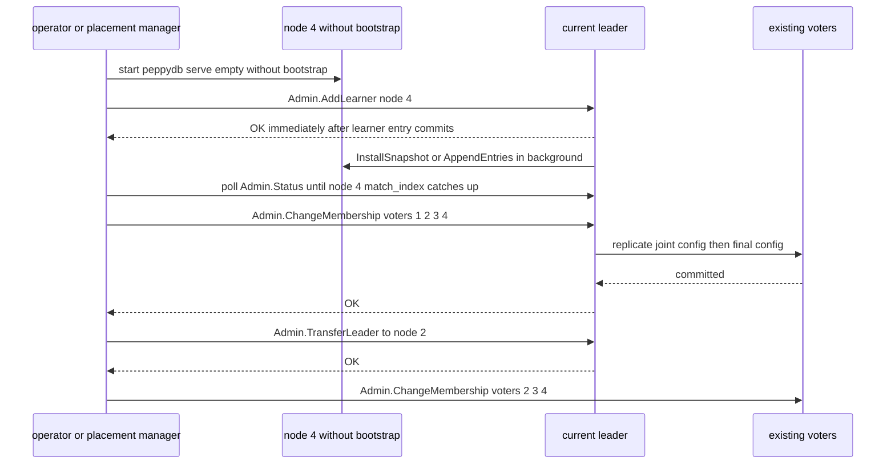
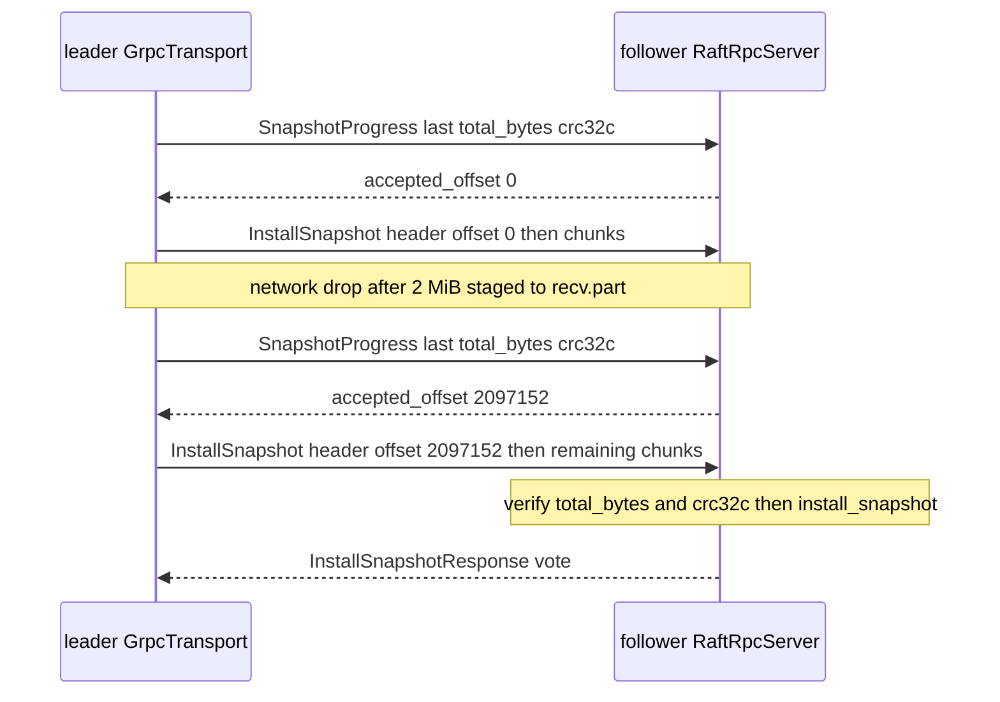

# 0034: Dynamic membership, resumable snapshots, and fault testing

**Status:** Complete

**Parent roadmap:** [Server roadmap](0025-server-roadmap.md), milestone S8
(completes phase 2; decisions 2, 3, 7, 11, 12, 15).

**Design references:** [Server](../design/server.md),
[server Raft](../design/server-raft.md),
[gateway](../design/gateway.md) (`lib/lincheck`, `peppydb-gateway`),
[engine external-log mode](../design/engine.md#external-log-mode).

**Builds on:** [Plan 0030](0030-server-raft-state-machine.md) (S6 `DbStateMachine`),
[plan 0032](0032-server-multi-node.md) (S7 multi-node server over gRPC),
[plan 0033](0033-server-gateway.md) (S3 Go gateway and Porcupine `lib/lincheck`).

## Goal and scope

After plans 0032 and 0033, `peppydb` runs a static multi-node Raft cluster
behind `peppydb-gateway` and passes a basic 3-node leader-`SIGKILL` Porcupine
check. Three phase 2 gaps remain before moving to phase 3 sharding:

1. **Membership is static:** Adding, replacing, or draining nodes requires
   restarting with static `--peers`, and `GrpcTransport` + `RaftBridge` only
   know peer addresses supplied at startup.
2. **Snapshots are in-memory and non-resumable:** `DbStateMachine` buffers the
   entire store image in a `Vec<u8>` on both sender and receiver, and a
   network drop mid-`InstallSnapshot` restarts from byte 0.
3. **Fault coverage is narrow:** Only a single scripted `SIGKILL` is checked
   under Porcupine; randomized multi-fault runs combining crashes, restarts,
   membership churn, snapshot catch-up, and `iptables` partitions are missing.

This stack closes all three gaps and completes phase 2:

- **In scope:**
  - **Dynamic membership:**
    - `RaftNode::add_learner`, `RaftNode::change_membership`, and live
      membership (`voters`, `learners`, `PeerInfo` addresses) on
      `server_raft::Status`;
    - dynamic peer registration in `server_raft::Transport` / `GrpcTransport`
      (learning peer addresses from openraft's `PeerInfo` on `new_client`, and
      resolving `LeaderHint` addresses from live Raft membership);
    - backwards-compatible `kv.v1` `AdminService` additions: `AddLearner`,
      `ChangeMembership`, `TransferLeader`, plus `voters` and `learners` on
      `StatusResponse`;
    - explicit `--bootstrap` semantics on `peppydb serve`: an empty node
      without `--bootstrap` starts uninitialized (ready to join an existing
      cluster via `AddLearner`), removing 1-node implicit auto-bootstrap so
      new nodes never accidentally form isolated 1-node clusters; `--bootstrap`
      is a no-op on restart once `--data-dir` holds state.
  - **File-backed & resumable snapshots:**
    - `SnapshotData` enum (`Bytes(Vec<u8>)` for the simulator; `File(SnapshotFile)`
      for `DbStateMachine` on real disk under `<data_dir>/snapshots/`, cleaned
      on drop and on startup), keeping memory usage `O(chunk_size)`;
    - backwards-compatible `raft.v1` additions: `SnapshotProgress` RPC plus
      `offset`, `total_bytes`, and `crc32c` on `InstallSnapshotHeader`;
    - receiver-side partial snapshot staging (`<data_dir>/snapshots/recv-*.part`)
      so a dropped transfer resumes from the last verified byte offset and
      checks Castagnoli CRC32C before calling `Db::install_snapshot`.
  - **Randomized chaos & linearizability testing:**
    - seeded randomized fault driver in `lib/lincheck` combining concurrent
      `Get`/`Put`/`Delete` traffic through `peppydb-gateway` with leader and
      follower `SIGKILL`, restarts, log-purge snapshot catch-up, and dynamic
      membership changes (`AddLearner` -> promote -> `TransferLeader` ->
      remove voter), verified by Porcupine;
    - Linux `iptables` randomized partition + crash chaos test runnable under
      `tools/linux-run`;
    - deterministic `rt-sim` simulator tests for dynamic membership changes in
      `lib/server-raft`.
- **Out of scope:**
  - Phase 3 sharding, μshards, migration fences, and etcd placement driver;
  - Engine MVCC / follower reads (deferred to its own roadmap);
  - Non-hermetic / off-site GCP fault runners (all S8 tests run hermetically
    under Buck2 and the pinned `tools/linux-run` container).
- **Done when:**
  - a running 3-node cluster dynamically adds an unbootstrapped node 4 as a
    learner (catching up via log or snapshot), promotes it to voter, transfers
    leadership, and removes an old voter with zero downtime and zero lost
    acknowledged writes;
  - `DbStateMachine` builds, streams, and installs snapshots via temp files on
    disk without buffering the full store image in RAM;
  - killing a connection mid-`InstallSnapshot` resumes from the received byte
    offset on retry and verifies CRC32C before install;
  - seeded randomized multi-fault runs (crashes, restarts, snapshot catch-up,
    membership churn, and Linux `iptables` partitions) pass Porcupine
    linearizability checks;
  - dependency rules remain intact (`server-raft` has no tonic/proto deps;
    `server` has no openraft deps);
  - all `AGENTS.md` workspace checks and Miri pass, and design docs are
    updated.

## Approach

### 1. Dynamic membership (`server-raft`, `kv.v1`, `server`)

Openraft 0.10 implements Raft joint consensus (`C_old,new` -> `C_new`) and
non-voting learners natively. Exposing `AddLearner` + `ChangeMembership` +
`TransferLeader` covers single-server changes as a special case while staying
ready for the phase 3 placement manager.



#### `server-raft` facade additions (`lib/server-raft/src/node.rs`)

```rust
/// Result of a membership RPC that failed before committing.
#[derive(Debug, Clone, PartialEq, Eq, thiserror::Error)]
pub enum MembershipError {
    #[error("not the leader (leader: {:?})", .0.id)]
    NotLeader(LeaderHint),
    #[error("membership change already in progress")]
    InProgress,
    #[error("learner not found or invalid membership change: {0}")]
    Invalid(String),
    #[error("the node stopped: {0}")]
    Stopped(String),
}

impl<SM, RT> RaftNode<SM, RT> {
    /// Add `id` at `peer` as a non-voting learner. Non-blocking: returns once
    /// the learner membership entry commits; replication and snapshot transfer
    /// proceed asynchronously in the background.
    pub async fn add_learner(
        &self,
        id: NodeId,
        peer: PeerInfo,
    ) -> Result<Proposed, MembershipError>;

    /// Change the voting set to `voters` via openraft joint consensus.
    /// When `retain_learners` is true, removed voters remain as learners;
    /// otherwise they are removed from the cluster.
    pub async fn change_membership(
        &self,
        voters: BTreeSet<NodeId>,
        retain_learners: bool,
    ) -> Result<Proposed, MembershipError>;
}
```

`server_raft::Status` gains `pub membership: MembershipConfig` (read from
`metrics.membership_config.membership()`) and
`pub replication: BTreeMap<NodeId, Option<LogId>>` (populated on the leader
from `metrics.replication`), exposing live voter/learner sets, peer addresses,
and per-peer replication progress.

#### Dynamic peer channels (`Transport` + `GrpcTransport`)

Currently `lib/server-raft/src/network.rs` ignores `_node: &PeerInfo` in
`RaftNetworkFactory::new_client`, and `GrpcTransport` only looks up peers from
the static `--peers` map. In S8:

- Add a default no-op method on `server_raft::Transport`:
  ```rust
  fn register_peer(&self, _id: NodeId, _peer: &PeerInfo) {}
  ```
- `Factory::new_client(&mut self, target: NodeId, node: &PeerInfo)` calls
  `self.transport.register_peer(target, node)` before returning `Peer`.
- `GrpcTransport::register_peer` inserts or updates `(addr, lazy_channel(&addr))`
  in its `RwLock<BTreeMap<NodeId, (String, Channel)>>` when `addr` is new or
  changed.
- `RaftBridge::leader_addr(id)` resolves `id` from `self.node.status().membership.nodes`
  first, falling back to startup peers, so `LeaderHint` works immediately for
  dynamically added leaders.

#### Client Admin API additions (`proto/kv/v1/kv.proto`)

Additive, backwards-compatible extensions to `AdminService` and `StatusResponse`:

```protobuf
service AdminService {
  rpc Status(StatusRequest) returns (StatusResponse);
  rpc Checkpoint(CheckpointRequest) returns (CheckpointResponse);
  rpc Snapshot(SnapshotRequest) returns (stream SnapshotResponse);
  // Add a non-voting learner to the Raft group. Leader-only.
  rpc AddLearner(AddLearnerRequest) returns (AddLearnerResponse);
  // Change the Raft voting set via joint consensus. Leader-only.
  rpc ChangeMembership(ChangeMembershipRequest) returns (ChangeMembershipResponse);
  // Hand leadership to target_node_id. Leader-only.
  rpc TransferLeader(TransferLeaderRequest) returns (TransferLeaderResponse);
}

message MemberInfo {
  uint64 node_id = 1;
  string addr = 2;
  // Last Raft log index matched on this peer; populated on the leader only.
  optional uint64 match_index = 3;
}

message StatusResponse {
  // Existing fields 1..7 unchanged.
  repeated MemberInfo voters = 8;
  repeated MemberInfo learners = 9;
}

message AddLearnerRequest {
  uint64 node_id = 1;
  string addr = 2;
}
message AddLearnerResponse {}

message ChangeMembershipRequest {
  // Complete target voter node ids (must already be known voters or learners).
  repeated uint64 voter_ids = 1;
  // Keep removed voters as learners when true; drop them otherwise.
  bool retain_learners = 2;
}
message ChangeMembershipResponse {}

message TransferLeaderRequest {
  uint64 target_node_id = 1;
}
message TransferLeaderResponse {}
```

Non-leaders reject `AddLearner`, `ChangeMembership`, and `TransferLeader` with
`UNAVAILABLE` carrying a standard `google.rpc.Status` `LeaderHint`.
`ChangeMembership` rejects an empty `voter_ids` set with `INVALID_ARGUMENT` and
maps `MembershipError::InProgress` to `ABORTED` (safe to retry).

#### Explicit `--bootstrap` startup mode (`lib/server/src/cli.rs`, `lib/server/src/lib.rs`)

Remove implicit 1-node auto-bootstrap (matching TiKV and CockroachDB, where
brand-new nodes never form an isolated cluster unless explicitly initialized):

| Scenario | Flags | Behavior |
| --- | --- | --- |
| New 1-node cluster | `--data-dir D --bootstrap` | Initializes `{node_id}` if `D` is empty |
| New 3-node cluster | Node 1: `--peers ... --bootstrap`; Nodes 2–3: `--peers ...` | Node 1 initializes `{1,2,3}`; nodes 2–3 wait for replication |
| New node joining an existing cluster | `--data-dir D --node-id 4 --listen ...` (no `--bootstrap`) | Starts empty and waits for `AdminService.AddLearner(4, addr)` |
| Restart of any existing member | `--data-dir D --node-id N --listen ...` | Recovers persisted `raft-log` and `MEMBERSHIP_KEY` from `D` and catches up automatically (`--bootstrap` ignored if set) |

Existing 1-node callers (`lib/server/src/tests/process.rs`,
`lib/lincheck/cluster.go`, `tools/gcp/suites/server-perf.txt`) are updated to
pass `--bootstrap` when initializing a fresh 1-node cluster.

### 2. File-backed & resumable snapshots

#### File-backed `SnapshotData` (`lib/server-raft`)

Replace `Vec<u8>` on `DbStateMachine` with a lightweight enum so the
in-memory simulator stays fast and deterministic while production never loads a
store file into RAM:

```rust
/// A temporary snapshot file on disk; unlinked automatically on drop.
pub struct SnapshotFile {
    path: PathBuf,
    len: u64,
    crc32c: u32,
}

impl SnapshotFile {
    pub fn path(&self) -> &Path;
    pub fn len(&self) -> u64;
    pub fn crc32c(&self) -> u32;
    pub fn open_at(&self, offset: u64) -> io::Result<std::fs::File>;
}

/// Snapshot payload carried between state machine and transport.
pub enum SnapshotData {
    /// Used by the in-memory simulator (`ModelSm`, `SimStore`).
    Bytes(Vec<u8>),
    /// Used by `DbStateMachine` on real disk: bounded O(chunk_size) memory.
    File(SnapshotFile),
}
```

- `DbStateMachine::open_dir` creates `<data_dir>/snapshots/` and deletes any
  leftover `*.tmp` / `*.part` files from an earlier crash.
- `db_snapshot::build` and `current` stream `db.write_snapshot` through a
  hashing writer directly into `<data_dir>/snapshots/snap-<seq>-<id>.tmp`,
  computing `len` and Castagnoli `crc32c` on the fly without extra passes.
- `db_snapshot::install` opens the `SnapshotFile` (or slice for `Bytes`) and
  streams straight into `db.install_snapshot(&mut reader)`.

#### Offset-resumable `InstallSnapshot` (`proto/raft/v1/raft.proto` + `GrpcTransport`)

Backwards-compatible additions to `peppydb.raft.v1`:

```protobuf
service RaftService {
  // Existing RPCs unchanged.
  // Query how many contiguous verified bytes the receiver already staged for
  // snapshot_id, allowing InstallSnapshot to resume after a disconnect.
  rpc SnapshotProgress(SnapshotProgressRequest) returns (SnapshotProgressResponse);
}

message SnapshotProgressRequest {
  uint64 from = 1;
  Vote vote = 2;
  LogId last = 3;
  uint64 total_bytes = 4;
  uint32 crc32c = 5;
}

message SnapshotProgressResponse {
  Vote vote = 1;
  // Byte offset the sender should resume from (0 if no matching partial file).
  uint64 accepted_offset = 2;
}

message InstallSnapshotHeader {
  // Existing fields 1..3 unchanged.
  uint64 offset = 4;
  uint64 total_bytes = 5;
  uint32 crc32c = 6;
}
```



Receiver staging invariants:
- At most one active staging file (`<data_dir>/snapshots/recv-<term>-<index>.part`)
  guarded by a mutex.
- If a new `SnapshotProgress` or `InstallSnapshotHeader` arrives with a higher
  `last` or mismatched `(total_bytes, crc32c)`, discard the old `.part` file
  and reset `accepted_offset = 0`.
- If `header.offset != staged_len`, reject with `FAILED_PRECONDITION` so the
  sender re-queries `SnapshotProgress`.
- Write incoming chunks to the `.part` file via `spawn_blocking` (off async
  workers, roadmap decision 14) with a bounded channel (`SNAPSHOT_CHUNK_BYTES = 256 KiB`).
- When `staged_len == total_bytes`, verify Castagnoli `crc32c` over the file;
  on mismatch delete `.part` and return `DATA_LOSS` so the sender restarts from
  byte 0; on match wrap as `SnapshotData::File` and hand to
  `RaftNode::handle_snapshot`.

### 3. Randomized chaos & linearizability testing (`lib/lincheck` + `tools/linux-run`)

Extend `lib/lincheck` (`Cluster` + new `chaos.go`) so multi-fault runs are
seeded, reproducible, and reusable:

- **`Cluster` additions (`lib/lincheck/cluster.go`):**
  - `AddNode(ctx)` — allocates a free port and data dir, spawns a fresh
    `peppydb serve --node-id <N>` (without `--bootstrap`), and returns
    `(nodeID, addr)`.
  - `AddLearner(ctx, nodeID, addr)`, `WaitCaughtUp(ctx, nodeID)`,
    `ChangeMembership(ctx, voters, retain)`, `TransferLeader(ctx, targetID)` —
    find the current leader (following `LeaderHint` if needed) and invoke
    `AdminService`.
- **Seeded chaos runner (`lib/lincheck/chaos.go`):**
  - Runs `RunWorkload` through `peppydb-gateway` (8 workers, hot keyspace of 5
    keys) while a fault loop driven by `rand.NewPCG(seed, ...)` picks faults at
    bounded intervals:
    1. **Leader `SIGKILL` + restart** (wait for failover, then restart).
    2. **Follower `SIGKILL` + log purge + restart** (configure low
       `--snapshot-after` so writes force compaction and the restarted follower
       catches up via `InstallSnapshot`).
    3. **Membership cycle** (`AddNode` -> `AddLearner` -> `WaitCaughtUp` ->
       `ChangeMembership` add voter -> `TransferLeader` -> `ChangeMembership`
       remove old voter -> verify gateway continues routing via `LeaderHint`).
    4. **Linux `iptables` partition + heal** (optional fault enabled under
       `tools/linux-run` with `LINCHECK_IPTABLES=1`: isolate leader or follower
       using `iptables`, wait for majority progress, heal, verify convergence).
  - Always logs the seed, every injected fault with timestamps, and op stats;
    runs Porcupine `Check` at the end and writes an HTML visualization on
    failure.

## Decisions and trade-offs

- **Explicit `--bootstrap` everywhere (no `--join` flag):** An empty node
  started without `--bootstrap` always waits uninitialized for
  `AdminService.AddLearner`, matching TiKV/CockroachDB and phase 3's empty
  storage-node startup. Restarting an existing member recovers its persisted
  log and membership from `--data-dir` and catches up automatically without
  needing `--peers` or special flags.
- **Always non-blocking `AddLearner`:** `AddLearner(node_id, addr)` returns as
  soon as the learner membership entry commits (`blocking = false` in openraft)
  and never holds an RPC open across snapshot transfer, matching etcd's
  `MemberAdd --learner` and TiKV/PD's asynchronous scheduling. Callers poll
  `AdminService.Status` (`MemberInfo.match_index` on the leader) to observe
  learner catch-up before calling `ChangeMembership`.
- **Joint consensus (`AddLearner` + `ChangeMembership`) over restricted
  single-server RPCs:** Openraft 0.10 implements joint consensus cleanly, and
  exposing `ChangeMembership(voter_ids, retain_learners)` supports both
  single-server changes and multi-server swaps without extra server state.
  Requiring `AddLearner` before promoting keeps quorum disruption minimal
  (dissertation §4.2.1).
- **Enum `SnapshotData::Bytes | File`:** Keeps `rt-sim` deterministic tests
  fast in memory while production `DbStateMachine` streams directly to/from
  disk in `O(chunk_size)` memory.
- **Streamed `InstallSnapshot` + `SnapshotProgress` offset query:** Preserves
  full HTTP/2 streaming throughput on the happy path while resuming from the
  exact byte offset on reconnect, without breaking `peppydb.raft.v1`.
- **No external dependencies added:** `crc32c` is already in `third-party/rust`
  (used by `lib/server` and `lib/wal-segments`); `tempfile` or stdlib temp
  files in `<data_dir>/snapshots/` need no new crates.

## Proposed commit stack

### `[1/9][server-membership][plan] plan dynamic membership, resumable snapshots, and fault testing`

- **Purpose:** Record the agreed S8 design, APIs, snapshot staging invariants,
  fault-testing matrix, and commit stack.
- **Core changes:** Add `docs/plans/0034-server-membership.md`.
- **Verification:** Document review.

### `[2/9][server-membership][raft] expose dynamic membership and peer registration in server-raft`

- **Purpose:** Add `add_learner`, `change_membership`, `MembershipError`, live
  `Status::membership`, and `Transport::register_peer` to `server-raft`.
- **Core changes:**
  - `lib/server-raft/src/node.rs`, `error.rs`, `transport.rs`, `network.rs`.
  - Simulator tests in `lib/server-raft/src/tests/` verifying `add_learner`,
    voter promotion, leadership transfer, voter removal, and safety checks
    during membership changes under `rt-sim`.
- **Verification:** `tools/buck2 test //lib/server-raft/...`.

### `[3/9][server-membership][proto] add membership AdminService RPCs and resumable snapshot fields`

- **Purpose:** Extend `peppydb.kv.v1` and `peppydb.raft.v1` backwards-compatibly
  and regenerate Rust + Go bindings.
- **Core changes:**
  - `proto/kv/v1/kv.proto`: `AddLearner`, `ChangeMembership`, `TransferLeader`,
    `MemberInfo`, and `voters`/`learners` on `StatusResponse`.
  - `proto/raft/v1/raft.proto`: `SnapshotProgress` RPC and `offset`,
    `total_bytes`, `crc32c` on `InstallSnapshotHeader`.
  - Run `tools/gen-proto` to update `proto/kv/v1/{rust,go}` and
    `proto/raft/v1/rust`.
- **Verification:** `tools/gen-proto --check`, `tools/buck2 test //proto/...`.

### `[4/9][server-membership][membership] wire dynamic membership, GrpcTransport peer updates, and explicit --bootstrap`

- **Purpose:** Connect `AdminService` membership RPCs, live `LeaderHint`
  address lookup, dynamic `GrpcTransport` peer channels, and explicit
  `--bootstrap` semantics on `peppydb serve`.
- **Core changes:**
  - `lib/server/src/raft_transport.rs`: implement `register_peer` updating
    `peers` map lazily.
  - `lib/server/src/bridge.rs`, `admin.rs`, `metrics.rs`, `lib.rs`, `cli.rs`:
    wire `AddLearner`, `ChangeMembership`, `TransferLeader`, live `voters`/
    `learners` (with `match_index` on the leader) in `Status`, and remove
    implicit 1-node auto-bootstrap (updating 1-node tests and
    `tools/gcp/suites/server-perf.txt` to pass `--bootstrap`).
  - Multi-process test in `lib/server/src/tests/cluster.rs`: 3-node cluster
    dynamically adds unbootstrapped node 4 (`AddLearner` -> wait catch-up ->
    promote -> `TransferLeader` -> remove node 1), verifying reads/writes and
    leader hints.
- **Verification:** `tools/buck2 test //lib/server/...`.

### `[5/9][server-membership][snapshot-file] store DbStateMachine snapshots in temporary files`

- **Purpose:** Eliminate full-database `Vec<u8>` snapshot buffering in
  `DbStateMachine` while keeping `ModelSm` in-memory.
- **Core changes:**
  - Add `lib/server-raft/src/snapshot_file.rs` (`SnapshotFile`, `SnapshotData`
    enum) and add `//third-party/rust:crc32c` to `lib/server-raft/BUCK` (run
    `tools/autocargo`).
  - Update `lib/server-raft/src/db_sm.rs` and `db_snapshot.rs` to stream
    `write_snapshot` / `install_snapshot` via `<data_dir>/snapshots/*.tmp` and
    clean stale temp files on open.
  - Unit tests verifying file cleanup on drop/startup, CRC32C calculation, and
    snapshot install from disk.
- **Verification:** `tools/buck2 test //lib/server-raft/... //lib/server/...`,
  `tools/autocargo --check`.

### `[6/9][server-membership][snapshot-resume] implement chunked offset-resumable InstallSnapshot over gRPC`

- **Purpose:** Stream `SnapshotFile` chunks off async threads and resume
  interrupted transfers from the receiver's staged byte offset with CRC32C
  verification.
- **Core changes:**
  - `lib/server/src/raft_transport.rs`: implement `SnapshotProgress` and
    offset-based `InstallSnapshot` sender/receiver staging (`recv-*.part`),
    bounded streaming channel, and CRC32C check before `handle_snapshot`.
  - Unit + transport tests in `lib/server/src/raft_transport.rs`:
    - simulated disconnect mid-stream resumes from exact `accepted_offset`
      without resending earlier chunks;
    - corrupted chunk fails CRC32C, clears staging, and succeeds on fresh retry;
    - newer snapshot supersedes an older partial staging file.
- **Verification:** `tools/buck2 test //lib/server/...`.

### `[7/9][server-membership][faults] add seeded multi-fault and membership linearizability tests`

- **Purpose:** Exercise randomized crashes, restarts, snapshot catch-up, and
  dynamic membership churn through `peppydb-gateway` under Porcupine.
- **Core changes:**
  - `lib/lincheck/cluster.go`: pass `--bootstrap` for 1-node clusters and add
    `AddNode`, `AddLearner`, `WaitCaughtUp`, `ChangeMembership`, and
    `TransferLeader` helpers.
  - `lib/lincheck/chaos.go`, `lib/lincheck/chaos_test.go`: seeded chaos runner
    combining leader/follower `SIGKILL`, snapshot catch-up after compaction,
    and membership rotation through `peppydb-gateway`, checked by Porcupine.
  - Update `lib/gateway-kvclient` if needed so dynamically added nodes learned
    from `LeaderHint` / `Admin.Status` work seamlessly when original seeds are
    removed.
- **Verification:** `tools/buck2 test //lib/lincheck/... //lib/gateway-kvclient/... //lib/gateway/...`.

### `[8/9][server-membership][linux-faults] add Linux iptables partition fault test under tools/linux-run`

- **Purpose:** Run randomized `iptables` network partitions alongside leader
  kills and gateway traffic under `tools/linux-run`, verified by Porcupine.
- **Core changes:**
  - `lib/lincheck/iptables_linux.go` and `lib/lincheck/chaos_linux_test.go`
    (gated by `LINCHECK_IPTABLES=1` so default local runs stay rootless; runs
    with `--privileged` / `NET_ADMIN` inside `tools/linux-run`).
- **Verification:** `tools/linux-run` run of the `iptables` chaos test +
  `go vet ./...`.

### `[9/9][server-membership][docs] document dynamic membership, resumable snapshots, and S8 completion`

- **Purpose:** Update enduring design docs and mark S8 (and phase 2) complete
  on the server roadmap.
- **Core changes:**
  - Update `docs/design/server.md`, `docs/design/server-raft.md`,
    `docs/design/gateway.md`, `docs/plans/0025-server-roadmap.md`, and
    `docs/plans/0034-server-membership.md`.
- **Verification:** Full `AGENTS.md` workspace verification suite + Miri on
  `bf-tree-circular-buffer`.

## Open questions

None. Resolved in discussion:

1. **Declarative `ChangeMembership` (joint consensus):** Expose
   `AddLearner(node_id, addr)` + `ChangeMembership(voter_ids, retain_learners)`
   + `TransferLeader(target)`, using openraft's joint consensus for both
   single-server changes and direct swaps (`[1,2,3] -> [2,3,4]`).
2. **Non-blocking `AddLearner`:** Dropped `blocking` from `AddLearnerRequest`;
   callers observe catch-up via `MemberInfo.match_index` on the leader's
   `AdminService.Status`.
3. **Explicit `--bootstrap` (no `--join` flag):** Empty nodes without
   `--bootstrap` start uninitialized waiting for `AddLearner`; restarts of
   existing members recover persisted state automatically.
4. **Resumable snapshot wire protocol:** `SnapshotProgress` offset query
   followed by offset-based streamed `InstallSnapshot` with Castagnoli CRC32C
   verification and `.part` staging on disk.
5. **Hermetic fault testing only:** Keep S8 tests fully hermetic under Buck2
   and `tools/linux-run` (no GCP fault controller).

## Verification strategy

| Check | Command or procedure | Expected result |
| --- | --- | --- |
| Proto lint & breaking check | `tools/gen-proto --check` | `kv.v1` and `raft.v1` additions lint clean and remain backwards-compatible |
| Raft membership simulation | `tools/buck2 test //lib/server-raft/...` | Dynamic learner/voter changes pass all 4 Raft safety properties under `rt-sim` |
| File-backed & resumable snapshots | `tools/buck2 test //lib/server/...` | Temp files cleaned up; mid-stream drop resumes from exact offset; CRC mismatch retries cleanly |
| Dynamic 4-node cluster lifecycle | `tools/buck2 test //lib/server/...` | empty node -> `AddLearner` -> wait catch-up -> promote -> `TransferLeader` -> remove old voter with zero lost writes |
| Randomized chaos + Porcupine | `tools/buck2 test //lib/lincheck/...` | Seeded crashes, snapshot catch-up, and membership churn through `peppydb-gateway` check `porcupine.Ok` |
| Linux `iptables` chaos | `tools/linux-run ... LINCHECK_IPTABLES=1` | Isolated leader steps down, majority serves through gateway, heals cleanly, Porcupine `Ok` |
| Full workspace & Miri | Full `AGENTS.md` suite + Miri on `bf-tree-circular-buffer` | All pass; dependency rules intact |

## Progress

- [x] Agree on the design and commit stack with the user.
- [x] 1/9 Plan commit.
- [x] 2/9 `server-raft` dynamic membership and `Transport::register_peer`.
- [x] 3/9 `kv.v1` membership RPCs and `raft.v1` resumable snapshot proto.
- [x] 4/9 `server` membership wiring, dynamic `GrpcTransport`, and explicit `--bootstrap`.
- [x] 5/9 File-backed `SnapshotFile` in `DbStateMachine`.
- [x] 6/9 Chunked offset-resumable `InstallSnapshot` in `GrpcTransport` / `RaftRpcServer`.
- [x] 7/9 Seeded multi-fault + membership linearizability tests in `lib/lincheck`.
- [x] 8/9 Linux `iptables` partition fault test under `tools/linux-run`.
- [x] 9/9 Design docs and stack-wide verification.

## Verification outcomes (2026-11-24)

On macOS (Apple Silicon, APFS).

| Check | Result |
| --- | --- |
| `tools/fmt.sh`, `tools/clippy.sh` (with `check-unsafe`) | Pass; 43 Rust targets clean |
| `tools/buck2 test -j 4 //bin/... //lib/... //proto/...` | Pass; 46 targets, 0 failures (`server-raft-unittest`: 75 passed; `server-unittest`: 32 passed including 4-node dynamic membership + resumable snapshot offset/corruption/supersede tests; `lincheck-test`: passed including seeded multi-fault + live membership swaps `[1,2,3] -> [1,3,4] -> [1,3,5]` + leader `SIGKILL` under Porcupine) |
| `cargo test --workspace --locked` | Pass |
| `go vet ./... && go test -race ./...` | Pass (`bin/peppydb-gateway`, `bin/peppydb-load`, `lib/gateway`, `lib/gateway-kvclient`, `lib/lincheck`, `lib/load`) |
| `GOOS=linux GOARCH=amd64 go vet` & `go test -c ./lib/lincheck/...` | Pass (Linux `iptables` partition fault test compiles cleanly; live execution runs under `tools/linux-run` with `LINCHECK_IPTABLES=1`) |
| `tools/autocargo --check`, `tools/gobuckify-remote --check`, `tools/gen-proto --check` | Up to date |
| `sh tools/gcp/testing/test-driver.sh` | Pass |
| Miri: `lib/bf-tree-circular-buffer` | Pass (30 passed, no new `unsafe`) |

## Discoveries and plan changes

- **`ChangeMembershipError::UncommittedLeaderLog` must be retryable:** Openraft
  rejects `add_learner` / `change_membership` right after an election until the
  new leader's initial blank log entry commits. Mapping `UncommittedLeaderLog`
  to `MembershipError::NotReady` -> gRPC `UNAVAILABLE` (rather than
  `INVALID_ARGUMENT`) lets callers (`lincheck`, phase 3 placement manager)
  retry cleanly across rapid leader transfers.
- **Worker error backoff for Porcupine search bounds:** Under tight-loop fault
  runs with zero backoff on `UNAVAILABLE`, 8 concurrent workers can accumulate
  hundreds of overlapping unknown-outcome writes on one key during a 300 ms
  failover, blowing up Porcupine's exponential search. Adding `ErrorBackoff`
  (default 25 ms, 50 ms in multi-fault tests) keeps overlapping unknowns small
  and Porcupine verification fast without weakening linearizability checks.
- **Leader readiness after `TransferLeader`:** Openraft flips `role == Leader`
  before its committed vote finishes fsyncing to disk; multi-process tests
  confirming leadership readiness should wait for a linearizable read
  (`read_barrier`) before asserting a single-shot `Put` succeeds.
- **Live `cluster-perf` run after S8 (2026-11-24):** run
  `20261124-201721-0f632d90` at revision `0f632d90`: the top of the `server-membership` stack before it was rebased onto `main`, with the same tree as after the rebase, all steps passed, no
  elections, no RPC errors. Throughput is within 0.92x to 1.01x of the
  plan 0032 run; file-backed snapshots leave the 32 ms snapshot stop
  unchanged (33.9 ms at p50), because `build` still holds the applier's
  gate for the checkpoint and the export. Results are in
  [server Raft measurements](../design/server-raft.md#three-server-vms-cluster-perf).
  Cheap snapshots are deferred to the post-phase-2 cleanup stack.

## Agent notes

- **Entry points:**
  - `lib/server-raft/src/node.rs`, `network.rs`, `transport.rs`: `RaftNode`,
    `Factory::new_client`, and `Transport` trait.
  - `lib/server-raft/src/db_sm.rs`, `db_snapshot.rs`: `DbStateMachine` and
    current `Vec<u8>` snapshot build/install path.
  - `lib/server/src/raft_transport.rs`: `GrpcTransport` and `RaftRpcServer`.
  - `lib/server/src/admin.rs`, `bridge.rs`, `cli.rs`: `AdminService`,
    `LeaderHint` address lookup, and startup flags.
  - `lib/lincheck/cluster.go`, `workload.go`, `model.go`: cluster process
    harness and Porcupine checker to extend for chaos.
- **Execution details:**
  - `lib/server-raft` currently does not depend on `crc32c`; add
    `//third-party/rust:crc32c` to `lib/server-raft/BUCK` and run
    `tools/autocargo`.
  - Verify `lib/gateway-kvclient`'s `statusDiscovery` learns newly added peer
    addresses from `StatusResponse.voters` (or `LeaderHint`) when original seed
    nodes are removed during membership rotation.
