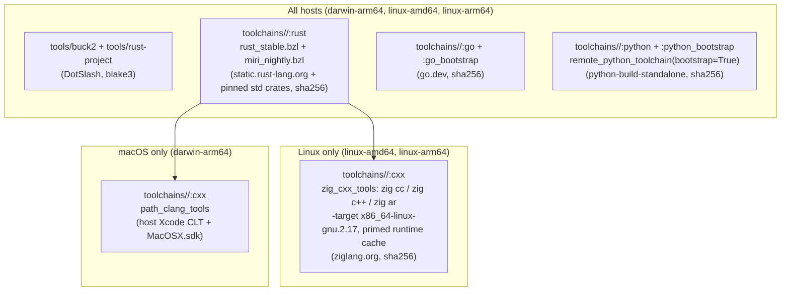

# 0035: Hermetic Buck2 toolchains and removal of `tools/linux-run`

**Status:** Implemented; verified on macOS and on Linux (WSL2)

**Design references:** [Build system](../design/build-system.md),
[remote benchmarks](../design/remote-benchmarks.md),
[BF-Tree concurrency](../design/bf-tree-concurrency.md).

## Goal and scope

Make Buck2 builds hermetic across all supported platforms: **100% hermetic on
Linux** (`linux-amd64`, `linux-arm64`), and **everything except Apple's
proprietary `MacOSX.sdk` / linker on macOS** (`darwin-arm64`). Remove
`tools/linux-run` and `tools/linux/Dockerfile`, since development happens
natively on macOS and Linux testing, benchmarks, and CI run directly on WSL2
and Linux runners rather than through Docker-on-macOS.

Today, Buck2 downloads Go and the Miri nightly itself, but still leaves four
hermeticity gaps:

1. Stable Rust (`rustc`, `rustdoc`, `clippy-driver`, `rustfmt`, `cargo`) comes
   from host `PATH` via rustup and `rust-toolchain.toml`.
2. `:miri-sysroot` runs `cargo miri setup` online, downloading `rust-src`'s
   crates.io dependencies without Buck2 sha256 pins and using the host linker.
3. Python (`system_python_bootstrap_toolchain`) comes from host `PATH`, used by
   Buck2 prelude helper scripts.
4. The C/C++ linker and sysroot (`system_cxx_toolchain`) come from host `PATH`,
   which `rustc` invokes to link `*-unknown-linux-gnu` binaries against
   `crt*.o`, glibc (`libc.so`), and `libgcc_s`.

Because of this, fresh Linux machines, WSL2 setups, and CI runners must
preinstall `rustup`, `clang`, `lld`, `build-essential`, and `python3`, and host
toolchain drift can silently change build outputs.

- **In scope:**
  - Hermetic stable Rust toolchain (`rustc`, `rust-std`, `clippy-driver`,
    `rustfmt`, `cargo`, `rust-src`) pinned by sha256 in
    `build/toolchains/rust_stable.bzl`, generated by `tools/update-rust`, for
    `darwin-arm64`, `linux-amd64`, and `linux-arm64`.
  - `tools/update-go <version>`, matching `tools/update-rust`: fetches official
    Go checksums from `go.dev`, updates `go.mod`, and updates the Go pins in
    `build/toolchains/BUCK`.
  - Hermetic offline `:miri-sysroot`: extend `tools/update-miri` to extract
    `rust-src`'s `library/Cargo.lock` crates.io dependencies into
    `MIRI_STD_CRATES` in `build/toolchains/miri_nightly.bzl`, download them via
    sha256-pinned `http_archive`s, and run `cargo miri setup` with
    `CARGO_NET_OFFLINE=true` and a vendored source directory.
  - Hermetic Python bootstrap toolchain via the prelude's
    `remote_python_toolchain(bootstrap = True)` (Astral's sha256-pinned
    `python-build-standalone` archives).
  - Hermetic Linux C compiler and linker driver via the pinned official Zig
    release (`zig cc`, `zig c++`, `zig ar`; `amd64`, `arm64`), wired into
    `cxx_tools_info_toolchain` (and into `:miri-sysroot` build scripts) on
    Linux, while keeping host Apple CLT (`path_clang_tools`) on macOS. Zig
    brings its own clang, lld, glibc stubs, start files, compiler-rt, and
    libunwind, so no sysroot is needed.
  - Toolchains (Rust, Go, Zig) fetched from their origin by a
    `toolchain_distribution` rule and never uploaded to or served from a
    remote cache.
  - Updating `tools/fmt.sh`, `tools/check-tools`, and `tools/autocargo` to use
    the Buck2-pinned Rust toolchain instead of host `PATH`.
  - Deleting `tools/linux-run` and `tools/linux/Dockerfile`, and updating CI
    (`.github/workflows/ci.yaml`, `buck2-update.yaml`) so the `buck2` job runs
    without `dtolnay/rust-toolchain` or preinstalled compilers.
  - Updating `AGENTS.md`, `docs/design/build-system.md`, and code/design
    references to `tools/linux-run`.
- **Out of scope:**
  - Making Apple's `MacOSX.sdk` hermetic on macOS (Apple's Xcode license
    forbids redistributing the SDK).
  - Cross-compiling Linux binaries from macOS (for example, running
    `tools/gcp-bench` from macOS).
  - Replacing `system_genrule_toolchain` (standard POSIX `/bin/sh` + coreutils
    remain assumed on Linux and macOS).
  - Removing the secondary `cargo test --workspace --locked` and
    `go vet && go test` workflows; `rust-toolchain.toml` and `go.mod` stay in
    sync with Buck2's pins.
- **Done when:**
  - On Linux (CI `ubuntu-latest` and WSL2), `tools/fmt.sh`, `tools/clippy.sh`,
    `tools/buck2 test //bin/... //lib/... //proto/...`,
    `tools/autocargo --check`, and the Miri tests pass without `rustup`,
    `rustc`, `clang`, `gcc`, `go`, or `python3` on `PATH` (only `dotslash` and
    minimal POSIX tools).
  - `:miri-sysroot` builds completely offline (`CARGO_NET_OFFLINE=true`) from
    sha256-pinned `http_archive`s.
  - On macOS (`darwin-arm64`), all Buck2 builds, tests, Miri tests,
    `tools/fmt.sh`, and `tools/clippy.sh` use Buck2-downloaded Rust, Go, and
    Python (with only the Apple CLT linker/SDK from the host).
  - `tools/buck2 audit providers --target-platforms //build:linux-x86_64
    toolchains//:rust toolchains//:cxx toolchains//:python_bootstrap` resolves
    cleanly to the pinned archives from macOS.
  - `tools/linux-run` and `tools/linux/Dockerfile` are removed, and no live
    docs or scripts refer to them.

## Approach

### Toolchain architecture



### 1. Hermetic stable Rust (`build/toolchains/rust_stable.bzl`, `tools/update-rust`)

Mirror `miri_nightly.bzl` and `tools/update-miri`:

- `tools/update-rust [version]` reads `channel` from `rust-toolchain.toml` (or
  an explicit version argument, updating `rust-toolchain.toml`), fetches
  `https://static.rust-lang.org/dist/channel-rust-<version>.toml`, and writes
  `build/toolchains/rust_stable.bzl` with sha256-pinned `.tar.xz` archives for
  `darwin-arm64`, `linux-amd64`, and `linux-arm64`:
  - `rustc`
  - `rust-std`
  - `cargo`
  - `clippy-preview`
  - `rustfmt-preview`
  - `rust-src` (target-independent `*`)
- A `genrule` (`:rust-stable`) merges those archives into one sysroot directory
  (`bin/`, `lib/`, `lib/rustlib/...`), identical to `:rust-nightly`.
- `toolchains//:rust-root` aliases `:rust-stable` so scripts (`tools/fmt.sh`,
  `tools/autocargo`) can locate `bin/rustfmt` and `bin/cargo` the same way
  `tools/fmt.sh` and `tools/gen-proto` already locate `toolchains//:go-root`.
- `peppy_rust_toolchain` in `build/toolchains/rust.bzl` takes a required `dist`
  attribute (`:rust-stable` by default, `:rust-nightly` under
  `@build/mode/miri`) and always runs `{dist}/bin/rustc`, `{dist}/bin/rustdoc`,
  and `{dist}/bin/clippy-driver` — never falling back to `PATH`.

```python
# build/toolchains/rust.bzl (sketch)
def _impl(ctx):
    dist = ctx.attrs.dist[DefaultInfo].default_outputs[0]
    compiler = RunInfo(args = cmd_args(dist, format = "{}/bin/rustc"))
    rustdoc = RunInfo(args = cmd_args(dist, format = "{}/bin/rustdoc"))
    clippy_driver = RunInfo(args = cmd_args(dist, format = "{}/bin/clippy-driver"))
    miri_driver = None
    if ctx.attrs.miri_sysroot:
        sysroot = ctx.attrs.miri_sysroot[DefaultInfo].default_outputs[0]
        miri_driver = RunInfo(args = cmd_args(
            cmd_args(dist, format = "{}/bin/miri"),
            cmd_args(sysroot, format = "--sysroot={}"),
        ))
    ...
```

- `tools/check-tools` verifies that:
  - `rust-toolchain.toml`'s `channel` equals `RUST_VERSION` in
    `build/toolchains/rust_stable.bzl`, and every host in `GO_RELEASES` has
    pins in `rust_stable.bzl` and `miri_nightly.bzl`.
  - `go.mod`'s `go` version equals `GO_VERSION` in `build/toolchains/BUCK`.
  - Host `rustc` on `PATH` is no longer required or checked.

### 2. Hermetic offline `:miri-sysroot` (`tools/update-miri`, `miri_nightly.bzl`)

- Extend `tools/update-miri` to read
  `rust-src-nightly/rust-src/lib/rustlib/src/rust/library/Cargo.lock` from the
  pinned `rust-src` archive, extract every `crates.io` registry package
  (`name`, `version`, and its existing sha256 `checksum`), and emit
  `MIRI_STD_CRATES` in `build/toolchains/miri_nightly.bzl`.
- In `build/toolchains/BUCK`:
  - Define one `http_archive` per crate in `MIRI_STD_CRATES` pointing at
    `https://static.crates.io/crates/{name}/{name}-{version}.crate`
    (`type = "tar.gz"`, `strip_prefix = "{name}-{version}"`, sha256-verified).
  - Update `:miri-sysroot` to assemble a vendored source directory under
    `$scratch/vendor/` (one directory per crate with `.cargo-checksum.json`
    set to `{"files":{}}`), write `$scratch/cargo-home/config.toml` replacing
    `crates-io` with `vendored-sources`, and run `$dist/bin/cargo miri setup`
    with `CARGO_NET_OFFLINE=true`.
- In diff 5 (Linux Zig), pass the pinned Linux `zig cc` wrapper via
  `CARGO_TARGET_<TRIPLE>_LINKER` / `CC` inside `:miri-sysroot` so `std`'s
  build scripts link hermetically on Linux too.

### 3. Hermetic Python bootstrap (`build/toolchains/BUCK`)

The bundled Buck2 prelude's `remote_python_toolchain` already downloads
sha256-pinned CPython 3.13.6 archives from `python-build-standalone` for Linux
(`x86_64`, `arm64`) and macOS (`arm64`). Today `build/toolchains/BUCK` passes
`bootstrap = False` and defines a separate `system_python_bootstrap_toolchain`
that invokes host `python3`.

Switching to `remote_python_toolchain(name = "python", bootstrap = True,
visibility = ["PUBLIC"])` removes `system_python_bootstrap_toolchain` and gives
every prelude helper script (C++/Rust internal wrappers, link wrappers, test
runners) the pinned CPython interpreter.

### 4. Hermetic Linux C compiler and linker via Zig (`build/toolchains/zig.bzl`, `cxx.bzl`)

`third-party/rust/Cargo.toml` is pure Rust on Linux (no C/C++ crates). On
Linux (`*-unknown-linux-gnu`), Rust's `std` dynamically links against glibc
and `libgcc_s` for unwinding, so `rustc` delegates linking to a C compiler
driver, which finds the C runtime start files (`crt1.o`, ...) and glibc and
then runs the linker. Go's cgo also compiles C with it.

The design follows the rue project (`toolchains/cxx_tools.bzl` and
`toolchains/zig/` in rue-language/rue; see `docs/references.md`).

- `build/toolchains/zig.bzl` pins the official Zig 0.17.1 release for
  `linux-amd64` and `linux-arm64` (about 55 MB each, sha256-verified), and
  the Zig target per host: `x86_64-linux-gnu.2.17` and
  `aarch64-linux-gnu.2.17`. glibc 2.17 is the oldest glibc that Rust supports.
- `zig cc` is clang plus lld, and it builds glibc stubs for the chosen glibc
  version, the start files, compiler-rt, and libunwind (for `-lgcc_s`) from
  source. No sysroot is needed.
- `zig_cxx_tools` in `build/toolchains/cxx.bzl` returns `CxxToolsInfo` with
  scripts (Buck2's `cmd_script`) around `zig cc`, `zig c++`, and `zig ar`. The
  linker is `zig cc` (`zig c++` would build libc++ on first use) with the
  linker script `zig_runtime_debug_discard.ld`.
- `build/toolchains/zig_cc.sh` runs Zig with its cache directories in the
  action's scratch directory (Zig needs writable caches; an action must not
  write to its inputs). It also flattens nested response files, which the
  prelude's C compiles use and `zig cc` rejects.
- `zig_runtime_cache` builds Zig's runtime support once per target by linking
  a trivial program three ways (plain, `-pie`, `-lgcc_s`) and archives the
  cache as one `.tar`. The linker unpacks it into its scratch cache first, so
  a link does not spend about 15 s (rue's measurement) building it again.

```python
# build/toolchains/cxx.bzl (sketch)
linker = cmd_script(
    actions = ctx.actions,
    name = "zig-link",
    cmd = cmd_args(
        "/bin/sh", ctx.attrs.wrapper, runtime_cache, zig,  # zig_cc.sh SEED ZIG_DIR
        "cc", "-target", ctx.attrs.target,
        cmd_args("-Wl,-T,", ctx.attrs.linker_script, delimiter = ""),
    ),
)
```

- `build/toolchains/BUCK` replaces `system_cxx_toolchain` with the prelude's
  `cxx_tools_info_toolchain`:

```python
cxx_tools_info_toolchain(
    name = "cxx",
    cxx_tools_info = select({
        "config//os:linux": ":zig-cxx-tools",
        "config//os:macos": "prelude//toolchains/cxx/clang:path_clang_tools",
    }),
    visibility = ["PUBLIC"],
)
```

- On macOS, `path_clang_tools` preserves the exact current behavior (`clang`,
  `clang++`, `ar`, Darwin linker with host Xcode CLT / `MacOSX.sdk`).

### 5. Removing `tools/linux-run` and simplifying CI

- Delete `tools/linux-run` and `tools/linux/Dockerfile`.
- In `.github/workflows/ci.yaml`:
  - Remove `dtolnay/rust-toolchain` from the `buck2` job. Run the `buck2` job
    with only `actions/checkout`, `tools/ci/install-dotslash`, and Buck2
    commands (`tools/fmt.sh`, `tools/clippy.sh`, `tools/buck2 test`,
    `tools/gen-proto --check`, `tools/autocargo --check`).
  - Keep `dtolnay/rust-toolchain` in the `cargo` job and `actions/setup-go` in
    the `go` job (those verify the secondary `cargo` and `go` interfaces).
- Update `.github/workflows/buck2-update.yaml` to match.
- Update comments in `lib/server/src/tests/cluster.rs`,
  `lib/engine/src/tests/bench.rs`, `tools/gcp/testing/test-driver.sh`, and
  `tools/gcp/testing/test-remote.sh` to describe running on Linux / WSL2 rather
  than `tools/linux-run`.

## Decisions and trade-offs

- **Zig (`zig cc`) over LLVM + a Debian sysroot, or musl:**
  - *Small download:* about 55 MB per host, against 1.9 GB of LLVM plus a
    40 MB sysroot. The first implementation used LLVM; see "Discoveries and
    plan changes" for why it was replaced.
  - *No runtime behavior change:* binaries stay `*-unknown-linux-gnu`,
    dynamically linked against glibc. The glibc floor drops from 2.31 to 2.17,
    so binaries run on more systems.
  - *Costs:* Zig needs writable cache directories (kept in each action's
    scratch directory) and builds its runtime support from source (built
    once by `zig_runtime_cache`); its runtime objects carry the checkout path
    in debug information (discarded by a linker script); and `zig cc`
    rejects nested response files (flattened by `zig_cc.sh`).
  - *Alternatives rejected:*
    - LLVM release + Debian sysroot: used first; a 12 GB release (631 MB
      after trimming) that every link declares as an input.
    - `*-unknown-linux-musl` + `rust-lld`: removes the external linker, but
      changes runtime behavior (musl's default allocator scales poorly under
      multi-threaded contention, skewing `bf-tree` benchmarks).
    - Host `cc`: not hermetic, so remote-cache results could come from
      different compilers.
- **Toolchains never go through the remote cache (`toolchain_distribution`):**
  - The Rust, Go, and Zig archives are downloaded from their origin and
    extracted with `allow_cache_upload = False`. Their extracted trees are
    the largest outputs in the build and contain thousands of small files.
  - *Trade-off:* each machine with an empty `buck-out` downloads and
    extracts the toolchains it needs (hundreds of MB, from the origin sites).
    Python stays on the prelude's `remote_python_toolchain`, which peppydb
    does not control.
- **Offline `:miri-sysroot` via pinned `MIRI_STD_CRATES`:**
  - Keeps `cargo miri setup` (avoids brittle custom Buck2 rules for `libstd`),
    while pinning every `rust-src` dependency by sha256 so Miri setup never
    touches the network inside a Buck2 action.
- **Keep host Xcode CLT on macOS:**
  - Apple's Xcode license prohibits redistributing `MacOSX.sdk`. macOS still
    gets hermetic Rust, Go, Python, and Buck2; only the Darwin linker/SDK
    comes from Xcode CLT.
- **Delete `tools/linux-run` instead of shrinking it:**
  - Development runs natively on macOS and Linux/WSL2. Running Docker-on-macOS
    is no longer part of the workflow, so deleting `tools/linux-run` and
    `tools/linux/Dockerfile` removes dead maintenance surface.
- **Keep `rust-toolchain.toml` and `go.mod` in sync with Buck2 pins:**
  - Secondary interfaces (`cargo`, `go`, `rust-analyzer`, `gopls`) keep working
    with matching versions, enforced by `tools/check-tools`.
- **Keep `system_genrule_toolchain`:**
  - Genrules only need POSIX `/bin/sh` and basic file utilities (`mkdir`, `cp`,
    `mktemp`), which are standard on Linux and macOS.

## Proposed commit stack

### `[1/7][workspace-hermetic][plan] plan hermetic toolchains and removal of linux-run`

- **Purpose:** Record the hermetic build design, trade-offs, and commit stack.
- **Core changes:** Add `docs/plans/0035-workspace-hermetic-build.md`.
- **Verification:** Review and link check.

### `[2/7][workspace-hermetic][rust] pin and download stable Rust toolchain in Buck2`

- **Purpose:** Make `rustc`, `rustdoc`, `clippy-driver`, `rustfmt`, and `cargo`
  hermetic on all hosts (`darwin-arm64`, `linux-amd64`, `linux-arm64`).
- **Core changes:**
  - Add `tools/update-rust` and generate `build/toolchains/rust_stable.bzl` for
    Rust `1.98.1`.
  - Add `:rust-stable` and `:rust-root` in `build/toolchains/BUCK`.
  - Add `build/toolchains/distribution.bzl` (`toolchain_distribution`) and
    use it for the Rust components and Go, so extracted toolchains are never
    uploaded to or served from a remote cache.
  - Update `build/toolchains/rust.bzl` to always invoke tools from `dist`.
  - Update `tools/fmt.sh` (use `toolchains//:rust-root/bin/rustfmt`),
    `tools/autocargo` (use `toolchains//:rust-root/bin/cargo`), and
    `tools/check-tools` (check `rust_stable.bzl` against `rust-toolchain.toml`
    instead of host `rustc`).
  - Add `tools/update-go <version>` to update `go.mod` and the Go version/sha256
    pins in `build/toolchains/BUCK` from `https://go.dev/dl/?mode=json&include=all`.
- **Verification:**
  - `tools/buck2 audit providers toolchains//:rust` shows `buck-out` paths for
    `compiler`, `rustdoc`, and `clippy_driver`.
  - `tools/fmt.sh`, `tools/clippy.sh`, `tools/buck2 test //bin/... //lib/...
    //proto/...`, and `tools/autocargo --check` pass even when
    `rustc`/`rustfmt`/`cargo` are absent from `PATH`.

### `[3/7][workspace-hermetic][miri] pin stdlib crates for offline miri-sysroot`

- **Purpose:** Make `:miri-sysroot` 100% offline and sha256-verified.
- **Core changes:**
  - Extend `tools/update-miri` to read `rust-src`'s `library/Cargo.lock` and
    write `MIRI_STD_CRATES` into `build/toolchains/miri_nightly.bzl`.
  - Add `http_archive` targets for `MIRI_STD_CRATES` and update `:miri-sysroot`
    in `build/toolchains/BUCK` to build with `CARGO_NET_OFFLINE=true` against
    a vendored source directory.
- **Verification:**
  - `tools/buck2 test @build/mode/miri '//lib/bf-tree-circular-buffer:bf-tree-circular-buffer-unittest[miri]'`
    builds `:miri-sysroot` cleanly offline and passes all tests.

### `[4/7][workspace-hermetic][python] switch python_bootstrap to remote_python_toolchain`

- **Purpose:** Remove host `python3` dependency from Buck2 prelude actions.
- **Core changes:**
  - In `build/toolchains/BUCK`, replace `system_python_bootstrap_toolchain` and
    `remote_python_toolchain(bootstrap = False)` with
    `remote_python_toolchain(name = "python", bootstrap = True, visibility = ["PUBLIC"])`.
- **Verification:**
  - `tools/buck2 audit providers toolchains//:python_bootstrap` shows the
    downloaded `cpython_archive` binary instead of `"python3"`.
  - `tools/buck2 test //bin/... //lib/... //proto/...` and `tools/clippy.sh`
    pass cleanly.

### `[5/7][workspace-hermetic][cxx] add hermetic zig cc toolchain on Linux`

- **Purpose:** Eliminate host `clang`/`gcc`/`lld`/glibc dependencies on Linux
  with no runtime behavior change.
- **Core changes:**
  - Add `build/toolchains/zig.bzl` with the sha256-pinned official Zig
    release (`zig-{x86_64,aarch64}-linux-0.17.1.tar.xz`) and the Zig targets
    (glibc 2.17).
  - Add `build/toolchains/cxx.bzl` implementing `zig_cxx_tools` and
    `zig_runtime_cache`, plus `zig_cc.sh`, `zig_runtime_debug_discard.ld`, and
    `zig_runtime_cache_probe.c`.
  - Switch `toolchains//:cxx` in `build/toolchains/BUCK` to
    `cxx_tools_info_toolchain` selecting `:zig-cxx-tools` on Linux and
    `prelude//toolchains/cxx/clang:path_clang_tools` on macOS, and pass the
    Linux `zig cc` wrapper into `:miri-sysroot` on Linux.
- **Verification:**
  - On macOS: native macOS tests still pass unchanged.
  - On Linux (WSL2 / CI): full `tools/buck2 test //bin/... //lib/... //proto/...`
    and `@build/mode/release` link and pass without host `clang`/`gcc`/`lld`.

### `[6/7][workspace-hermetic][linux-run] remove tools/linux-run and simplify CI`

- **Purpose:** Remove Docker-on-macOS tooling and prove hermeticity in CI.
- **Core changes:**
  - Delete `tools/linux-run` and `tools/linux/Dockerfile`.
  - Remove `dtolnay/rust-toolchain` from the `buck2` job in
    `.github/workflows/ci.yaml` (and update `.github/workflows/buck2-update.yaml`).
  - Update comments in `lib/server/src/tests/cluster.rs`,
    `lib/engine/src/tests/bench.rs`, `tools/gcp/testing/test-driver.sh`, and
    `tools/gcp/testing/test-remote.sh`.
- **Verification:**
  - Grep confirms no live scripts or code reference `linux-run`.
  - All workspace checks pass locally on macOS and on Linux CI/WSL2.

### `[7/7][workspace-hermetic][docs] update build-system docs and AGENTS.md`

- **Purpose:** Keep enduring design documentation and agent instructions
  accurate.
- **Core changes:**
  - Update `docs/design/build-system.md` and `AGENTS.md` to reflect hermetic
    Rust, offline Miri, Python, Go, and Linux C (Zig), the
    macOS Apple SDK exception, and removal of `tools/linux-run`.
  - Update `tools/linux-run` references in `docs/design/bf-tree-concurrency.md`,
    `docs/design/remote-benchmarks.md`, `docs/design/gateway.md`, and
    `docs/design/server.md` to reference Linux / WSL2.
  - Mark this plan complete with recorded verification outcomes.
- **Verification:** All checks pass; local markdown links valid.

## Open questions

None. Confirmed during planning:
- Ubuntu 24.04 (WSL2 and GitHub Actions `ubuntu-latest`, glibc 2.39) is the
  baseline Linux host; binaries built for glibc 2.17 run on it and on older
  distributions.
- Diff 5 is graph-verified on macOS via `--target-platforms //build:linux-x86_64`,
  and execution-verified on WSL2 / GitHub Actions CI.
- `tools/update-go <version>` is added alongside `tools/update-rust` so every
  pinned toolchain has a single update command.

## Verification strategy

| Check | Command or procedure | Expected result |
| --- | --- | --- |
| Hermetic Rust (macOS) | Run `PATH=/usr/bin:/bin:/opt/homebrew/bin tools/buck2 test //bin/... //lib/... //proto/...`, `tools/fmt.sh`, `tools/clippy.sh` (without `~/.cargo/bin`) | All pass using `buck-out` Rust & Python |
| Offline Miri | `tools/buck2 test @build/mode/miri '//lib/bf-tree-circular-buffer:bf-tree-circular-buffer-unittest[miri]'` | Builds `:miri-sysroot` with `CARGO_NET_OFFLINE=true` and passes |
| Hermetic Python | `tools/buck2 audit providers toolchains//:python_bootstrap` | Interpreter points to `cpython_archive`, not `"python3"` |
| Linux toolchain graph (from macOS) | `tools/buck2 audit providers --target-platforms //build:linux-x86_64 toolchains//:rust toolchains//:cxx toolchains//:python_bootstrap` | Resolves to `rust-stable`, `zig-cxx-tools`, and `cpython_archive` |
| Hermetic Linux build & tests | Run `tools/fmt.sh`, `tools/clippy.sh`, `tools/buck2 test //bin/... //lib/... //proto/...`, `@build/mode/release` on WSL2 or CI `ubuntu-latest` without `rustup`/`clang` | All link via pinned `clang++`/`lld` + Debian sysroot and pass |
| Generated files & secondary interfaces | `tools/autocargo --check`, `tools/gobuckify-remote --check`, `tools/gen-proto --check`, `cargo test --workspace --locked`, `go vet ./... && go test ./...` | All pass |

## Progress

- [x] Agree on the design and commit stack with the user.
- [x] `[1/7][workspace-hermetic][plan]`
- [x] `[2/7][workspace-hermetic][rust]`
- [x] `[3/7][workspace-hermetic][miri]`
- [x] `[4/7][workspace-hermetic][python]`
- [x] `[5/7][workspace-hermetic][cxx]`
- [x] `[6/7][workspace-hermetic][linux-run]`
- [x] `[7/7][workspace-hermetic][docs]`
- [x] Complete stack-wide verification and design-document updates.

## Discoveries and plan changes

- **Buck2's built-in `cmd_script` replaced hand-written wrappers.** Using
  `@prelude//utils:cmd_script.bzl` in `build/toolchains/cxx.bzl` generates the
  executable wrappers for `clang`, `clang++`, `linker` (`clang++ -fuse-ld=lld`),
  and `llvm-ar` while automatically tracking both the LLVM and Debian sysroot
  directories as hidden inputs.
- **Cargo vendored `.cargo-checksum.json` requires the `"package"` sha256.**
  During `:miri-sysroot` offline builds, Cargo verifies each vendored crate's
  checksum against `rust-src`'s `library/Cargo.lock`, so `.cargo-checksum.json`
  writes `{"files":{},"package":"<sha256>"}` using the pinned digest from
  `MIRI_STD_CRATES` (31 crates for `nightly-2026-11-01`).
- **Genrule shell substitution uses backticks.** Buck2 interprets `$(pwd)` as a
  macro expansion; `:miri-sysroot` uses ``repo=`pwd` `` to construct absolute
  paths for the Linux linker wrapper inside `$scratch`.
- **Chromium's Debian Bullseye sysroot extracts directly to `./`** (no
  `strip_prefix`) and has no filename extension, so its `http_archive` specifies
  `type = "tar.xz"`. `LLVM-23.1.6-Linux-{X64,ARM64}.tar.xz` uses
  `strip_prefix = "LLVM-23.1.6-Linux-{X64,ARM64}"`.
- **The Debian sysroot contains a file name with a backslash.**
  `lib/systemd/system/system-systemd\x2dcryptsetup.slice` makes Buck2 fail
  when it collects the unpacked output ("slashes in path"). The stack was first
  verified on macOS, which never unpacks the Linux sysroot, so the first Linux
  build found the problem. The sysroot `http_archive` now uses
  `excludes = [r"\./lib/systemd/"]`. A C/C++ sysroot needs no systemd unit
  files. A failed unpack leaves the bad file in `buck-out`, and Buck2 cannot
  delete it, so remove that output directory by hand once.
- **The full LLVM release is too large to be an action input.** The release
  unpacks to 12 GB (10,528 files): it includes Fortran, MLIR, LLDB, `libclang`,
  `clangd`, and 170 more tools. `llvm_cxx_tools` declares the LLVM directory
  as an input of every C/C++ compile and every Rust or cgo link. Locally this
  costs only hashing, so the macOS verification did not show it. With a
  remote cache or remote execution, each machine must download the whole
  directory (plan 0036 measured 1.87 TB of cache downloads). The LLVM target
  now downloads the archive with `http_file` and extracts only `LLVM_KEEP`
  (631 MB, 431 files). `clang`, `lld`, and `llvm-ar` need only host system
  libraries (`libc`, `libm`, `libstdc++`, `libgcc_s`, `libz`), not the LLVM
  shared libraries in `lib/`. The prelude's `http_archive` `excludes` cannot
  express an allowlist, because its regexes do not support lookahead.
- **cgo links need `-lpthread` and `-lresolv` with the Bullseye sysroot.** The
  first Linux build failed to link Go test binaries that use cgo, with
  `undefined symbol: pthread_create` (and other `pthread_*` functions) and
  `undefined symbol: __res_search`. glibc 2.31 keeps these in `libpthread` and
  `libresolv`; glibc 2.34 and later moved them into `libc`, which is why host
  builds on Ubuntu 24.04 (glibc 2.39) worked. The Go standard library asks
  for them (`#cgo LDFLAGS: -lpthread` in `runtime/cgo` and `-lresolv` in
  `net`), but the prelude's Go link did not pass them. The `go_toolchain` now
  sets `external_linker_flags = ["-lpthread", "-lresolv"]` on Linux. The
  prelude places these after the objects. The flags stay valid with newer
  glibc, where both libraries remain as empty compatibility stubs.
- **Replaced LLVM + the Debian sysroot with Zig.** The LLVM release had to be
  downloaded (1.9 GB) on every fresh machine, and every link declared its
  directory as an input. With the remote cache of plan 0036, that traffic
  went through BuildBuddy. Zig is about 55 MB per host and needs no sysroot.
  The implementation follows the rue project, which runs Buck2 with `zig cc`
  behind every Linux Rust link. Measured on WSL2 (x86-64):
  - The Zig 0.17.1 tree unpacks to 412 MB and 19,520 files (rue measured
    19,546 for 0.16.0).
  - The primed runtime cache archive is 60 MB. It contains the glibc 2.17
    stubs (`libc.so.6`, `libpthread.so.0`, `libresolv.so.2`, ...), the start
    files (`crt1.o`, `Scrt1.o`), libunwind, and compiler-rt.
  - `zig cc` accepts `-fuse-ld=lld` and maps `-lgcc_s` to its libunwind, so
    no argument rewriting was needed for Rust links.
  - `zig cc` rejected the prelude's nested response files in the Go standard
    library's cgo compiles (`error: unable to parse command line parameters:
    NestedResponseFile`). `zig_cc.sh` now flattens response files.
  - The `-lpthread -lresolv` fix for cgo links stays: glibc 2.17 also keeps
    those functions outside `libc`.
- **Toolchains are fetched from their origin, never from the remote cache.**
  With uploads enabled (plan 0036), `http_archive` uploaded each extracted
  toolchain (352 extraction actions in one full build), and every CI job
  downloaded the trees back from BuildBuddy. `toolchain_distribution`
  (`build/toolchains/distribution.bzl`, after rue's rule of the same name)
  downloads with `download_file` and extracts with
  `allow_cache_upload = False`. The Rust components, Go, and Zig use it. The
  Miri std crates stay `http_archive`s; they are small.
- **Go pins extracted into `build/toolchains/go.bzl`.** Added
  `tools/update-go` matching `tools/update-rust` and `tools/update-miri`, so
  every pinned toolchain has a dedicated update command and `tools/check-tools`
  compares `rust-toolchain.toml` and `go.mod` against `rust_stable.bzl` and
  `go.bzl`.

### Verification outcomes

Measured on macOS arm64 (`darwin-arm64`) with `~/.cargo/bin` removed from
`PATH` (`PATH=/opt/homebrew/bin:/usr/bin:/bin`) for all Buck2 commands:

| Check | Result |
| --- | --- |
| `tools/fmt.sh` (without `~/.cargo/bin`) | Pass (uses `toolchains//:rust-root/bin/rustfmt` and `toolchains//:go-root/bin/gofmt`) |
| `tools/clippy.sh` (without `~/.cargo/bin`) | Pass (43 targets clean via `toolchains//:rust-stable`) |
| `tools/buck2 test //bin/... //lib/... //proto/...` (without `~/.cargo/bin`) | Pass (46/46 targets pass, 0 failed) |
| `tools/autocargo --check` (without `~/.cargo/bin`) | Pass (20 files up to date via `toolchains//:rust-root/bin/cargo`) |
| `tools/gobuckify-remote --check` | Pass (14 modules, 133 packages up to date) |
| `tools/gen-proto --check` | Pass |
| `tools/buck2 test @build/mode/miri '//lib/bf-tree-circular-buffer:bf-tree-circular-buffer-unittest[miri]'` | Pass (30 passed, 2 ignored; `:miri-sysroot` built offline with `CARGO_NET_OFFLINE=true`) |
| `tools/buck2 audit providers toolchains//:python_bootstrap` | Resolves to `cpython_archive/bin/python` |
| `tools/buck2 audit providers --target-platforms //build:linux-x86_64 toolchains//:rust toolchains//:cxx toolchains//:python_bootstrap` & `cquery` | With the LLVM toolchain (later replaced): resolved to `rust-stable`, `llvm-cxx-tools` (`clang.sh`, `clang++.sh`, `linker.sh`, `llvm-ar.sh`), `cpython_archive`; 80 Linux targets resolved |
| `cargo test --workspace --locked` | Pass (all unit tests + doctests pass) |
| `go vet ./... && go test ./...` | Pass (all Go packages pass) |
| Live Linux execution with LLVM + Debian sysroot (replaced) | First WSL2 runs found three Linux-only bugs (sysroot file name, 12 GB LLVM input, cgo link libraries); see "Discoveries" |
| `toolchain_distribution` at diff 2 (WSL2) | `tools/buck2 test //lib/bf-tree-node-id: //lib/gateway-kvclient:` passes (3/3); the 12 extraction actions log `allows_cache_upload: false` |
| Zig toolchain at diff 5 (WSL2): `tools/buck2 test //bin/... //lib/... //proto/...` | Pass (46/46 targets) |
| Zig toolchain at diff 5 (WSL2): Miri `bf-tree-circular-buffer-unittest[miri]` | Pass (1/1); the Miri sysroot links build scripts through `zig cc` |
| Zig toolchain at diff 5 (WSL2): `tools/clippy.sh`, `tools/fmt.sh` | Pass (43 targets clean) |
| glibc floor of `//bin/peppydb` (WSL2): `objdump -T` | Highest symbol version `GLIBC_2.17` |
| Checkout path in debug info (WSL2): `readelf --debug-dump=info` on `//bin/peppydb`, `strings` on `//bin/peppydb-gateway` | No `DW_AT_comp_dir` or string contains the checkout path |
