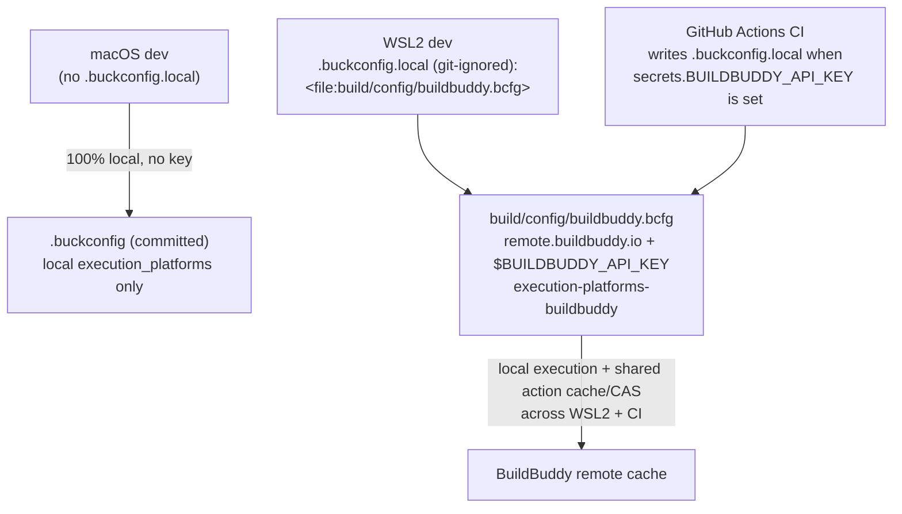
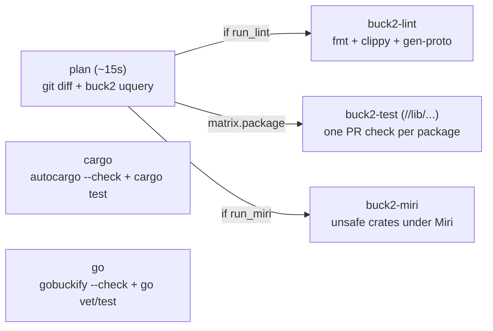

# 0036: Dynamic affected-target CI and BuildBuddy remote cache

**Status:** Implemented; cache hits on CI after a WSL2 build are not yet measured

**Design references:** [Build system](../design/build-system.md),
[plan 0035](0035-workspace-hermetic-build.md).

## Goal and scope

Make CI both **visible per package** and **fast**:

1. Replace the monolithic `buck2` CI job with a Buck2 `uquery`-driven `plan`
   job that dynamically fans out one GitHub Actions check per affected package
   (`buck2-test (//lib/bf-tree)`, `buck2-test (//lib/engine)`, etc.), runs Miri
   automatically when unsafe crates or toolchains are affected, and skips lint
   and test jobs on docs-only PRs.
2. Add an opt-in **BuildBuddy remote cache** so GitHub Actions matrix runners
   and your WSL2 Linux machine share action results. An action that one
   machine already built and uploaded is a cache hit on the other, so CI does
   not rebuild what was built and tested locally. Every action still runs
   locally on a cache miss; there is no remote execution. macOS local
   development (and any contributor without a BuildBuddy API key) stays 100%
   local with zero configuration.

- **In scope:**
  - Opt-in remote-cache execution platforms
    (`//build:execution-platforms-buildbuddy`) in `build/platforms.bzl` and
    `build/BUCK` (`local_enabled = True`, `remote_enabled = False`,
    `remote_cache_enabled = True`, `allow_cache_uploads = True`), covering both
    normal builds and Miri.
  - Committed, secret-free `build/config/buildbuddy.bcfg` configuring the
    `[buck2_re_client]` action cache and CAS (content-addressable storage)
    against `remote.buildbuddy.io` with `$BUILDBUDDY_API_KEY`.
  - Ignoring `/.buckconfig.local` in `.gitignore` and `.slignore` so WSL2
    developers can opt in once with `<file:build/config/buildbuddy.bcfg>` and
    never pass extra flags.
  - Dynamic `.github/workflows/ci.yaml`:
    - `plan` job computing affected packages via `tools/buck2 uquery` (`rdeps`
      + `owner`) directly inline (no extra tool scripts), emitting `packages`,
      `run_lint`, and `run_miri`.
    - `buck2-lint` conditional job (`tools/fmt.sh`, `tools/clippy.sh`,
      `tools/gen-proto --check`), skipped on docs-only PRs.
    - `buck2-test` dynamic matrix (one PR check per affected package).
    - `buck2-miri` conditional job (runs when `//lib/bf-tree-circular-buffer`
      or global build/toolchain files are affected).
    - Automatic `.buckconfig.local` activation in CI whenever
      `secrets.BUILDBUDDY_API_KEY` is configured (graceful fallback to local
      builds on fork PRs or before the secret is set).
  - Updating `docs/design/build-system.md` with the CI fanout and BuildBuddy
    setup (including the one-line WSL2 `.buckconfig.local` recipe).
- **Out of scope:**
  - Remote execution (RBE). It was tried and removed; see "Discoveries and
    plan changes". It can return later if measurements show that cold builds
    need more cores than the local machine or CI runner has.
  - The remote cache on macOS (macOS local dev remains 100% local).
  - Replacing the secondary `cargo` and `go` CI jobs.
  - Configuring the BuildBuddy account or GitHub repository secret itself (the
    user adds `BUILDBUDDY_API_KEY` in GitHub Settings → Secrets).
- **Done when:**
  - Local macOS builds with plain `tools/buck2 test //...` remain 100% local
    with no API key or network call to BuildBuddy.
  - `tools/buck2 audit providers //build:execution-platforms-buildbuddy`
    resolves to a local executor with the remote cache and cache uploads
    enabled, and `tools/buck2 audit config --config-file
    build/config/buildbuddy.bcfg` shows the expected `[buck2_re_client]` and
    `execution_platforms` settings.
  - The inline `plan` query logic is verified locally against representative
    file-change sets (Rust leaf crate, core page crate crossing into Go
    `lincheck`, `bf-tree-circular-buffer` triggering Miri, Go-only crate,
    `build/` global change, docs-only change skipping lint & tests, and
    deleted file).
  - `.github/workflows/ci.yaml` is valid YAML and gracefully handles both
    `BUILDBUDDY_API_KEY` set and unset.
  - All workspace verification checks pass.

## Approach

### How config layering separates macOS, WSL2, and CI



Writing `.buckconfig.local` in CI (when `BUILDBUDDY_API_KEY` is non-empty)
means **every** `tools/buck2` call — including those inside `tools/fmt.sh`,
`tools/clippy.sh`, `tools/gen-proto`, and `tools/buck2 test` — uses BuildBuddy
automatically without modifying any tool scripts.

### 1. Remote-cache execution platforms (`build/platforms.bzl`, `build/BUCK`, `build/config/buildbuddy.bcfg`)

```python
# build/platforms.bzl (sketch)
executor_config = CommandExecutorConfig(
    local_enabled = True,
    remote_enabled = False,
    remote_cache_enabled = ctx.attrs.remote_cache,
    allow_cache_uploads = ctx.attrs.remote_cache,
    # Part of every action's cache key, so all machines that share the
    # cache must use the same values.
    remote_execution_properties = ctx.attrs.remote_execution_properties if ctx.attrs.remote_cache else None,
    remote_execution_use_case = "peppydb" if ctx.attrs.remote_cache else None,
    remote_output_paths = "output_paths" if ctx.attrs.remote_cache else None,
    use_windows_path_separators = host_info().os.is_windows,
)
```

```python
# build/BUCK (sketch)
# The properties are part of each action's cache key; they keep amd64 and
# arm64 results apart. No container image: nothing runs remotely.
_BUILDBUDDY_PROPS = {
    "OSFamily": "Linux",
    "Arch": "arm64" if host_info().arch.is_aarch64 else "amd64",
}

peppy_execution_platform(
    name = "exec-host-buildbuddy",
    constraints = [host_configuration.cpu, host_configuration.os],
    remote_cache = True,
    remote_execution_properties = _BUILDBUDDY_PROPS,
)

peppy_execution_platform(
    name = "exec-host-miri-buildbuddy",
    constraints = [host_configuration.cpu, host_configuration.os, ":mode-miri"],
    remote_cache = True,
    remote_execution_properties = _BUILDBUDDY_PROPS,
)

peppy_execution_platforms(
    name = "execution-platforms-buildbuddy",
    platforms = [":exec-host-buildbuddy", ":exec-host-miri-buildbuddy"],
    visibility = ["PUBLIC"],
)
```

```ini
# build/config/buildbuddy.bcfg
[buck2]
digest_algorithms = SHA256

[buck2_re_client]
engine_address       = remote.buildbuddy.io  # required by the cache client
action_cache_address = remote.buildbuddy.io
cas_address          = remote.buildbuddy.io
http_headers         = x-buildbuddy-api-key:$BUILDBUDDY_API_KEY

[build]
execution_platforms = root//build:execution-platforms-buildbuddy
```

### 2. Dynamic affected-package CI fanout (`.github/workflows/ci.yaml`)



- **Global triggers** (`build/`, `third-party/`, `tools/`, `.buckconfig`,
  `go.mod`, `go.sum`, `rust-toolchain.toml`, `.github/workflows/ci.yaml`):
  query all testable packages via
  `tools/buck2 uquery 'kind("rust_library|rust_test|go_test", //bin/... + //lib/... + //proto/...)'`
  and set `run_lint=true` and `run_miri=true`.
- **Scoped changes:** for changed files under `bin/`, `lib/`, `proto/`:
  - Existing files → `owner("<path>")`.
  - `BUCK` files or deleted files → nearest owning package (`//<dir>:`).
  - Run `tools/buck2 uquery 'kind("rust_library|rust_test|go_test", rdeps(//bin/... + //lib/... + //proto/..., <seeds>))'`.
  - Deduplicate targets (`root//lib/foo:bar` → `//lib/foo`) into a sorted JSON
    array `packages`.
  - Set `run_lint=true` whenever any non-doc file changed (anything outside
    `docs/` and `*.md`).
  - Set `run_miri=true` if `//lib/bf-tree-circular-buffer` is in `packages`.
- **Docs-only PRs:** `packages` is `[]`, `run_lint` is `false`, and `run_miri`
  is `false`, so `buck2-lint`, `buck2-test`, and `buck2-miri` all skip cleanly.
- **Zero hand-maintained lists:** adding a new crate under `lib/` or `bin/`
  automatically makes it discoverable by `plan`.

## Decisions and trade-offs

- **Remote cache only, no remote execution:**
  - *Goal:* Build and test once on the WSL2 machine, and let CI reuse those
    results instead of rebuilding every target. A shared action cache gives
    exactly that. Remote execution adds a worker image, network transfer of
    every action input, and hybrid scheduling, and does not serve this goal.
  - *Behavior:* Every action runs locally. Before it runs, Buck2 looks up the
    action's digest in BuildBuddy's action cache. On a hit, Buck2 uses the
    stored result and downloads outputs only when something local needs them.
    On a miss, the action runs locally and Buck2 uploads its result.
  - *Requirement:* A hit is possible only when both machines compute the same
    action digest: the same command, environment, inputs, and platform
    properties. The hermetic toolchains of plan 0035 make the inputs and
    commands match across WSL2 and GitHub's Ubuntu runners.
  - *Trade-off:* Cache downloads still move every output that a local action
    needs. Large toolchain directories that are action outputs (such as the
    unpacked LLVM release) are downloaded on each CI runner that needs them.
    See "Open questions".
- **Skip `buck2-lint` on docs-only PRs:**
  - Documentation-only PRs skip `buck2-lint`, `buck2-test`, and `buck2-miri`
    completely, finishing in ~15 seconds.
- **Package-level matrix (`//lib/bf-tree`) over per-target matrix:**
  - One PR check per crate/package (covering both unit tests and doctests),
    readable in GitHub's PR UI and well under GitHub's 256-job matrix limit.
- **Inline Python in `ci.yaml` instead of a new script in `tools/`:**
  - Keeps `tools/` focused on developer commands; the query logic lives beside
    the matrix that consumes it.
- **Graceful fallback when `BUILDBUDDY_API_KEY` is unset:**
  - Fork PRs and repos before setting the secret run locally without auth
    errors.

## Proposed commit stack

### `[1/4][workspace-ci-cache][plan] plan dynamic CI fanout and BuildBuddy remote cache`

- **Purpose:** Record the BuildBuddy config layering and dynamic CI design.
- **Core changes:** Add `docs/plans/0036-workspace-ci-cache.md`.
- **Verification:** Review and link check.

### `[2/4][workspace-ci-cache][config] add BuildBuddy remote cache platforms and config`

- **Purpose:** Enable an opt-in BuildBuddy remote cache for WSL2 and CI
  without affecting default local builds.
- **Core changes:**
  - Add `remote_cache` and `remote_execution_properties` attributes to
    `peppy_execution_platform` in `build/platforms.bzl`.
  - Add `exec-host-buildbuddy`, `exec-host-miri-buildbuddy`, and
    `execution-platforms-buildbuddy` in `build/BUCK`.
  - Add `build/config/buildbuddy.bcfg`.
  - Ignore `/.buckconfig.local` in `.gitignore` and `.slignore`.
- **Verification:**
  - `tools/buck2 audit providers //build:execution-platforms-buildbuddy`
    resolves to a local executor with `remote_cache_enabled = true` and cache
    uploads enabled.
  - `tools/buck2 audit config --config-file build/config/buildbuddy.bcfg`
    shows `[buck2_re_client]` and `execution-platforms-buildbuddy`.
  - Plain `tools/buck2 test //lib/bf-tree-node-id/...` still runs 100% locally.

### `[3/4][workspace-ci-cache][ci] dynamically fan out affected Buck2 packages in CI`

- **Purpose:** Show one PR check per affected package, skip untouched packages
  (and skip lint on docs-only PRs), run Miri automatically when relevant, and
  activate BuildBuddy whenever the secret is set.
- **Core changes:**
  - Rewrite the `buck2` job in `.github/workflows/ci.yaml` into `plan`,
    `buck2-lint`, `buck2-test` (dynamic matrix), and `buck2-miri`.
  - Add the conditional `.buckconfig.local` step using
    `secrets.BUILDBUDDY_API_KEY`.
- **Verification:**
  - Run the inline Python query snippet locally against simulated diff lists
    (leaf crate, `bf-tree-page` crossing into Go `lincheck`,
    `bf-tree-circular-buffer` triggering Miri, Go-only crate, `build/` global
    change, docs-only change skipping lint & tests, and deleted file) and
    verify exact JSON output.
  - Validate `.github/workflows/ci.yaml` syntax.

### `[4/4][workspace-ci-cache][docs] document dynamic CI and BuildBuddy setup`

- **Purpose:** Keep `docs/design/build-system.md` accurate and document the
  one-line WSL2 `.buckconfig.local` setup.
- **Core changes:**
  - Update `docs/design/build-system.md` with CI dynamic test selection and
    BuildBuddy remote cache instructions.
  - Mark this plan complete with recorded verification outcomes.
- **Verification:** Full `AGENTS.md` verification suite passes.

## Open questions

- **LLVM toolchain size (resolved in plan 0035).** The unpacked LLVM release
  was 12 GB (10,528 files), and every C/C++ compile and Rust link declared all
  of it as an input. With the remote cache, each CI runner that links anything
  would download it. Plan 0035's toolchain now extracts only the files that
  compiling and linking use (631 MB, 431 files).
- **Cache hits across WSL2 and CI are not yet measured.** The goal is met only
  if CI gets cache hits for actions that WSL2 built. Verify with one local
  build followed by one CI run, and record the hit rate.

Confirmed during planning: skip `buck2-lint` on docs-only PRs.

## Verification strategy

| Check | Command or procedure | Expected result |
| --- | --- | --- |
| Default local build unchanged | `tools/buck2 test //lib/bf-tree-node-id/...` (no API key) | Runs 100% locally, passes |
| BuildBuddy cache platform & config | `tools/buck2 audit providers //build:execution-platforms-buildbuddy` and `tools/buck2 audit config --config-file build/config/buildbuddy.bcfg` | Resolves a local executor with `remote_cache_enabled = true`, cache uploads enabled, and `remote.buildbuddy.io` |
| Cache shared across machines | `tools/buck2 build //lib/...` on WSL2 with the key, then a CI run of the same revision | CI `buck2-test` jobs report mostly cache hits |
| `plan` query logic | Run the exact `ci.yaml` Python logic against 7 synthetic file-change sets | Exact expected `packages`, `run_lint`, and `run_miri` outputs for every case |
| Workspace checks | `tools/fmt.sh`, `tools/clippy.sh`, `tools/buck2 test //bin/... //lib/... //proto/...`, `tools/autocargo --check`, `tools/gobuckify-remote --check`, `tools/gen-proto --check`, Miri, `cargo test`, `go vet && go test` | All pass |

## Progress

- [x] Agree on the design and commit stack with the user.
- [x] `[1/4][workspace-ci-cache][plan]`
- [x] `[2/4][workspace-ci-cache][config]`
- [x] `[3/4][workspace-ci-cache][ci]`
- [x] `[4/4][workspace-ci-cache][docs]`
- [x] Complete stack-wide verification and design-document updates.
- [x] Replace hybrid remote execution with the remote cache only.
- [x] Rename the stack label from `workspace-rbe` to `workspace-ci-cache` and
  the plan file to `0036-workspace-ci-cache.md`, because the stack no longer
  uses remote build execution (RBE).
- [ ] Measure cache hits on CI after a WSL2 build.

## Discoveries and plan changes

- **Chose limited hybrid execution immediately** (`local_enabled = True`,
  `remote_enabled = True`, `remote_cache_enabled = True`,
  `use_limited_hybrid = True`, `allow_limited_hybrid_fallbacks = True`,
  `allow_cache_uploads = True`) instead of cache-only, using the stock
  digest-pinned `ubuntu:24.04` image (`glibc 2.39`, matching LLVM 23.1.6's host
  requirement). The image was later replaced; see the next entry.
- **Stock `ubuntu:24.04` cannot unpack archives remotely.** The first real
  hybrid build on WSL2 failed in `http_archive` actions with
  `xz: Cannot exec` (for `.tar.xz` toolchains such as `rust-stable-src` and
  `sysroot-linux-amd64`) and `unzip: not found` (for Go module zips). With
  `digest_algorithms = SHA256` and a `sha256` on every archive, the prelude
  defers the download and unpacks on the remote executor, which uses host
  `xz` and `unzip`. Switched `container-image` to BuildBuddy's
  `rbe-ubuntu24-04` multi-arch index
  (`sha256:be9853fc45092d2cf2bda3abed30d22182881659a50bf35c7125161d7cfc8a75`).
  Its amd64 layers contain `/usr/bin/xz`, `/usr/bin/unzip`, `/usr/bin/bzip2`,
  and `/usr/bin/python3`. It has no `zstd`, and no archive in the repository
  uses `.tar.zst`.
- **Limited hybrid is remote-first, not local-first.** An earlier version of
  this plan said limited hybrid "keeps local cores busy and spills overflow
  work" to BuildBuddy. That is wrong. With `use_limited_hybrid = True`, Buck2
  does not race local and remote execution: after a cache miss, an action runs
  on BuildBuddy, and it runs locally only when it prefers or requires local
  execution or when a remote attempt fails. The first WSL2 hybrid build ran
  `1 local, 1213 remote` actions with local CPUs mostly idle.
- **Remote execution moved the whole LLVM release over the network.** After a
  few hybrid builds and CI runs, BuildBuddy reported 8.6 million CAS hits,
  1.87 TB downloaded from the cache (1.51 TB inside BuildBuddy, 0.36 TB to
  machines outside it), and 16.5 GB uploaded. Each remote link action's input
  root contained the 12 GB, 10,528-file LLVM directory and the 16,681-file
  sysroot, and executors and CI runners fetched them again and again. See
  "Open questions" for the toolchain fix.
- **The first cache-only builds uploaded nothing.** Two full WSL2 builds
  with the key set ran 3,260 local actions each with `up 0B`. The build log
  (`tools/buck2 log show`) showed two causes:
  - Removing `engine_address` broke the cache client. Every cache lookup
    failed with `No engine address`, although nothing executes remotely.
    Errors in cache lookups do not fail a build, so an earlier check that
    only looked for `BUILD SUCCEEDED` missed this. `engine_address` is back
    in `buildbuddy.bcfg`. With it, a test with a dummy key reached BuildBuddy
    and failed with `Invalid API key`, as expected.
  - Buck2 uploads a local result only when the action allows it. Most
    prelude actions (including every `rust_library` compile) pass no
    preference and fall back to `[buck2] default_allow_cache_upload`, which
    defaults to `false`; most `genrule`s set `False` explicitly.
  - `default_allow_cache_upload = true` had no effect in `buildbuddy.bcfg`.
    The build log showed Buck2 read the value, but every action still logged
    `allows_cache_upload: false`. Experiments with a dummy key on WSL2
    (`tools/buck2 log show`, counting `allows_cache_upload` per rule):
    | Where the key was set | `allows_cache_upload` for `rust_library` and `http_archive` |
    | --- | --- |
    | `[buck2]` in `buildbuddy.bcfg` (through `.buckconfig.local`) | `false` |
    | `[build]` in `buildbuddy.bcfg` | `false` |
    | `[buck2]` in the root `.buckconfig` | `true` |
    The reason is unknown; the prelude comment names the key but says
    nothing about where it is read. The key now lives in the root
    `.buckconfig`. It has no effect without a remote cache, so default
    local builds are unchanged. As a control, `allow_cache_upload = True` on
    `go_toolchain` made Go actions log `true` even with the key in
    `buildbuddy.bcfg`, which showed the per-action flag was the gate.

  With both fixes and a dummy key, a build of `//lib/bf-tree-node-id:` and
  `//lib/gateway-kvclient:` logged `allows_cache_upload: true` for every
  `rust_library`, `rust_test`, `go_*`, and `http_archive` action. Uploads then
  failed only because the dummy key was rejected (`Invalid API key`). The
  exceptions are the two `genrule`s (LLVM extraction and the Miri sysroot)
  and 32 C compiles inside `go_stdlib`, whose C toolchain sets
  `allow_cache_upload = False`. Every CI job that needs the genrules runs
  them, and dependent actions wait for their output hashes. Making them
  uploadable is a possible follow-up. A build with the real key must confirm
  that uploads now happen.
- **Removed remote execution; kept the remote cache.** The goal is to build
  and test once locally and let CI reuse the results, which the cache alone
  provides. `remote_enabled` is now `False`, `use_limited_hybrid` and the
  container image are gone. The `rbe-ubuntu24-04` image fix above is no longer
  needed. The `remote` attribute of `peppy_execution_platform` is renamed to
  `remote_cache`.
- **Skip `buck2-lint` on docs-only PRs** via `plan`'s `run_lint` output.
- **Unowned files in `owner(...)`:** Verified `tools/buck2 uquery` returns an
  empty set with exit 0 on unowned files inside a package directory (such as
  generated `Cargo.toml`), so `plan` handles them cleanly.

### Verification outcomes

Measured on macOS arm64 (`darwin-arm64`) with `~/.cargo/bin` excluded from
`PATH` for all Buck2 commands:

| Check | Result |
| --- | --- |
| `tools/buck2 audit providers //build:execution-platforms-buildbuddy` (hybrid version, later replaced) | Resolved `Hybrid { local, remote, level: Fallback }`, `remote_cache_enabled = true`, `cache_upload_behavior = Enabled` |
| `BUILDBUDDY_API_KEY=dummy tools/buck2 audit config --config-file build/config/buildbuddy.bcfg` | Resolves `remote.buildbuddy.io`, `digest_algorithms = SHA256`, `execution-platforms-buildbuddy` |
| Synthetic `plan` query matrix (7 cases) | Exact outputs: `docs_only` (`[]`, `lint=False`, `miri=False`), `go_gateway` (3 pkgs), `bf_tree_page` (9 pkgs crossing Rust→Go `lincheck`), `unsafe_cbuf` (7 pkgs, `miri=True`), `deleted_file` (`//lib/load`), `global_build` (all 22 pkgs, `miri=True`), `proto_change` (3 pkgs) |
| `.github/workflows/ci.yaml` YAML validation | Valid (`plan, buck2-lint, buck2-test, buck2-miri, cargo, go`) |
| `tools/fmt.sh` & `tools/clippy.sh` | Pass (43 targets clean) |
| `tools/buck2 test //bin/... //lib/... //proto/...` | Pass (all 46 targets pass; `server` and `lincheck` passed cleanly on re-run after initial 46-target local CPU saturation) |
| `tools/autocargo --check`, `tools/gobuckify-remote --check`, `tools/gen-proto --check` | Pass |
| `tools/buck2 test @build/mode/miri '//lib/bf-tree-circular-buffer:bf-tree-circular-buffer-unittest[miri]'` | Pass (30/30) |
| `cargo test --workspace --locked` & `go vet ./... && go test ./...` | Pass |
| Live BuildBuddy hybrid execution on Linux (WSL2) | Ran `1 local, 1213 remote` actions; transferred far too much data (see "Discoveries"); replaced by cache-only |
| Cache-only platform on Linux (WSL2): `tools/buck2 audit providers //build:exec-host-buildbuddy` | Resolves `RemoteEnabled { executor: Local(..), remote_cache_enabled: true, cache_upload_behavior: Enabled }` |
| Cache-only build on Linux (WSL2) with a dummy key, without `engine_address` | `BUILD SUCCEEDED`, `local: 16, remote: 0`. This was wrongly read as "the client works"; the build log shows every cache lookup failed with `No engine address` |
| Cache-only build on Linux (WSL2) with a dummy key, with `engine_address` | `BUILD SUCCEEDED`; cache lookups reach BuildBuddy and fail with `Invalid API key` |
| Uploads with the real key | Pending |
| Cache hits on CI after a WSL2 build | Pending |
