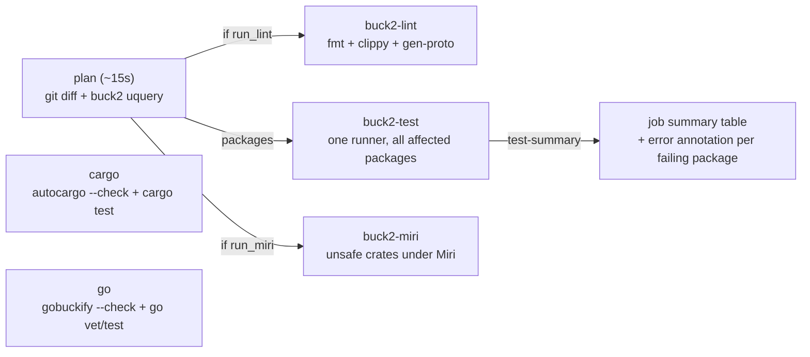

# 0036: Affected-package CI (BuildBuddy remote cache rejected)

**Status:** Complete

**Design references:** [Build system](../design/build-system.md),
[plan 0035](0035-workspace-hermetic-build.md).

## Goal and scope

Make pull-request CI **faster and easier to read** by testing only the Buck2
packages that a change affects.

The stack originally had a second goal: share build results between the WSL2
development machine and GitHub Actions through a BuildBuddy remote cache, so
that CI would not rebuild what was already built locally. That part was built,
measured, and then removed, because its network traffic does not fit
BuildBuddy's free tier (100 GB). See
[Rejected: BuildBuddy remote cache](#rejected-buildbuddy-remote-cache).

- **In scope:**
  - A `plan` job in `.github/workflows/ci.yaml` that selects the affected
    packages with `tools/buck2 uquery` (`rdeps` + `owner`) and emits
    `packages`, `run_lint`, and `run_miri`.
  - A `buck2-lint` job (`tools/fmt.sh`, `tools/clippy.sh`,
    `tools/gen-proto --check`) that is skipped on documentation-only PRs.
  - A `buck2-test` job that tests all affected packages in one
    `tools/buck2 test` invocation. `tools/ci/test-summary` then writes a
    per-package results table to the job summary and an error annotation for
    each failing package.
  - A `buck2-miri` job that runs only when unsafe crates or global build
    files are affected.
  - Updates to `docs/design/build-system.md`.
- **Out of scope:**
  - Any remote cache or remote execution (see the rejected section).
  - A CI-only cache of `buck-out` (for example the GitHub Actions cache).
    This can be a separate plan if CI build time becomes a problem.
  - Changes to the secondary `cargo` and `go` CI jobs.
- **Done when:**
  - The `plan` logic gives the expected output for representative change
    sets (see [Verification strategy](#verification-strategy)).
  - `.github/workflows/ci.yaml` is valid YAML and has no remote-cache steps.
  - The repository contains no BuildBuddy configuration.
  - All workspace verification checks pass.

## Approach

The `plan` job runs only Buck2's unconfigured query graph, so it downloads no
toolchains.

- **Global triggers** (`build/`, `third-party/`, `tools/`, `.buckconfig`,
  `go.mod`, `go.sum`, `rust-toolchain.toml`, `.github/workflows/ci.yaml`):
  select all testable packages with
  `tools/buck2 uquery 'kind("rust_library|rust_test|go_test", //bin/... + //lib/... + //proto/...)'`,
  and set `run_lint=true` and `run_miri=true`.
- **Scoped changes:** for changed files under `bin/`, `lib/`, and `proto/`:
  - An existing file seeds the query with `owner("<path>")`.
  - A `BUCK` file or a deleted file seeds it with its nearest package
    (`//<dir>:`).
  - `tools/buck2 uquery 'kind("rust_library|rust_test|go_test", rdeps(//bin/... + //lib/... + //proto/..., <seeds>))'`
    gives the affected targets.
  - Targets are reduced to packages (`root//lib/foo:bar` → `//lib/foo`) and
    emitted as a sorted JSON array, `packages`.
  - `run_lint=true` when any file outside `docs/` and `*.md` changed.
  - `run_miri=true` when `//lib/bf-tree-circular-buffer` is in `packages`.
- **Documentation-only PRs:** `packages` is `[]` and both flags are `false`,
  so `buck2-lint`, `buck2-test`, and `buck2-miri` are skipped.
- **No hand-maintained lists:** a new crate under `lib/` or `bin/` is found
  by the query automatically.

## Decisions and trade-offs

- **One test job with a per-package summary, not a job per package:**
  - One runner downloads the toolchains and builds shared dependencies once.
    A job per package would repeat that work for each package (about 20 per
    push).
  - `tools/ci/test-summary` reads per-target results from the `TestResult`
    events in `tools/buck2 log show` and build failures from the console log.
  - *Trade-off:* the pull request shows one `buck2-test` check, not one per
    package. Failing packages appear as annotations on that check.
  - *Rejected:* one check run per package created through the GitHub Checks
    API from the same job. GitHub attached those check runs to a check suite
    of its choice (another workflow run for the same commit) and ignored their
    `details_url`, so each check opened an empty page.
  - *Rejected:* build once, upload per-package bundles as artifacts, and run
    each package on its own runner. Jobs share no disk, and running tests
    outside `tools/buck2 test` would need a custom runner that reproduces
    Buck2's environment, working directory, and doctest setup.
- **Inline Python in `ci.yaml` instead of a new script in `tools/`:** keeps
  the query logic next to the jobs that use it.
- **No remote cache:** see the next section.

## Rejected: BuildBuddy remote cache

### What was tried

The stack first added an opt-in BuildBuddy remote cache, shared by the WSL2
machine and CI:

- Execution platforms `//build:execution-platforms-buildbuddy` with
  `remote_cache_enabled = True` and `allow_cache_uploads = True`, and
  platform properties (`OSFamily`, `Arch`) in the cache key.
- `build/config/buildbuddy.bcfg`, included from a git-ignored
  `.buckconfig.local` on WSL2, and written by CI when
  `secrets.BUILDBUDDY_API_KEY` was set.
- `[buck2] default_allow_cache_upload = true` in the root `.buckconfig`.

Before that, hybrid remote execution (actions running on BuildBuddy workers)
was tried and replaced by the cache alone.

### Why it was removed

The cache worked, but each CI run moved too much data for the free tier
(100 GB of transfer):

- A single `buck2-test` run on PR #315 downloaded about 600–700 MB from the
  cache. 100 GB covers roughly 150 such runs. With restacks that push several
  PRs at once, that budget lasts days, not a month.
- Most of the traffic was not what the cache is meant to save. Debug-build
  Rust test binaries with full debug info were about 306 MiB, the debug
  binaries about 120 MiB, and the compiled Rust libraries and Go packages only
  about 12 MiB.
- Smaller debug info (`-Cdebuginfo=line-tables-only`) could cut that by an
  estimated 3–5×. That still does not fit the budget, and every toolchain
  change invalidates many entries and causes a new upload wave (the switch to
  Zig re-uploaded about 1 GB).
- The cache hit rate on CI after a WSL2 build was never measured, so the
  benefit was not shown either.

Revisit this only with a larger transfer budget, or with a cache that lives
next to the CI runners.

### Measurements and lessons

These results are kept so that a future attempt does not repeat them.

- **Remote execution moved the whole LLVM release over the network.** After a
  few hybrid builds and CI runs, BuildBuddy reported 8.6 million CAS
  (content-addressable storage) hits and 1.87 TB downloaded. Each remote link
  action's input root contained the 12 GB, 10,528-file LLVM directory and the
  16,681-file sysroot. Plan 0035 replaced LLVM with Zig (about 55 MB).
- **Limited hybrid execution is remote-first.** With
  `use_limited_hybrid = True`, an action runs on BuildBuddy after a cache
  miss, and runs locally only when it prefers local execution or a remote
  attempt fails. The first WSL2 hybrid build ran `1 local, 1213 remote`
  actions with local CPUs mostly idle.
- **The stock `ubuntu:24.04` worker image cannot unpack archives.** Remote
  `http_archive` actions failed with `xz: Cannot exec` and `unzip: not found`.
  BuildBuddy's `rbe-ubuntu24-04` image has these tools.
- **The cache client needs `engine_address`.** Without it, every cache lookup
  failed with `No engine address`, although nothing ran remotely. Cache
  errors do not fail a build, so `BUILD SUCCEEDED` alone proves nothing. Check
  the `up` figure, or `cache_query_error` and `cache_upload_result` in
  `tools/buck2 log show`. `tools/buck2 log what-uploaded` counts only inputs
  uploaded for remote execution.
- **Uploads are opt-in per action.** Most prelude actions, including every
  `rust_library` compile, pass no preference and follow
  `[buck2] default_allow_cache_upload`, which defaults to `false`. The key
  took effect only in the root `.buckconfig`; Buck2 read it but ignored it
  when it came through `.buckconfig.local`. The reason is unknown. `rust_test`
  links, most `genrule`s, and the C compiles in `go_stdlib` opt out.
- **Caching toolchains is expensive.** With uploads on, `http_archive`
  uploaded each extracted toolchain tree. CI jobs downloaded them back, and
  account usage passed 1 TB. All runs were cancelled. Plan 0035's
  `toolchain_distribution` now always fetches toolchains from their origin
  and never uploads them.
- **A job per package multiplied the downloads.** Each job is a fresh
  machine. This led to the single `buck2-test` job.
- **Local read-back worked.** After `tools/buck2 clean`, a full WSL2 build
  had 99% cache hits and took 1:03 instead of 5:46 (`down 506MiB`).

## Proposed commit stack

### `[1/3][workspace-ci-fanout][plan] plan affected-package CI`

- **Purpose:** Record the CI design and the rejected remote-cache attempt.
- **Core changes:** Add `docs/plans/0036-workspace-ci-fanout.md`.
- **Verification:** Review and link check.

### `[2/3][workspace-ci-fanout][ci] select affected Buck2 packages in CI`

- **Purpose:** Test only affected packages, skip lint and tests on
  documentation-only PRs, run Miri only when needed, and report results per
  package.
- **Core changes:**
  - Replace the `buck2` job in `.github/workflows/ci.yaml` with `plan`,
    `buck2-lint`, `buck2-test`, and `buck2-miri`.
  - Add `tools/ci/test-summary`.
- **Verification:**
  - Run the inline `plan` logic against the change sets in the verification
    table.
  - Validate `.github/workflows/ci.yaml`.

### `[3/3][workspace-ci-fanout][docs] document affected-package CI`

- **Purpose:** Keep `docs/design/build-system.md` accurate.
- **Core changes:**
  - Describe affected-package CI and why CI has no shared cache.
  - Update the comment in `build/toolchains/distribution.bzl` that referred
    to the removed `default_allow_cache_upload` setting.
  - Mark this plan complete with verification outcomes.
- **Verification:** Full `AGENTS.md` verification suite.

## Open questions

None.

## Verification strategy

| Check | Command or procedure | Expected result |
| --- | --- | --- |
| `plan` query logic | Run the `ci.yaml` Python logic against 7 synthetic change sets | Expected `packages`, `run_lint`, and `run_miri` for each case |
| Workflow syntax | Parse `.github/workflows/ci.yaml` | Valid; jobs `plan`, `buck2-lint`, `buck2-test`, `buck2-miri`, `cargo`, `go` |
| No BuildBuddy left | `grep -ri buildbuddy` outside `docs/` | No matches |
| Workspace checks | `tools/fmt.sh`, `tools/clippy.sh`, `tools/buck2 test //bin/... //lib/... //proto/...`, `tools/autocargo --check`, `tools/gobuckify-remote --check`, `tools/gen-proto --check`, Miri, `cargo test`, `go vet && go test` | All pass |

## Progress

- [x] Agree on the design and commit stack with the user.
- [x] `[1/3][workspace-ci-fanout][plan]`
- [x] `[2/3][workspace-ci-fanout][ci]`
- [x] `[3/3][workspace-ci-fanout][docs]`
- [x] Complete stack-wide verification and design-document updates.

## Discoveries and plan changes

- **Hybrid remote execution replaced by the remote cache alone** (see the
  measurements above).
- **Job per package replaced by one test job** with `tools/ci/test-summary`.
  On PR #315 (run 45760036729), the per-package check runs passed but were
  attached to another workflow run (45759911093) and linked to empty pages.
- **Remote cache removed (2026-11-27).** The stack was renamed from
  `workspace-ci-cache` to `workspace-ci-fanout`, the plan file from
  `0036-workspace-ci-cache.md` to `0036-workspace-ci-fanout.md`, and the
  `[config]` commit (BuildBuddy platforms, `buildbuddy.bcfg`,
  `default_allow_cache_upload`, `.buckconfig.local` ignores) was dropped.
  The stack was earlier named `workspace-rbe`.
- **Unowned files in `owner(...)`:** `tools/buck2 uquery` returns an empty
  set with exit 0 for unowned files inside a package directory (such as a
  generated `Cargo.toml`), so `plan` handles them.

### Verification outcomes

| Check | Result |
| --- | --- |
| Synthetic `plan` query matrix (7 cases) | Exact outputs: `docs_only` (`[]`, `lint=False`, `miri=False`), `go_gateway` (3 packages), `bf_tree_page` (9 packages, crossing Rust→Go `lincheck`), `unsafe_cbuf` (7 packages, `miri=True`), `deleted_file` (`//lib/load`), `global_build` (all 22 packages, `miri=True`), `proto_change` (3 packages) |
| `tools/ci/test-summary` | Real `TestResult` events gave passing rows; a simulated build failure and a package without results gave failing rows and `::error` annotations |
| Workflow syntax | Valid; jobs `plan`, `buck2-lint`, `buck2-test`, `buck2-miri`, `cargo`, `go` |
| No BuildBuddy left | No matches outside `docs/` |
| `tools/fmt.sh`, `tools/clippy.sh` | Pass |
| `tools/buck2 test //bin/... //lib/... //proto/...` (WSL2) | Pass (46 targets) |
| `tools/autocargo --check`, `tools/gobuckify-remote --check`, `tools/gen-proto --check` | Pass |
| Miri: `//lib/bf-tree-circular-buffer:bf-tree-circular-buffer-unittest[miri]` | Pass |
| `cargo test --workspace --locked`, `go vet ./... && go test ./...` | Pass |
