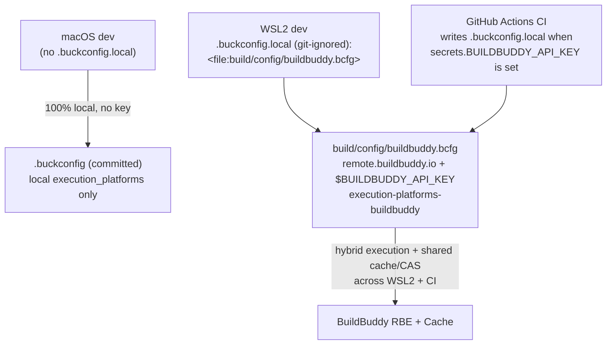
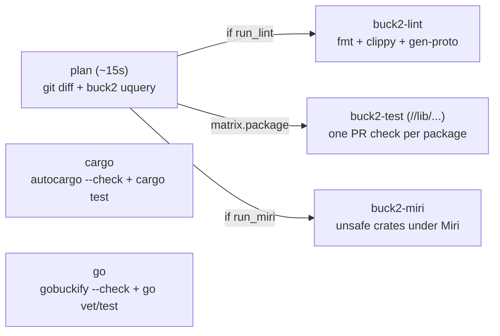

# 0036: Dynamic affected-target CI and BuildBuddy hybrid execution

**Status:** Complete

**Design references:** [Build system](../design/build-system.md),
[plan 0035](0035-workspace-hermetic-build.md).

## Goal and scope

Make CI both **visible per package** and **fast**:

1. Replace the monolithic `buck2` CI job with a Buck2 `uquery`-driven `plan`
   job that dynamically fans out one GitHub Actions check per affected package
   (`buck2-test (//lib/bf-tree)`, `buck2-test (//lib/engine)`, etc.), runs Miri
   automatically when unsafe crates or toolchains are affected, and skips lint
   and test jobs on docs-only PRs.
2. Add opt-in **BuildBuddy hybrid execution + remote cache** so GitHub Actions
   matrix runners and your WSL2 Linux machine share cached artifacts and run
   cache misses on BuildBuddy's Linux executors, while macOS local
   development (and any contributor without a BuildBuddy API key) stays 100%
   local with zero configuration.

- **In scope:**
  - Opt-in hybrid execution platforms (`//build:execution-platforms-buildbuddy`)
    in `build/platforms.bzl` and `build/BUCK` (`local_enabled = True`,
    `remote_enabled = True`, `remote_cache_enabled = True`,
    `use_limited_hybrid = True`, `allow_limited_hybrid_fallbacks = True`,
    `allow_cache_uploads = True`), pinned to Ubuntu 24.04 by digest, covering
    both normal builds and Miri.
  - Committed, secret-free `build/config/buildbuddy.bcfg` configuring
    `[buck2_re_client]` against `remote.buildbuddy.io` with
    `$BUILDBUDDY_API_KEY`.
  - Ignoring `/.buckconfig.local` in `.gitignore` and `.slignore` so WSL2
    developers can opt in once with `<file:build/config/buildbuddy.bcfg>` and
    never pass extra flags.
  - Dynamic `.github/workflows/ci.yaml`:
    - `plan` job computing affected packages via `tools/buck2 uquery` (`rdeps`
      + `owner`) directly inline (no extra tool scripts), emitting `packages`,
      `run_lint`, and `run_miri`.
    - `buck2-lint` conditional job (`tools/fmt.sh`, `tools/clippy.sh`,
      `tools/gen-proto --check`), skipped on docs-only PRs.
    - `buck2-test` dynamic matrix (one PR check per affected package).
    - `buck2-miri` conditional job (runs when `//lib/bf-tree-circular-buffer`
      or global build/toolchain files are affected).
    - Automatic `.buckconfig.local` activation in CI whenever
      `secrets.BUILDBUDDY_API_KEY` is configured (graceful fallback to local
      builds on fork PRs or before the secret is set).
  - Updating `docs/design/build-system.md` with the CI fanout and BuildBuddy
    setup (including the one-line WSL2 `.buckconfig.local` recipe).
- **Out of scope:**
  - Remote execution on macOS (macOS local dev remains 100% local).
  - Building or publishing a custom Docker image for RBE. Plan 0035 made all
    Linux toolchains hermetic inside Buck2, so an off-the-shelf image is
    enough. BuildBuddy's `rbe-ubuntu24-04` image is used, not stock
    `ubuntu:24.04` (see "Discoveries and plan changes").
  - Replacing the secondary `cargo` and `go` CI jobs.
  - Configuring the BuildBuddy account or GitHub repository secret itself (the
    user adds `BUILDBUDDY_API_KEY` in GitHub Settings → Secrets).
- **Done when:**
  - Local macOS builds with plain `tools/buck2 test //...` remain 100% local
    with no API key or network call to BuildBuddy.
  - `tools/buck2 audit providers //build:execution-platforms-buildbuddy`
    resolves cleanly with hybrid execution settings and pinned Ubuntu 24.04
    `container-image`, and `tools/buck2 audit config --config-file
    build/config/buildbuddy.bcfg` shows the expected `[buck2_re_client]` and
    `execution_platforms` settings.
  - The inline `plan` query logic is verified locally against representative
    file-change sets (Rust leaf crate, core page crate crossing into Go
    `lincheck`, `bf-tree-circular-buffer` triggering Miri, Go-only crate,
    `build/` global change, docs-only change skipping lint & tests, and
    deleted file).
  - `.github/workflows/ci.yaml` is valid YAML and gracefully handles both
    `BUILDBUDDY_API_KEY` set and unset.
  - All workspace verification checks pass.

## Approach

### How config layering separates macOS, WSL2, and CI



Writing `.buckconfig.local` in CI (when `BUILDBUDDY_API_KEY` is non-empty)
means **every** `tools/buck2` call — including those inside `tools/fmt.sh`,
`tools/clippy.sh`, `tools/gen-proto`, and `tools/buck2 test` — uses BuildBuddy
automatically without modifying any tool scripts.

### 1. Hybrid execution platforms (`build/platforms.bzl`, `build/BUCK`, `build/config/buildbuddy.bcfg`)

```python
# build/platforms.bzl (sketch)
executor_config = CommandExecutorConfig(
    local_enabled = True,
    remote_enabled = ctx.attrs.remote,
    remote_cache_enabled = ctx.attrs.remote,
    use_limited_hybrid = ctx.attrs.remote,
    allow_limited_hybrid_fallbacks = ctx.attrs.remote,
    allow_cache_uploads = ctx.attrs.remote,
    remote_execution_properties = ctx.attrs.remote_execution_properties,
    remote_execution_use_case = "peppydb" if ctx.attrs.remote else None,
    remote_output_paths = "output_paths" if ctx.attrs.remote else None,
    use_windows_path_separators = host_info().os.is_windows,
)
```

```python
# build/BUCK (sketch)
# Stock Ubuntu 24.04 pinned by digest; all Linux compilers/linkers/sysroot are
# hermetic Buck2 inputs (plan 0035), so no custom RBE image is needed.
_RBE_PROPS = {
    "OSFamily": "Linux",
    "Arch": "arm64" if host_info().arch.is_aarch64 else "amd64",
    "container-image": "docker://gcr.io/flame-public/rbe-ubuntu24-04@sha256:be9853fc45092d2cf2bda3abed30d22182881659a50bf35c7125161d7cfc8a75",
}

peppy_execution_platform(
    name = "exec-host-buildbuddy",
    constraints = [host_configuration.cpu, host_configuration.os],
    remote = True,
    remote_execution_properties = _RBE_PROPS,
)

peppy_execution_platform(
    name = "exec-host-miri-buildbuddy",
    constraints = [host_configuration.cpu, host_configuration.os, ":mode-miri"],
    remote = True,
    remote_execution_properties = _RBE_PROPS,
)

peppy_execution_platforms(
    name = "execution-platforms-buildbuddy",
    platforms = [":exec-host-buildbuddy", ":exec-host-miri-buildbuddy"],
    visibility = ["PUBLIC"],
)
```

```ini
# build/config/buildbuddy.bcfg
[buck2]
digest_algorithms = SHA256

[buck2_re_client]
engine_address       = remote.buildbuddy.io
action_cache_address = remote.buildbuddy.io
cas_address          = remote.buildbuddy.io
http_headers         = x-buildbuddy-api-key:$BUILDBUDDY_API_KEY

[build]
execution_platforms = root//build:execution-platforms-buildbuddy
```

### 2. Dynamic affected-package CI fanout (`.github/workflows/ci.yaml`)



- **Global triggers** (`build/`, `third-party/`, `tools/`, `.buckconfig`,
  `go.mod`, `go.sum`, `rust-toolchain.toml`, `.github/workflows/ci.yaml`):
  query all testable packages via
  `tools/buck2 uquery 'kind("rust_library|rust_test|go_test", //bin/... + //lib/... + //proto/...)'`
  and set `run_lint=true` and `run_miri=true`.
- **Scoped changes:** for changed files under `bin/`, `lib/`, `proto/`:
  - Existing files → `owner("<path>")`.
  - `BUCK` files or deleted files → nearest owning package (`//<dir>:`).
  - Run `tools/buck2 uquery 'kind("rust_library|rust_test|go_test", rdeps(//bin/... + //lib/... + //proto/..., <seeds>))'`.
  - Deduplicate targets (`root//lib/foo:bar` → `//lib/foo`) into a sorted JSON
    array `packages`.
  - Set `run_lint=true` whenever any non-doc file changed (anything outside
    `docs/` and `*.md`).
  - Set `run_miri=true` if `//lib/bf-tree-circular-buffer` is in `packages`.
- **Docs-only PRs:** `packages` is `[]`, `run_lint` is `false`, and `run_miri`
  is `false`, so `buck2-lint`, `buck2-test`, and `buck2-miri` all skip cleanly.
- **Zero hand-maintained lists:** adding a new crate under `lib/` or `bin/`
  automatically makes it discoverable by `plan`.

## Decisions and trade-offs

- **Limited hybrid execution (`use_limited_hybrid = True`,
  `allow_limited_hybrid_fallbacks = True`) immediately:**
  - *Behavior:* Limited hybrid is remote-first. It does not race local and
    remote execution, and it does not fill local cores before it sends work to
    BuildBuddy. Buck2 first checks its local state and BuildBuddy's action
    cache. On a cache miss, an action runs on a BuildBuddy executor. An action
    runs locally only when it prefers or requires local execution (for example,
    `prefer_local` or `local_only` on `ctx.actions.run`), or when the remote
    attempt fails and `allow_limited_hybrid_fallbacks = True` retries it
    locally. Local CPUs are therefore mostly idle on a hybrid build.
  - *Why:* Limited hybrid gives predictable placement, does not spend remote
    capacity on duplicate work, and leaves the developer's machine free.
  - *Alternative:* Full hybrid (`use_limited_hybrid = False`) starts an action
    locally when a local slot is free and also remotely, and uses the first
    result. It keeps both sides busy but duplicates work and BuildBuddy usage.
    Revisit it only with measurements that show limited hybrid is slower.
  - *Off-the-shelf Ubuntu 24.04 image:* Because plan 0035 made every Linux
    toolchain hermetic inside Buck2, BuildBuddy's digest-pinned
    `rbe-ubuntu24-04` image (glibc 2.39, matching LLVM 23.1.6's host
    requirement) works with no custom RBE Dockerfile to maintain. The stock
    `ubuntu:24.04` image does not work because it lacks `xz` and `unzip`.
  - *Trade-off:* First cold remote action that invokes LLVM uploads the
    unpacked LLVM toolchain digest to BuildBuddy CAS; subsequent runs reuse it
    from CAS.
- **Skip `buck2-lint` on docs-only PRs:**
  - Documentation-only PRs skip `buck2-lint`, `buck2-test`, and `buck2-miri`
    completely, finishing in ~15 seconds.
- **Package-level matrix (`//lib/bf-tree`) over per-target matrix:**
  - One PR check per crate/package (covering both unit tests and doctests),
    readable in GitHub's PR UI and well under GitHub's 256-job matrix limit.
- **Inline Python in `ci.yaml` instead of a new script in `tools/`:**
  - Keeps `tools/` focused on developer commands; the query logic lives beside
    the matrix that consumes it.
- **Graceful fallback when `BUILDBUDDY_API_KEY` is unset:**
  - Fork PRs and repos before setting the secret run locally without auth
    errors.

## Proposed commit stack

### `[1/4][workspace-rbe][plan] plan dynamic CI fanout and BuildBuddy hybrid execution`

- **Purpose:** Record the hybrid BuildBuddy config layering and dynamic CI design.
- **Core changes:** Add `docs/plans/0036-workspace-remote-execution.md`.
- **Verification:** Review and link check.

### `[2/4][workspace-rbe][config] add BuildBuddy hybrid execution platforms and config`

- **Purpose:** Enable opt-in BuildBuddy hybrid execution + remote caching for
  WSL2 and CI without affecting default local builds.
- **Core changes:**
  - Add `remote` and `remote_execution_properties` attributes to
    `peppy_execution_platform` in `build/platforms.bzl`.
  - Add `exec-host-buildbuddy`, `exec-host-miri-buildbuddy`, and
    `execution-platforms-buildbuddy` (with digest-pinned Ubuntu 24.04) in
    `build/BUCK`.
  - Add `build/config/buildbuddy.bcfg`.
  - Ignore `/.buckconfig.local` in `.gitignore` and `.slignore`.
- **Verification:**
  - `tools/buck2 audit providers //build:execution-platforms-buildbuddy`
    resolves cleanly with `local_enabled = True`, `remote_enabled = True`,
    `use_limited_hybrid = True`, `remote_cache_enabled = True`, and the pinned
    Ubuntu 24.04 `container-image`.
  - `tools/buck2 audit config --config-file build/config/buildbuddy.bcfg`
    shows `[buck2_re_client]` and `execution-platforms-buildbuddy`.
  - Plain `tools/buck2 test //lib/bf-tree-node-id/...` still runs 100% locally.

### `[3/4][workspace-rbe][ci] dynamically fan out affected Buck2 packages in CI`

- **Purpose:** Show one PR check per affected package, skip untouched packages
  (and skip lint on docs-only PRs), run Miri automatically when relevant, and
  activate BuildBuddy whenever the secret is set.
- **Core changes:**
  - Rewrite the `buck2` job in `.github/workflows/ci.yaml` into `plan`,
    `buck2-lint`, `buck2-test` (dynamic matrix), and `buck2-miri`.
  - Add the conditional `.buckconfig.local` step using
    `secrets.BUILDBUDDY_API_KEY`.
- **Verification:**
  - Run the inline Python query snippet locally against simulated diff lists
    (leaf crate, `bf-tree-page` crossing into Go `lincheck`,
    `bf-tree-circular-buffer` triggering Miri, Go-only crate, `build/` global
    change, docs-only change skipping lint & tests, and deleted file) and
    verify exact JSON output.
  - Validate `.github/workflows/ci.yaml` syntax.

### `[4/4][workspace-rbe][docs] document dynamic CI and BuildBuddy setup`

- **Purpose:** Keep `docs/design/build-system.md` accurate and document the
  one-line WSL2 `.buckconfig.local` setup.
- **Core changes:**
  - Update `docs/design/build-system.md` with CI dynamic test selection and
    BuildBuddy hybrid execution instructions.
  - Mark this plan complete with recorded verification outcomes.
- **Verification:** Full `AGENTS.md` verification suite passes.

## Open questions

None. Confirmed during planning:
- Use limited hybrid execution (`use_limited_hybrid = True`,
  `allow_limited_hybrid_fallbacks = True`) immediately with a digest-pinned
  Ubuntu 24.04 image.
- Skip `buck2-lint` on docs-only PRs.

## Verification strategy

| Check | Command or procedure | Expected result |
| --- | --- | --- |
| Default local build unchanged | `tools/buck2 test //lib/bf-tree-node-id/...` (no API key) | Runs 100% locally, passes |
| BuildBuddy hybrid platform & config | `tools/buck2 audit providers //build:execution-platforms-buildbuddy` and `tools/buck2 audit config --config-file build/config/buildbuddy.bcfg` | Resolves `local_enabled = True`, `remote_enabled = True`, `use_limited_hybrid = True`, `remote_cache_enabled = True`, `allow_cache_uploads = True`, Ubuntu 24.04 image, and `remote.buildbuddy.io` |
| `plan` query logic | Run the exact `ci.yaml` Python logic against 7 synthetic file-change sets | Exact expected `packages`, `run_lint`, and `run_miri` outputs for every case |
| Workspace checks | `tools/fmt.sh`, `tools/clippy.sh`, `tools/buck2 test //bin/... //lib/... //proto/...`, `tools/autocargo --check`, `tools/gobuckify-remote --check`, `tools/gen-proto --check`, Miri, `cargo test`, `go vet && go test` | All pass |

## Progress

- [x] Agree on the design and commit stack with the user.
- [x] `[1/4][workspace-rbe][plan]`
- [x] `[2/4][workspace-rbe][config]`
- [x] `[3/4][workspace-rbe][ci]`
- [x] `[4/4][workspace-rbe][docs]`
- [x] Complete stack-wide verification and design-document updates.

## Discoveries and plan changes

- **Chose limited hybrid execution immediately** (`local_enabled = True`,
  `remote_enabled = True`, `remote_cache_enabled = True`,
  `use_limited_hybrid = True`, `allow_limited_hybrid_fallbacks = True`,
  `allow_cache_uploads = True`) instead of cache-only, using the stock
  digest-pinned `ubuntu:24.04` image (`glibc 2.39`, matching LLVM 23.1.6's host
  requirement). The image was later replaced; see the next entry.
- **Stock `ubuntu:24.04` cannot unpack archives remotely.** The first real
  hybrid build on WSL2 failed in `http_archive` actions with
  `xz: Cannot exec` (for `.tar.xz` toolchains such as `rust-stable-src` and
  `sysroot-linux-amd64`) and `unzip: not found` (for Go module zips). With
  `digest_algorithms = SHA256` and a `sha256` on every archive, the prelude
  defers the download and unpacks on the remote executor, which uses host
  `xz` and `unzip`. Switched `container-image` to BuildBuddy's
  `rbe-ubuntu24-04` multi-arch index
  (`sha256:be9853fc45092d2cf2bda3abed30d22182881659a50bf35c7125161d7cfc8a75`).
  Its amd64 layers contain `/usr/bin/xz`, `/usr/bin/unzip`, `/usr/bin/bzip2`,
  and `/usr/bin/python3`. It has no `zstd`, and no archive in the repository
  uses `.tar.zst`.
- **Limited hybrid is remote-first, not local-first.** An earlier version of
  this plan said limited hybrid "keeps local cores busy and spills overflow
  work" to BuildBuddy. That is wrong. The first WSL2 hybrid build ran
  `1 local, 1213 remote` actions with local CPUs mostly idle. The
  "Decisions and trade-offs" section now describes the real behavior. The
  configuration is unchanged.
- **Skip `buck2-lint` on docs-only PRs** via `plan`'s `run_lint` output.
- **Unowned files in `owner(...)`:** Verified `tools/buck2 uquery` returns an
  empty set with exit 0 on unowned files inside a package directory (such as
  generated `Cargo.toml`), so `plan` handles them cleanly.

### Verification outcomes

Measured on macOS arm64 (`darwin-arm64`) with `~/.cargo/bin` excluded from
`PATH` for all Buck2 commands:

| Check | Result |
| --- | --- |
| `tools/buck2 audit providers //build:execution-platforms-buildbuddy` | Resolves `Hybrid { local, remote, level: Fallback }`, `remote_cache_enabled = true`, `cache_upload_behavior = Enabled`, Ubuntu 24.04 digest |
| `BUILDBUDDY_API_KEY=dummy tools/buck2 audit config --config-file build/config/buildbuddy.bcfg` | Resolves `remote.buildbuddy.io`, `digest_algorithms = SHA256`, `execution-platforms-buildbuddy` |
| Synthetic `plan` query matrix (7 cases) | Exact outputs: `docs_only` (`[]`, `lint=False`, `miri=False`), `go_gateway` (3 pkgs), `bf_tree_page` (9 pkgs crossing Rust→Go `lincheck`), `unsafe_cbuf` (7 pkgs, `miri=True`), `deleted_file` (`//lib/load`), `global_build` (all 22 pkgs, `miri=True`), `proto_change` (3 pkgs) |
| `.github/workflows/ci.yaml` YAML validation | Valid (`plan, buck2-lint, buck2-test, buck2-miri, cargo, go`) |
| `tools/fmt.sh` & `tools/clippy.sh` | Pass (43 targets clean) |
| `tools/buck2 test //bin/... //lib/... //proto/...` | Pass (all 46 targets pass; `server` and `lincheck` passed cleanly on re-run after initial 46-target local CPU saturation) |
| `tools/autocargo --check`, `tools/gobuckify-remote --check`, `tools/gen-proto --check` | Pass |
| `tools/buck2 test @build/mode/miri '//lib/bf-tree-circular-buffer:bf-tree-circular-buffer-unittest[miri]'` | Pass (30/30) |
| `cargo test --workspace --locked` & `go vet ./... && go test ./...` | Pass |
| Live BuildBuddy hybrid execution on Linux | Pending first PR/WSL2 run once `BUILDBUDDY_API_KEY` is configured |
