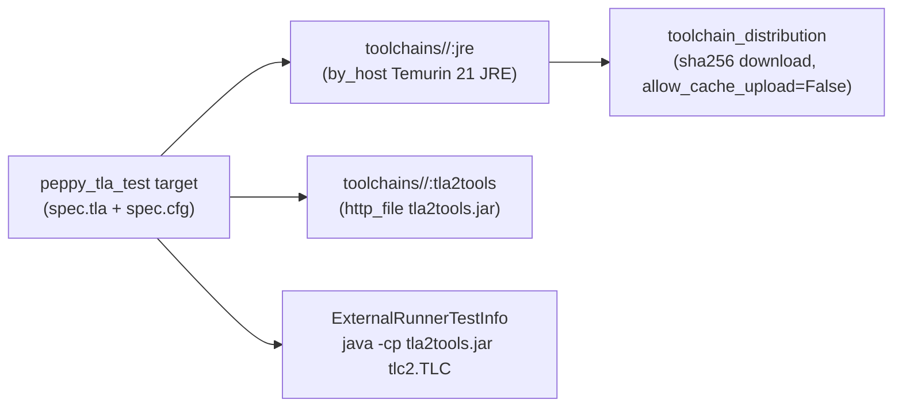

# 0037: Workspace TLA+ toolchain and Buck2 test rule

**Status:** Complete

**Design references:** [Build system](../design/build-system.md)

## Goal and scope

Several concurrent state machines and recovery protocols in peppydb—such as
the circular buffer, optimistic latch-coupled inner frames, fuzzy checkpoints
and snapshots, cache hints, and distributed sharding—have subtle interleavings
that are hard to catch with unit tests alone.

peppydb pins every build and verification tool hermetically through Buck2 so
that checks run identically on macOS and Linux with no manual host installs.
This stack adds a pinned TLA+ model-checker toolchain (Temurin JRE +
`tla2tools.jar`) and a `peppy_tla_test` rule so any package can declare a
`BUCK` test target that runs TLC via `tools/buck2 test`.

- **In scope:**
  - `build/toolchains/tla.bzl`: pinned `tla2tools.jar` version/URL/sha256 and
    per-host Temurin 21 JRE archives (`darwin-arm64`, `linux-amd64`,
    `linux-arm64`).
  - `tools/update-tla`: helper script (following `tools/update-go`) to fetch
    and regenerate `build/toolchains/tla.bzl` from official GitHub and
    Adoptium release feeds.
  - `build/toolchains/BUCK`: `jre` (`toolchain_distribution` + `by_host`
    alias) and `tla2tools` (`http_file`) targets.
  - `build/defs.bzl`: `peppy_tla_test(name, spec, cfg, deps, tlc_flags)` rule
    returning `ExternalRunnerTestInfo` that runs TLC hermetically in an
    isolated temporary `-metadir`.
  - Updating `docs/design/build-system.md` to document the TLA+ toolchain and
    `peppy_tla_test`.
- **Out of scope:**
  - Domain specs for individual components and checked-in smoke specs (we
    verify `peppy_tla_test` with a temporary local spec during implementation
    and remove it before committing).
  - Apalache or TLAPS (symbolic / theorem-proving backends); TLC covers
    explicit-state model checking and requires only a standard JRE + one jar.
  - Running TLA+ checks through `cargo test` (TLA+ targets live in Buck2 only).
- **Done when:**
  - Verified with a temporary local spec (deleted before commit) that
    `peppy_tla_test` downloads the pinned JRE and `tla2tools.jar` hermetically,
    passes on a valid invariant without host `java`/`tlc`, fails with TLC's
    counterexample trace on a broken invariant, and resolves cleanly under
    `--target-platforms=//build:linux-x86_64`.
  - Existing workspace verification (`tools/fmt.sh`, `tools/clippy.sh`,
    `tools/buck2 test //bin/... //lib/... //proto/...`, `tools/autocargo --check`,
    `tools/gobuckify-remote --check`, `tools/gen-proto --check`,
    `cargo test --workspace --locked`, `go vet ./... && go test ./...`) passes.

## Approach

### Toolchain layout (`build/toolchains/`)



- **JRE via `toolchain_distribution`:** Temurin 21 headless JRE tarballs are
  ~45–55 MiB per host. Using `toolchain_distribution` (the same rule used for
  Rust, Go, and Zig) fetches the sha256-pinned tarball directly from origin
  and extracts it with `allow_cache_upload = False` so extracted JRE trees
  never bloat remote caches. On macOS, `strip_prefix` strips
  `jdk-21.../Contents/Home`; on Linux, `jdk-21...`; both expose `bin/java`.
- **`tla2tools.jar` via `http_file`:** One platform-independent ~15 MiB jar
  pinned by sha256 from the official `tlaplus/tlaplus` GitHub release.
- **No host Java dependency:** `peppy_tla_test` invokes `<jre>/bin/java`
  directly and ignores `JAVA_HOME` / `PATH`.

### `peppy_tla_test` rule (`build/defs.bzl`)

```python
def _tla_test_impl(ctx: AnalysisContext) -> list[Provider]:
    java = cmd_args(ctx.attrs._jre[DefaultInfo].default_outputs[0], format = "{}/bin/java")
    jar = ctx.attrs._tla2tools[DefaultInfo].default_outputs[0]

    cmd = cmd_args(
        "/bin/sh",
        "-c",
        'set -eu; java=$1; jar=$2; cfg=$3; spec=$4; shift 4; ' +
        'd=$(mktemp -d); trap \'rm -rf "$d"\' EXIT; ' +
        '"$java" -XX:+UseParallelGC -XX:ParallelGCThreads=1 ' +
        '-Djava.rmi.server.hostname=127.0.0.1 -cp "$jar" tlc2.TLC ' +
        '-cleanup -metadir "$d" -config "$cfg" "$@" "$spec"',
        "peppy_tla_test",
        java,
        jar,
        ctx.attrs.cfg,
        ctx.attrs.spec,
        ctx.attrs.tlc_flags,
        hidden = ctx.attrs.deps,
    )
    return [
        DefaultInfo(),
        ExternalRunnerTestInfo(
            type = "tla",
            command = [cmd],
        ),
    ]

peppy_tla_test = rule(
    impl = _tla_test_impl,
    attrs = {
        "cfg": attrs.source(),
        "deps": attrs.list(attrs.source(), default = []),
        "spec": attrs.source(),
        "tlc_flags": attrs.list(attrs.string(), default = ["-workers", "1"]),
        "_jre": attrs.default_only(attrs.dep(default = "toolchains//:jre")),
        "_tla2tools": attrs.default_only(attrs.dep(default = "toolchains//:tla2tools")),
    },
)
```

Key properties:
- **Isolated `-metadir`:** Each test run passes `-metadir "$d"` using a fresh
  `mktemp -d` directory cleaned up on exit (`-cleanup` + `trap`), so parallel
  Buck2 test runs never collide on TLC's default `states/` directory or leave
  untracked files in the working tree.
- **Deterministic caching:** Buck2 tracks `spec`, `cfg`, `deps`, `tlc_flags`,
  `_jre`, and `_tla2tools` as inputs; unchanged specs hit Buck2's test cache
  without re-running TLC.
- **No Cargo impact:** `tools/autocargo` queries only `rust_(library|binary|test)`
  targets, so `peppy_tla_test` targets in `//lib/...` are ignored cleanly.
- **Visible to `tools/buck2 test //lib/...`:** Placing `peppy_tla_test` inside
  a crate's `BUCK` file means the standard verification command
  `tools/buck2 test //bin/... //lib/... //proto/...` automatically runs every
  crate's TLA+ specs alongside its Rust/Go tests.

## Decisions and trade-offs

- **Temurin 21 JRE (pinned) vs. host `java`:**
  - Chosen: pinned Temurin 21 JRE via `toolchain_distribution`. Matches
    peppydb's hermetic build guarantee (plan 0035) and avoids "works on my
    machine" JDK version drift on macOS and Linux CI.
  - Trade-off: ~50 MiB one-time download per host architecture when a TLA+
    target is built or tested; developers who do not build TLA+ targets do not
    download it (Buck2 fetches lazily).
- **TLC (`tla2tools.jar`) vs. Apalache:**
  - Chosen: TLC. Mature, fast for finite concurrent state machines, single
    self-contained jar, and standard TLA+ syntax with zero extra native
    dependencies (Apalache also requires Z3).
- **`-workers 1` vs. `-workers auto` default:**
  - Chosen: `-workers 1`. Buck2 already parallelizes test targets across cores;
    `-workers auto` inside each JVM would oversubscribe the machine and starve
    concurrent Rust/Go/TLA+ test targets. Single-worker TLC also produces
    deterministic shortest-path traces and finishes small models in seconds.
    Individual targets can still opt into more workers via `tlc_flags` (e.g.,
    `["-workers", "4"]`).
- **`tla2tools.jar` `v1.7.4` vs. `v1.8.0`:**
  - Chosen: `v1.7.4`, the latest immutable upstream release on
    `tlaplus/tlaplus` (includes the `v1.7.3` `LazyValue` and `v1.7.4`
    multi-worker liveness fixes). Upstream's `v1.8.0` pre-release tag is
    rebuilt on pushes to `master`, so its sha256 would drift and break
    hermetic downloads.
- **Run TLA+ in `//lib/...` and CI by default:**
  - Chosen: place `peppy_tla_test` targets in crate `BUCK` files and add
    `peppy_tla_test` to `TESTABLE` in `.github/workflows/ci.yaml` so edits to
    `.tla`/`.cfg` files trigger `buck2-test` in CI.
- **Crate-local `spec/` directories:**
  - Real specs live beside the crate they model (e.g.,
    `lib/<crate>/spec/<Model>.tla`) so `tools/buck2 test //lib/<crate>/...`
    and `tools/buck2 test //lib/...` run them automatically. No permanent
    smoke-test spec is checked in.

## Proposed commit stack

### `[1/4][workspace-tla][plan] draft workspace TLA+ toolchain plan`

- **Purpose:** Record the toolchain design, Buck2 rule, and verification plan.
- **Core changes:** Add `docs/plans/0037-workspace-tla-toolchain.md`.
- **Verification:** Review with the user.

### `[2/4][workspace-tla][pins] add tools/update-tla and pinned JRE and tla2tools.jar`

- **Purpose:** Fetch and pin Temurin 21 JRE archives for all three supported
  hosts (`darwin-arm64`, `linux-amd64`, `linux-arm64`) and `tla2tools.jar` in
  `build/toolchains/tla.bzl`, and expose `toolchains//:jre` and
  `toolchains//:tla2tools`.
- **Core changes:**
  - Add `tools/update-tla` (Python 3 stdlib only, matching `tools/update-go`).
  - Generate `build/toolchains/tla.bzl`.
  - Wire `:jre` and `:tla2tools` in `build/toolchains/BUCK`.
- **Verification:**
  - `tools/buck2 build toolchains//:jre toolchains//:tla2tools`
  - `tools/buck2 cquery toolchains//:jre --target-platforms=//build:linux-x86_64`

### `[3/4][workspace-tla][rule] add peppy_tla_test rule`

- **Purpose:** Provide the reusable `peppy_tla_test` Buck2 rule and verify
  end-to-end TLC execution in Buck2.
- **Core changes:**
  - Add `peppy_tla_test` to `build/defs.bzl`.
  - Add `peppy_tla_test` to `TESTABLE` in `.github/workflows/ci.yaml` so
    changes to `.tla`/`.cfg` files select their package in CI fanout.
- **Verification:**
  - Using a temporary local spec (deleted before committing), verify that:
    - `tools/buck2 test` passes cleanly and leaves no `states/` directory,
    - violating an invariant fails with TLC's counterexample output, and
    - `tools/buck2 cquery --target-platforms=//build:linux-x86_64` resolves.

### `[4/4][workspace-tla][docs] document TLA+ toolchain and finalize plan`

- **Purpose:** Keep build-system documentation and plan status up to date.
- **Core changes:**
  - Document the TLA+ toolchain and `peppy_tla_test` in `docs/design/build-system.md`.
  - Record verification results and mark `docs/plans/0037-workspace-tla-toolchain.md` Complete.
- **Verification:** Full repo verification suite (below).

## Open questions

None. (Resolved: run TLC in `//lib/...` and CI by default; pin immutable
`tla2tools.jar` `v1.7.4` from upstream GitHub + Temurin 21 LTS JRE.)

## Verification strategy

| Check | Command or procedure | Expected result | Outcome |
| --- | --- | --- | --- |
| Toolchain targets build | `tools/buck2 build toolchains//:jre toolchains//:tla2tools` | Downloads verify sha256 and extract cleanly | Pass (`jdk-21.0.13.1+2` + `tla2tools.jar` `v1.7.4`) |
| Smoke check (temporary, deleted before commit) | Run `peppy_tla_test` on a temporary spec: valid invariant, broken invariant, `uquery`, and `--target-platforms=//build:linux-x86_64` `cquery` | Valid passes with no `states/` left behind; broken fails with counterexample; Linux graph resolves | Pass: valid `1.6s` (4 distinct states, 0 warnings, no `states/`), broken failed with exit 32 and full counterexample trace, Linux `cquery` resolved `jre-linux-amd64` + `tla2tools`, CI `uquery` matched `peppy_tla_test` |
| Formatting & lints | `tools/fmt.sh && tools/clippy.sh` | Clean | Pass (`clippy: 43 targets clean`) |
| Full Buck2 test suite | `tools/buck2 test //bin/... //lib/... //proto/...` | All pass | Pass (46 targets; `server-unittest` and `lincheck-test` timed out under parallel saturation and passed on re-run in `10.0s` / `11.1s`) |
| Generated files & secondary tools | `tools/autocargo --check && tools/gobuckify-remote --check && tools/gen-proto --check && cargo test --workspace --locked && go vet ./... && go test ./...` | All pass | Pass (`autocargo` 20 files, `gobuckify-remote` 14 modules / 133 packages, `gen-proto`, `cargo test --workspace --locked`, `go vet` & `go test`) |

## Progress

- [x] Agree on the design and commit stack with the user.
- [x] `[1/4][workspace-tla][plan] draft workspace TLA+ toolchain plan`
- [x] `[2/4][workspace-tla][pins] add tools/update-tla and pinned JRE and tla2tools.jar`
- [x] `[3/4][workspace-tla][rule] add peppy_tla_test rule`
- [x] `[4/4][workspace-tla][docs] document TLA+ toolchain and finalize plan`
- [x] Complete stack-wide verification and design-document updates.

## Discoveries and plan changes

- **Upstream `v1.8.0` is mutable:** `tlaplus/tlaplus` rebuilds its `v1.8.0`
  pre-release asset on pushes to `master`. Pinning `v1.7.4` keeps the sha256
  stable from origin without hosting a mirror.
- **CI affected-package filter:** `.github/workflows/ci.yaml` filters targets
  with `kind("rust_library|rust_test|go_test", ...)`; diff 3 adds
  `peppy_tla_test` so PRs editing `.tla`/`.cfg` files run TLC in CI.
- **JVM GC & macOS RMI startup delay:** `-XX:+UseSerialGC` triggered TLC's
  GC warning, and default RMI hostname resolution hit macOS's 5-second `.local`
  mDNS timeout (`5.68s` wall for 4 states). Switching to
  `-XX:+UseParallelGC -XX:ParallelGCThreads=1 -Djava.rmi.server.hostname=127.0.0.1`
  silenced the warning, kept GC single-threaded, and dropped runtime to `0.59s`.
- **POSIX shell & trap cleanup:** Replaced bash-only `"${@:5}"` and `exec`
  with POSIX `shift 4` and a direct subshell invocation so `/bin/sh` (`dash` on
  Ubuntu) works and the `EXIT` trap removes the temporary `-metadir`.
- **Buck2 `cmd_args` hidden inputs:** Passed `hidden = ctx.attrs.deps` as a
  keyword argument to `cmd_args(...)` rather than calling a `.hidden()` method.

## Agent notes

- **Entry points:** `build/defs.bzl`, `build/toolchains/BUCK`, `build/toolchains/distribution.bzl`, `build/toolchains/host.bzl`, `tools/update-go`, `docs/design/build-system.md`.
- **macOS Temurin archive layout:** Adoptium macOS tarballs nest `bin/java` under `jdk-<ver>-jre/Contents/Home/`; `toolchain_distribution` already supports multi-component `strip_prefix`, so both macOS and Linux extract `bin/java` at the root of the output directory.
- **TLC exit codes & flags:** Use `-cleanup` + a temporary `-metadir` so TLC never writes `states/` into the source tree and parallel test runs never collide. Verify whether `-deadlock` or default deadlock checking is preferred per spec.
