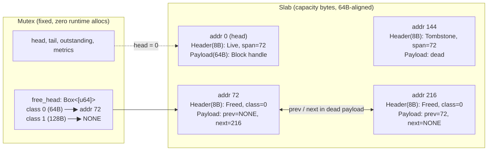

# 0038: Circular buffer v2 — TLA+ model, 8-byte intrusive slab header, and allocation-free free lists

**Status:** Complete

**Design references:** [Circular buffer](../design/bf-tree-circular-buffer.md),
[Tree structure](../design/bf-tree-structure.md),
[Build system](../design/build-system.md#tla)

**Depends on:** [Plan 0037: Workspace TLA+ toolchain and Buck2 test rule](0037-workspace-tla-toolchain.md)

## Goal and scope

`bf-tree-circular-buffer` is supposed to bound the memory that mini-pages and
cached full pages occupy. Today it fails to bound total RAM and pays for block
metadata twice:

1. Every block reserves `BLOCK_HEADER_BYTES = 16` bytes inside the slab, even
   though release builds never read or write those 16 bytes (debug builds store
   a canary there). That wastes 20% of slab space on 64-byte mini-pages—double
   upstream BF-Tree's 8-byte `AllocMeta`.
2. All real block metadata lives on the heap outside the configured budget:
   `VecDeque<BlockMeta>` (40 bytes per block) plus `free: Vec<Vec<u64>>` per
   size class. Both grow dynamically during normal operation, and the free
   lists accumulate stale entries that require periodic `retain()` sweeps.
3. Small blocks are the common case, not a corner case: an 8-byte key with a
   16-byte value fits the 64-byte class exactly, and record-cache misses create
   mini-pages at the smallest class that fits. Each 64-byte block therefore
   costs 80 bytes of slab plus ≥40 bytes of untracked heap metadata.
4. `TreeConfig::validate` checks the circular-buffer budget by calling
   `CircularBuffer::new`, allocating and zeroing a full slab (32 MiB by
   default, 1 GiB in `lib/bf-tree/src/tests/config.rs`) only to drop it
   immediately.

This stack first specifies and exhaustively model-checks the new state machine
in TLA+ via `peppy_tla_test` (plan 0037), then moves all per-block metadata
into an **8-byte intrusive header** inside the slab and links freed holes
through their **dead payload bytes**. The configured `capacity` then strictly
bounds all per-block memory, and `CircularBuffer` performs zero heap
allocations after `CircularBuffer::new`.

- **In scope:**
  - `lib/bf-tree-circular-buffer/spec/CircularBuffer.tla` and `.cfg` files,
    wired into `lib/bf-tree-circular-buffer/BUCK` with `peppy_tla_test` and
    verified by TLC *before* any Rust changes.
  - `CircularBuffer::validate` (allocation-free) and wiring
    `TreeConfig::validate` to call it instead of `CircularBuffer::new`.
  - Shrinking `BLOCK_HEADER_BYTES` from 16 to 8, removing the debug canary,
    and making `Block` cover payload bytes only (so safe callers cannot reach
    the header).
  - Storing per-block metadata (`owner`, `span_units`, `state`, `flags`) in
    the 8-byte slab header, walking the slab by span, and identifying blocks
    and `Victim`s by logical `addr` instead of `seq`.
  - Storing doubly-linked per-class free-list pointers (`prev_addr`,
    `next_addr`) inside freed blocks' dead payloads (`free_head: Box<[u64]>`),
    giving O(1) unlink in `advance_head` with zero stale entries and removing
    `VecDeque<BlockMeta>`, `Vec<Vec<u64>>`, and `retain()` sweeps.
  - Updated unit, differential model, threaded stress, and Miri tests, plus
    updated design documents.
- **Out of scope:**
  - Changing the locking model (`Mutex<State>` continues to guard metadata;
    never held while callers access payload bytes or perform I/O).
  - Changing block alignment (payloads remain unaligned to 64-byte cache
    lines, as today; see Open questions).
  - Changes to other `bf-tree-*` crates, except updating
    `TreeConfig::validate` and its config test in `lib/bf-tree`.
- **Done when:**
  - `CircularBuffer.tla` passes TLC under
    `tools/buck2 test //lib/bf-tree-circular-buffer/...` (and a deliberately
    broken action fails an invariant).
  - `CircularBuffer` makes zero heap allocations after `CircularBuffer::new`,
    and no per-block metadata exists outside the slab.
  - `TreeConfig::validate` allocates no slab.
  - All workspace checks (`AGENTS.md`) and Miri tests for
    `bf-tree-circular-buffer` pass.

## Approach

### 1. Memory layout

```text
Slab (strictly `capacity` bytes; all per-block metadata lives inside it):

┌────────┬──────────────────┬────────┬──────────────────────────────┬────────┬─────
│ Header │ Live payload     │ Header │ Freed hole payload (≥16 B)   │ Header │ ...
│  8 B   │ (64 B mini-page) │  8 B   │ [prev_addr: u64][next: u64]  │  8 B   │
└────────┴──────────────────┴────────┴──────────────────────────────┴────────┴─────
▲ addr   ▲ Block slice      ▲ addr+72▲ intrusive links (no handle)  ▲ addr+144
◄─────── span = 72 B ──────►◄────────── span = 72 B ───────────────►

Mutex<State> (fixed size ~100 B + 8 B per class; independent of slab size):
  head: usize, tail: usize, outstanding: usize, metrics: Metrics
  free_head: Box<[u64]>     (one logical-address head per size class, NONE = u64::MAX)
```



### 2. 8-byte block header (`BLOCK_HEADER_BYTES = 8`)

```rust
const NO_OWNER: u32 = u32::MAX;
const NONE_ADDR: u64 = u64::MAX;

/// Eight bytes at the start of every block in the slab.
/// Read and written only under `Mutex<State>`; no `Block` slice covers them.
#[derive(Clone, Copy, Debug)]
#[repr(C)]
pub(super) struct BlockHeader {
    /// Raw `LeafId` of the owner (`NO_OWNER` for a wrap `Filler`).
    owner: u32,
    /// Total block span in 8-byte units (header + payload, or filler bytes).
    span_units: u16,
    state: BlockState,
    /// Bit 0: `Kind` (0 = Mini, 1 = Full).
    /// Bit 1: `freed_while_claimed`.
    /// Bits 2..8: size-class index (0..63).
    flags: u8,
}
const _: () = assert!(size_of::<BlockHeader>() == 8);
```

- **32-bit `owner`:** Leaf IDs are already capped at 32 bits across the tree
  (`Page::set_leaf` stores a `u32` stamp, and `LeafMap::alloc` caps at
  `MAX_LEAVES = u32::MAX`). `CircularBuffer::alloc` asserts `owner.raw() < u32::MAX`.
- **`span_units` in 8-byte units:** Because every size class is a multiple of
  8 and `BLOCK_HEADER_BYTES = 8`, every block span (including any wrap
  `Filler`) is a multiple of 8. Storing `span / 8` in `u16` covers blocks up
  to `65535 * 8 = 524,280` bytes (~512 KiB, plenty for 4 KiB today and even
  64 KiB pages later).
- **Wrap fillers always fit a header:** Because every span and `capacity` are
  multiples of 8, the remaining bytes before the end of the slab are always a
  multiple of 8 (≥8), so a `Filler` always fits its 8-byte `BlockHeader`.
- **Minimum capacity:** `2 * (largest_class + 8)` (down from `2 * (largest_class + 16)`),
  still guaranteeing that an empty buffer fits the largest block even after a
  wrap filler.
- **Validation rules in `CircularBuffer::validate`:**
  - `classes` nonempty, strictly ascending, `classes.len() <= 64` (fits the
    6-bit class index in `flags`), every class a multiple of 8, `smallest >= 16`
    (holds the two 8-byte free-list links), and `(largest + 8) / 8 <= u16::MAX`.
  - `capacity` a power of two, `>= 2 * (largest + 8)`, `<= isize::MAX`.
  - `second_chance_percent <= 100`.

### 3. O(1) intrusive doubly-linked free lists

When a block is freed outside the head and outside the second-chance region,
its state becomes `BlockState::Freed` and its `Block` handle has been
consumed—no thread can dereference its payload. The first 16 bytes of that
dead payload store `[prev: u64, next: u64]` (logical addresses, with
`NONE_ADDR = u64::MAX` as sentinel):

- **`add_hole(addr, class)`:** writes `prev = NONE_ADDR, next = free_head[class]`
  into `addr`'s dead payload, updates the old head's `prev = addr`, and sets
  `free_head[class] = addr`.
- **`unlink_hole(addr, class)`:** reads `(prev, next)` from `addr`'s payload,
  rewires neighbours (or `free_head[class]` if `prev == NONE_ADDR`), and
  clears the links.
- **`take_hole(class, threshold, kind, owner)`:** pops `free_head[class]` via
  `unlink_hole`. If `tail - addr >= threshold`, marks `Tombstone` and loops;
  otherwise sets `Live`, updates `owner`/`kind`, and returns `addr`.
- **`advance_head()`:** walks forward from `head` reading each 8-byte
  `BlockHeader` while `state.is_dead()`; if `state == BlockState::Freed`,
  calls `unlink_hole(head, class)` before advancing `head += span`.

Every operation is O(1) with zero heap allocations and zero stale free-list
entries—beating upstream BF-Tree's O(n) singly-linked `find_and_remove` scan.

### 4. Identity without sequence numbers

`Block` and `Victim` identify a block by its monotonic logical `addr` instead
of a `seq`:
- `Block` shrinks from 32 bytes (`ptr`, `addr`, `seq`, `len`) to 24 bytes
  (`ptr`, `addr`, `len`), pointing directly to the payload (bytes `[8..8+len]`).
- `Block::is(&victim)` compares `self.addr == victim.addr`.
- Why this is sound: while a block is `Evicting`, `free()` never puts it on a
  free list (`freed_while_claimed = true`), and `head` never passes it until
  `retire()` or `unclaim()`. No other live block can ever hold that `addr`
  during the claim. (Note: sequence numbers offered no stronger ABA guard
  today because reused holes kept their old `seq`.) The TLA+ model verifies
  this invariant exhaustively before implementation.

### 5. Unsafe code & safety boundary

`bf-tree-circular-buffer` is already the one crate on `tools/check-unsafe`.
Moving metadata into the slab expands `unsafe` within this crate from two
modules (`slab.rs`, `block.rs`) to three (`slab.rs`, `block.rs`, `state.rs`):

- **`slab.rs`** exposes `unsafe fn read_header`, `write_header`, `read_links`,
  and `write_links` operating by value on `[u8; 8]` / `[u8; 16]` at a slab
  offset (never creating `&mut` references that could overlap adjacent blocks).
- **`state.rs`** calls those helpers under `Mutex<State>`, with `// SAFETY:`
  comments documenting the preconditions:
  1. Headers occupy `[offset, offset + 8)` and are never covered by any
     `Block` slice (`Block` covers `[offset + 8, offset + 8 + len)`).
  2. Links occupy `[offset + 8, offset + 24)` and are accessed *only* while
     the block's state is `Freed` (its `Block` handle was consumed by `free`
     and no handle exists until `take_hole` finishes unlinking it).
- **`block.rs`** exposes only payload bytes `[8..8+len]` via `AsRef<[u8]>` /
  `AsMut<[u8]>`, preserving the guarantee that safe page code cannot corrupt
  buffer bookkeeping.

Justification per `AGENTS.md`: a safe sidecar design requires up to 50% extra
RAM outside `capacity` for the common 64-byte mini-page case, defeating the
bounded-memory goal. Keeping all raw-pointer code inside this single
Miri-tested crate achieves strict memory bounding with zero runtime
allocations.

### 6. TLA+ model (`lib/bf-tree-circular-buffer/spec/CircularBuffer.tla`)

Models `head`, `tail`, the in-slab block map keyed by logical `addr`
(`header` + `prev`/`next` links for `Freed` blocks), `freeHead[c]`, and two
ghost sets: `held` (addresses of live `Block` handles) and `claimed`
(addresses of active `Victim` claims). Actions: `Alloc(c)`, `Free(addr)`,
`ClaimVictim`, `Retire(addr)`, `Unclaim(addr)`.

TLC exhaustively checks six safety invariants across multiple slab laps:
1. **`BudgetBound`:** `head <= tail` and `tail - head <= Capacity`.
2. **`HeadSafety`:** `head` never advances past any `addr \in held` or
   `addr \in claimed`.
3. **`NoPhysicalOverlap`:** no two `addr \in held` overlap physically in
   `[0..Capacity)` and no block crosses `Capacity`.
4. **`ContiguousWalk`:** walking `addr' = addr + span` starting at `head`
   visits every live block and lands on `tail` with zero gaps.
5. **`FreeListIntegrity`:** every `freeHead[c]` chain is symmetrically doubly
   linked (`prev` ↔ `next`), contains only `Freed` blocks of class `c` in
   `[head, tail)`, every such `Freed` block is on its class's list, and no
   non-`Freed` block holds links (zero stale entries, zero leaks, and proves
   `write_links` never touches a `held` payload).
6. **`ClaimIdentity`:** every `addr \in claimed` names a unique `Evicting`
   block in `[head, tail)` whose span and identity never change while claimed.

## Decisions and trade-offs

- **8-byte intrusive slab header vs. pre-allocated sidecar ring:**
  - Chosen: 8-byte intrusive header in the slab. Strictly bounds all
    per-block RAM to `capacity` with zero runtime heap allocations, and cuts
    the 64-byte block span from 80 B to 72 B (~11% more blocks per slab).
  - Alternative: 0-byte slab header + fixed sidecar ring (earlier draft).
    Kept `state.rs` safe and aligned blocks to 64 B, but required up to 50%
    extra RAM outside the budget on 64-byte mini-pages (the common case).
  - Trade-off accepted: `state.rs` uses `unsafe` slab accessors (verified
    under Miri + TLA+), and `advance_head`/`claim_victim` walk slab headers
    instead of a contiguous sidecar array.
- **8-byte header with `owner: u32` vs. upstream's ownerless 8-byte header:**
  - Upstream's `AllocMeta` (8 B) omits `owner` and relies on casting slab
    bytes to a page header in the eviction callback. Keeping `owner: u32` in
    our 8-byte header keeps `bf-tree-circular-buffer` completely decoupled
    from `bf-tree-page` at the exact same 8-byte cost.
- **Doubly-linked dead-payload free lists vs. upstream's singly-linked list:**
  - Upstream's `FreeList::find_and_remove` walks the singly-linked list in
    O(n) when eviction hits a freed hole. Storing both `prev` and `next` in
    the ≥16-byte dead payload makes head unlinking O(1) at zero extra memory.
- **Keep `alloc` zeroing in this stack:**
  - Reused holes now contain 16 bytes of stale link addresses. Keeping
    `block.as_mut().fill(0)` preserves the existing zeroed-block contract
    while changing the layout; dropping it can be measured separately if
    profiles ever show `memset` is hot.
- **Remove `holes: bool` and `without_holes()`:**
  - `holes` was always `true` in production and only used by one `#[ignore]`
    benchmark (`bench_circular_buffer_free`), which gets identical
    tombstone-on-free behaviour by passing `second_chance_percent = 100`.

## Proposed commit stack

### `[1/7][bf-tree-cb-v2][plan] draft circular buffer v2 plan`

- **Purpose:** Record the intrusive 8-byte header design, safety argument,
  TLA+ invariants, and commit stack before code changes.
- **Core changes:** Add `docs/plans/0038-bf-tree-circular-buffer-v2.md`.
- **Verification:** Review with the user.

### `[2/7][bf-tree-cb-v2][spec] model-check circular buffer v2 in TLA+`

- **Purpose:** Exhaustively verify the span-walking slab layout, O(1)
  intrusive doubly-linked free lists, address-based identity, and concurrent
  owner/evictor claims with TLC *before* implementing the Rust changes.
- **Core changes:**
  - Add `lib/bf-tree-circular-buffer/spec/CircularBuffer.tla` and `.cfg`
    files (aligned and unaligned size classes over multiple slab laps).
  - Register `peppy_tla_test` targets in `lib/bf-tree-circular-buffer/BUCK`.
- **Verification:**
  - `tools/buck2 test //lib/bf-tree-circular-buffer/...` passes all TLC checks.
  - Sensitivity check: temporarily omitting `Unlink` in `Advance` fails
    `FreeListIntegrity` in TLC.

### `[3/7][bf-tree-cb-v2][validate] add CircularBuffer::validate without allocating`

- **Purpose:** Stop `TreeConfig::validate` from allocating and zeroing a full
  slab (32 MiB default, 1 GiB in config tests) just to validate parameters.
- **Core changes:**
  - Extract `CircularBuffer::validate(capacity, classes, second_chance_percent)`
    in `lib/bf-tree-circular-buffer/src/lib.rs`, called by `CircularBuffer::new`.
  - Switch `TreeConfig::validate` in `lib/bf-tree/src/lib.rs` to call
    `CircularBuffer::validate`.
- **Verification:** `tools/buck2 test //lib/bf-tree-circular-buffer/... //lib/bf-tree/...`

### `[4/7][bf-tree-cb-v2][block] shrink slab header to 8 bytes and make blocks payload-only`

- **Purpose:** Prepare the 8-byte header slab layout and payload-only `Block`
  handles while `VecDeque<BlockMeta>` still drives `State`.
- **Core changes:**
  - `lib/bf-tree-circular-buffer/src/lib.rs`: `BLOCK_HEADER_BYTES = 8`,
    remove debug canary helpers and the dead `holes: bool` / `without_holes`
    toggle, update minimum capacity to `2 * (largest + 8)`, and require
    classes to be multiples of 8 (`>= 16`, `<= 64` classes).
  - `lib/bf-tree-circular-buffer/src/block.rs`: `Block` points directly to
    payload bytes (`[offset + 8 .. offset + 8 + len]`), removing `header` /
    `header_mut` / `whole` / `whole_mut`.
  - `lib/bf-tree/src/lib.rs` and `lib/bf-tree/src/tests/config.rs`: update
    minimum-budget error message and boundary test.
  - Update `H = BLOCK_HEADER_BYTES` arithmetic in `bf-tree-circular-buffer` tests.
- **Verification:**
  - `tools/buck2 test //lib/bf-tree-circular-buffer/... //lib/bf-tree-mini-page/... //lib/bf-tree/...`
  - `tools/buck2 test @build/mode/miri '//lib/bf-tree-circular-buffer:bf-tree-circular-buffer-unittest[miri]'`

### `[5/7][bf-tree-cb-v2][header] move block metadata into the 8-byte slab header`

- **Purpose:** Eliminate `VecDeque<BlockMeta>` and block sequence numbers so
  all block metadata lives inside the slab's 8-byte headers.
- **Core changes:**
  - `lib/bf-tree-circular-buffer/src/slab.rs`: add `unsafe fn read_header` /
    `write_header` (by-value `[u8; 8]` copies at slab offset).
  - `lib/bf-tree-circular-buffer/src/state.rs`: allow `unsafe_code`; replace
    `blocks: VecDeque<BlockMeta>` and `first_seq` with `BlockHeader` reads
    and span-walking from `head` to `tail`.
  - `lib/bf-tree-circular-buffer/src/{block,lib}.rs`: remove `seq` from
    `Block` (now 24 bytes) and `Victim`; identify blocks by `addr`; narrow
    `owner` to `u32` (asserting `< u32::MAX` in `alloc`).
  - Update `blocks_are_32_bytes_with_a_niche` → `blocks_are_24_bytes_with_a_niche`
    and model/unit tests. *(Note: this diff may exceed 300 lines due to
    rewriting `state.rs` and test helpers together.)*
- **Verification:**
  - `tools/buck2 test //lib/bf-tree-circular-buffer/... //lib/bf-tree/...`
  - `tools/buck2 test @build/mode/miri '//lib/bf-tree-circular-buffer:bf-tree-circular-buffer-unittest[miri]'`

### `[6/7][bf-tree-cb-v2][holes] store doubly-linked free lists in freed payloads`

- **Purpose:** Eliminate `free: Vec<Vec<u64>>` and `stale` sweeps so
  `CircularBuffer` makes zero heap allocations after `new()` and unlinks
  holes at `head` in O(1), matching `CircularBuffer.tla`.
- **Core changes:**
  - `lib/bf-tree-circular-buffer/src/slab.rs`: add `unsafe fn read_links` /
    `write_links` (by-value `[u8; 16]` copies at payload start).
  - `lib/bf-tree-circular-buffer/src/state.rs`: replace `free: Vec<Vec<u64>>`
    and `stale: usize` with `free_head: Box<[u64]>`; implement `add_hole`,
    `unlink_hole`, `take_hole`, and O(1) unlink in `advance_head`.
  - Update `lib/bf-tree-circular-buffer/src/tests/holes.rs` (assert holes
    leave their free list immediately when `head` passes them; test multi-lap
    alloc/free/evict with zero stale entries).
- **Verification:**
  - `tools/buck2 test //lib/bf-tree-circular-buffer/... //lib/bf-tree/...`
  - `tools/buck2 test @build/mode/miri '//lib/bf-tree-circular-buffer:bf-tree-circular-buffer-unittest[miri]'`

### `[7/7][bf-tree-cb-v2][docs] update circular buffer design docs and finalize plan`

- **Purpose:** Keep design documents and plan status consistent with the
  8-byte intrusive layout, expanded safety argument, and TLA+ model.
- **Core changes:**
  - Update `docs/design/bf-tree-circular-buffer.md` (8-byte header layout,
    intrusive free lists, updated safety section covering `state.rs`, TLA+
    model), plus references in `docs/design/bf-tree-structure.md` and
    `docs/design/bf-tree-persistence.md`.
  - Record microbenchmark and verification results here and mark Plan 0038
    Complete.
- **Verification:** Full repo verification suite (below).

## Open questions

None. (Resolved: keep `block.as_mut().fill(0)` on `alloc`; remove `holes: bool`
and `without_holes()`, using `second_chance_percent = 100` in
`bench_circular_buffer_free`; defer Linux false-sharing measurement to
`tools/gcp-bench` after this stack lands.)

## Verification strategy

| Check | Command or procedure | Expected result | Outcome |
| --- | --- | --- | --- |
| TLA+ model checking | `tools/buck2 test //lib/bf-tree-circular-buffer/...` | All 6 invariants hold across all reachable states; broken unlink fails TLC | Pass: `circular-buffer-tla` (163,920 generated / 27,655 distinct states, depth 26, `3.4s`) and `circular-buffer-no-region-tla` (19,943 generated / 3,878 distinct states, depth 20, `2.1s`); omitting `Unlink` in `Advance` violated `FreeListIntegrity` at depth 5 |
| Formatting | `tools/fmt.sh` | Clean | Pass |
| Lints & unsafe allowlist | `tools/clippy.sh` | Clean; only `bf-tree-circular-buffer` (`slab.rs`, `block.rs`, `state.rs`) allows `unsafe_code` | Pass (`clippy: 43 targets clean`) |
| Buck2 tests | `tools/buck2 test //bin/... //lib/... //proto/...` | All pass | Pass (48 targets including both TLA+ specs; `server-unittest` and `lincheck-test` flaked under full-suite parallel saturation and passed on re-run) |
| Miri (unsafe & threading) | `tools/buck2 test @build/mode/miri '//lib/bf-tree-circular-buffer:bf-tree-circular-buffer-unittest[miri]'` | All pass (`alloc`, `holes`, `claims`, `model`, `stress`) | Pass (30/30 tests in `21.3s`) |
| Build & generated files | `tools/autocargo --check && tools/gobuckify-remote --check && tools/gen-proto --check` | Clean | Pass (`autocargo` 20 files, `gobuckify-remote` 14 modules / 133 packages, `gen-proto`) |
| Cargo & Go checks | `cargo test --workspace --locked && go vet ./... && go test ./...` | All pass | Pass |
| Microbenchmark (before/after, macOS M4 Pro, release) | `tools/buck2 run @build/mode/release //lib/bf-tree-circular-buffer:bf-tree-circular-buffer-unittest -- --ignored --nocapture tests::bench::` | Record alloc/free ns/op before and after | `circular_buffer_cost` (10k / 100k / 300k): `60.1 / 131.3 / 166.0` → `60.8 / 138.5 / 169.8` ns/op; `bench_circular_buffer_free` free lists: `125.9` ns, 426,599 evictions → `135.5` ns, 420,579 evictions; tombstone-on-free: `72.1` ns, 967,219 evictions → `75.7` ns, 962,372 evictions |

## Progress

- [x] Agree on the design and commit stack with the user.
- [x] `[1/7][bf-tree-cb-v2][plan] draft circular buffer v2 plan`
- [x] `[2/7][bf-tree-cb-v2][spec] model-check circular buffer v2 in TLA+`
- [x] `[3/7][bf-tree-cb-v2][validate] add CircularBuffer::validate without allocating`
- [x] `[4/7][bf-tree-cb-v2][block] shrink slab header to 8 bytes and make blocks payload-only`
- [x] `[5/7][bf-tree-cb-v2][header] move block metadata into the 8-byte slab header`
- [x] `[6/7][bf-tree-cb-v2][holes] store doubly-linked free lists in freed payloads`
- [x] `[7/7][bf-tree-cb-v2][docs] update circular buffer design docs and finalize plan`
- [x] Complete stack-wide verification and design-document updates.

## Discoveries and plan changes

- **Sidecar ring dropped in favour of an 8-byte intrusive header:** An
  earlier draft proposed a 0-byte slab header + pre-allocated 32 B/slot
  sidecar ring. That required up to 50% extra RAM outside `capacity` for
  64-byte mini-pages—the common case for small records and read-cache misses.
- **Upstream's header is 8 bytes, not 16:** Verified against
  `microsoft/bf-tree` (`f442e6172bf7`, `src/circular_buffer/mod.rs`), where
  `AllocMeta` is 8 bytes. Packing `owner: u32`, `span_units: u16`, `state`,
  and `flags` into 8 bytes matches upstream's footprint while keeping the
  buffer decoupled from `bf-tree-page`.
- **Sequence numbers are not generation counters:** Reused holes already keep
  their old `seq`, so logical `addr` provides the same identity guarantee
  (verified by TLC in diff 2 via `ClaimIdentity`).
- **`TreeConfig::validate` allocates up to 1 GiB in tests:**
  `lib/bf-tree/src/tests/config.rs` calls `validate()` with
  `circular_buffer_bytes = 1 << 30` via `CircularBuffer::new`. Diff 3 fixes
  this (`tests::config::` now completes in `0.00s`).
- **Parallel `peppy_tla_test` shared `java.io.tmpdir` race:** Running two
  `peppy_tla_test` targets concurrently caused both JVMs to unpack TLC's
  standard modules (`Integers.tla`, etc.) to the same `$TMPDIR` path,
  occasionally triggering a parser NPE. Diff 2 added `-Djava.io.tmpdir="$d"`
  to `peppy_tla_test` in `build/defs.bzl` so every TLC run gets an isolated
  temp directory.

## Agent notes

- **Entry points:** `lib/bf-tree-circular-buffer/spec/`,
  `lib/bf-tree-circular-buffer/src/{lib,block,slab,state}.rs`,
  `lib/bf-tree/src/lib.rs`, `lib/bf-tree/src/tests/config.rs`,
  `docs/design/bf-tree-circular-buffer.md`.
- **Tests encoding the old layout:** `H = BLOCK_HEADER_BYTES` arithmetic in
  `tests/{alloc,holes,claims,model}.rs`; `blocks_are_32_bytes_with_a_niche`
  (becomes 24 bytes); `stale_entries_are_never_handed_out_and_are_compacted`.
- **Unsafe rules:** `slab.rs`, `block.rs`, and `state.rs` are the only
  modules allowing `unsafe_code`; every `unsafe` block needs a `// SAFETY:`
  comment (`clippy::undocumented_unsafe_blocks`,
  `clippy::multiple_unsafe_ops_per_block`), verified under Miri.
